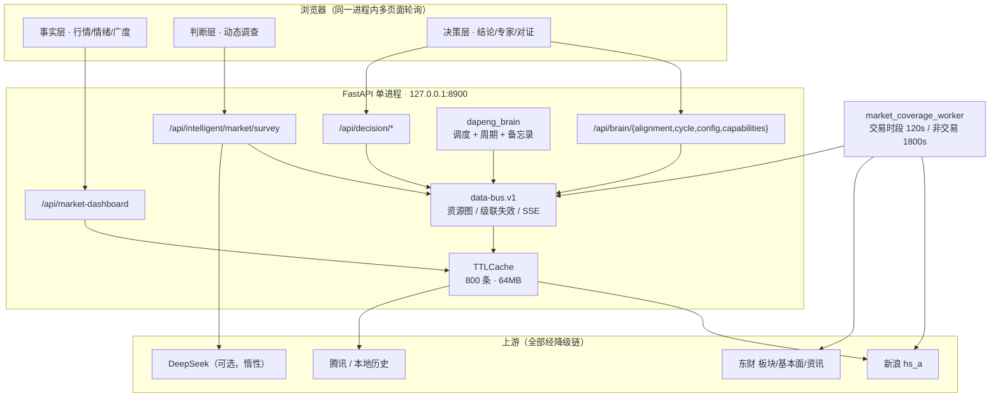

# 面向全 A 股的实时分析决策台 · 架构规范

> 版本 `decision-desk-arch.v1` ｜ 落地日期 2026-11-02 ｜ 基线：`pytest 331 passed`、`/openapi.json` 177 个路径 / 185 个操作
>
> 对应代码：`server/data_bus.py`、`server/brain.py`、`server/brain_config.py`、
> `server/brain_capabilities.py`、`server/layer_crosscheck.py`、`server/market_survey_engine.py`、
> `server/sentiment_tracker.py`、`server/decision_snapshot.py`、`server/decision_experts*.py`、
> `server/routers/{brain,decision}.py`、`static/js/{market-dashboard,intelligent-analysis,decision-desk}.js`
>
> 本文只描述**当前真实运行**的架构。凡是尚未实现的能力，一律写在 §6「已知边界」，
> 不用「未来将支持」把它写成现状。

---

## 0. 一页结论

| 问题 | 答案 | 证据 |
|---|---|---|
| 主脑在哪 | `server/brain.py::dapeng_brain`，唯一裁决者；决策产物只有一个出口 `brain-cycle.v1.memo` | `POST /api/brain/cycle` |
| 三层怎么分 | 事实层（测量）/ 判断层（解释）/ 决策层（动作），三层互不越界，跨层只读总线的资源图 | §2.1 |
| 三层怎么互相验证 | `layer-crosscheck.v1`：9 项检查、5 档状态、冲突则备忘录置信 ×0.85 | `GET /api/brain/alignment?light=false` |
| 参数怎么配 | `data/brain_config.json`（`brain-config.v1`）单一来源，mtime 热重载 + 校验回落 | `GET /api/brain/config` |
| 怎么升级/回滚 | `scripts/brain_config_admin.py`：预检不过绝不落盘，原子写入 + sha256 留痕 + 可回滚 | §3.4 |
| 延迟多少 | 热态 p95 **16–32ms**，8 并发 276 req/s、p95 42.7ms、错误率 0；冷启首聚合 3.08s | `scripts/verify/perf_budget.py` |
| 能力可用率 | 15 项能力（8 计算 / 7 决策）→ 13 ok / 2 degraded / 0 blocked | `GET /api/brain/capabilities` |

一句话：**三层各算各的，但主脑用「同一份快照 + 一张资源图 + 一套集中阈值」把它们绑在一根时间轴上，并且敢把「三层说的不是同一件事」当成一等公民报出来。**

---

## 1. 整体架构说明

### 1.1 先摆约束（约束决定架构，不是反过来）

| 约束 | 现状 | 对架构的强制要求 |
|---|---|---|
| 数据源 | 新浪 hs_a（~5581 只）、东财（板块/基本面/资讯）、腾讯（降级）、LLM | 上游**必须可降级**，任何一个断了不能让整屏变空 |
| 上游频控 | 东财会 403 / 超时 | 读路径**不准直连上游**，一律走缓存 + 后台 worker + 退避 |
| 部署形态 | 单机、单进程 uvicorn、端口 8900、看门狗 8899 | 不能用多 worker 共享内存之外的东西；状态必须落在盘或单进程内 |
| 使用方式 | 个人工作台，多个页面同时轮询 | 并发不高但要**稳**：一个慢上游不能拖死事件循环 |
| 决策性质 | 辅助决策，必须可解释、可回溯 | 每个数字都要带来源、时点、口径；三层不一致要显式暴露 |

### 1.2 分层与进程模型



进程只有一个：**没有跨进程锁、没有 Redis、没有消息队列**。所有「总线」语义都在进程内，
数据本体存在 `TTLCache`（单一事实源），总线只负责「注册 / 触发 / 失效 / 通知 / 观测」。

### 1.3 模块地图（谁负责哪一段）

| 层 | 主模块 | 对外接口 | 缓存 | 触发方式 |
|---|---|---|---|---|
| — | `market_coverage_payload` | 内部 | 模块内 dict，TTL 300s | **worker**（时段节拍） |
| 事实 | `services/market_dashboard` | `/api/market-dashboard` | `market_dashboard:v3` | request |
| 事实 | `decision_snapshot`（packet） | `/api/decision/snapshot` | `decision_market_packet:v1`，TTL 55s | request |
| 事实 | `decision_snapshot`（sentiment） | `/api/decision/sentiment` | `decision_sentiment:v1`，TTL 45s | request |
| 事实 | `sentiment_tracker` | `/api/decision/sentiment/flow` | `sentiment_flow:v1`，TTL 60s | request |
| 事实 | `market_scanner` | `/api/decision/scan` | `market_scan:v1`，TTL 120s | request |
| 判断 | `market_survey_engine` | `/api/intelligent/market/survey` | 模块内 dict，TTL 600s | request |
| 决策 | `decision_experts*` | `/api/decision/experts` | KV（含账本落盘），TTL 300s 语义 | request |
| 决策 | `brain_capabilities` | `/api/brain/capabilities` | 无（纯组合） | request |
| 跨层 | `layer_crosscheck` | `/api/brain/alignment` | 按 mode 两份文件，TTL 60s | request / cycle |
| 跨层 | `brain` | `/api/brain/cycle`、`/cycle/latest` | KV `brain_cycle_latest` | 手动 / 定时 |

### 1.4 一次读请求的生命周期

```
HTTP → 路由 → cache.get(key)
        ├─ 命中且未过期 → 直接返回（热态 3–30ms）
        └─ 未命中 → 单飞（single-flight）重建
                     ├─ 上游并发拉取（asyncio.gather + 单点超时）
                     ├─ 装配 payload（含 source / as_of / coverage / 降级标记）
                     ├─ cache.set → 记录字节与 TTL
                     └─ bus.publish → 记账 + 级联失效下游 + SSE 通知
```

两条硬规矩：

1. **读路径不写业务状态**（除了缓存与总线记账），所以任何 GET 都可以安全重试；
2. **失败不抛给用户**：单点失败返回 `ok:false` + `reason` + 降级来源，由上层决定怎么呈现。

### 1.5 数据契约（版本化，全部带后缀）

| 契约 | 生产者 | 关键字段 |
|---|---|---|
| `market-coverage.v1` | coverage worker | `ashare.quotes`（5581 只）、`quality`、`global`、`macro` |
| `market-dashboard` | 事实层 | `indices`、`breadth`（6 档分布/涨停/中位）、`turnover`、`sectors` |
| `decision-snapshot.v1` | 事实层 | `chain.build_ms`、`coverage_age_s`、`quality` |
| `sentiment.v1` | 事实层 | 六维 `dimensions[]`（30/20/15/15/10/10）、`coverage`、`score` |
| `sentiment-flow.v1` | 事实层 | `level`、`band`、`delta_short/day`、`slope_per_hour`、`z20`、`turning_point`、`drivers/drags` |
| `survey-pipeline.v1` | 判断层 | 三阶段 `pipeline.stages`、`regime`、`rotation`、`alerts`、`divergence`、`facts` |
| `brain-capability.v1` | 跨层 | 15 项能力、`inputs`（总线键）、`metrics[].target`、`fallback` |
| `brain-memo.v1` | 决策层 | `stance`、`position_cap`、`confidence`、`thesis`、`risks`、`invalidation`、`gaps` |
| `brain-cycle.v1` | 主脑 | `stages[]`（逐步耗时）、`memo`、`crosscheck`、`total_ms` |
| `layer-crosscheck.v1` | 跨层 | `checks[9]`、`counts`、`score`、`comparable_ratio`、`blockers` |
| `brain-config.v1` | 配置 | 容差 / 分档 / 时点 / 板块体系 |

---

## 2. 三层功能划分与联动逻辑

### 2.1 边界原则（先说「不做什么」）

> **事实层只测量、不解释；判断层只解释、不下单；决策层只决策、不自证。**
> 任何一层想「顺手」做下一层的事，都必须走总线拿数据，而不是自己再算一份。

这条原则是用代价换来的：此前判断层把 `regime.score`（宽度+指数+涨跌停合成的**结构分**）
标成「情绪分」显示 100，而事实层同一时刻是 80.5 —— 同一屏两个情绪分，用户无法判断信谁。
根因不是算错，而是**边界没定义清楚，同一概念被两层各实现了一次**。

### 2.2 事实层（Fact）—— 测量

| 项 | 内容 |
|---|---|
| 回答的问题 | 现在是什么状态？（涨跌、量能、情绪、广度） |
| 输入 | `market_coverage`（全 A 报价 + 基本面）、日线历史、全球指数 |
| 输出 | 指数/广度/成交额/板块、`sentiment.v1` 六维、`sentiment-flow.v1` 追踪、三锚点 |
| 明确不做 | 不给操作建议、不判断「该不该买」、不解释因果 |
| 失败姿态 | 逐项降级：`source` 标注真实来源，`coverage` 如实下降，绝不填 0 或中性值 |
| 刷新节拍 | packet 55s / sentiment 45s / flow 60s；上游 coverage 由 worker 120s（盘中）驱动 |
| 时点契约 | 每个 payload 必须带 `as_of`；跨层对证用它算时点偏差（阈值 300s） |

### 2.3 判断层（Survey）—— 解释

| 项 | 内容 |
|---|---|
| 回答的问题 | 为什么会这样？结构处在什么阶段？ |
| 输入 | packet（事实快照）+ sentiment-flow + scan + 宏观 + 资讯 |
| 输出 | `survey-pipeline.v1`：三阶段（采集→诊断→结论）、`regime`、`rotation`、`alerts`、`divergence`、`facts` |
| 明确不做 | 不输出仓位、不输出买卖动作（那是决策层） |
| 失败姿态 | 单源缺失 → 该阶段 `available:false`；LLM 不可用 → `ai_powered:false`，规则结论照常出 |
| 刷新节拍 | TTL 600s（含 LLM 成本考量），可 `?refresh=1` 强刷 |
| 关键设计 | `facts` 显式暴露**本层真正用到的输入**（涨停/涨跌家数/成交额/口径/时点），供对证比对，而不是让对证去猜 |

### 2.4 决策层（Decision）—— 动作

| 项 | 内容 |
|---|---|
| 回答的问题 | 该怎么做？做多少？什么情况下认错？ |
| 输入 | experts（六专家规则研判 + 互评 + 账本）、sentiment-flow、survey.divergence、crosscheck |
| 输出 | `brain-memo.v1`：`stance` / `position_cap` / `confidence` / `thesis` / `actions` / `risks` / `invalidation` / `gaps` |
| 明确不做 | 不改上游数字、不重算情绪、不覆盖专家的独立意见 |
| 失败姿态 | 数据质量不足 → `stance=neutral`、`position_cap=0` 并显式说明；绝不「猜一个方向」 |
| 刷新节拍 | experts TTL 300s；`/api/brain/cycle` 按需全链跑一次 |
| 硬规则 | 情绪降温 ×0.7、结构-情绪背离 ×0.8、存在 veto → 0、`stance=observe` → 0、硬顶 80% |

### 2.5 主脑（Brain）—— 跨层唯一裁决者

主脑不是「第四层」，它是**横切三层的编排者与唯一出口**：

- 编排：`run_cycle()` = 情绪追踪 → 市场调查 → 六专家 → 三层对证 → 备忘录，逐步计时写进 `stages[]`；
- 裁决：冲突时**降置信**（×0.85）并写入 `risks`，而不是选一个数覆盖另一个；
- 自述：`capabilities()` 声明 15 项能力的输入、指标目标与降级兜底 —— 能力不可用时说清楚是哪条依赖断了；
- 时间：定时任务（盘中每 15 分钟）与按需闭环共用同一条链路，只是触发源不同。

### 2.6 边界速查表

| 维度 | 事实层 | 判断层 | 决策层 |
|---|---|---|---|
| 动词 | 测量 | 解释 | 裁决 |
| 可写状态 | 缓存 / 历史环形 | 缓存 / 调查历史 | 专家账本 / 决策备忘录 |
| 能否读别层 | — | 读事实层 | 读事实层 + 判断层 |
| 能否被别层读 | 被两层读 | 被决策层读 | **不被读**（终点） |
| 数值口径 | 唯一权威 | 引用不重算 | 引用不重算 |
| 冲突时的角色 | 提供证据 | 提供解释 | 记账并降置信 |

### 2.7 数据交互方式：一张资源图 + 五道闸门

总线注册的依赖链（`server/data_bus.py::register_default_resources`）：

```
coverage ──┬─→ packet ──┬─→ sentiment ──→ sentiment_flow ──→ survey
           │             └─→ scan ───────────────────────────┘
           └────────────→ （packet 失效）
sentiment/scan ──→ experts
```

| 上游刷新 | 级联失效 | 闸门（`min_interval_s`） | 为什么需要 |
|---|---|---|---|
| `coverage` | `packet` | 60s | worker 盘中 120s 一轮，避免连击 |
| `packet` | `sentiment`、`scan` | 40s | packet TTL 55s，闸门必须短于 TTL |
| `sentiment` | `experts` | 180s | 专家团含互评与账本落盘，最重，必须挡重算风暴 |
| `scan` | `experts` | 180s | 同上 |
| `sentiment_flow` | `survey` | 30s | 调查只做派生判断，重算便宜，可以跟得紧 |

四类触发方式全部收敛到 `publish()`：

- **时间触发**：coverage worker 按时段节拍（盘中 120s / 非盘中 1800s）；
- **事件触发**：上游 publish → 级联失效 + SSE 推送（订阅者慢则丢帧，绝不阻塞发布方）；
- **请求触发**：读时 TTL 自然过期重建，单飞去重；
- **手动触发**：`?refresh=1` / `POST /api/brain/cycle`。

> **本轮修掉的一个真问题**：`survey` 此前从不向总线报到。结果链路视图里它永远 `fresh=false`、
> 能力图把它算成 degraded（实测 ok 只有 4/15）。补上 publish 后变成 **13 ok / 2 degraded**。
> 同一个根因还带出两处：五个发布点各自手抄 `last_refresh`（三处漏了耗时，页面长期显示 0ms）；
> 缓存键有两张映射表（`sentiment_flow`/`survey` 的键只在一处登记，失效会静默打偏）。
> 现在记账统一在 `publish()`，缓存键只在 `Resource.cache_key` 声明一次。

### 2.8 联动逻辑：一次完整决策的 9 步

```
1  事实层 frozen packet（55s）           ← 全市场报价 + 广度 + 成交额
2  事实层 sentiment.v1（45s）             ← 六维加权，coverage<70% 不输出
3  事实层 sentiment-flow.v1（60s）        ← 变化量/斜率/分位/拐点/归因
4  判断层 survey（600s）                  ← 结构状态 + 轮动 + 预警 + 背离(facts 显式)
5  决策层 experts（300s）                 ← E1–E6 独立意见 → 共识/分歧/veto
6  跨层 crosscheck（60s / 每闭环）        ← 9 项对证：同源同值？异量纲？时点一致？
7  主脑 memo                             ← 仓位：共识 ×0.7/0.8 → 硬顶 80%；冲突则置信 ×0.85
8  写回：KV cycle_latest + 洞察环形 + 账本
9  前端：决策层顶部「三层对证」条 + 备忘录卡；事实/判断层各自只读自己那段
```

冲突处理规则（写死在代码里，不靠人记）：

| 情形 | 处置 | 代码位置 |
|---|---|---|
| 三层对证出现 `conflict` | `confidence ×0.85`，冲突明细写入 `memo.risks` | `brain_capabilities.compose_memo` |
| 口径不同（`scope_mismatch`） | 宽度类判 `incomparable` + `blockers`，**不降置信**（不是错误） | `layer_crosscheck` |
| 分类体系不同（东财 vs 申万） | 领涨板块判 `incomparable`，名称不做比对 | `layer_crosscheck` |
| 情绪降温 / 结构-情绪背离 | 仓位 ×0.7 / ×0.8 | `compose_memo` |
| 专家 veto | 仓位归零 | `compose_memo` |
| 数据不足 | `stance=neutral`、仓位 0，`gaps` 写明缺口 | `compose_memo` |

---

## 3. 配置与升级策略

### 3.1 为什么必须集中

改造前，容差、分档、时点上限散落在 8 个模块的常量里：

- `sentiment_tracker._BANDS`、`decision_snapshot._status_of` 各有一套档位阈值（已漂移成 30/45/58/72 vs 20/40/60/80）；
- 对证容差写在 `layer_crosscheck` 里，改一处不知道另一处；
- 板块体系（东财/申万）是隐式的，靠人记。

后果不是「不方便」，而是**同一概念在不同层给出不同答案，且没人能发现**。

### 3.2 `brain-config.v1` 全项

| 路径 | 默认 | 作用 | 调大的后果 |
|---|---|---|---|
| `crosscheck.number_tolerance` | 0.5 | 分数类容差（情绪分） | 更容易判一致，可能漏掉真漂移 |
| `crosscheck.ratio_tolerance` | 0.5 | 比例类容差（百分点） | 同上 |
| `crosscheck.amount_tolerance_pct` | 0.5 | 成交额相对容差（%） | 成交额对账变宽松 |
| `crosscheck.count_tolerance` | 0 | 计数类容差（涨停家数） | 家数允许差几家 |
| `crosscheck.sector_top_n` | 3 | 领涨板块比对深度 | 更容易有交集（更松） |
| `crosscheck.max_as_of_skew_s` | 300 | 三层时点最大偏差 | 允许更旧的数据混用 |
| `crosscheck.warn_factor` | 2.0 | 超容差多少倍内算 warn | warn 区间变宽（必须 ≥1） |
| `crosscheck.min_comparable_ratio` | 0.5 | 可比率下限 | 更容易判健康（风险） |
| `crosscheck.cache_ttl_s` | 60 | 对证结果缓存 | 冲突发现变慢 |
| `crosscheck.sector_taxonomy` | `em` | 板块体系标签 | 只影响展示与可比判定 |
| `sentiment.bands` | 0/20/40/60/80 | 情绪五档边界 | 档位措辞整体平移 |
| `sentiment.min_coverage` | 0.7 | 六维覆盖率下限 | 更容易输出低置信情绪分 |
| `layers.*` | 事实/判断/决策 | 层标签与接口说明 | 仅展示 |

校验判据（`validate_payload`，命令行与运行期共用同一套）：

1. 数值项必须是非负数、非布尔；`min_comparable_ratio ∈ [0,1]`；`warn_factor ≥ 1`；
2. 分档必须**严格递增**、键固定五个、范围 0–100；
3. `sector_taxonomy.default` 必须登记在 `labels` 里；
4. `version` 必须是 `brain-config.v1`；
5. **未知键只告警不阻断** —— 十有八九是拼写错误，但把自己锁在门外更糟。

### 3.3 生效路径（改完不用重启）

```
文件写入 → 下次读取时 os.path.getmtime 变化 → 重新 json.load → 与 DEFAULTS 深合并
         → validate() 兜底非法项（回落默认 + 记 issues）→ 全局生效
坏 JSON → 保留上一份成功加载的配置并告警（绝不因配置问题让主链路失败）
```

### 3.4 升级流程（唯一推荐路径）

```bash
# 1) 看现状：跑的是哪一版、有没有回落
python scripts/brain_config_admin.py show

# 2) 预检（不写盘）：可改单项，也可整份替换
python scripts/brain_config_admin.py apply --set crosscheck.number_tolerance=0.8 --dry-run

# 3) 正式应用：备份 → 原子写入 → 追加 sha256 留痕
python scripts/brain_config_admin.py apply --set crosscheck.number_tolerance=0.8 --note "放宽数值容差"

# 4) 验证：接口视角确认已生效、无 issues
curl -s localhost:8900/api/brain/config | python -m json.tool | head -30
curl -s "localhost:8900/api/brain/alignment?light=false&refresh=true"

# 5) 出问题回滚（同样先预检，坏快照拒绝回滚）
python scripts/brain_config_admin.py rollback --steps 1
python scripts/brain_config_admin.py history -n 5
```

护栏（都有单测）：

- 预检不通过 → **退出码 2，磁盘零改动**；
- 写入用 `tmp + os.replace` 原子替换，不会出现半截文件；
- 每次变更留 `data/brain_config_history/<时间>-<动作>-<sha>.json` + `brain_config_history.jsonl`
  （含 `from_sha → to_sha`、变更路径、备注、告警数）；
- 留档保留最近 50 份，自动清理更旧的；
- **HTTP 上不开写口**：`GET /api/brain/config` 只读。配置错误的代价远高于「省一步命令」。

### 3.5 版本与兼容策略

| 变更类型 | 规则 | 守卫 |
|---|---|---|
| 响应结构 | 只能改 `server/contracts/envelope.py`，契约版本随 `X-Schema-Version` 头 | `tests/test_contracts.py` |
| 新增/改路由 | 必须显式更新 `tests/data/routes_baseline.json`（`UPDATE_ROUTES=1`），不许「顺手让它过」 | 路由快照测试 |
| 数据结构 | 加字段可以，改语义必须换版本后缀（`v1 → v2`），旧字段保留一个迭代 | 各 schema 的 `version` 字段 |
| 阈值/容差 | **不准写进代码**，只能进 `brain_config.json` | `test_brain_config` + 对证 |
| 模块规模 | 单文件 >900 行即闸门失败，拆分只走 `tools/split_module.py` | `arch_report --check` |
| 架构决策 | 影响多模块的取舍写 ADR（`docs/10-architecture/ADR-*.md`） | 评审约定 |

### 3.6 分级灰度与回滚

| 级别 | 手段 | 回滚方式 | 生效范围 |
|---|---|---|---|
| L1 参数 | `brain_config_admin apply` | `rollback --steps 1` | 立即（mtime） |
| L2 前端资源 | 版本号 `?v=N` 递增 | 改回 N-1 | 刷新即生效 |
| L3 代码 | `ci_guard` 三道闸门 + 5 个 Playwright 验收 | `_archive/` 里的备份或上一次提交 | 重启进程（看门狗自愈） |
| L4 数据 | 快照文件（`data/*.json` 环形缓冲） | 直接替换快照文件 | 下次读取 |

> 本轮把 61 个 `.bak-*`（12MB）从 `static/` 归档到 `_archive/static-backups-2026-11-02/`。
> 原因不是「乱」，而是 `static/` 是 Web 根目录 —— `/dashboard.html.bak-v85` 当时**返回 200，公开可访问**。
> 备份写在 `static/` 等于把历史版本挂到线上。

### 3.7 配置可观测（谁改的、改了什么、现在跑的是哪版）

```
GET /api/brain/config
→ file{path,bytes,mtime,sha256} + validation{ok,issues,warnings} + history[最近 N 条] + effective{生效值}
```

页面「三层对证」条右侧常驻 `配置 brain-config.v1 已校验`；有回落项时变成
`配置有 N 项回落默认值`（金色），点开可见具体路径与回落值。

---

## 4. 性能：目标、实测、手段、约束

### 4.1 延迟预算（写进验收，`--gate` 可判）

| 端点 | 预算 p95 | 实测 p95 | 占用 | 定预算的理由 |
|---|---|---|---|---|
| `/api/health` | 120ms | 23.6ms | 20% | 纯内存读 |
| `/api/brain/config` | 250ms | 29.7ms | 12% | 校验 + 摘要 + 历史尾 |
| `/api/decision/bus` | 200ms | 17.3ms | 9% | 资源图 + 事件环 |
| `/api/brain/alignment?light=true` | 400ms | 25.2ms | 6% | 事实↔判断，不跑专家 |
| `/api/decision/sentiment` | 600ms | 23.5ms | 4% | 六维缓存读 |
| `/api/decision/sentiment/flow` | 500ms | 19.3ms | 4% | 纯派生 |
| `/api/market-dashboard` | 1800ms | 32.0ms | 2% | 允许一次全市场聚合 |
| `/api/brain/capabilities` | 500ms | 20.1ms | 4% | 15 项能力组合 |
| `/api/decision/experts` | 2500ms | 16.0ms | 1% | 规则研判 + 账本 |
| `/api/brain/alignment?light=false` | 3200ms | 27.3ms | 1% | 含决策层比对 |

> 预算不是「现状 × 2」，而是按语义定的：**派生层必须是毫秒级**，聚合层允许一次全市场扫描，
> 专家层不得超过轮询间隔（60s）的 1/10。实测远低于预算是缓存 + 共享快照的收益，不是余量。

### 4.2 实测基线（2026-11-02 22:4x，同一进程）

**热态（服务已预热，n=5/端点）**

```
health 14.5/23.6   config 15.9/29.7   bus 13.9/17.3   align-light 15.0/25.2
sentiment 14.3/23.5  flow 15.3/19.3  dashboard 9.6/32.0  capabilities 15.5/20.1
experts 15.7/16.0   align-full 14.8/27.3          （p50/p95，ms）
```

**冷启（重启后首次，冷成本集中在第一个触发全市场聚合的请求）**

| 请求 | 冷启 | 说明 |
|---|---|---|
| `/api/decision/sentiment` | **3080ms** | 触发 packet 全市场聚合，一次付清 |
| `/api/intelligent/market/survey` | **2554ms** | 四路并发采集（行情/宏观/资讯/情绪）+ 三阶段装配 |
| 其余读路径 | 4–58ms | 依赖上面那份 packet，共享后全绿 |

**并发（8 并发 × 6–8 轮 × 6 端点）**

```
空载时实测：吞吐 275.9 req/s · p50 26.5ms · p95 42.7ms · 错误率 0.00%
同机有其它负载时：吞吐 107–114 req/s · p50 60–67ms · p95 94–117ms · 错误率 0.00%
```

> 并发指标对**同机其它负载**很敏感（单进程 Python，GIL 内排队）。所以预算给的是
> 「p95 ≤ 150ms」，而不是拿某一次空载的 42.7ms 当门槛 —— 门槛贴着最好成绩定，等于没有门槛。

**容量**

```
TTLCache 120 / 800 条 · 1.46MB / 64MB · 字节利用率 2.18%
最大条目 market_dashboard:v3 84KB，其次 packet 18KB
```

结论：当前是**单机个人工作台**的负载，缓存预算用了 2%，瓶颈不在内存也不在本机 CPU，
而在**上游时延与频控**。所以优化重点一直是「少打上游、打一次多复用」，而不是加线程。

### 4.3 优化手段（每条都给机制与代价）

| # | 手段 | 机制 | 代价 / 边界 |
|---|---|---|---|
| 1 | **共享快照 packet** | 55s 内所有派生层复用同一份全市场事实，避免各算一次 | 最旧 55s；派生数据时点受它约束 |
| 2 | **分层 TTL** | 越靠近事实越短（45–55s），越靠近结论越长（300–600s） | 结论可能滞后，用 `as_of` 显式暴露 |
| 3 | **级联失效 + 闸门** | 上游刷新即失效下游，但按 `min_interval_s` 收敛 | 最坏情况下游多等一个闸门周期 |
| 4 | **单飞去重** | 同 key 并发只跑一次 loader，其余等待复用 | 慢 loader 会让等待者一起慢 |
| 5 | **缓存字节治理** | 800 条 / 64MB 双上限，单条超预算拒写（宁可不缓存也不炸内存） | 超大 payload 会反复重建 |
| 6 | **后台 worker** | 上游采集搬出请求路径，交易时段 120s 一轮 | 非交易时段数据陈旧（1800s） |
| 7 | **SSE 推送** | 失效事件推给订阅者，前端不必高频轮询；慢消费者丢帧不阻塞 | 需要客户端重连与兜底轮询 |
| 8 | **LLM 惰性** | 只有调查结论用 LLM，失败即降级为规则结论 | 无 LLM 时结论深度下降 |
| 9 | **环形落盘** | 情绪/调查/对证结果写固定长度环形文件，重启可回溯 | 历史深度有限（240/120 点） |

### 4.4 硬约束（不承认约束就会做出错误方案）

| 约束 | 数值 / 事实 | 后果 |
|---|---|---|
| 单进程 asyncio | 1 个 uvicorn 进程，GIL 内并发 | **不能靠多 worker 扩容**：缓存与总线都是进程内状态，多 worker 会各存一份 |
| 上游频控 | 东财 403/超时是常态 | 必须退避 + 降级；不能「失败就重试三次」 |
| LLM 时延与成本 | 单次调查 1–3s（含 LLM 时更久） | 判断层 TTL 600s 是有意的取舍 |
| 缓存预算 | 64MB 硬上限 | 全市场明细不能整包缓存，只能存聚合结果 |
| 端口单实例 | 8900 独占 + 看门狗 8899 | 扩副本要改端口与共享缓存策略 |
| 情绪分覆盖率 | `coverage < 70%` 不输出分数 | 宁可没有分数，也不给低置信数字 |

### 4.5 扩展路径（按触发信号升级，不提前做）

| 阶段 | 触发信号（实测阈值） | 做法 | 代价 |
|---|---|---|---|
| P0 现状 | 缓存 <30%、并发 p95 <60ms | 单进程 + 共享快照 | — |
| P1 计算分离 | 冷启聚合 >5s，或单轮 cycle >10s | 把 coverage/scan 挪到独立采集进程，结果落盘/落本地 HTTP，主进程只读 | 多一个进程与一套健康检查 |
| P2 读扩展 | 并发 >50 或 p95 >200ms | N 个只读副本 + 共享缓存层（Redis 或本地文件 mtime 同步） | 一致性从「内存内」变成「最终一致」，需版本号 |
| P3 行情级实时 | 需要秒级推送全市场 | 引入 websocket 行情源 + 增量 diff，替代快照轮询 | 复杂度上一个量级，需要背压设计 |

判断依据写清楚，避免「先上微服务再找理由」。

---

## 5. 集成单一决策主脑后的验收标准

> 每条都可执行、可判定。**A1–A8 全绿才算「主脑集成完成」**，任何一条红都不许对外说「已集成」。

### A1 单一决策出口

- 判据：一次闭环的产物只有一个 `brain-cycle.v1`；仓位/立场只能来自 `memo`，三层不得各自给仓位。
- 命令：`curl -s -X POST localhost:8900/api/brain/cycle | python -m json.tool`
- 阈值：`memo.position_cap`、`memo.stance`、`memo.invalidation` 均存在；`GET /cycle/latest` 的 `trace_id` 与之一致。
- 现状：**通过**（stance=attack、cap=40、conf=0.583、trace_id 贯通）。

### A2 三层对证无冲突

- 命令：`curl -s "localhost:8900/api/brain/alignment?light=false&refresh=true"`
- 阈值：`healthy=true`、`crosscheck.counts.conflict=0`、`comparable_ratio ≥ 0.5`、`blockers` 为空。
- 现状：**通过**（9 项：7 一致 / 2 不可比 / 0 冲突，score 1.0）。

### A3 同源指标同值

- 阈值：情绪分 Δ ≤ 0.5；上涨占比 Δ ≤ 0.5 个百分点；成交额相对偏差 ≤ 0.5%；涨停家数 Δ = 0；时点偏差 ≤ 300s。
- 现状：**通过**（Δ 0.000 / 0.040% / 0.000% / 0 家 / 27s）。

### A4 配置可管、可回滚

- 阈值：`/api/brain/config` 的 `validation.ok=true`；非法值 `apply` 退出码 2 且文件 sha256 不变；`rollback` 后 sha256 回到上一版。
- 守卫：`tests/test_brain_config.py`(7) + `tests/test_brain_config_admin.py`(9)。
- 现状：**通过**。

### A5 延迟预算达标

- 命令：`python scripts/verify/perf_budget.py --gate`
- 阈值：10 项 p95 全部 ≤ 预算（§4.1），退出码 0。
- 现状：**通过**（最紧一项占用 20%）。

### A6 并发稳定

- 命令：`python scripts/verify/perf_budget.py --concurrency 8 --rounds 6 --gate`
- 阈值：错误率 ≤ 1%、p95 ≤ 150ms。
- 现状：**通过**（0.00%、42.7–117ms，区间取决于同机负载）。

### A7 降级不伪装成冲突

- 判据：上游不可用时应出现 `unavailable`/`degraded`，**不得**出现 `conflict`；能力图 `blocked` 反映依赖断点。
- 守卫：`test_layer_crosscheck`（缺数据不参与打分）+ `test_brain_capabilities`（依赖缺失 → degraded 且给 fallback）。
- 演练：停掉上游或断网后重跑 A2，`conflict` 仍为 0，`unavailable` 上升。

### A8 回归闸门全绿

```bash
python -m pytest tests -q                     # 331 passed
python scripts/ci_guard.py                    # 架构测绘 / 拆分计划 / 全量测试 三 PASS
node scripts/verify/verify_layer_crosscheck.mjs   # 18/18
node scripts/verify/verify_hub_merge.mjs          # 21/21
node scripts/verify/verify_market_merge.mjs       # 19/19
node scripts/verify/verify_armillary_drag.mjs     # 17/17
node scripts/verify/verify_split_round.mjs        # 13/13
```

### 一键验收

```bash
python -m pytest tests -q \
 && python scripts/ci_guard.py \
 && python scripts/verify/perf_budget.py --gate --concurrency 8 \
 && curl -sf "localhost:8900/api/brain/alignment?light=false" | grep -q '"healthy": true' \
 && echo "ACCEPTED"
```

---

## 6. 已知边界与下一步

| # | 边界 | 现状 | 影响 | 下一步 |
|---|---|---|---|---|
| 1 | 板块级对证缺映射表 | 东财 vs 申万只判 `incomparable` | 领涨板块无法真正对账 | 建一张 `em ↔ sw` 映射表并入 `brain_config` |
| 2 | 判断层 TTL 600s | 情绪分可能滞后（实测 Δ0.6 触发 warn） | 对证偶发 warn | 把调查拆成「规则快档 120s + LLM 慢档 600s」 |
| 3 | 量能维缺样本 | 需 20 个交易日成交额，当前返回 null | 六维只出五维 | 历史回填补齐后自动恢复 |
| 4 | 事件维是代理 | 用风险评分代理地缘/政策事件 | 事件驱动偏弱 | 接结构化事件源，替换代理 |
| 5 | 资金流在频控期降级 | 东财不可达时用注意力代理并显式标注 | 资金维度可信度下降 | 换稳定源或加本地累积 |
| 6 | 专家权重未校准 | 固定权重，无滚动命中率 | 共识质量有上限 | 用账本做滚动命中率加权 |
| 7 | 单进程不可水平扩展 | 缓存/总线是进程内状态 | 并发上限受单机约束 | 见 §4.5 P1/P2 |

---

## 附录 A · 常用命令

```bash
# 三层对证（轻量 / 完整）
curl -s "localhost:8900/api/brain/alignment?light=true"
curl -s "localhost:8900/api/brain/alignment?light=false&refresh=true"

# 一次闭环 + 最近一次
curl -s -X POST localhost:8900/api/brain/cycle
curl -s localhost:8900/api/brain/cycle/latest

# 能力矩阵 / 数据链路 / 缓存 / 配置
curl -s localhost:8900/api/brain/capabilities
curl -s localhost:8900/api/decision/bus
curl -s localhost:8900/api/decision/cache
curl -s localhost:8900/api/brain/config

# 性能预算（报告 / 判定 / 并发）
python scripts/verify/perf_budget.py
python scripts/verify/perf_budget.py --gate
python scripts/verify/perf_budget.py --concurrency 8 --rounds 6 --gate

# 配置升级
python scripts/brain_config_admin.py show
python scripts/brain_config_admin.py apply --set crosscheck.warn_factor=2.5 --note "放宽 warn 区间"
python scripts/brain_config_admin.py rollback --steps 1
```

## 附录 B · 术语

| 术语 | 含义 |
|---|---|
| 事实包（packet） | 55s 内跨模块共享的全市场事实快照 |
| 对证（crosscheck） | 三层对同一指标的逐项比对，含不可比判定 |
| 不可比（incomparable） | 异量纲/异体系/异口径，**不是错误**，不参与打分 |
| 可比率 | 参与打分的项 / 全部项，低于 0.5 判不健康 |
| 闸门（gate） | 级联失效的最小间隔，防重算风暴 |
| 单飞（single-flight） | 同 key 并发只执行一次重建 |
| 硬顶 | 仓位上限 80%，单一系统不给满仓 |
