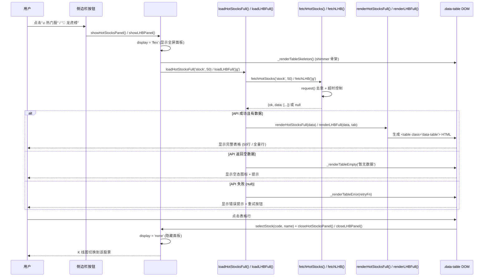
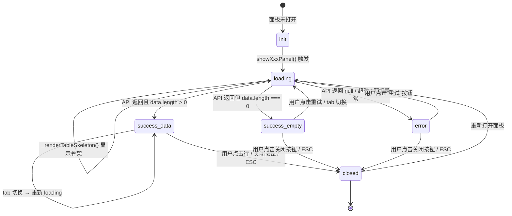
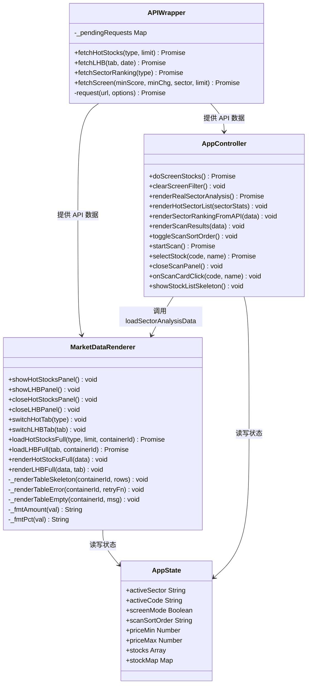
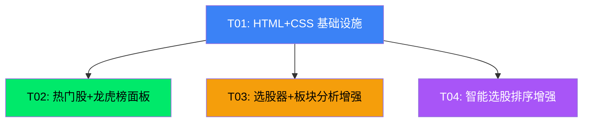

# 架构设计文档 — Sidebar 5 工具功能补全

> 📎 **历史设计（v5.3）** — 本文描述的是**该版本当时的设计**；**现状以 [`MASTER-PLAN-2026Q4.md`](../00-strategy/MASTER-PLAN-2026Q4.md) 与 [`DATA-DICTIONARY.md`](../30-data/DATA-DICTIONARY.md) 为准**。正文保留作演进记录。

> **版本**: v1.0 | **日期**: 2025-07-13 | **架构师**: Bob (高见远)
> **输入**: `docs/20-prd/incremental-prd-sidebar-tools.md` (PRD v5.3-incremental)
> **范围**: 5 个侧边栏工具的独立面板/数据源修复/UX 增强

---

## 1. 实现方案概述

### 1.1 架构模式选型

| 面板 | 当前模式 | 目标模式 | 理由 |
|------|----------|----------|------|
| 🔥 热门股 | 寄生 `#sector-analysis-panel` 的 `#top-stocks-list` | **全屏覆盖 `.full-overlay-panel`** | 需展示 50 条 + 类型切换 tab，寄生容器太小 |
| 📜 龙虎榜 | 寄生 `#sector-analysis-panel` 的 `#top-stocks-list` | **全屏覆盖 `.full-overlay-panel`** | 需展示 5 个 tab 全量数据，寄生容器太小 |
| 🔍 选股器 | 结果灌入 `#stock-list`（共享板块股池容器） | **保持现有容器**，增加清除筛选按钮 | 选股结果替换股池列表是合理交互，只需增加返回入口 |
| 📊 板块分析 | `#sector-analysis-panel` 右侧滑入面板 | **保持现有面板**，修复数据源 | 面板结构完整，问题是 `#sa-hot-sectors` 被本地数据覆盖 |
| 🤖 智能选股 | `#scan-panel` 替换左右面板 | **保持现有面板**，增加排序 | 面板基本可用，卡片点击已有 `onScanCardClick()` |

**核心决策**：只有热门股和龙虎榜需要新建全屏覆盖面板；其余 3 个面板在现有结构上增量增强。

### 1.2 全屏覆盖面板设计

新增通用 `.full-overlay-panel` CSS 类，与 `#scan-panel` 风格一致但使用 `position:fixed; inset:0` 真正覆盖全屏（scan-panel 是 flex 替换模式，不是 overlay）。两个面板复用同一套样式：

```
.full-overlay-panel
  ├── .full-overlay-header (sticky)
  │     ├── h2 标题
  │     ├── .full-overlay-tabs (tab 切换组)
  │     └── .full-overlay-close (✕ 关闭按钮)
  └── .full-overlay-body (flex:1, overflow-y:auto)
        └── .data-table (统一表格)
```

### 1.3 数据加载策略

| 策略 | 实现 |
|------|------|
| **三态渲染** | 每个数据区先渲染 shimmer 骨架 → 成功渲染表格 → 失败渲染错误+重试按钮 → 空数据渲染空态图标 |
| **请求去重** | 复用 `api.js` 的 `request()` 函数（已有 `_pendingRequests` Map 去重机制），tab 切换时同 URL 不会重复请求 |
| **无前端缓存** | tab 切换每次重新请求（API 层有 15s 超时 + 1 次重试），不引入额外缓存层。热门股/龙虎榜数据时效性高，缓存价值低 |
| **错误降级** | API 返回 `null` 时（`request()` 内部已 catch），渲染错误态 + 重试按钮，不 crash |
| **板块分析 fallback** | `renderRealSectorAnalysis()` 改为 async：先 `fetchSectorRanking()` 获取 API 数据，成功则渲染 API 数据到 `#sa-hot-sectors`；失败则 fallback 到本地 `calculateSectorStats()` |

### 1.4 现有代码复用分析

经代码审查，以下功能**已实现**，无需重复开发：

| 功能 | 现有实现 | 位置 | 状态 |
|------|----------|------|------|
| 选股器加载骨架 | `showStockListSkeleton()` | app.js:553 | ✅ 已在 `doScreenStocks()` 中调用 (app.js:1115) |
| 智能选股卡片点击选股 | `onScanCardClick()` | app.js:1662 | ✅ 已实现 `closeScanPanel()` + `selectStock()` |
| API 封装函数 | `fetchHotStocks/fetchLHB/fetchSectorRanking/fetchScreen` | api.js:281-456 | ✅ 全部存在且已验证 |
| HTML 转义 | `escapeHtml()` | api.js:20 | ✅ 已有 |
| 金额/百分比格式化 | `_fmtAmount()/_fmtPct()` | market-data.js:17-33 | ✅ 已有 |
| Toast 通知 | `showToast()` | app.js:264 | ✅ 已有 |
| 状态指示器 | `setStatus()` | app.js | ✅ 已有 |

---

## 2. 文件改动清单（精确到行号）

### 2.1 `static/dashboard.html`

| 改动位置 | 改动内容 | 类型 |
|----------|----------|------|
| **Line 297** 之后 | 在 `#screen-panel` 内部、`<button class="screen-go-btn">` 之后，新增"清除筛选"按钮：`<button class="screen-clear-btn" onclick="clearScreenFilter()">清除</button>` | 增量 |
| **Line 732** 之后（`#sector-analysis-panel` 闭合 `</div>` 之后） | 新增 `#hot-stocks-panel` 全屏覆盖面板 DOM（标题栏 + 股票/基金 tab + 关闭按钮 + `#hot-stocks-table` 表格容器） | 增量 |
| **Line 732** 之后（紧接 `#hot-stocks-panel`） | 新增 `#lhb-panel` 全屏覆盖面板 DOM（标题栏 + 5 个 tab + 关闭按钮 + `#lhb-table` 表格容器） | 增量 |
| **Line 795** | market-data.js 版本号 `?v=5` → `?v=6` | 修改 |
| **Line 797** | app.js 版本号 `?v=7` → `?v=8` | 修改 |
| **Line 8** | dashboard.css 版本号 `?v=7` → `?v=8` | 修改 |

### 2.2 `static/css/dashboard.css`

| 改动位置 | 改动内容 | 类型 |
|----------|----------|------|
| **文件末尾**（约 Line 2000+） | 新增 `.full-overlay-panel` 通用全屏面板样式（`position:fixed; inset:0; z-index:1000; background:rgba(15,23,42,0.95); backdrop-filter:blur(12px); display:flex; flex-direction:column; padding:20px`） | 增量 |
| **同上** | 新增 `.full-overlay-header`（flex 布局, gap:16px, border-bottom） | 增量 |
| **同上** | 新增 `.full-overlay-body`（flex:1, overflow-y:auto, margin-top:16px） | 增量 |
| **同上** | 新增 `.full-overlay-close`（margin-left:auto, 与 `.sector-analysis-close-btn` 风格一致） | 增量 |
| **同上** | 新增 `.full-overlay-tabs` + `.full-overlay-tab` + `.full-overlay-tab.active`（tab 切换样式，参考 `.sh-filter-btn`） | 增量 |
| **同上** | 新增 `.data-table` 统一表格样式（width:100%, border-collapse, th sticky, 斑马纹, hover 高亮, selected 高亮） | 增量 |
| **同上** | 新增 `.data-table-skeleton`（shimmer 骨架行样式） | 增量 |
| **同上** | 新增 `.screen-clear-btn`（清除筛选按钮样式，参考 `.screen-go-btn` 但用灰色调） | 增量 |
| **同上** | 新增 `.status-tag` 状态标签样式（涨停红/跌停绿/停牌灰） | 增量 |
| **同上** | 新增 `.scan-sort-btn`（排序切换按钮样式） | 增量 |
| **Line 170-174** | `body.light-theme` 规则中补充 `.full-overlay-panel` 的亮色适配 | 增量 |

### 2.3 `static/js/market-data.js`

| 改动位置 | 改动内容 | 类型 |
|----------|----------|------|
| **Line 270-280** | `loadHotStocks()` → 重写为 `loadHotStocksFull(type, limit)`，参数 `type` 默认 `'stock'`，`limit` 默认 `50`，渲染目标改为 `#hot-stocks-table` | 重写 |
| **Line 285-312** | `renderHotStocks()` → 重写为 `renderHotStocksFull(data)`，渲染完整 `.data-table` 表格（排名/名称/代码/涨跌幅/现价/状态标签），目标 `#hot-stocks-table`，行点击 `selectStock()` + `closeHotStocksPanel()` | 重写 |
| **Line 170-177** | `loadLHBTop5()` → 重写为 `loadLHBFull(tab)`，参数 `tab` 默认 `'jg'`，渲染目标改为 `#lhb-table` | 重写 |
| **Line 182-212** | `renderLHBTop5()` → 重写为 `renderLHBFull(data, tab)`，渲染完整 `.data-table` 表格（排名/名称/代码/净买入额/上榜原因/席位数），目标 `#lhb-table`，行点击 `selectStock()` + `closeLHBPanel()` | 重写 |
| **Line 641-654** | `showHotStocksPanel()` → 重写：打开 `#hot-stocks-panel`（`display:flex`），调用 `loadHotStocksFull('stock', 50)` | 重写 |
| **Line 659-671** | `showLHBPanel()` → 重写：打开 `#lhb-panel`（`display:flex`），调用 `loadLHBFull('jg')` | 重写 |
| **Line 672 之后** | **新增** `closeHotStocksPanel()`：隐藏 `#hot-stocks-panel` | 新增 |
| **同上** | **新增** `closeLHBPanel()`：隐藏 `#lhb-panel` | 新增 |
| **同上** | **新增** `switchHotTab(type)`：切换 tab active 状态 + 调用 `loadHotStocksFull(type, 50)` | 新增 |
| **同上** | **新增** `switchLHBTab(tab)`：切换 tab active 状态 + 调用 `loadLHBFull(tab)` | 新增 |
| **同上** | **新增** `_renderTableSkeleton(containerId, rows)`：通用表格骨架渲染函数 | 新增 |
| **同上** | **新增** `_renderTableError(containerId, retryFn)`：通用表格错误态渲染函数 | 新增 |
| **同上** | **新增** `_renderTableEmpty(containerId, msg)`：通用表格空态渲染函数 | 新增 |
| **同上** | **新增** ESC 键全局监听：`document.addEventListener('keydown', ...)` 检测 ESC 关闭当前打开的全屏面板 | 新增 |

> **注意**：`loadSectorAnalysisData()` (line 321-328) 中调用的 `loadHotStocks()` 和 `loadLHBTop5()` 需要同步重命名引用。但板块分析面板内的 `#top-stocks-list`（龙头股 TOP5）不再被热门股/龙虎榜复用，需保留一个轻量版加载函数。方案：保留原 `loadHotStocks()` 和 `loadLHBTop5()` 函数名但改为调用新版函数的精简版（limit=5, 渲染到 `#top-stocks-list`），或者修改 `loadSectorAnalysisData()` 直接调用 `loadHotStocksFull('stock', 5)` 并传入不同的渲染目标。

**推荐方案**：将 `loadHotStocksFull(type, limit, containerId)` 和 `loadLHBFull(tab, containerId)` 设计为接受可选 `containerId` 参数，默认分别为 `#hot-stocks-table` 和 `#lhb-table`。板块分析面板调用时传入 `#top-stocks-list` 并 limit=5。

### 2.4 `static/js/app.js`

| 改动位置 | 改动内容 | 类型 |
|----------|----------|------|
| **Line 1110-1135** | `doScreenStocks()` 增强：确认 `showStockListSkeleton()` 已调用（✅ 已有）；在成功渲染后设置 `window.appState.screenMode = true`（✅ 已有）；新增 `clearScreenFilter()` 函数定义 | 增强 |
| **Line 1137-1142** 之后 | **新增** `clearScreenFilter()`：恢复当前板块股池（`loadQuotes()` + `renderStockList()`），重置 `window.appState.screenMode = false`，恢复 `#sector-title-name` 标题 | 新增 |
| **Line 3320-3330** | `renderRealSectorAnalysis()` 改为 `async`：先 `await fetchSectorRanking()`，成功则用 API 数据渲染 `#sa-hot-sectors`（调用新版 `renderSectorRankingFromAPI(data)`）；失败则 fallback 到 `renderHotSectorList(sectorStats)`（本地数据）。其余区块（distribution/flow/compare）保持本地计算 | 重写 |
| **Line 3364-3384** | `renderHotSectorList(sectorStats)` 保留作为 fallback，但在函数开头增加判断：如果 API 数据已渲染则跳过 | 增强 |
| **Line 3364 之后** | **新增** `renderSectorRankingFromAPI(data)`：将 API 返回的板块排行数据渲染到 `#sa-hot-sectors`，字段映射 `{name, chg_pct→avgChg, amount→totalAmount, leader_stock→topStock.name}` | 新增 |
| **Line 1539-1648** | `renderScanResults()` 增强：在渲染前对 `recommendations` 按 `total_score` 降序排序（默认）；在统计卡片区增加"平均评分"指标；在 `#scan-result-area` 顶部增加排序切换按钮（评分↓/评分↑） | 增强 |
| **Line 1539 之前** | **新增** `window.appState.scanSortOrder = 'desc'`（默认降序）状态变量 | 新增 |
| **Line 1394-1511** | `startScan()` 增强：扫描中禁用价格输入框（`disabled=true`），扫描完成后恢复 | 增强 |
| **Line 1539 之前** | **新增** `toggleScanSortOrder()`：切换 `window.appState.scanSortOrder` 并重新调用 `renderScanResults()` | 新增 |

### 2.5 `static/js/api.js`

**无需改动**。以下函数已存在且已验证可用：

| 函数 | 位置 | API 端点 |
|------|------|----------|
| `API.hotStocks(type, limit)` | api.js:64 | `GET /api/hot-stocks?type={type}&limit={limit}` |
| `API.lhb(tab, date)` | api.js:62 | `GET /api/lhb?tab={tab}` |
| `API.sectorRanking()` | api.js:61 | `GET /api/sector-ranking` |
| `API.screen(minScore, minChg, sector, limit)` | api.js:48 | `GET /api/screen?min_score=&min_chg=&limit=` |
| `fetchHotStocks(type, limit)` | api.js:398 | — |
| `fetchLHB(tab, date)` | api.js:384 | — |
| `fetchSectorRanking(type)` | api.js:377 | — |
| `fetchScreen(minScore, minChg, sector, limit)` | api.js:281 | — |

---

## 3. 关键 Mermaid 图

### 3.1 时序图 — 用户点击侧边栏 → 全屏面板 → API → 渲染表格



### 3.2 数据状态机 — 面板数据加载三态



### 3.3 类图 — 核心函数关系



---

## 4. 任务列表（有序，含依赖关系）

### T01: HTML DOM + CSS 样式基础设施

| 属性 | 内容 |
|------|------|
| **编号** | T01 |
| **名称** | HTML DOM + CSS 样式基础设施 |
| **依赖** | 无 |
| **涉及文件** | `static/dashboard.html`, `static/css/dashboard.css` |
| **优先级** | P0 |
| **估时** | 1.5h |

**改动内容**：
1. `dashboard.html`:
   - Line 297 后：`#screen-panel` 内新增"清除"按钮 `<button class="screen-clear-btn" onclick="clearScreenFilter()">清除</button>`
   - Line 732 后：新增 `#hot-stocks-panel` 全屏面板 DOM（标题 + 股票/基金 tab + 关闭按钮 + `#hot-stocks-table`）
   - Line 732 后：新增 `#lhb-panel` 全屏面板 DOM（标题 + 5 tab + 关闭按钮 + `#lhb-table`）
   - Line 8/795/797：CSS/JS 版本号 +1
2. `dashboard.css`:
   - 文件末尾新增 `.full-overlay-panel` / `.full-overlay-header` / `.full-overlay-body` / `.full-overlay-close` / `.full-overlay-tabs` / `.full-overlay-tab` 样式
   - 新增 `.data-table` / `.data-table th` / `.data-table td` / `.data-table tr:hover` / `.data-table tr.selected` 统一表格样式
   - 新增 `.data-table-skeleton` / `.status-tag` / `.screen-clear-btn` / `.scan-sort-btn` 辅助样式
   - `body.light-theme` 规则补充 `.full-overlay-panel` 亮色适配

**验收要点**：
- [ ] `#hot-stocks-panel` 和 `#lhb-panel` DOM 存在且默认 `display:none`
- [ ] `.full-overlay-panel` 样式为 `position:fixed; inset:0; z-index:1000`
- [ ] `.data-table` 表头 sticky、斑马纹、hover 高亮生效
- [ ] "清除"按钮在 `#screen-panel` 中可见
- [ ] 页面加载无 JS 报错（DOM 就绪）

---

### T02: 热门股 + 龙虎榜全屏面板逻辑

| 属性 | 内容 |
|------|------|
| **编号** | T02 |
| **名称** | 热门股 + 龙虎榜全屏面板逻辑（market-data.js） |
| **依赖** | T01 |
| **涉及文件** | `static/js/market-data.js` |
| **优先级** | P0 |
| **估时** | 3h |

**改动内容**：
1. 重写 `showHotStocksPanel()` (line 641)：打开 `#hot-stocks-panel`，调用 `loadHotStocksFull('stock', 50)`
2. 重写 `showLHBPanel()` (line 659)：打开 `#lhb-panel`，调用 `loadLHBFull('jg')`
3. 重写 `loadHotStocks()` → `loadHotStocksFull(type, limit, containerId)` (line 270)：limit=50，渲染到 `#hot-stocks-table`（或指定的 containerId）
4. 重写 `renderHotStocks()` → `renderHotStocksFull(data)` (line 285)：生成 `.data-table` 表格（排名/名称/代码/涨跌幅/现价/状态标签），行点击 `selectStock()` + `closeHotStocksPanel()`
5. 重写 `loadLHBTop5()` → `loadLHBFull(tab, containerId)` (line 170)：渲染到 `#lhb-table`（或指定的 containerId）
6. 重写 `renderLHBTop5()` → `renderLHBFull(data, tab)` (line 182)：生成 `.data-table` 表格（排名/名称/代码/净买入额/上榜原因/席位数），行点击 `selectStock()` + `closeLHBPanel()`
7. 新增 `closeHotStocksPanel()` / `closeLHBPanel()`
8. 新增 `switchHotTab(type)` / `switchLHBTab(tab)`
9. 新增通用三态渲染函数：`_renderTableSkeleton(containerId, rows)` / `_renderTableError(containerId, retryFn)` / `_renderTableEmpty(containerId, msg)`
10. 新增 ESC 键全局监听：检测 `#hot-stocks-panel` 或 `#lhb-panel` 可见时按 ESC 关闭
11. 修改 `loadSectorAnalysisData()` (line 321) 中的 `loadHotStocks()` / `loadLHBTop5()` 调用为 `loadHotStocksFull('stock', 5, 'top-stocks-list')` / `loadLHBFull('jg', 'top-stocks-list')`

**验收要点**：
- [ ] 点击"🔥 热门股"→ `#hot-stocks-panel` 全屏显示，先骨架后表格
- [ ] 热门股表格 ≥30 条，含排名/名称/代码/涨跌幅/现价/状态
- [ ] 股票/基金 tab 切换 → 表格刷新
- [ ] 点击行 → 面板关闭 + K 线切换
- [ ] 点击"📜 龙虎榜"→ `#lhb-panel` 全屏显示，默认 jg tab
- [ ] 龙虎榜 5 个 tab 可切换，至少 3 个有数据
- [ ] ESC 键关闭当前打开的面板
- [ ] API 失败时显示错误提示 + 重试按钮
- [ ] 板块分析面板的 `#top-stocks-list`（龙头股 TOP5）仍正常显示

---

### T03: 选股器 + 板块分析增强

| 属性 | 内容 |
|------|------|
| **编号** | T03 |
| **名称** | 选股器清除筛选 + 板块分析 API 数据源修复（app.js） |
| **依赖** | T01 |
| **涉及文件** | `static/js/app.js` |
| **优先级** | P0 |
| **估时** | 2h |

**改动内容**：
1. 新增 `clearScreenFilter()` 函数（line 1142 后）：
   - 重置 `window.appState.screenMode = false`
   - 调用 `loadQuotes()` 恢复当前板块股池
   - 恢复 `#sector-title-name` 为当前板块名称
   - 隐藏 `#screen-panel`（可选，保持展开也行）
2. `renderRealSectorAnalysis()` 改为 `async` (line 3320)：
   - 先 `const apiData = await fetchSectorRanking()`
   - 如果 `apiData` 有数据：调用 `renderSectorRankingFromAPI(apiData)` 渲染 `#sa-hot-sectors`
   - 如果 `apiData` 为 null：fallback 到 `renderHotSectorList(sectorStats)`（本地数据）
   - 其余区块（distribution/flow/compare/mini）保持现有本地计算逻辑
3. 新增 `renderSectorRankingFromAPI(data)` 函数（line 3364 后）：
   - 从 API 数据提取 sectors 数组
   - 字段映射：`s.name` → 名称, `s.chg_pct || s.change_pct` → 涨跌幅, `s.amount` → 成交额, `s.lead_stock || s.top_stock` → 领涨股
   - 渲染到 `#sa-hot-sectors`，保持与 `renderHotSectorList()` 相似的 HTML 结构
   - 板块项点击 → `switchSector(key)` （需确认 API 返回的板块 key 与本地 SECTORS 的 key 映射）

**验收要点**：
- [ ] 选股后点击"清除"→ 恢复当前板块股池
- [ ] `#sector-title-name` 恢复为板块名称
- [ ] 板块分析面板打开后，`#sa-hot-sectors` 显示 API 真实数据（非本地空壳）
- [ ] API 失败时 fallback 到本地数据（不白屏）
- [ ] 板块排行项点击 → 切换到该板块

---

### T04: 智能选股排序增强

| 属性 | 内容 |
|------|------|
| **编号** | T04 |
| **名称** | 智能选股排序 + 扫描中禁用输入（app.js） |
| **依赖** | T01 |
| **涉及文件** | `static/js/app.js` |
| **优先级** | P0 |
| **估时** | 1h |

**改动内容**：
1. `renderScanResults()` 增强 (line 1539)：
   - 在渲染前对 `recommendations` 按 `total_score` 排序（默认降序 `desc`）
   - 排序方向由 `window.appState.scanSortOrder` 控制（新增状态变量，默认 `'desc'`）
   - 统计卡片区增加"平均评分"指标：`avgScore = recommendations.reduce((sum, r) => sum + r.total_score, 0) / recommendations.length`
   - 在 `#scan-result-area` 顶部增加排序切换按钮：`<button class="scan-sort-btn" onclick="toggleScanSortOrder()">评分↓</button>`
2. 新增 `toggleScanSortOrder()` 函数：
   - 切换 `window.appState.scanSortOrder`（`'desc'` ↔ `'asc'`）
   - 重新调用 `renderScanResults()` 并传入缓存的 scan data
   - 需要将最近一次 scan data 缓存到 `window.appState.lastScanData`
3. `startScan()` 增强 (line 1394)：
   - 扫描开始时：`document.getElementById('scan-price-min').disabled = true` / `scan-price-max` 同理
   - 扫描完成/失败后：恢复 `disabled = false`

> **注意**：`onScanCardClick()` (line 1662) 已实现 `closeScanPanel()` + `selectStock()`，无需改动。

**验收要点**：
- [ ] 扫描完成后卡片默认按评分降序排列
- [ ] 点击排序按钮 → 升序/降序切换
- [ ] 统计卡片区显示"平均评分"
- [ ] 扫描中价格输入框禁用
- [ ] 扫描完成后价格输入框恢复

---

### 任务依赖图



> T02、T03、T04 均仅依赖 T01，三者之间无依赖，可并行开发。但 T03 和 T04 都修改 `app.js`，建议同一工程师按 T03 → T04 顺序执行以避免冲突。

---

## 5. 依赖包列表

**无新增依赖**。所有改动基于现有技术栈：
- 原生 JavaScript（无框架）
- 原生 DOM API（无 jQuery/React）
- 现有 CSS 变量系统（`var(--green)` / `var(--red)` 等）
- 现有 API 封装层（`api.js` 的 `request()` / `fetchXxx()` 函数）

---

## 6. 共享知识（跨文件约定）

### 6.1 全屏面板约定

| 约定 | 说明 |
|------|------|
| **面板 class** | 所有全屏覆盖面板统一使用 `.full-overlay-panel` class |
| **面板显示/隐藏** | 通过 `element.style.display = 'flex' / 'none'` 控制（与 `#scan-panel` 一致） |
| **面板 z-index** | `.full-overlay-panel` 固定 `z-index: 1000`，高于 `#sector-analysis-panel`(400) 和 `#scan-panel`(默认) |
| **ESC 键** | 全局 `keydown` 监听，ESC 关闭当前可见的全屏面板（热门股/龙虎榜优先） |
| **面板关闭后行为** | 仅隐藏面板，不销毁数据。下次打开时重新请求最新数据 |

### 6.2 表格约定

| 约定 | 说明 |
|------|------|
| **表格 class** | 所有数据表格统一使用 `.data-table` class |
| **表头 sticky** | `.data-table th` 使用 `position: sticky; top: 0` |
| **行点击** | 统一调用 `selectStock(code, name)` + 对应的 `closeXxxPanel()` |
| **行 hover** | `.data-table tr:hover` 高亮 `rgba(59,130,246,0.08)` |
| **行选中** | `.data-table tr.selected` 高亮 `rgba(59,130,246,0.15)` |
| **涨跌色** | 正数 `var(--green)` #00e96a，负数 `var(--red)` #ff3d6a |
| **状态标签** | 涨停：红底红字 `rgba(255,61,106,0.15)` / 跌停：绿底绿字 / 停牌：灰底灰字 |

### 6.3 三态渲染约定

| 状态 | HTML 结构 | 触发时机 |
|------|-----------|----------|
| **loading** | `<div class="data-table-skeleton">` + N 行 shimmer | 面板打开 / tab 切换时立即显示 |
| **success (data)** | `<table class="data-table">` + 数据行 | API 返回且 `data.length > 0` |
| **success (empty)** | `<div class="error-empty"><div class="error-empty-icon">📭</div>...</div>` | API 返回但 `data.length === 0` |
| **error** | `<div class="error-empty"><div class="error-empty-icon">⚠️</div>...<button class="retry-btn" onclick="...">重试</button></div>` | API 返回 null / 超时 |

### 6.4 函数命名约定

| 模式 | 命名 | 示例 |
|------|------|------|
| 面板入口 | `showXxxPanel()` | `showHotStocksPanel()` |
| 面板关闭 | `closeXxxPanel()` | `closeHotStocksPanel()` |
| Tab 切换 | `switchXxxTab(param)` | `switchHotTab('fund')` |
| 数据加载 | `loadXxxFull(params)` | `loadHotStocksFull('stock', 50)` |
| 数据渲染 | `renderXxxFull(data)` | `renderHotStocksFull(data)` |
| 通用工具 | `_renderXxx()` 前缀下划线 | `_renderTableSkeleton()` |

### 6.5 API 响应格式约定

所有 API 响应遵循统一格式：
```json
{
  "ok": true,
  "data": { ... }  // 或 [...] 数组
}
```
`request()` 函数（api.js:123）已自动处理：HTTP 非 200 → 返回 null；`json.ok !== true` → 返回 null；成功 → 返回 `json.data`。

### 6.6 appState 状态变量约定

| 变量 | 类型 | 用途 |
|------|------|------|
| `window.appState.screenMode` | Boolean | true=当前在选股结果模式，clearScreenFilter() 时重置为 false |
| `window.appState.scanSortOrder` | String | `'desc'`（默认）或 `'asc'`，控制智能选股卡片排序方向 |
| `window.appState.lastScanData` | Object | 缓存最近一次扫描结果，排序切换时重新渲染 |
| `window.appState.activeSector` | String | 当前板块 key，clearScreenFilter() 时用于恢复股池 |

---

## 7. 风险与备选

### 风险 1：龙虎榜 5 个 tab 部分返回空

**风险描述**：API `/api/lhb?tab={tab}` 的 5 个 tab（jg/yzb/yyb/gslmr/gslxw）中，部分 tab 可能返回空数据或字段结构不一致。

**影响**：用户切换到空 tab 时看到空态，可能误以为功能故障。

**缓解措施**：
- 三态渲染已覆盖空态（显示"暂无数据"图标 + 提示文字）
- tab 标签上可增加数据量 badge（如"机构席位 (12)"），让用户预知数据量
- 如果某个 tab 持续返回 null（非空数组），显示错误态 + 重试

**备选方案**：如果 `yyb` tab 确实不存在或返回异常，可在 UI 上隐藏该 tab，仅展示有数据的 tab。

### 风险 2：板块排行 API 字段与本地计算不一致

**风险描述**：`/api/sector-ranking` 返回的字段名（如 `chg_pct`, `amount`, `lead_stock`）可能与本地 `calculateSectorStats()` 输出的字段（`avgChg`, `totalAmount`, `topStock`）不同，需要字段映射。

**影响**：如果映射不正确，`#sa-hot-sectors` 渲染的数据会显示 `--` 或 `undefined`。

**缓解措施**：
- `renderSectorRankingFromAPI(data)` 函数中做多字段兼容：`s.chg_pct || s.change_pct || s['涨跌幅'] || 0`
- 参考现有 `renderSectorRanking()` (market-data.js:134) 的字段提取模式
- 如果 API 数据格式完全不同，fallback 到本地 `renderHotSectorList()`

**备选方案**：如果 API 返回的板块名与本地 `SECTORS` 的 key 无法映射（如 API 返回"半导体芯片"但本地 key 是"semiconductor"），则板块点击 `switchSector()` 无法工作。此时可在 `renderSectorRankingFromAPI()` 中做名称→key 的映射表，或改为点击后调用 `fetchSectorStocks(sectorName)` 直接加载成分股。

### 风险 3：ESC 键与现有快捷键冲突

**风险描述**：dashboard 已有键盘快捷键（Ctrl+K 命令面板、↑↓ 切换股票、R 刷新等），新增 ESC 监听可能与现有逻辑冲突。

**缓解措施**：
- ESC 监听仅在 `.full-overlay-panel` 可见时触发关闭，否则不拦截
- 检查现有 `keydown` 监听器（如命令面板的 ESC 关闭）是否已处理 ESC
- 使用 `event.stopPropagation()` 防止冒泡（仅在面板可见时）

### 风险 4：market-data.js 函数重命名影响其他调用方

**风险描述**：将 `loadHotStocks()` 重命名为 `loadHotStocksFull()` 后，`loadSectorAnalysisData()` (line 326) 中的调用需要同步更新，否则会报 `ReferenceError`。

**缓解措施**：
- 使用 `loadHotStocksFull(type, limit, containerId)` 签名，`containerId` 默认为 `#hot-stocks-table`
- `loadSectorAnalysisData()` 中改为 `loadHotStocksFull('stock', 5, 'top-stocks-list')`
- 同理 `loadLHBTop5()` → `loadLHBFull('jg', 'top-stocks-list')`
- 搜索全代码库确认无其他调用方（已确认仅 `loadSectorAnalysisData` 调用）

---

## 附录：代码审查发现

### 已实现功能（无需重复开发）

| PRD 需求 | 现有实现 | 代码位置 | 结论 |
|----------|----------|----------|------|
| P0-3 增强点1：选股加载骨架 | `showStockListSkeleton()` 已在 `doScreenStocks()` 中调用 | app.js:1115 | ✅ 已实现 |
| P0-5 微调2：卡片点击选股+关闭面板 | `onScanCardClick()` 已实现 `closeScanPanel()` + `selectStock()` | app.js:1662-1676 | ✅ 已实现 |
| P0-4 修复点2：loadSectorRanking() 已存在 | `loadSectorRanking()` 已调用 `fetchSectorRanking()` 并渲染到 `#sa-hot-sectors` | market-data.js:122-161 | ⚠️ 存在但被 `renderHotSectorList()` 覆盖 |

### 关键冲突点

`#sa-hot-sectors` 容器被两个函数同时渲染：
1. `renderSectorRanking()` (market-data.js:134) — API 数据，异步
2. `renderHotSectorList()` (app.js:3364) — 本地数据，同步

`toggleSectorAnalysisPanel()` (app.js:3269) 先调用 `renderRealSectorAnalysis()`（同步，本地数据渲染），再调用 `updateSectorAnalysisPanel()` → `loadSectorAnalysisData()` → `loadSectorRanking()`（异步，API 数据渲染）。如果 API 成功，API 数据会覆盖本地数据；如果 API 失败，本地数据保留。

**T03 的修复策略**：将 `renderRealSectorAnalysis()` 改为 async，显式先尝试 API，失败再 fallback 本地，避免两者竞争同一容器。
