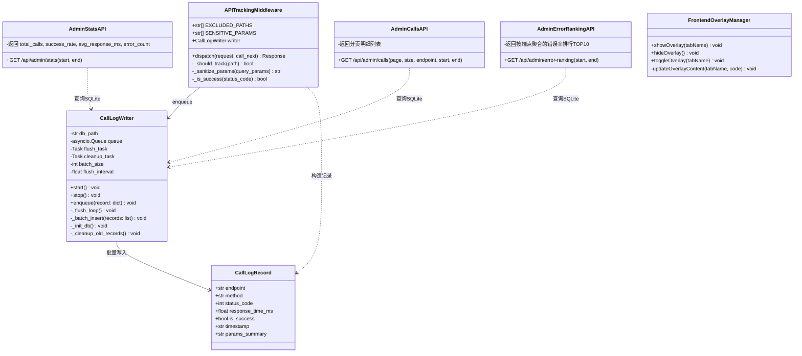
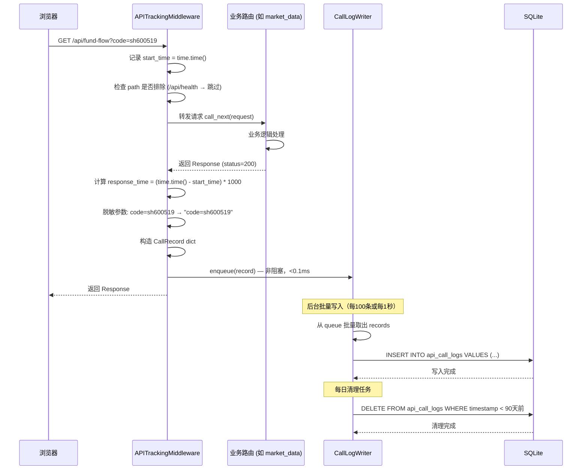
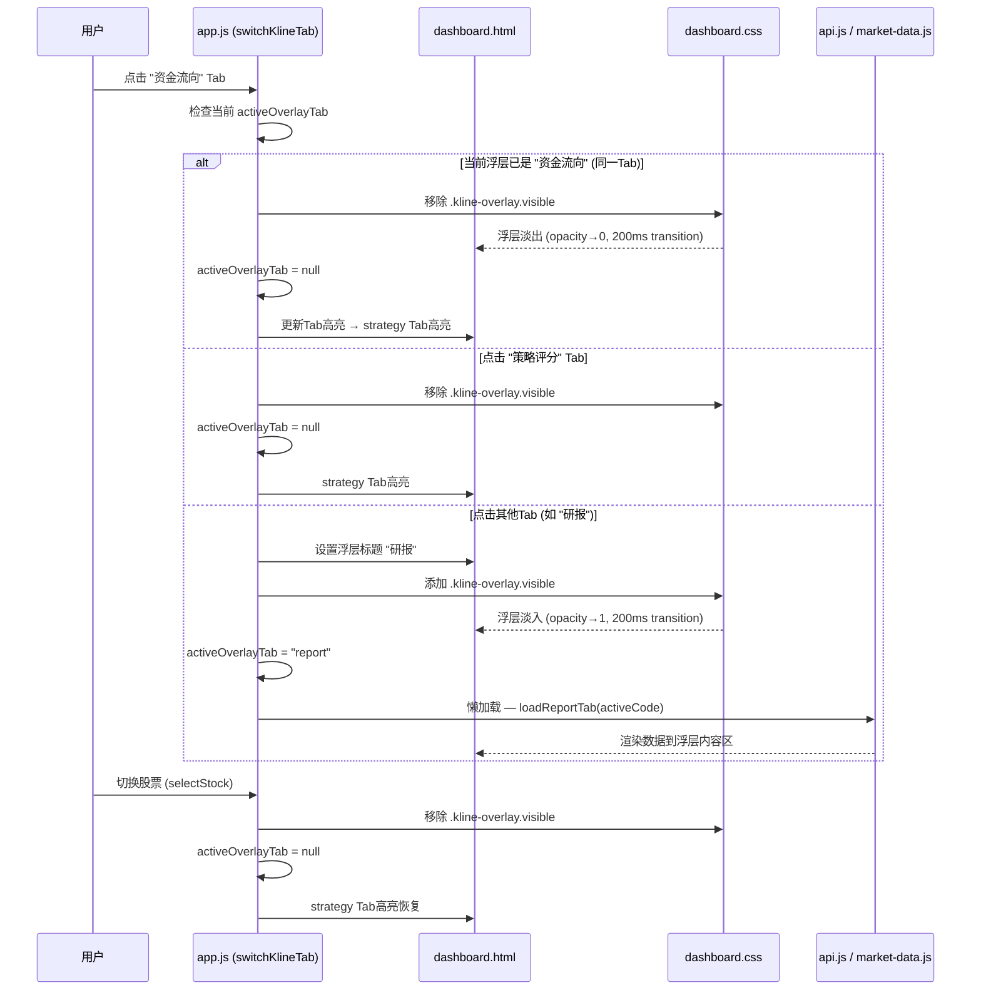
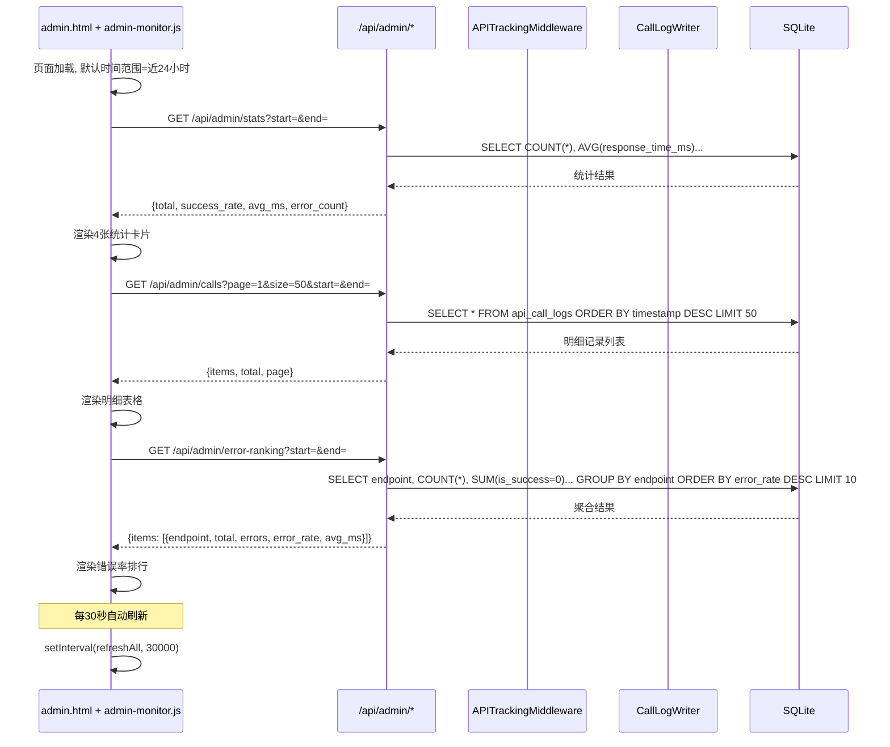
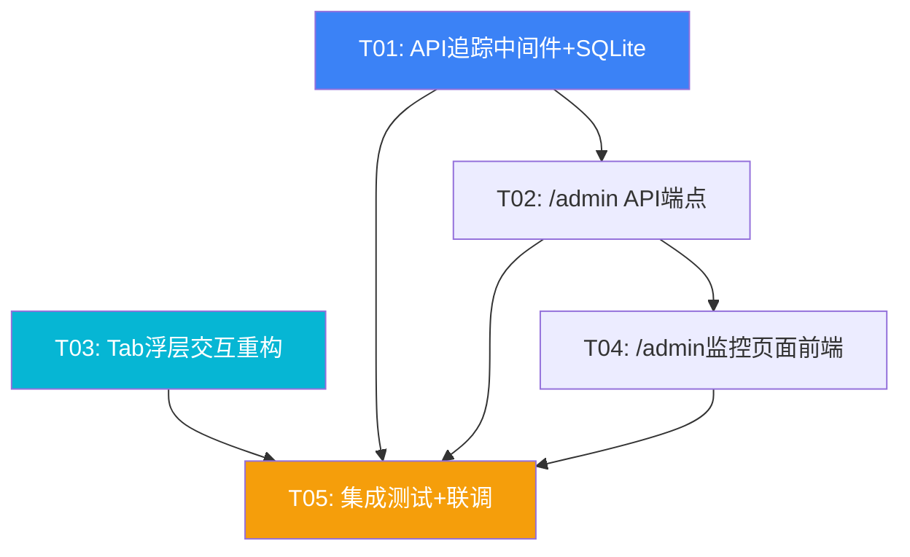

# 系统架构设计: Tab浮层交互重构 + API调用追踪后台

> 📎 **历史设计（v5.1）** — 本文描述的是**该版本当时的设计**；**现状以 [`MASTER-PLAN-2026Q4.md`](../00-strategy/MASTER-PLAN-2026Q4.md) 与 [`DATA-DICTIONARY.md`](../30-data/DATA-DICTIONARY.md) 为准**。正文保留作演进记录。

> **版本**: v5.1-architecture | **日期**: 2025-07-11 | **作者**: 架构师 高见远
> **对应PRD**: `docs/20-prd/incremental-prd-tab-admin.md`
> **项目路径**: `dapeng-water/`

---

## Part A: 系统设计

### 1. 实现方案与框架选型

#### 1.1 核心技术挑战

| 挑战 | 方案 |
|------|------|
| Tab浮层覆盖K线图但不影响ECharts渲染 | 纯CSS方案：`position:absolute` + `backdrop-filter:blur` + `z-index`分层。浮层作为K线图的兄弟元素叠加，不修改K线图DOM结构，避免ECharts resize |
| 中间件零侵入记录所有API调用 | FastAPI `@app.middleware("http")` 中间件，在请求前后记录耗时，不修改任何路由代码 |
| SQLite异步写入不阻塞API响应 | `asyncio.Queue` 缓冲 + 后台 `asyncio.Task` 消费，每100条或每1秒批量INSERT |
| 敏感参数脱敏 | 中间件中对 `token/password/key/secret` 参数值替换为 `***` |
| /admin页面复用暗色玻璃态风格 | 独立HTML页面，内联CSS变量与dashboard.css一致，复用ECharts CDN |

#### 1.2 框架选型

| 组件 | 选型 | 理由 |
|------|------|------|
| Tab浮层 | 纯CSS + 原生JS | 零新依赖，`backdrop-filter` 原生支持，`transition` 动画平滑 |
| API追踪中间件 | FastAPI `@app.middleware("http")` | 框架内置，零侵入，已有 `global_error_handler` 中间件可参考 |
| 数据存储 | Python `sqlite3`（标准库） | 无需安装第三方包，文件级数据库，重启不丢数据 |
| 异步写入 | `asyncio.Queue` + `asyncio.create_task` | 标准库，无新依赖，与FastAPI事件循环天然集成 |
| /admin前端 | 独立HTML + ECharts CDN | 复用现有 `admin.html` 的Tailwind+暗色风格基础 |
| 数据清理 | 后台定时 `asyncio.Task` | 标准库，每日执行一次DELETE WHERE timestamp < 90天前 |

**新增第三方依赖：无**（全部使用Python标准库 + 现有框架能力）

#### 1.3 架构模式

```
┌─────────────────────────────────────────────────┐
│                  浏览器前端                       │
│  dashboard.html          admin.html             │
│  ├── app.js (浮层逻辑)   ├── admin.js (统计渲染)  │
│  ├── api.js (fetch封装)  ├── echarts (图表)      │
│  └── dashboard.css       └── admin内联样式        │
└──────────────┬──────────────┬───────────────────┘
               │              │
┌──────────────▼──────────────▼───────────────────┐
│              FastAPI 后端 (main.py)              │
│                                                   │
│  ┌─────────────────────────────────────┐         │
│  │  APITrackingMiddleware (新增)         │         │
│  │  拦截 /api/* → 记录 → asyncio.Queue   │         │
│  └──────────────┬──────────────────────┘         │
│                 │                                  │
│  ┌──────────────▼──────────────────────┐         │
│  │  各业务路由 (market_data, quotes...) │         │
│  └─────────────────────────────────────┘         │
│                                                   │
│  ┌─────────────────────────────────────┐         │
│  │  admin_router (现有 + 新增3端点)     │         │
│  │  /api/admin/stats                   │         │
│  │  /api/admin/calls                   │         │
│  │  /api/admin/error-ranking           │         │
│  └──────────────┬──────────────────────┘         │
│                 │                                  │
│  ┌──────────────▼──────────────────────┐         │
│  │  CallLogWriter (新增, 后台任务)       │         │
│  │  asyncio.Queue → 批量INSERT SQLite   │         │
│  │  + 定时清理90天前数据                │         │
│  └──────────────┬──────────────────────┘         │
│                 │                                  │
│  ┌──────────────▼──────────────────────┐         │
│  │  SQLite: data/api_calls.db           │         │
│  │  表: api_call_logs                   │         │
│  └─────────────────────────────────────┘         │
└───────────────────────────────────────────────────┘
```

---

### 2. 文件列表

#### 新建文件（5个）

| 文件路径 | 说明 |
|----------|------|
| `server/api_tracking.py` | API调用追踪中间件 + SQLite写入器 + 数据清理 |
| `static/js/admin-monitor.js` | /admin页面API监控的前端逻辑（统计卡片、明细表、错误排行） |
| `docs/10-architecture/sequence-diagram.mermaid` | 时序图（独立文件） |
| `docs/10-architecture/class-diagram.mermaid` | 类图（独立文件） |

#### 修改文件（5个）

| 文件路径 | 修改内容 |
|----------|----------|
| `server/main.py` | 注册API追踪中间件 + 启动/停止CallLogWriter后台任务 |
| `server/routers/admin.py` | 新增3个API端点：`/stats`, `/calls`, `/error-ranking` |
| `static/dashboard.html` | 新增浮层DOM容器 + 浮层关闭按钮 |
| `static/js/app.js` | 改造`switchKlineTab`函数 + 新增浮层显示/隐藏逻辑 + 切换股票收起浮层 |
| `static/css/dashboard.css` | 新增浮层样式（`.kline-overlay`系列） |

#### 不修改的文件（确认零侵入）

- `server/routers/market_data.py` — 中间件自动拦截，无需改动
- `server/routers/quotes.py` — 同上
- `static/js/market-data.js` — Tab渲染函数不变，浮层容器仍引用原panel ID
- `static/js/api.js` — fetch封装不变
- `server/config.py` — 无需新增配置常量

---

### 3. 数据结构与接口

#### 3.1 类图



#### 3.2 SQLite 表结构

```sql
CREATE TABLE IF NOT EXISTS api_call_logs (
    id              INTEGER PRIMARY KEY AUTOINCREMENT,
    endpoint        TEXT NOT NULL,          -- API路径，如 /api/fund-flow
    method          TEXT NOT NULL,          -- HTTP方法: GET/POST
    status_code     INTEGER NOT NULL,       -- HTTP状态码: 200/404/500
    response_time_ms REAL NOT NULL,         -- 响应耗时(毫秒)
    is_success      INTEGER NOT NULL,      -- 1=成功(2xx), 0=失败
    timestamp       TEXT NOT NULL,          -- ISO 8601 UTC时间
    params_summary  TEXT                    -- 查询参数摘要，截断200字符，敏感参数脱敏
);

-- 按时间范围查询的索引
CREATE INDEX IF NOT EXISTS idx_call_logs_timestamp ON api_call_logs(timestamp);

-- 按端点聚合查询的索引
CREATE INDEX IF NOT EXISTS idx_call_logs_endpoint ON api_call_logs(endpoint);

-- 复合索引：端点+时间（用于错误率排行查询）
CREATE INDEX IF NOT EXISTS idx_call_logs_endpoint_ts ON api_call_logs(endpoint, timestamp);
```

#### 3.3 中间件数据结构

```python
# 单条调用记录（放入asyncio.Queue的dict）
CallRecord = {
    "endpoint": "/api/fund-flow",          # API路径
    "method": "GET",                        # HTTP方法
    "status_code": 200,                     # HTTP状态码
    "response_time_ms": 45.3,               # 响应耗时(毫秒)
    "is_success": True,                     # 2xx=True
    "timestamp": "2025-07-11T14:32:00Z",    # ISO 8601 UTC
    "params_summary": "code=sh600519",      # 脱敏后的参数摘要
}
```

#### 3.4 前端状态结构

```javascript
// appState 中新增字段
window.appState = {
    // ... 现有字段 ...
    activeOverlayTab: null,    // 当前浮层显示的Tab名，null=无浮层
};

// 浮层管理状态
overlayManager = {
    visible: false,
    currentTab: null,
    // lazy-load标记：哪些Tab已加载过数据
    loadedTabs: new Set(),
};
```

---

### 4. 程序调用流程

#### 4.1 API调用追踪流程（中间件拦截）



#### 4.2 Tab浮层展开/收起流程



#### 4.3 /admin页面数据加载流程



---

### 5. 关键实现细节

#### 5.1 中间件排除规则

```python
# 排除的路径前缀/精确匹配
EXCLUDED_PATHS = {
    "/api/health",        # Q2: 心跳端点不记录
    "/api/admin",         # admin自身API不记录（避免自调用循环）
    "/admin",             # /admin静态页面不记录
    "/docs",               # Swagger文档不记录
    "/openapi.json",       # OpenAPI schema不记录
    "/favicon.ico",       # 静态资源不记录
}

def _should_track(path: str) -> bool:
    """判断是否需要追踪此路径"""
    # 只追踪 /api/ 前缀
    if not path.startswith("/api/"):
        return False
    # 排除特定路径
    for excluded in EXCLUDED_PATHS:
        if path.startswith(excluded):
            return False
    return True
```

#### 5.2 敏感参数脱敏

```python
SENSITIVE_PARAM_KEYS = {"token", "password", "key", "secret", "apikey", "api_key"}

def _sanitize_params(query_string: str) -> str:
    """对查询参数中的敏感值进行脱敏"""
    if not query_string:
        return ""
    # 解析参数，对敏感key的值替换为 ***
    # 截断到200字符
    params = parse_qs(query_string)
    sanitized = {}
    for k, v in params.items():
        if k.lower() in SENSITIVE_PARAM_KEYS:
            sanitized[k] = "***"
        else:
            sanitized[k] = v[0] if v else ""
    result = "&".join(f"{k}={v}" for k, v in sanitized.items())
    return result[:200]
```

#### 5.3 SQLite异步写入方案

```python
class CallLogWriter:
    """异步缓冲队列 + 批量写入SQLite"""
    
    BATCH_SIZE = 100         # 每100条触发flush
    FLUSH_INTERVAL = 1.0     # 或每1秒触发flush
    DB_PATH = "data/api_calls.db"
    
    def __init__(self):
        self._queue = asyncio.Queue()
        self._flush_task = None
        self._cleanup_task = None
        self._db_path = os.path.join(DB_DIR, "api_calls.db")
    
    async def start(self):
        """在FastAPI lifespan startup时调用"""
        self._init_db()  # 建表 + 建索引
        self._flush_task = asyncio.create_task(self._flush_loop())
        self._cleanup_task = asyncio.create_task(self._cleanup_loop())
    
    async def stop(self):
        """在FastAPI lifespan shutdown时调用"""
        # 刷新剩余队列
        await self._flush_remaining()
        self._flush_task.cancel()
        self._cleanup_task.cancel()
    
    def enqueue(self, record: dict):
        """非阻塞入队，<0.1ms"""
        self._queue.put_nowait(record)
    
    async def _flush_loop(self):
        """后台消费循环：每100条或每1秒批量INSERT"""
        while True:
            batch = []
            try:
                # 等待第一条（最多等1秒）
                first = await asyncio.wait_for(
                    self._queue.get(), timeout=self.FLUSH_INTERVAL
                )
                batch.append(first)
                # 非阻塞地取更多（直到batch满或队列空）
                while len(batch) < self.BATCH_SIZE:
                    try:
                        item = self._queue.get_nowait()
                        batch.append(item)
                    except asyncio.QueueEmpty:
                        break
            except asyncio.TimeoutError:
                pass  # 1秒超时，即使batch不满也flush
            
            if batch:
                await self._batch_insert(batch)
    
    async def _batch_insert(self, records: list):
        """批量INSERT — 使用线程池执行同步sqlite操作"""
        loop = asyncio.get_event_loop()
        await loop.run_in_executor(None, self._do_insert, records)
    
    def _do_insert(self, records: list):
        """同步批量INSERT（在线程池中执行）"""
        conn = sqlite3.connect(self._db_path)
        conn.executemany(
            "INSERT INTO api_call_logs (endpoint, method, status_code, response_time_ms, is_success, timestamp, params_summary) VALUES (?, ?, ?, ?, ?, ?, ?)",
            [(r["endpoint"], r["method"], r["status_code"], r["response_time_ms"], r["is_success"], r["timestamp"], r["params_summary"]) for r in records]
        )
        conn.commit()
        conn.close()
    
    async def _cleanup_loop(self):
        """每日清理90天前的数据"""
        while True:
            await asyncio.sleep(86400)  # 24小时
            loop = asyncio.get_event_loop()
            await loop.run_in_executor(None, self._do_cleanup)
    
    def _do_cleanup(self):
        """同步DELETE"""
        cutoff = (datetime.now(timezone.utc) - timedelta(days=90)).isoformat()
        conn = sqlite3.connect(self._db_path)
        conn.execute("DELETE FROM api_call_logs WHERE timestamp < ?", (cutoff,))
        conn.commit()
        conn.close()
```

#### 5.4 浮层CSS关键属性

```css
/* 浮层容器 — 绝对定位覆盖K线图区域 */
.kline-overlay {
    position: absolute;
    top: 0;
    left: 0;
    right: 0;
    bottom: 0;                    /* 覆盖K线图 + kline-header区域 */
    z-index: 10;                  /* 高于K线图(z:1)，低于模态弹窗(z:500+) */
    background: rgba(15, 23, 42, 0.85);
    backdrop-filter: blur(12px);
    -webkit-backdrop-filter: blur(12px);
    border-radius: 12px;
    display: flex;
    flex-direction: column;
    opacity: 0;
    visibility: hidden;
    transform: translateY(8px);
    transition: opacity 0.2s ease, transform 0.2s ease, visibility 0.2s;
    overflow: hidden;
}

/* 浮层显示状态 */
.kline-overlay.visible {
    opacity: 1;
    visibility: visible;
    transform: translateY(0);
}

/* 浮层标题栏 */
.kline-overlay-header {
    display: flex;
    align-items: center;
    justify-content: space-between;
    padding: 10px 16px;
    border-bottom: 1px solid var(--border);
    flex-shrink: 0;
}

/* 浮层关闭按钮 */
.kline-overlay-close {
    background: none;
    border: none;
    color: var(--text2);
    font-size: 20px;
    cursor: pointer;
    padding: 4px 8px;
    border-radius: 6px;
    transition: all 0.15s;
}
.kline-overlay-close:hover {
    color: var(--red);
    background: rgba(255, 61, 106, 0.1);
}

/* 浮层内容区 — 可滚动 */
.kline-overlay-body {
    flex: 1;
    overflow-y: auto;
    padding: 12px 16px;
}

/* 移动端全屏覆盖 */
@media (max-width: 768px) {
    .kline-overlay {
        position: fixed;
        top: 0; left: 0; right: 0; bottom: 0;
        z-index: 400;
        border-radius: 0;
    }
}
```

**z-index 层级体系**：
| 层级 | z-index | 元素 |
|------|---------|------|
| K线图 | 1 | `#kline-chart` (ECharts canvas) |
| 浮层 | 10 | `.kline-overlay` |
| Toast通知 | 1000 | `.signal-toast` |
| 命令面板 | 500 | `#cmd-palette-overlay` |
| 模态弹窗 | 600 | `#shortcuts-overlay` |
| Loader | 9999 | `#loader` |

#### 5.5 switchKlineTab 函数改造方案

**改造前**（display:none/block 切换）：
```javascript
function switchKlineTab(tabName) {
    // 直接显示/隐藏 panel
    document.querySelectorAll('.kline-tab-content').forEach(function(panel) {
        panel.style.display = (panel.id === 'tab-' + tabName) ? 'block' : 'none';
    });
}
```

**改造后**（浮层显示/隐藏）：
```javascript
function switchKlineTab(tabName) {
    if (!KLINE_TABS[tabName]) return;
    
    var overlay = document.getElementById('kline-overlay');
    var overlayTitle = document.getElementById('kline-overlay-title');
    var overlayBody = document.getElementById('kline-overlay-body');
    
    // 1. 策略评分Tab → 收起浮层，回到K线视图
    if (tabName === 'strategy') {
        hideKlineOverlay();
        window.appState.activeTab = 'strategy';
        updateKlineTabButtons('strategy');
        return;
    }
    
    // 2. 点击当前已展开的同一Tab → 收起浮层
    if (window.appState.activeOverlayTab === tabName) {
        hideKlineOverlay();
        window.appState.activeTab = 'strategy';
        updateKlineTabButtons('strategy');
        return;
    }
    
    // 3. 展开新Tab浮层
    window.appState.activeTab = tabName;
    window.appState.activeOverlayTab = tabName;
    
    // 设置浮层标题
    var tabConfig = KLINE_TABS[tabName];
    var tabLabel = TAB_LABELS[tabName] || tabName;
    if (overlayTitle) overlayTitle.textContent = tabLabel;
    
    // 将对应Tab内容移入浮层body
    var tabContent = document.getElementById('tab-' + tabName);
    if (tabContent && overlayBody) {
        overlayBody.innerHTML = '';
        overlayBody.appendChild(tabContent);
        tabContent.style.display = 'block';
    }
    
    // 显示浮层
    if (overlay) overlay.classList.add('visible');
    updateKlineTabButtons(tabName);
    
    // 懒加载数据
    if (tabConfig.loadFn && window.appState.activeCode) {
        tabConfig.loadFn(window.appState.activeCode);
    }
}

function hideKlineOverlay() {
    var overlay = document.getElementById('kline-overlay');
    if (overlay) overlay.classList.remove('visible');
    window.appState.activeOverlayTab = null;
}

// 点击浮层外部收起
document.addEventListener('click', function(e) {
    var overlay = document.getElementById('kline-overlay');
    if (overlay && overlay.classList.contains('visible')) {
        if (!e.target.closest('#kline-overlay') && !e.target.closest('#kline-tabs')) {
            hideKlineOverlay();
            window.appState.activeTab = 'strategy';
            updateKlineTabButtons('strategy');
        }
    }
});
```

**切换股票时自动收起**：在 `selectStock()` 函数中增加：
```javascript
// 切换股票时收起浮层
if (window.appState.activeOverlayTab) {
    hideKlineOverlay();
    window.appState.activeTab = 'strategy';
    updateKlineTabButtons('strategy');
}
```

#### 5.6 /admin页面3个API端点设计

**端点1：统计汇总**
```
GET /api/admin/stats?start={ISO8601}&end={ISO8601}

Response:
{
    "ok": true,
    "data": {
        "total_calls": 12453,
        "success_count": 12291,
        "error_count": 162,
        "success_rate": 98.7,
        "avg_response_ms": 156.3,
    }
}
```

**端点2：明细分页查询**
```
GET /api/admin/calls?page=1&size=50&endpoint=&start=&end=

Response:
{
    "ok": true,
    "data": {
        "total": 12453,
        "page": 1,
        "size": 50,
        "items": [
            {
                "id": 12345,
                "endpoint": "/api/fund-flow",
                "method": "GET",
                "status_code": 200,
                "response_time_ms": 45.3,
                "is_success": true,
                "timestamp": "2025-07-11T14:32:00Z",
                "params_summary": "code=sh600519"
            }
        ]
    }
}
```

**端点3：错误率排行**
```
GET /api/admin/error-ranking?start=&end=

Response:
{
    "ok": true,
    "data": [
        {
            "endpoint": "/api/finance",
            "total_calls": 234,
            "error_count": 29,
            "error_rate": 12.39,
            "avg_response_ms": 1567.5
        }
    ]
}
```

#### 5.7 /admin页面HTML结构

```html
<!-- 在现有 admin.html 中新增 API监控区域 -->
<div id="api-monitor-section" class="section">
    <!-- 时间范围筛选器 -->
    <div class="monitor-toolbar">
        <select id="time-range">
            <option value="1h">近1小时</option>
            <option value="24h" selected>近24小时</option>
            <option value="7d">近7天</option>
            <option value="30d">近30天</option>
        </select>
        <button onclick="refreshMonitor()">刷新</button>
    </div>
    
    <!-- 4张统计卡片 -->
    <div class="stats-cards">
        <div class="stat-card"><div class="stat-label">总调用</div><div class="stat-value" id="stat-total">--</div></div>
        <div class="stat-card"><div class="stat-label">成功率</div><div class="stat-value" id="stat-rate">--</div></div>
        <div class="stat-card"><div class="stat-label">平均响应</div><div class="stat-value" id="stat-avg">--</div></div>
        <div class="stat-card"><div class="stat-label">错误数</div><div class="stat-value" id="stat-errors">--</div></div>
    </div>
    
    <!-- 错误率排行 -->
    <div class="card">
        <h3>错误率排行 (TOP 10)</h3>
        <table id="error-ranking-table">...</table>
    </div>
    
    <!-- 调用明细表 -->
    <div class="card">
        <h3>调用明细</h3>
        <div class="filter-bar">
            <select id="filter-endpoint"><option value="">全部端点</option></select>
        </div>
        <table id="calls-table">...</table>
        <div class="pagination">...</div>
    </div>
</div>
```

---

### 6. 待确认/假设事项

| # | 事项 | 处理方式 |
|---|------|----------|
| 1 | admin.html已存在（含Tailwind+暗色风格），在其上新增API监控区域而非新建页面 | 在现有 `admin.html` 中新增一个 section，引入新的 `admin-monitor.js` |
| 2 | admin路由已有 `prefix="/api/admin"`，新增3个端点直接在此路由内添加 | 复用 `server/routers/admin.py`，无需新建router |
| 3 | `data/` 目录已存在（`DB_DIR`已在config.py中定义并创建） | SQLite文件直接放 `data/api_calls.db` |
| 4 | 现有 `global_error_handler` 中间件已记录请求耗时到日志 | 新中间件独立于错误处理，不修改现有中间件 |
| 5 | Tab内容面板（`#tab-fund-flow`等）在浮层中通过appendChild移动 | 移动后原位置留空，浮层关闭时面板DOM仍在浮层内，下次打开直接显示 |

---

## Part B: 任务分解

### 7. 依赖包列表

**无需新增任何第三方依赖。** 全部使用：
- Python标准库：`sqlite3`, `asyncio`, `time`, `datetime`, `urllib.parse`
- FastAPI内置：`@app.middleware("http")`, `Request`, `Response`
- 前端：纯CSS + 原生JS + 现有ECharts CDN

---

### 8. 任务列表（按依赖顺序）

#### T01: 后端API追踪中间件 + SQLite存储

| 属性 | 内容 |
|------|------|
| **Task ID** | T01 |
| **任务名** | API追踪中间件 + SQLite异步写入器 + 数据清理 |
| **源文件** | `server/api_tracking.py`（新建）, `server/main.py`（修改：注册中间件+lifespan集成） |
| **依赖** | 无（基础设施层，最优先） |
| **优先级** | P0 |
| **描述** | 1. 新建 `server/api_tracking.py`：实现 `APITrackingMiddleware` 类（拦截`/api/`请求、排除`/api/health`和`/api/admin`、记录耗时、脱敏参数）和 `CallLogWriter` 类（asyncio.Queue缓冲、每100条/每1秒批量INSERT、每日清理90天前数据、SQLite建表建索引）<br>2. 修改 `server/main.py`：在lifespan中启动/停止CallLogWriter，注册中间件（在CORS和NoCache之后） |
| **验收** | 中间件正确拦截所有`/api/`请求；`/api/health`不被记录；SQLite文件创建在`data/api_calls.db`；API响应延迟无明显增加 |

#### T02: 后端/admin API端点

| 属性 | 内容 |
|------|------|
| **Task ID** | T02 |
| **任务名** | /admin 3个统计查询API端点 |
| **源文件** | `server/routers/admin.py`（修改：新增3个端点） |
| **依赖** | T01（需要SQLite表已建好且有数据） |
| **优先级** | P0 |
| **描述** | 在现有 `server/routers/admin.py` 中新增：<br>1. `GET /api/admin/stats?start=&end=` — 聚合统计（总调用/成功率/平均响应/错误数）<br>2. `GET /api/admin/calls?page=&size=&endpoint=&start=&end=` — 明细分页查询<br>3. `GET /api/admin/error-ranking?start=&end=` — 按端点聚合错误率排行TOP10<br>所有端点使用 `sqlite3` 直接查询 `data/api_calls.db`，返回 `{ok: true, data: {...}}` 格式 |
| **验收** | 3个端点返回正确数据；分页正常；时间筛选生效；空数据时返回友好空状态 |

#### T03: Tab浮层交互重构（前端核心）

| 属性 | 内容 |
|------|------|
| **Task ID** | T03 |
| **任务名** | K线Tab浮层化 — CSS + JS改造 |
| **源文件** | `static/dashboard.html`（修改：新增浮层DOM）, `static/js/app.js`（修改：改造switchKlineTab + 浮层逻辑）, `static/css/dashboard.css`（修改：新增浮层样式） |
| **依赖** | 无（前端独立，可与T01/T02并行） |
| **优先级** | P0 |
| **描述** | 1. `dashboard.html`：在 `#kline-card` 内新增浮层DOM（`.kline-overlay`容器 + 标题栏 + 关闭按钮 + 内容区）<br>2. `dashboard.css`：新增 `.kline-overlay` 系列样式（backdrop-filter、z-index:10、transition动画、移动端全屏）<br>3. `app.js`：改造 `switchKlineTab()` — 策略评分收起浮层、同Tab再点收起、其他Tab弹出浮层；新增 `hideKlineOverlay()`；在 `selectStock()` 中切换股票收起浮层；浮层外部点击收起；ESC键收起 |
| **验收** | 点击Tab浮层200ms内平滑展开；K线图不被缩放/重排；3种方式可收起（同Tab/关闭按钮/外部点击）；策略评分回到K线视图；切换股票自动收起 |

#### T04: /admin后台监控页面（前端）

| 属性 | 内容 |
|------|------|
| **Task ID** | T04 |
| **任务名** | /admin页面API监控区域 — HTML + JS |
| **源文件** | `static/admin.html`（修改：新增API监控section）, `static/js/admin-monitor.js`（新建） |
| **依赖** | T02（需要3个API端点可用） |
| **优先级** | P0 |
| **描述** | 1. `admin.html`：新增API监控section（时间范围选择器 + 4张统计卡片 + 错误率排行表 + 调用明细表含分页）<br>2. `admin-monitor.js`：实现 `refreshMonitor()`（调用3个API渲染数据）、`renderStats()`、`renderErrorRanking()`、`renderCallsTable()`、分页逻辑、30秒轮询定时器、时间范围选择联动、空状态提示 |
| **验收** | 页面加载<2s；统计卡片实时反映数据；明细表分页正常；时间筛选联动所有组件；30秒自动刷新；无数据时显示空状态提示 |

#### T05: 集成测试 + 联调

| 属性 | 内容 |
|------|------|
| **Task ID** | T05 |
| **任务名** | 端到端集成验证 + 边界情况处理 |
| **源文件** | 所有修改过的文件 |
| **依赖** | T01, T02, T03, T04（全部完成后） |
| **优先级** | P0 |
| **描述** | 1. 验证中间件对所有14个API端点的拦截覆盖<br>2. 验证SQLite写入延迟对API响应的影响（P99 < 2ms）<br>3. 验证浮层在不同浏览器（Chrome/Firefox/Safari）的backdrop-filter效果<br>4. 验证浮层与ECharts的z-index层级关系<br>5. 验证/admin页面30秒轮询不造成内存泄漏<br>6. 验证服务重启后SQLite数据完整保留<br>7. 验证90天数据清理逻辑<br>8. 修复联调中发现的问题 |
| **验收** | 所有P0验收标准通过；无控制台报错；API响应延迟无明显增加 |

---

### 9. 共享知识（跨文件约定）

```
1. API响应格式统一：{ "ok": true/false, "data": {...}, "message": "..." }
2. 时间戳格式：ISO 8601 UTC（如 "2025-07-11T14:32:00Z"）
3. SQLite文件路径：data/api_calls.db（复用config.py的DB_DIR）
4. 敏感参数列表：token, password, key, secret, apikey, api_key — 统一替换为 ***
5. 中间件排除路径：/api/health, /api/admin/*, /admin, /docs, /openapi.json
6. 浮层z-index：10（高于K线图，低于Toast/模态弹窗）
7. 浮层动画时长：200ms（opacity + transform transition）
8. 统计轮询间隔：30秒（setInterval）
9. SQLite批量写入阈值：100条或1秒（先到先触发）
10. 数据保留期：90天（每日清理一次）
11. Tab名称映射：strategy→策略评分, fund-flow→资金流向, profile→个股简况, report→研报, north→北向资金, news→资讯
12. 浮层内容懒加载：首次点击Tab才请求API数据
```

---

### 10. 任务依赖图



**说明**：
- T01 是后端基础，必须最先完成
- T02 依赖 T01（需要SQLite表已建好）
- T03 是前端独立任务，可与 T01/T02 并行
- T04 依赖 T02（需要API端点可用）
- T05 是最终集成，依赖所有前序任务
