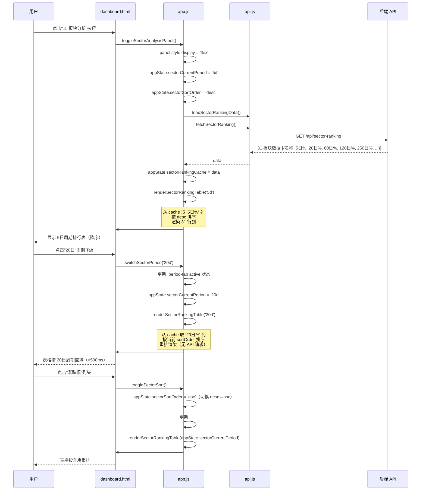
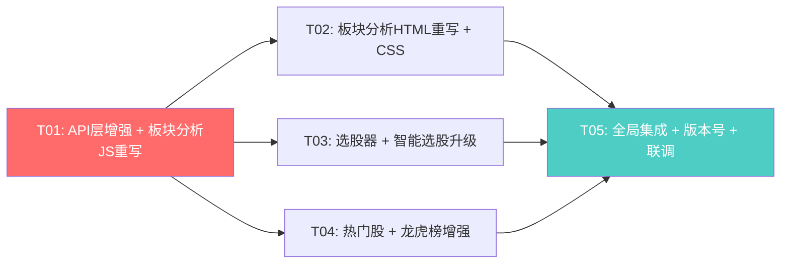
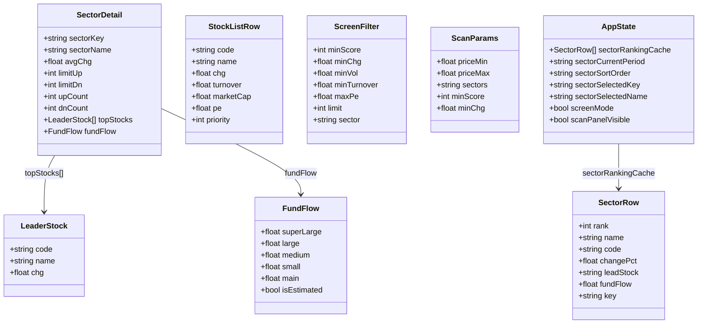

# DAPENG Alpha v5.4 架构设计 — Sidebar 5 工具深度升级

> 📎 **历史设计（v5.4）** — 本文描述的是**该版本当时的设计**；**现状以 [`MASTER-PLAN-2026Q4.md`](../00-strategy/MASTER-PLAN-2026Q4.md) 与 [`DATA-DICTIONARY.md`](../30-data/DATA-DICTIONARY.md) 为准**。正文保留作演进记录。

> **版本**: v5.4-architecture | **日期**: 2025-07-14 | **架构师**: Bob
> **基线 PRD**: `docs/20-prd/incremental-prd-v54-sidebar-pro.md`（482 行）
> **基线代码**: v5.3 — `dashboard.html?v=8`, `dashboard.css?v=8`, `app.js?v=8`, `market-data.js?v=6`, `api.js?v=5`

---

## 1. 总体实现策略

### 1.1 重构 vs 增量原则

本次升级遵循"**核心重构、外围增量**"策略：

| 模块 | 策略 | 理由 |
|------|------|------|
| 📊 板块分析面板 | **完全重写**（删旧 DOM + 删旧渲染函数 + 写新） | v5.3 的 `#sector-analysis-panel` 是基于本地 `calculateSectorStats()` 的伪分析（市场主线/热度排行/涨跌分布/资金流概览/龙头 TOP5/板块对比 6 个 section），数据源是 `window.appState.stocks`（当前板块成分股），无法支持多周期/全市场 31 板块/API 驱动的需求。旧 DOM 结构与新需求完全不兼容，重写成本低于改造 |
| 🔍 选股器 | **增量改造** | v5.3 已有 `#screen-panel` + `doScreenStocks()`，仅需加 3 个输入框 + 改结果渲染目标 |
| 🤖 智能选股 | **增量改造** | v5.3 已有 `#scan-panel` + `startScan()`，仅需加行业 checkbox 组 + 传 `sectors` 参数 |
| 🔥 热门股 | **增量改造** | v5.3 已有 `#hot-stocks-panel` + `loadHotStocksFull()`，仅需加详情按钮 |
| 📜 龙虎榜 | **增量改造** | v5.3 已有 `#lhb-panel` + `loadLHBFull()`，仅需加日期选择器 |

### 1.2 复用策略

以下 v5.3 已有资产**直接复用**，不重写：

| 资产 | 位置 | 复用方式 |
|------|------|----------|
| `.full-overlay-panel` | `dashboard.css:2398` | 板块分析/成分股/选股结果 3 个新面板均使用此 class，统一全屏覆盖 + 暗色玻璃态 |
| `.full-overlay-header` / `.full-overlay-tab` / `.full-overlay-close` | `dashboard.css:2407-2434` | 周期 Tab 复用 `.full-overlay-tab`，关闭按钮复用 `.full-overlay-close` |
| `.full-overlay-body` | `dashboard.css:2435` | 面板主体滚动区直接复用 |
| `.data-table` / `.data-table th/td` | `dashboard.css:2444-2469` | 所有表格复用，含斑马纹/悬停高亮/sticky 表头 |
| `.data-table-skeleton` / `.empty-msg` / `.error-msg` / `.loading-shimmer` | `dashboard.css:2483/2199/2205/2189` | 三态渲染复用 |
| `escapeHtml()` / `safeFixed()` / `_fmtAmount()` / `_fmtPct()` / `_flowCls()` | `api.js:20` / `market-data.js:17-41` | 所有渲染函数复用 |
| `request()` 请求封装（去重/超时/重试） | `api.js:123` | 新增 API 调用复用 |
| `selectStock(code, name)` | `app.js:804` | 所有表格行点击统一调用 |
| `showToast()` / `setStatus()` | `app.js` | 消息提示/状态指示复用 |
| ESC 键关闭面板 | `market-data.js:913` | 扩展此监听器，覆盖新面板 |

### 1.3 技术挑战与方案

| 挑战 | 方案 |
|------|------|
| **板块 key 映射**：API `/api/sector-ranking` 返回 31 板块（中文名），但 `/api/sector-stocks` 和 `/api/fund-flow/sector` 需传英文 key | 维护 `SECTOR_NAME_TO_KEY` 映射表（~31 条），API 返回数据时尝试匹配；匹配不到时从 ranking 数据中的 `key`/`code` 字段取（如果 API 返回了）；都取不到时用中文名做 key 直接传 API（降级） |
| **周期切换性能**（< 500ms） | 首次打开面板时调一次 `/api/sector-ranking` 缓存到 `window.appState.sectorRankingCache`，后续周期切换/排序纯前端操作，不重新请求 API |
| **资金流 API 缺数据时的本地估算** | `estimateSectorFundFlow(sectorData)` 函数：基于板块的 `totalAmount`/`upCount`/`totalCount` 按经验系数估算 5 分类，估算值标注 `(估)` |
| **选股器 5 条件全开时 API 性能** | API `/api/screen` 后端已支持多参数过滤，前端只需传参；设置 40s 超时（已有 `fetchScreen` 超时 40s）；加载中显示 skeleton |
| **成分股行情字段缺失** | `/api/sector-stocks` 仅返回 `{code, name, priority}`，缺涨跌幅/换手率/PE；方案：先渲染已有字段，缺列显示 `--`；可选后续用 `/api/realtime` 批量补充（P2，不在本次范围） |

### 1.4 架构模式

延续 v5.3 的**面向过程 + 全局函数**模式（非 MVC/MVVM），原因：
- 项目是单页 HTML + 原生 JS，无构建工具/框架
- v5.3 已有 3000+ 行 app.js 采用此模式，强行引入框架成本过高
- 新增函数遵循同样模式：全局函数 + `window.appState` 状态管理 + DOM 操作

---

## 2. 详细文件改动清单

### 2.1 改动总览

| 文件 | 改动类型 | 改动量 | 版本号 |
|------|----------|--------|--------|
| `static/dashboard.html` | 重写 + 新增 | 中 | `?v=8` → `?v=9` |
| `static/css/dashboard.css` | 新增 | 中 | `?v=8` → `?v=9` |
| `static/js/app.js` | 重写 + 新增 + 改造 | 大 | `?v=8` → `?v=9` |
| `static/js/api.js` | 新增 + 增强 | 小 | `?v=5` → `?v=6` |
| `static/js/market-data.js` | 增强 | 中 | `?v=6` → `?v=7` |

### 2.2 逐文件详细改动

#### `static/dashboard.html`

| 改动点 | 类型 | 说明 |
|--------|------|------|
| `#sector-analysis-panel`（L636-733） | **重写** | 删除旧的 6 个 section（市场主线/热度排行/涨跌分布/资金流概览/龙头 TOP5/板块对比），替换为新的周期 Tab + 涨幅榜表格 + 选中板块详情区结构。面板 class 从无改为 `full-overlay-panel`，与热门股/龙虎榜面板统一 |
| `#sector-stocks-panel`（新增） | **新增** | 成分股全屏覆盖面板，标题动态 + 表格 7 列（排名/代码/名称/涨跌幅/换手率/市值/PE） |
| `#screen-result-panel`（新增） | **新增** | 选股结果全屏覆盖面板，标题含数量 + 表格 8 列（排名/代码/名称/评分/涨跌幅/现价/换手率/PE） |
| `#screen-panel`（L293-300） | **改造** | 选股条件区从 2 条件扩展为 5 条件：新增换手率/量比/PE 三个输入框，网格化布局 |
| `#scan-panel`（L330-352） | **改造** | 智能选股条件区新增行业 checkbox 组容器 `#scan-industry-group`；价格区间默认值改为 `0` / `200` |
| `#hot-stocks-panel`（L736-748） | **改造** | 表格列增加"操作"列（含"详情"按钮）；或改为在 `loadHotStocksFull` 渲染时动态注入 |
| `#lhb-panel`（L751-765） | **改造** | header 区增加日期选择器 `<input type="date" id="lhb-date-picker">` |
| 版本号引用（L8/L827-831） | **改** | `dashboard.css?v=8→9`, `api.js?v=5→6`, `market-data.js?v=6→7`, `app.js?v=8→9` |

#### `static/css/dashboard.css`

| 改动点 | 类型 | 说明 |
|--------|------|------|
| `.sector-period-tabs` | 新增 | 周期 Tab 容器，flex 布局，复用 `.full-overlay-tab` 样式 |
| `.sector-ranking-table` | 新增 | 板块排行表格特有样式：排名列圆形标签、TOP3 金银铜色、选中行蓝色高亮 |
| `.sa-rank-rank-badge` | 新增 | 排名圆形标签，TOP3 分别 `var(--gold)` / `#c0c0c0` / `#cd7f32` |
| `.sa-rank-row.selected` | 新增 | 选中板块行 `background: rgba(59,130,246,0.15)` |
| `.sa-rank-sort-arrow` | 新增 | 排序箭头 ▼/▲ 样式 |
| `.sa-detail-section` | 新增 | 选中板块详情区容器 |
| `.sa-stats-bar` | 新增 | 统计栏：均涨幅/涨停/跌停/上涨/下跌，flex 横向排列 |
| `.sa-leaders` | 新增 | 龙头股 TOP 5 区域，pill 标签样式 |
| `.sa-leader-pill` | 新增 | 龙头股 pill：`display:inline-flex`，涨跌幅带颜色 |
| `.sa-fundflow` | 新增 | 资金流区域容器 |
| `.sa-fundflow-bar` | 新增 | 横向柱状图：正值红色右延伸，负值绿色左延伸，柱高 24px |
| `.sa-fundflow-bar-fill` | 新增 | 柱状图填充条 |
| `.sa-fundflow-list` | 新增 | 资金流数值列表，横向排列 5 分类 |
| `.sa-fundflow-main` | 新增 | 主力净流入大号字体高亮 |
| `.sa-fundflow-estimated` | 新增 | 估算值标注 `(估)` 灰色小字 |
| `.sa-view-stocks-btn` | 新增 | "查看成分股"按钮样式 |
| `.screen-input-group` | 新增 | 选股条件网格布局（2列×3行） |
| `.sector-checkbox-group` | 新增 | 智能选股行业 checkbox 组，每行 4 个 |
| `.sector-checkbox-item` | 新增 | 单个 checkbox 项样式 |
| `.stock-detail-popover` | 新增 | 热门股详情弹卡样式（定位到行旁，非全屏） |
| `.lhb-date-picker` | 新增 | 龙虎榜日期选择器样式 |
| 版本号注释 | 改 | 文件头注释更新版本号 |

#### `static/js/app.js`

| 改动点 | 类型 | 函数名 | 说明 |
|--------|------|--------|------|
| 板块分析面板开关 | **重写** | `toggleSectorAnalysisPanel()` | 改为：打开面板 → 设为 `display:flex` → 调 `loadSectorRankingData()` → 默认 5日 → 渲染表格；关闭时清理选中状态 |
| 板块排行数据加载 | **新增** | `loadSectorRankingData()` | 调 `fetchSectorRanking()` → 缓存到 `appState.sectorRankingCache` → 调 `renderSectorRankingTable('5d')` |
| 板块排行表格渲染 | **新增** | `renderSectorRankingTable(period)` | 从缓存取 `period` 对应列 → 排序 → 渲染 31 行到 `#sa-ranking-tbody` |
| 周期切换 | **新增** | `switchSectorPeriod(period)` | 更新 tab active → 调 `renderSectorRankingTable(period)` → 如有选中板块则同步更新详情 |
| 排序切换 | **新增** | `toggleSectorSort()` | 切换 `appState.sectorSortOrder` → 更新箭头 → 重排表格 |
| 板块选中 | **新增** | `selectSector(sectorKey, sectorName)` | 标记选中行高亮 → 调 `renderSectorDetail(sectorKey, period)` |
| 板块详情渲染 | **新增** | `renderSectorDetail(sectorKey, period)` | 渲染统计栏 + 龙头 TOP5 + 资金流 + 成分股按钮 |
| 板块资金流加载 | **新增** | `loadSectorFundFlow(sectorKey)` | 调 `fetchSectorFundFlow(sectorKey)` → 空数据时调 `estimateSectorFundFlow()` |
| 板块资金流渲染 | **新增** | `renderSectorFundFlow(data)` | 渲染横向柱状图 + 数值列表 + 主力高亮 |
| 资金流估算 | **新增** | `estimateSectorFundFlow(sectorData)` | 本地估算 5 分类资金流 |
| 成分股面板打开 | **新增** | `showSectorStocks()` | 打开 `#sector-stocks-panel` → 调 `fetchSectorStocks(key)` → 渲染表格 |
| 成分股面板关闭 | **新增** | `closeSectorStocksPanel()` | 关闭 `#sector-stocks-panel` |
| 板块分析面板关闭 | **新增** | `closeSectorPanel()` | 关闭 `#sector-analysis-panel` + 清理选中 |
| 板块 key 映射表 | **新增** | `SECTOR_NAME_TO_KEY`（常量） | 中文名 → 英文 key 映射，~31 条 |
| 选股执行 | **改造** | `doScreenStocks()` | 收集 5 条件 → 调增强版 `fetchScreen()` → 结果渲染到 `#screen-result-panel` 而非 `#stock-list` |
| 选股结果面板关闭 | **新增** | `closeScreenResultPanel()` | 关闭 `#screen-result-panel` |
| 智能选股行业加载 | **新增** | `loadScanIndustries()` | 从 `appState.sectorRankingCache`（或调 `fetchSectorRanking()`）生成行业 checkbox 组到 `#scan-industry-group` |
| 智能选股扫描 | **改造** | `startScan()` | 收集选中行业 checkbox → 拼接 `sectors` 参数 → 传入 `/api/scan` URL |
| appState 扩展 | **改造** | `window.appState` | 新增字段：`sectorRankingCache`, `sectorCurrentPeriod`, `sectorSortOrder`, `sectorSelectedKey`, `sectorSelectedName` |
| 旧函数清理 | **删除** | `renderRealSectorAnalysis()`, `calculateSectorStats()` 中板块分析面板相关部分 | 旧的全量分析渲染逻辑被新函数替代；`calculateSectorStats()` 仍保留供左下角迷你分析使用 |

#### `static/js/api.js`

| 改动点 | 类型 | 说明 |
|--------|------|------|
| `API.screen()` | **增强** | 支持更多参数：`min_turnover`, `max_pe`, `min_vol`（`min_vol` 已有参数名但未暴露给前端） |
| `fetchScreen()` | **增强** | 签名扩展为 `fetchScreen(filters)` 接收对象参数，内部拼接完整 URL |
| `API.sectorFundFlow()` | **已有** | 已在 L60 定义，无需改动 |
| `API.sectorStocks()` | **已有** | 已在 L72 定义，无需改动 |
| `fetchSectorStocks()` | **已有** | 已在 L454 定义，无需改动 |
| `fetchSectorFundFlow()` | **新增** | 封装 `request(API.sectorFundFlow(sector))` — 注意 api.js 中已有 `API.sectorFundFlow` URL 构建器，但缺少对应的 `fetchSectorFundFlow` 函数封装 |
| 版本号注释 | 改 | 文件头注释更新版本号 |

#### `static/js/market-data.js`

| 改动点 | 类型 | 函数名 | 说明 |
|--------|------|--------|------|
| 热门股详情按钮 | **改造** | `renderHotStocksFullTable()` | 每行右侧增加"详情"按钮，点击调 `showStockDetailPopover(code, event)` |
| 股票详情弹卡 | **新增** | `showStockDetailPopover(code, event)` | 调 `fetchProfile(code)` → 渲染 `.stock-detail-popover`（行业/市值/PE/换手率）→ 定位到行旁 |
| 详情弹卡关闭 | **新增** | `closeStockDetailPopover()` | 关闭弹卡 |
| 龙虎榜日期选择 | **改造** | `loadLHBFull()` / `switchLHBTab()` | 读取 `#lhb-date-picker` 值，传入 `fetchLHB(tab, date)` |
| ESC 键监听扩展 | **改造** | keydown 监听器（L913） | 扩展覆盖 `#sector-stocks-panel`, `#screen-result-panel`, `#sector-analysis-panel` 的 ESC 关闭 |
| 版本号注释 | 改 | 文件头注释更新版本号 |

---

## 3. 关键时序图

### 3.1 时序图 1：板块分析面板打开 → 周期切换 → 排序



### 3.2 时序图 2：板块选中 → 详情渲染 → 成分股弹层 → 切 K 线

```mermaid
sequenceDiagram
    participant U as 用户
    participant HTML as dashboard.html
    participant App as app.js
    participant API as api.js
    participant Backend as 后端 API

    U->>HTML: 点击排行表某板块行
    HTML->>App: selectSector(sectorKey, sectorName)
    App->>App: 标记选中行高亮 (.selected)
    App->>App: appState.sectorSelectedKey = sectorKey
    App->>App: appState.sectorSelectedName = sectorName

    App->>App: renderSectorDetail(sectorKey, period)
    Note over App: 从 cache 取该板块当前周期涨跌幅<br/>计算均涨幅/涨停/跌停/上涨/下跌<br/>取龙头股 TOP5
    App->>HTML: #sa-stats-bar / #sa-leaders 渲染完成

    par 资金流加载（并行）
        App->>API: loadSectorFundFlow(sectorKey)
        API->>Backend: GET /api/fund-flow/sector?sector=KEY
        Backend-->>API: 资金流数据（或 null）
        alt API 有数据
            API-->>App: {super_large, large, medium, small, main}
            App->>App: renderSectorFundFlow(data)
        else API 返回 null
            App->>App: estimateSectorFundFlow(sectorData)
            Note over App: 估算: baseFlow = totalAmount * (upCount/totalCount)<br/>超大单=baseFlow*0.3, 大单=baseFlow*0.2<br/>中单=-baseFlow*0.15, 小单=-baseFlow*0.1<br/>主力=超大单+大单, isEstimated=true
            App->>App: renderSectorFundFlow(estimatedData)
        end
        App->>HTML: #sa-fundflow 渲染柱状图 + 数值列表
    end

    HTML-->>U: 选中板块详情区完整展示

    U->>HTML: 点击"📋 查看成分股"按钮
    HTML->>App: showSectorStocks()
    App->>HTML: #sector-stocks-panel.style.display = 'flex'
    App->>App: 显示 loading-shimmer
    App->>API: fetchSectorStocks(sectorKey)
    API->>Backend: GET /api/sector-stocks?sector=KEY
    Backend-->>API: [{code, name, priority}, ...]
    API-->>App: data
    App->>App: 渲染成分股表格到 #sector-stocks-tbody
    Note over App: 涨跌幅/换手率/市值/PE 缺失时显示 '--'
    App->>HTML: #sector-stocks-title = "{板块名} 成分股 (N只)"
    HTML-->>U: 成分股面板弹出

    U->>HTML: 点击成分股表格某行
    HTML->>App: selectStock(code, name); closeSectorStocksPanel()
    App->>App: closeSectorStocksPanel(): #sector-stocks-panel.style.display = 'none'
    App->>App: selectStock(): 切换 K 线 + 加载策略评分
    App->>HTML: K 线区域更新为目标股票
    HTML-->>U: 成分股面板关闭 + K 线切换完成
```

---

## 4. 任务列表

### 4.1 任务总览

| ID | 任务名 | 依赖 | 优先级 | 估时 |
|----|--------|------|--------|------|
| T01 | API 层增强 + 板块分析 JS 重写 | 无 | P0 | 3h |
| T02 | 板块分析 HTML 重写 + CSS 新增 | T01 | P0 | 2h |
| T03 | 选股器 + 智能选股升级（HTML + JS + CSS） | T01 | P0 | 2h |
| T04 | 热门股 + 龙虎榜增强（market-data.js + HTML + CSS） | T01 | P1 | 1.5h |
| T05 | 全局集成 + 版本号更新 + ESC 键扩展 + 联调 | T02, T03, T04 | P0 | 1h |

> **总计**: 5 个任务，估时 9.5h
> **关键路径**: T01 → T02 → T05（或 T01 → T03 → T05）

### 4.2 任务依赖图



### 4.3 任务详细说明

#### T01: API 层增强 + 板块分析 JS 重写

| 属性 | 说明 |
|------|------|
| **涉及文件** | `static/js/api.js`, `static/js/app.js` |
| **依赖** | 无 |
| **优先级** | P0 |
| **估时** | 3h |

**api.js 改动**：
1. `API.screen()` 增强：支持 `min_turnover` / `max_pe` / `min_vol` 参数
2. `fetchScreen()` 增强：改为接收 filters 对象 `{minScore, minChg, minVol, minTurnover, maxPe, sector, limit}`
3. 新增 `fetchSectorFundFlow(sector)` 函数封装（URL 构建器 `API.sectorFundFlow` 已有，缺 fetch 封装）

**app.js 改动**：
1. `window.appState` 扩展：新增 `sectorRankingCache`, `sectorCurrentPeriod`, `sectorSortOrder`, `sectorSelectedKey`, `sectorSelectedName`
2. 新增 `SECTOR_NAME_TO_KEY` 常量映射表（~31 条）
3. **重写** `toggleSectorAnalysisPanel()`：打开时初始化 5日 + 加载数据
4. **新增** 12 个函数：`loadSectorRankingData`, `renderSectorRankingTable`, `switchSectorPeriod`, `toggleSectorSort`, `selectSector`, `renderSectorDetail`, `loadSectorFundFlow`, `renderSectorFundFlow`, `estimateSectorFundFlow`, `showSectorStocks`, `closeSectorStocksPanel`, `closeSectorPanel`
5. 旧 `renderRealSectorAnalysis()` 中板块面板渲染部分删除，保留左下角迷你分析调用

**验收要点**：
- `fetchSectorFundFlow('semiconductor')` 能正确请求并返回数据
- `fetchScreen({minScore:70, minTurnover:3, maxPe:50})` 能正确拼接 URL
- `SECTOR_NAME_TO_KEY['电力设备']` === `'power_equip'`
- `toggleSectorAnalysisPanel()` 打开面板后 `appState.sectorRankingCache` 非空
- `renderSectorRankingTable('5d')` 能从缓存渲染 31 行
- `switchSectorPeriod('20d')` 不触发 API 请求，纯前端重排
- `estimateSectorFundFlow({totalAmount:1e9, upCount:8, totalCount:15})` 返回 5 分类估算值
- `showSectorStocks()` 调用 `fetchSectorStocks(key)` 并渲染表格

---

#### T02: 板块分析 HTML 重写 + CSS 新增

| 属性 | 说明 |
|------|------|
| **涉及文件** | `static/dashboard.html`, `static/css/dashboard.css` |
| **依赖** | T01（JS 函数需先就绪，HTML 的 onclick 才能生效） |
| **优先级** | P0 |
| **估时** | 2h |

**dashboard.html 改动**：
1. 重写 `#sector-analysis-panel`（L636-733）：删除旧 6 section，替换为 PRD 4.6 节的新 DOM 结构（周期 Tab + 涨幅榜表格 + 选中详情区）
2. 新增 `#sector-stocks-panel`（成分股全屏面板，class=`full-overlay-panel`）
3. 面板 class 改为 `full-overlay-panel`，display 初始 `none`，JS 控制显示

**dashboard.css 改动**：
1. 新增 ~15 个 class：`.sector-period-tabs`, `.sector-ranking-table`, `.sa-rank-rank-badge`, `.sa-rank-row.selected`, `.sa-rank-sort-arrow`, `.sa-detail-section`, `.sa-stats-bar`, `.sa-leaders`, `.sa-leader-pill`, `.sa-fundflow`, `.sa-fundflow-bar`, `.sa-fundflow-bar-fill`, `.sa-fundflow-list`, `.sa-fundflow-main`, `.sa-fundflow-estimated`, `.sa-view-stocks-btn`

**验收要点**：
- 面板打开后显示周期 Tab（5日默认 active）+ 空表格 + 隐藏的详情区
- 点击周期 Tab 能切换 active 样式
- 表格列头"涨跌幅"有 ▼ 箭头，可点击
- 选中板块行有蓝色高亮
- 资金流柱状图正值红色右延伸、负值绿色左延伸
- 龙头股 pill 样式正确
- 暗色玻璃态风格与热门股/龙虎榜面板一致

---

#### T03: 选股器 + 智能选股升级

| 属性 | 说明 |
|------|------|
| **涉及文件** | `static/dashboard.html`, `static/js/app.js`, `static/css/dashboard.css` |
| **依赖** | T01（`fetchScreen` 增强需先完成） |
| **优先级** | P0 |
| **估时** | 2h |

**dashboard.html 改动**：
1. `#screen-panel`（L293-300）：从 2 条件改为 5 条件网格布局（评分/涨幅、换手率/量比、PE），新增 3 个 `<input>`
2. 新增 `#screen-result-panel`（选股结果全屏面板，class=`full-overlay-panel`，表格 8 列）
3. `#scan-panel`（L330-352）：价格默认值改 `0`/`200`；新增 `#scan-industry-group` 容器（行业 checkbox 组）

**app.js 改动**：
1. **改造** `doScreenStocks()`：收集 5 条件 → 调 `fetchScreen(filters)` → 结果渲染到 `#screen-result-panel`
2. **新增** `closeScreenResultPanel()`
3. **新增** `loadScanIndustries()`：从 `appState.sectorRankingCache` 生成 checkbox 组
4. **改造** `startScan()`：收集选中行业 → 拼接 `sectors` 参数 → 传入 scan URL

**dashboard.css 改动**：
1. 新增 `.screen-input-group`（选股条件网格）
2. 新增 `.sector-checkbox-group` / `.sector-checkbox-item`（行业 checkbox 组）

**验收要点**：
- 选股器 5 个输入框布局正确（2列×3行）
- 空输入框 = 不过滤（不传该参数）
- 选股结果在 `#screen-result-panel` 显示，不替换 `#stock-list`
- 结果行点击 → 面板关闭 + K 线切换
- 智能选股行业 checkbox 组从 31 板块动态生成
- 勾选 2 个行业后 scan URL 含 `sectors=key1,key2`
- 不勾选任何行业 = 全市场扫描

---

#### T04: 热门股 + 龙虎榜增强

| 属性 | 说明 |
|------|------|
| **涉及文件** | `static/js/market-data.js`, `static/dashboard.html`, `static/css/dashboard.css` |
| **依赖** | T01（无直接依赖，但建议 API 层先就绪） |
| **优先级** | P1 |
| **估时** | 1.5h |

**market-data.js 改动**：
1. **改造** `renderHotStocksFullTable()`：每行右侧增加"详情"按钮
2. **新增** `showStockDetailPopover(code, event)`：调 `fetchProfile(code)` → 渲染弹卡
3. **新增** `closeStockDetailPopover()`
4. **改造** `loadLHBFull()` / `switchLHBTab()`：读取日期选择器值传入 `fetchLHB(tab, date)`

**dashboard.html 改动**：
1. `#lhb-panel` header 增加 `<input type="date" id="lhb-date-picker">`
2. 热门股表格列增加"操作"列（或 JS 动态注入按钮）

**dashboard.css 改动**：
1. 新增 `.stock-detail-popover`（弹卡定位样式）
2. 新增 `.lhb-date-picker`

**验收要点**：
- 热门股每行右侧有"详情"按钮
- 点击"详情"弹出股票简况卡（行业/市值/PE/换手率）
- 弹卡定位在行旁，非全屏
- 点击其他区域关闭弹卡
- 龙虎榜 header 有日期选择器，默认今日
- 选择日期后重新请求龙虎榜数据

---

#### T05: 全局集成 + 版本号更新 + 联调

| 属性 | 说明 |
|------|------|
| **涉及文件** | `static/dashboard.html`, `static/js/market-data.js` |
| **依赖** | T02, T03, T04（所有功能开发完成后） |
| **优先级** | P0 |
| **估时** | 1h |

**改动**：
1. `dashboard.html` 版本号更新：`dashboard.css?v=9`, `api.js?v=6`, `market-data.js?v=7`, `app.js?v=9`
2. `market-data.js` ESC 键监听器扩展：覆盖 `#sector-stocks-panel`, `#screen-result-panel`, `#sector-analysis-panel`
3. 全局联调：打开板块分析 → 切周期 → 选中板块 → 看详情 → 看资金流 → 看成分股 → 切 K 线
4. 选股器 5 条件全开测试
5. 智能选股行业过滤测试
6. 热门股详情按钮 + 龙虎榜日期选择测试
7. 三态测试（API 异常/空数据/正常）

**验收要点**：
- 所有版本号已更新（浏览器无缓存问题）
- ESC 键能关闭所有 6 个全屏面板（板块分析/成分股/选股结果/热门股/龙虎榜/对比）
- PRD 验收标准 AC1-AC19 全部通过
- 无 JS 控制台报错

---

## 5. 数据流 / 数据结构

### 5.1 核心数据结构定义



### 5.2 数据结构详细说明

#### SectorRow（板块排行行）

```javascript
{
  rank: 1,                    // 排名（1-31）
  name: '电子',                // 板块中文名（API "名称"字段）
  code: 'semiconductor',      // 板块英文 key（从 SECTOR_NAME_TO_KEY 映射或 API 返回）
  changePct: 3.52,            // 当前周期涨跌幅（从 API 对应列取，如 "5日%"）
  leadStock: '沪电股份',       // 领涨股名称（API "领涨股"字段）
  fundFlow: 12.3,             // 资金流（亿元，从 fund-flow API 或估算，排行表中简略显示）
  key: 'semiconductor'        // 板块 key（与 code 相同，用于传给 sector-stocks/fund-flow API）
}
```

**数据来源**：`/api/sector-ranking` 返回的 31 行，经 `loadSectorRankingData()` 解析后缓存到 `appState.sectorRankingCache`。每行原始数据含 5 个周期列（`5日%`/`20日%`/`60日%`/`120日%`/`250日%`），渲染时按 `appState.sectorCurrentPeriod` 取对应列。

#### SectorDetail（板块详情）

```javascript
{
  sectorKey: 'power_equip',
  sectorName: '电力设备',
  avgChg: -1.2,               // 均涨幅（当前周期）
  limitUp: 2,                 // 涨停数
  limitDn: 0,                 // 跌停数
  upCount: 8,                 // 上涨数
  dnCount: 7,                 // 下跌数
  topStocks: [                // 龙头股 TOP 5
    { code: '600406', name: '国电南瑞', chg: 5.2 },
    { code: '600089', name: '特变电工', chg: 3.1 },
    // ... 最多 5 个
  ],
  fundFlow: {                 // 资金流（5 分类）
    superLarge: 3.2e8,        // 超大单净额（元）
    large: 2.0e8,             // 大单净额
    medium: -1.5e8,           // 中单净额
    small: -3.7e8,            // 小单净额
    main: 5.2e8,              // 主力净流入 = 超大单 + 大单
    isEstimated: false        // 是否估算值
  }
}
```

**数据来源**：
- `avgChg`/`limitUp`/`limitDn`/`upCount`/`dnCount`：从 `appState.sectorRankingCache` 中对应板块行计算
- `topStocks`：从 `/api/sector-stocks?sector=KEY` 返回的成分股 + 排序取 TOP 5（或 API 直接返回 `lead_stocks` 字段）
- `fundFlow`：从 `/api/fund-flow/sector?sector=KEY` 获取；空数据时调 `estimateSectorFundFlow()` 估算

#### StockListRow（成分股行）

```javascript
{
  code: '600406',
  name: '国电南瑞',
  chg: 5.2,                   // 涨跌幅（API 缺则 --）
  turnover: 2.3,              // 换手率（API 缺则 --）
  marketCap: null,            // 市值（API 缺则 --）
  pe: null,                   // PE（API 缺则 --）
  priority: 1                 // 优先级（API 返回的 priority 字段，用于排序）
}
```

**数据来源**：`/api/sector-stocks?sector=KEY` 返回 `{code, name, priority}`；行情字段（chg/turnover/marketCap/pe）API 可能不返回，缺失时显示 `--`。

#### ScreenFilter（选股条件）

```javascript
{
  minScore: 70,               // 最低评分（默认 70）
  minChg: null,               // 最低涨幅%（null = 不过滤）
  minVol: null,               // 量比 ≥（null = 不过滤）
  minTurnover: null,          // 换手率 ≥%（null = 不过滤）
  maxPe: null,                // PE ≤（null = 不过滤）
  limit: 30,                  // 返回数量上限
  sector: null                // 板块过滤（选股器不传，保留字段）
}
```

#### ScanParams（智能选股参数）

```javascript
{
  priceMin: 0,                // 最低价格（默认 0）
  priceMax: 200,              // 最高价格（默认 200）
  sectors: 'semiconductor,power_equip',  // 选中行业 key 逗号分隔（空 = 全市场）
  minScore: null,             // 最低评分（可选）
  minChg: null                // 最低涨幅（可选）
}
```

### 5.3 数据流总览

```
用户操作                    前端状态                     API 请求
─────────────────────────────────────────────────────────────────
打开板块分析面板    → appState.sectorRankingCache  ← GET /api/sector-ranking
切周期 Tab         → appState.sectorCurrentPeriod  → 纯前端重排（无请求）
点板块行           → appState.sectorSelectedKey    → 渲染详情（缓存数据）
                                                   ← GET /api/fund-flow/sector?sector=KEY
点"查看成分股"     → #sector-stocks-panel 打开     ← GET /api/sector-stocks?sector=KEY
点成分股行         → selectStock(code)             → 切 K 线（已有逻辑）

选股器"选股"       → ScreenFilter 收集             ← GET /api/screen?min_score=&min_chg=&min_vol=&min_turnover=&max_pe=&limit=
                   → #screen-result-panel 打开

智能选股"开始扫描" → ScanParams 收集               ← GET /api/scan?price_min=&price_max=&sectors=KEY1,KEY2
                   → 轮询扫描结果

热门股"详情"按钮   → showStockDetailPopover        ← GET /api/profile?code=CODE

龙虎榜选日期       → #lhb-date-picker.value        ← GET /api/lhb?tab=&date=YYYY-MM-DD
```

---

## 6. 共享知识（跨文件约定）

### 6.1 板块 key 统一规范

| 场景 | 使用值 | 示例 |
|------|--------|------|
| API 请求参数（`sector-stocks` / `fund-flow/sector` / `scan` 的 `sectors`） | **英文 key** | `semiconductor`, `power_equip`, `telecom` |
| UI 显示 | **中文显示名** | `电子`, `电力设备`, `通信` |
| `SECTOR_NAME_TO_KEY` 映射 | key → 英文，value → 英文 key | `{'电子': 'semiconductor', ...}` |
| `appState.sectorSelectedKey` | **英文 key** | `power_equip` |
| `appState.sectorSelectedName` | **中文名** | `电力设备` |

**映射表 `SECTOR_NAME_TO_KEY`**（放在 app.js 顶部，~31 条）：

```javascript
const SECTOR_NAME_TO_KEY = {
  '电子': 'semiconductor',
  '半导体': 'semiconductor',
  '电力设备': 'power_equip',
  '通信': 'telecom',
  '医药生物': 'pharma',
  '医药': 'pharma',
  '食品饮料': 'consumer',
  '消费': 'consumer',
  '银行': 'finance',
  '金融': 'finance',
  '国防军工': 'military',
  '军工': 'military',
  '计算机': 'ai_compute',
  'AI算力': 'ai_compute',
  '电力': 'photovoltaic',
  '光伏': 'photovoltaic',
  '传媒': 'internet',
  '互联网': 'internet',
  '房地产': 'real_estate',
  '钢铁': 'steel_material',
  '钢铁有色': 'steel_material',
  '汽车': 'auto',
  '消费电子': 'consumer_electronics',
  '化工新材料': 'chemical',
  '机械设备': 'machinery',
  '环保节能': 'environmental',
  '纺织服装': 'textile',
  '农业': 'agriculture',
  '交通运输': 'transport',
  '建材': 'building_materials',
  '网络安全': 'cyber',
  '新能源': 'new_energy',
  'ETF基金': 'etf',
};
```

> **注意**：API 返回 31 板块，本地 `SECTORS` 配置 24 个。API 返回但本地无映射的板块，降级方案：直接用中文名做 key 传给 API（后端可能支持），或从 API 返回数据的 `key`/`code` 字段取。

### 6.2 涨跌幅格式规范

```javascript
// 正数加 + 号，保留 2 位小数
function formatChg(val) {
  if (val == null || isNaN(val)) return '--';
  var n = Number(val);
  return (n >= 0 ? '+' : '') + n.toFixed(2) + '%';
}
// 示例: 3.52 → "+3.52%", -1.2 → "-1.20%", null → "--"
```

> **复用已有**：`market-data.js` 中的 `_fmtPct(val)` 已实现此逻辑（L29-33），直接复用。

### 6.3 颜色规范（A 股惯例：红涨绿跌）

| 场景 | 正值（涨/流入） | 负值（跌/流出） |
|------|-----------------|-----------------|
| 涨跌幅文字 | `var(--red)` #ff3d6a | `var(--green)` #00e96a |
| 资金流文字 | `var(--red)` #ff3d6a | `var(--green)` #00e96a |
| 资金流柱状图 | 红色右延伸 | 绿色左延伸 |
| 估算值标注 | 灰色小字 `(估)` `var(--text2)` | — |

> **注意**：v5.3 的 `.data-table .col-chg-up` 用的是 `var(--green)`，`.col-chg-dn` 用的是 `var(--red)`（L2468-2469），这是**国际惯例**（绿涨红跌）。但 PRD 5.2 节明确要求 **A 股惯例（红涨绿跌）**。板块分析面板内的新样式按 PRD 要求用红涨绿跌；已有的 `.data-table` 样式不改动（避免影响其他面板）。板块分析表格中的涨跌幅颜色用新 class `.sa-chg-up` / `.sa-chg-dn` 覆盖。

### 6.4 表格行点击统一行为

所有表格（板块排行/成分股/选股结果/热门股/龙虎榜）的行点击统一调用：

```javascript
selectStock(code, name);   // 切换 K 线 + 加载策略评分
closeXxxPanel();            // 关闭当前弹层
```

**例外**：板块排行表的行点击不调 `selectStock`，而是调 `selectSector(key, name)` 展开详情区。

### 6.5 三态渲染规范

沿用 v5.3 已有的三态模式：

| 状态 | HTML | CSS class |
|------|------|-----------|
| 加载中 | `<div class="loading-shimmer">加载中...</div>` 或 `<div class="data-table-skeleton">...</div>` | `.loading-shimmer` / `.data-table-skeleton` |
| 空数据 | `<div class="empty-msg">暂无数据</div>` | `.empty-msg` |
| 错误 | `<div class="error-msg">加载失败 <button onclick="retry()">重试</button></div>` | `.error-msg` |

### 6.6 API 响应格式

所有 API 返回 `{ok: bool, data: ..., message: string}` 格式。`request()` 函数（api.js:123）已处理：
- HTTP 非 200 → 返回 `null`
- `json.ok !== true` → 返回 `null`
- 正常 → 返回 `json.data`

前端函数统一检查 `if (!data)` 进入空/错误态。

---

## 7. 风险与备选方案

### 7.1 风险 1：`/api/sector-stocks?sector=KEY` 返回空或报错

**风险描述**：API 可能对某些板块 key 不支持，返回空数组或 404。

**影响**：成分股面板显示空表格，用户体验差。

**备选方案**：
1. **降级到本地 SECTORS 配置**：如果 API 返回空，从 `window.appState.stocks`（当前已加载的股票池）中过滤 `s.sector === sectorKey` 的股票作为 fallback
2. **显示友好空态**：`<div class="empty-msg">该板块暂无成分股数据</div>` + 返回按钮
3. **key 降级**：如果英文 key 不行，尝试用中文名传参（部分 API 可能接受中文）

```javascript
async function showSectorStocks() {
  // ... 打开面板 + 显示 loading
  var data = await fetchSectorStocks(sectorKey);
  if (!data || !data.stocks || data.stocks.length === 0) {
    // 降级：从本地股池过滤
    var localStocks = window.appState.stocks.filter(s => s.sector === sectorKey);
    if (localStocks.length > 0) {
      data = { stocks: localStocks.map(s => ({code: s.code, name: s.name, priority: 0})) };
    } else {
      // 显示空态
      document.getElementById('sector-stocks-tbody').innerHTML = '<tr><td colspan="7" class="empty-msg">该板块暂无成分股数据</td></tr>';
      return;
    }
  }
  // ... 渲染表格
}
```

### 7.2 风险 2：板块资金流 API 返回 null

**风险描述**：`/api/fund-flow/sector?sector=KEY` 可能对所有板块都返回 null（后端未实现板块级资金流）。

**影响**：所有板块的资金流都显示估算值。

**备选方案**：
- **本地估算**（PRD 已确认 Q5）：`estimateSectorFundFlow()` 基于 `totalAmount`/`upCount`/`totalCount` 估算
- 估算公式：

```javascript
function estimateSectorFundFlow(sectorData) {
  var totalAmount = sectorData.totalAmount || 0;
  var upCount = sectorData.upCount || 0;
  var totalCount = sectorData.totalCount || 1;
  var ratio = upCount / totalCount;
  var baseFlow = totalAmount * ratio;

  return {
    superLarge: baseFlow * 0.30,   // 超大单
    large: baseFlow * 0.20,        // 大单
    medium: -baseFlow * 0.15,      // 中单
    small: -baseFlow * 0.10,       // 小单
    main: baseFlow * 0.50,         // 主力 = 超大单 + 大单
    isEstimated: true
  };
}
```

- 估算值在 UI 上标注 `(估)` 灰色小字，让用户知道数据来源
- **后续优化**（P2）：后端实现板块级资金流 API 后，自动切换为真实数据

### 7.3 风险 3：选股器 5 条件全开时 API 性能

**风险描述**：`/api/screen?min_score=70&min_chg=2&min_vol=1.5&min_turnover=3&max_pe=50&limit=30` 多条件组合可能导致后端查询慢。

**影响**：用户等待时间过长（>10s），体验差。

**备选方案**：
1. **超时控制**：`fetchScreen()` 已设 40s 超时（api.js:282），超时后显示错误 + 重试
2. **加载态**：选股按钮点击后立即显示 loading-shimmer，按钮禁用 + 文字变"选股中..."
3. **结果上限**：`limit=30` 限制返回数量，减少传输和渲染压力
4. **前端预校验**：如果所有条件都为空（用户没填任何条件），提示"请至少输入一个筛选条件"
5. **后续优化**（P2）：后端添加缓存/索引优化多条件查询

### 7.4 风险 4：板块 key 映射不完整

**风险描述**：API 返回 31 板块，本地 `SECTOR_NAME_TO_KEY` 可能无法覆盖所有板块名。

**备选方案**：
1. `loadSectorRankingData()` 解析 API 数据时，优先用 API 返回的 `key`/`code` 字段
2. 如果 API 没返回 key 字段，查 `SECTOR_NAME_TO_KEY` 映射表
3. 都取不到时，用中文名做 key 直接传 API（降级）
4. 控制台 `console.warn` 记录未映射的板块名，便于后续补充映射表

```javascript
function resolveSectorKey(sectorData) {
  // 优先用 API 返回的 key/code 字段
  if (sectorData.key) return sectorData.key;
  if (sectorData.code) return sectorData.code;
  // 其次查映射表
  var name = sectorData.name || sectorData['名称'] || '';
  if (SECTOR_NAME_TO_KEY[name]) return SECTOR_NAME_TO_KEY[name];
  // 降级：用中文名
  console.warn('Sector key not found for:', name, '— using name as key');
  return name;
}
```

### 7.5 风险 5：ESC 键关闭面板的优先级冲突

**风险描述**：v5.3 已有 ESC 监听器（market-data.js:913）覆盖热门股/龙虎榜面板。新增 3 个面板后，ESC 需要按优先级关闭最上层面板。

**备选方案**：
- 扩展 ESC 监听器，按 z-index/显示顺序检查所有面板，关闭最上层（最后打开的）那个
- 检查顺序：`#sector-stocks-panel` > `#screen-result-panel` > `#sector-analysis-panel` > `#hot-stocks-panel` > `#lhb-panel` > `#compare-panel`

---

## 附录：v5.3 已有资产索引

| 资产 | 文件 | 行号 | 说明 |
|------|------|------|------|
| `request()` | api.js | 123 | 通用请求封装（去重/超时/重试） |
| `escapeHtml()` | api.js | 20 | HTML 转义 |
| `safeFixed()` | api.js | 38 | 安全 toFixed |
| `API.screen()` | api.js | 48 | 选股 URL 构建（待增强） |
| `API.sectorFundFlow()` | api.js | 60 | 板块资金流 URL |
| `API.sectorRanking()` | api.js | 61 | 板块排行 URL |
| `API.lhb()` | api.js | 62 | 龙虎榜 URL（已支持 date 参数） |
| `API.sectorStocks()` | api.js | 72 | 板块成分股 URL |
| `fetchScreen()` | api.js | 281 | 选股请求（待增强） |
| `fetchSectorRanking()` | api.js | 377 | 板块排行请求 |
| `fetchSectorStocks()` | api.js | 454 | 板块成分股请求 |
| `fetchLHB()` | api.js | 384 | 龙虎榜请求（已支持 date） |
| `fetchProfile()` | api.js | 405 | 个股简况请求 |
| `selectStock()` | app.js | 804 | 股票选中 + K 线切换 |
| `SECTORS` | app.js | 43 | 24 板块配置 |
| `window.appState` | app.js | 15 | 全局状态对象 |
| `toggleSectorAnalysisPanel()` | app.js | 3350 | 板块分析面板开关（待重写） |
| `calculateSectorStats()` | app.js | 3364 | 板块统计计算（保留供迷你分析用） |
| `renderRealSectorAnalysis()` | app.js | 3401 | 旧板块分析渲染（待删除面板部分） |
| `doScreenStocks()` | app.js | 1110 | 选股执行（待改造） |
| `startScan()` | app.js | 1418 | 智能选股扫描（待改造） |
| `_fmtAmount()` | market-data.js | 17 | 金额格式化 |
| `_fmtPct()` | market-data.js | 29 | 百分比格式化 |
| `_flowCls()` | market-data.js | 38 | 资金流 CSS class |
| `loadSectorRanking()` | market-data.js | 122 | 板块排行加载（旧版） |
| `renderSectorRanking()` | market-data.js | 134 | 板块排行渲染（旧版） |
| `loadHotStocksFull()` | market-data.js | 713 | 热门股加载（待改造） |
| `loadLHBFull()` | market-data.js | 801 | 龙虎榜加载（待改造） |
| `closeHotStocksPanel()` | market-data.js | 877 | 关闭热门股面板 |
| `closeLHBPanel()` | market-data.js | 885 | 关闭龙虎榜面板 |
| ESC 监听器 | market-data.js | 913 | ESC 键关闭面板（待扩展） |
| `.full-overlay-panel` | dashboard.css | 2398 | 全屏覆盖面板样式 |
| `.full-overlay-tab` | dashboard.css | 2419 | Tab 样式 |
| `.data-table` | dashboard.css | 2444 | 数据表格样式 |
| `.data-table-skeleton` | dashboard.css | 2483 | 表格骨架屏 |
| `.empty-msg` | dashboard.css | 2199 | 空态样式 |
| `.error-msg` | dashboard.css | 2205 | 错误态样式 |
| `.loading-shimmer` | dashboard.css | 2189 | 加载动画样式 |
