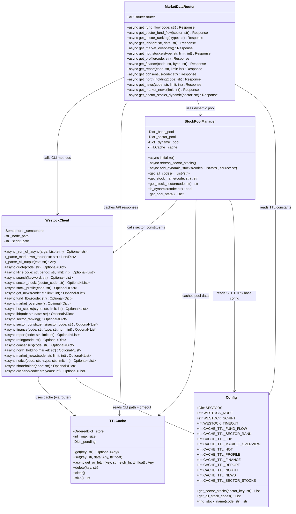
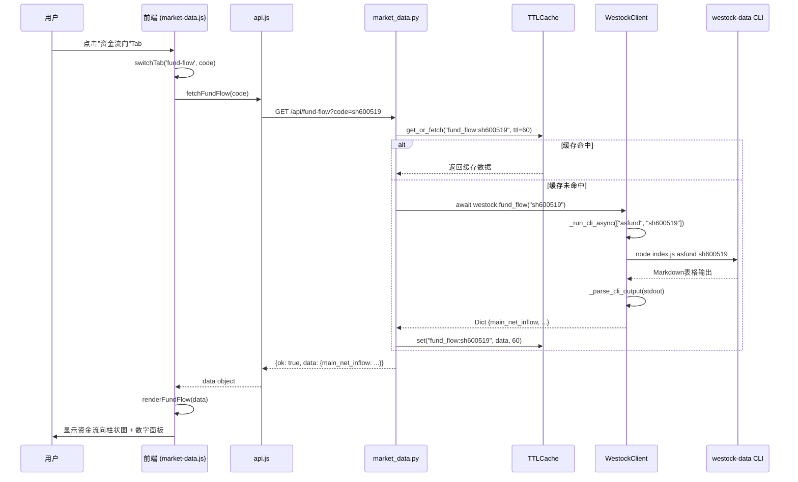
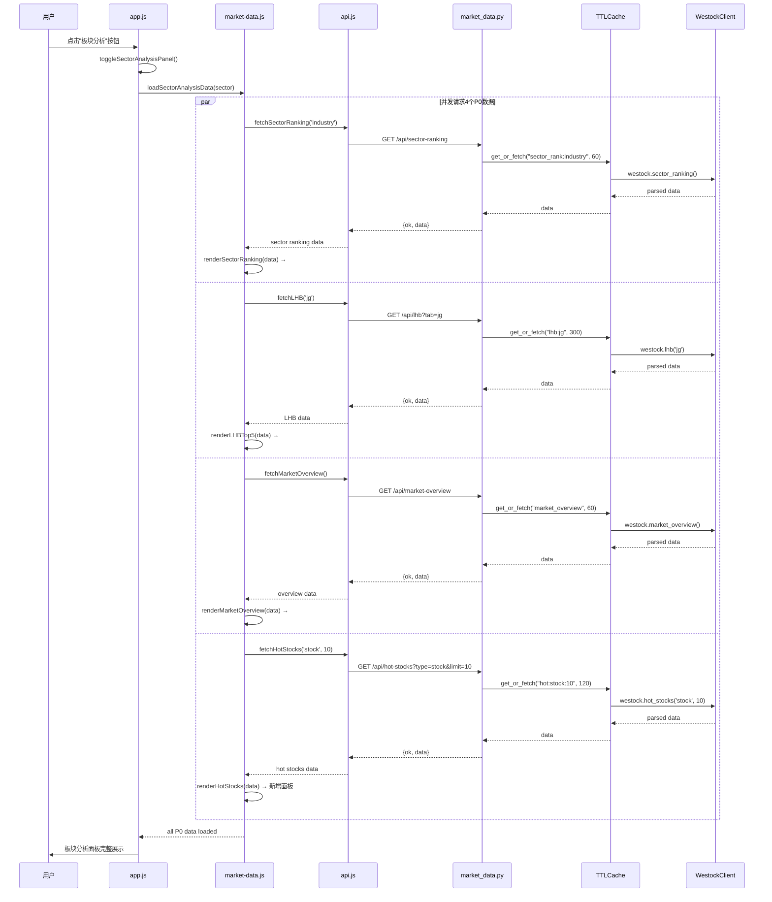
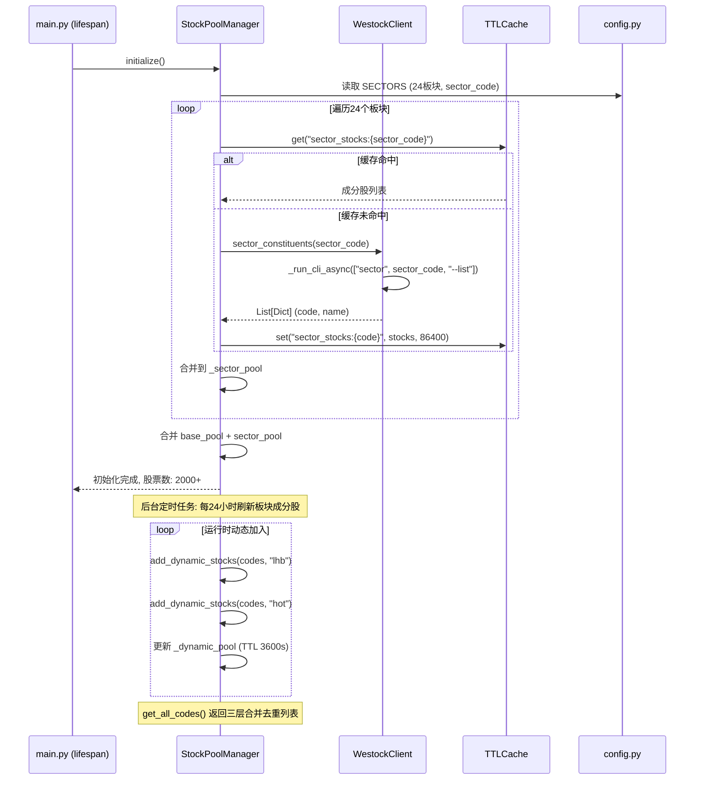
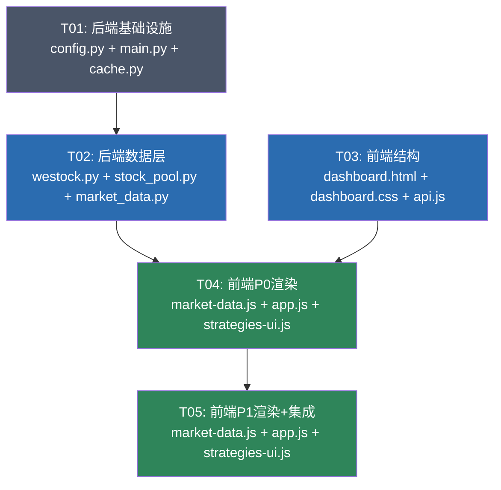

# DAPENG Alpha — MCP 数据源集成系统架构设计

> ⚠️ **状态更新（2026-10-16）：部分过期** —— 本文描述的 **`westock-data` CLI 链路已废弃**（该 skill 迁移到 MCP 后 CLI 永久不可用）。依赖它的端点（`/api/finance`、`/api/report`、`/api/consensus`、`/api/profile`）现返回 `null`。**请勿据此配置 westock CLI**；本文仅作**历史架构参考**。当前数据口径见 [`docs/30-data/DATA-DICTIONARY.md`](../30-data/DATA-DICTIONARY.md) §16。

> **版本**: v5.0-arch | **日期**: 2025-07-11 | **架构师**: Bob
> **输入**: `docs/20-prd/incremental-prd-westock-mcp.md` (产品经理 Alice)
> **项目路径**: `dapeng-water/`

---

## Part A: System Design

### 1. Implementation Approach

#### 1.1 核心架构决策

**直接扩展 `westock.py` CLI 封装，不引入 MCP HTTP 桥接层。**

现有系统已通过 `server/westock.py` 的 `WestockClient` 类封装了 westock-data CLI（Node.js 脚本），使用 `asyncio.create_subprocess_exec` + `Semaphore(3)` + 25秒超时 的成熟模式。CLI 输出 Markdown 表格，已有 `_parse_markdown_table()` 解析方法。本次集成仅需：

1. **更新 CLI 脚本路径**（config.py 中 `WESTOCK_SCRIPT`）
2. **扩展 WestockClient** 新增 ~15 个 CLI 方法
3. **新增路由模块** `server/routers/market_data.py` 统一暴露 P0/P1 API
4. **新增动态股票池管理器** `server/stock_pool.py`
5. **前端 Tab 化改造** + 空壳面板填充

#### 1.2 关键技术挑战与解决方案

| 挑战 | 解决方案 |
|------|----------|
| CLI 输出 Markdown 表格而非 JSON | 复用已有 `_parse_markdown_table()`，新增字段映射方法 |
| CLI 并发限制（Semaphore=3）| 已有信号量机制，新方法自动受控；高频请求靠缓存层吸收 |
| 股票池从 356→2000+ 扩展 | 三层动态股票池：静态基础池 + 板块成分股(TTL 86400s) + 热门/龙虎榜动态(TTL 3600s) |
| 前端 K线区域 Tab 化 | 原生 JS Tab 组件，懒加载机制：切换 Tab 时才请求对应数据 |
| 板块分析面板 4 个空壳填充 | 统一在打开板块分析面板时并发请求 P0 数据 |
| CLI 部分命令输出非标准表格（如 JSON 嵌套）| 新增 `_parse_cli_output()` 通用解析器，自动检测 Markdown 表格 vs JSON |

#### 1.3 架构模式

沿用现有 **MVC 变体** 架构：
- **Model**: `westock.py` (CLI 数据封装) + `stock_pool.py` (动态股票池) + `cache.py` (缓存)
- **View**: `dashboard.html` + `static/js/*.js` + `static/css/dashboard.css`
- **Controller**: `server/routers/market_data.py` + 现有路由模块

```
┌─────────────────────────────────────────────────────────────┐
│                    前端 (HTML/CSS/JS)                        │
│  dashboard.html (Tab结构) + market-data.js (数据渲染)        │
│  api.js (请求封装) + app.js (Tab切换/状态管理)               │
├─────────────────────────────────────────────────────────────┤
│                 FastAPI 路由层 (Controllers)                  │
│  routers/market_data.py (新增P0/P1端点)                      │
│  routers/quotes.py + kline.py + ... (现有路由)               │
├─────────────────────────────────────────────────────────────┤
│                   数据服务层 (Services)                       │
│  westock.py (WestockClient CLI封装)                          │
│  stock_pool.py (动态股票池管理器)          ← 新增            │
│  cache.py (TTLCache 内存缓存)                                │
│  config.py (板块配置 + CLI路径 + TTL常量)                    │
├─────────────────────────────────────────────────────────────┤
│                 数据源层 (Data Sources)                       │
│  westock-data CLI (Node.js)  ← 主数据源(本次扩展)            │
│  腾讯HTTP行情                  ← 行情主力源(不变)            │
└─────────────────────────────────────────────────────────────┘
```

---

### 2. File List

#### 2.1 后端新建文件

| 文件路径 | 说明 |
|----------|------|
| `server/routers/market_data.py` | 新增路由模块，包含所有 P0/P1 API 端点 |
| `server/stock_pool.py` | 动态股票池管理器（三层池 + 定时刷新） |

#### 2.2 后端修改文件

| 文件路径 | 修改内容 |
|----------|----------|
| `server/config.py` | 更新 `WESTOCK_SCRIPT` 路径；新增缓存 TTL 常量（`CACHE_TTL_FUND_FLOW`, `CACHE_TTL_SECTOR_RANK`, `CACHE_TTL_LHB`, `CACHE_TTL_MARKET_OVERVIEW`, `CACHE_TTL_HOT`, `CACHE_TTL_PROFILE`, `CACHE_TTL_FINANCE`, `CACHE_TTL_REPORT`, `CACHE_TTL_NORTH`, `CACHE_TTL_NEWS`, `CACHE_TTL_SECTOR_STOCKS`） |
| `server/westock.py` | 新增 ~15 个 CLI 方法（asfund, changedist, hot, lhb, sector_rank, sector_list, finance, report, rating, consensus, lgt, marketnews, notice, shareholder, dividend）；新增 `_parse_cli_output()` 通用解析器 |
| `server/main.py` | 注册新路由 `market_data.router`；在 lifespan 中启动股票池预热任务 |

#### 2.3 前端新建文件

| 文件路径 | 说明 |
|----------|------|
| `static/js/market-data.js` | 市场数据渲染模块：资金流向/板块排行/龙虎榜/热门股/市场总览/个股概览/财务/研报/北向资金/资讯 |

#### 2.4 前端修改文件

| 文件路径 | 修改内容 |
|----------|----------|
| `static/dashboard.html` | K线图区域新增 Tab 导航栏 + Tab 内容容器；右侧面板顶部新增市场总览条；侧边栏新增"热门股"/"龙虎榜"入口 |
| `static/css/dashboard.css` | Tab 导航样式；市场总览条样式；热门股/龙虎榜面板样式；资金流向网格增强 |
| `static/js/api.js` | 新增 P0/P1 API 端点 URL 定义 + fetch 封装函数 |
| `static/js/app.js` | Tab 切换逻辑；选股时触发 Tab 数据懒加载；板块分析面板打开时并发加载 P0 数据 |
| `static/js/strategies-ui.js` | 板块分析面板空壳填充函数（`#sa-flow-grid`, `#sa-hot-sectors`, `#top-stocks-list`, `#mini-flow-val`） |

---

### 3. Data Structures and Interfaces



---

### 4. Program Call Flow

#### 4.1 用户点击"资金流向"Tab → 数据加载全流程



#### 4.2 板块分析面板打开 → 并发加载 P0 数据



#### 4.3 动态股票池扩充流程



---

### 5. Anything UNCLEAR

| # | 不明确点 | 假设/处理方式 |
|---|----------|--------------|
| 1 | CLI `asfund`/`lhb`/`sector --rank` 等命令的具体输出格式（Markdown表格 vs JSON） | 假设与现有命令一致输出 Markdown 表格。新增 `_parse_cli_output()` 同时支持 Markdown 表格和 JSON 解析，自动检测格式 |
| 2 | CLI `sector --rank` 是否支持行业/概念/地区三种类型一次返回 | 假设一次 CLI 调用返回全部类型。若需分三次调用，API 层做并发合并 |
| 3 | 龙虎榜 `lhb --tab` 的5个tab是否可一次请求 | 假设需分别请求。API 层默认请求 `jg`(机构榜)，前端切换tab时懒加载其他 |
| 4 | `finance` 命令的 `--type` 参数具体值（income/balance/cashflow?） | 假设支持标准三表类型。若CLI仅返回默认报表，API层透传CLI原始字段 |
| 5 | 北向资金 `lgt sh/sz` 返回的是成份股列表还是持股数据 | 假设返回成份股列表。个股北向持股数据可能需额外命令，暂用成份股列表填充 |
| 6 | 动态股票池扩展后，现有 `get_all_stock_codes()` 被多处调用，性能是否受影响 | 假设内存中维护合并后的列表，`get_all_codes()` 直接返回内存列表，无IO开销 |
| 7 | 前端 Tab 切换时是否需要取消上一个 Tab 的进行中请求 | 假设需要。复用 api.js 的 AbortController 机制，切换Tab时取消未完成请求 |

---

## Part B: Task Decomposition

### 6. Required Packages

**无新增第三方包。** 本次集成完全基于现有技术栈：

| 包 | 用途 | 状态 |
|----|------|------|
| `fastapi` | Web 框架 | 已安装 |
| `uvicorn` | ASGI 服务器 | 已安装 |
| Node.js 22.x | CLI 运行时 | 已安装（路径见 config.py） |

所有新增功能仅使用 Python 标准库（`asyncio`, `json`, `logging`, `typing`）和前端原生 JS，无需 `pip install` 或 `npm install`。

---

### 7. Task List (ordered by dependency)

#### T01: 后端基础设施 — CLI路径更新 + 缓存常量 + 路由注册

| 属性 | 说明 |
|------|------|
| **Task ID** | T01 |
| **Task Name** | 后端基础设施：CLI路径修复 + TTL常量 + 路由注册 + 股票池预热 |
| **Source Files** | `server/config.py` (修改), `server/main.py` (修改), `server/cache.py` (修改) |
| **Dependencies** | 无 |
| **Priority** | P0 |
| **复杂度** | 简单 |

**具体工作：**
1. `config.py`: 更新 `WESTOCK_SCRIPT` 为新路径 `~/.workbuddy\plugins\marketplaces\experts\plugins\stock-partner-team\skills\westock-data\scripts\index.js`；新增 11 个缓存 TTL 常量
2. `main.py`: 在 import 区新增 `from server.routers import market_data`；在路由注册区新增 `app.include_router(market_data.router, prefix="/api")`；在 lifespan 中新增股票池预热任务调用
3. `cache.py`: 将 `max_size` 从 500 提升到 800（动态股票池扩展后缓存条目增多）

**新增 TTL 常量清单：**
```python
CACHE_TTL_FUND_FLOW = 60           # 资金流向 60秒
CACHE_TTL_SECTOR_RANK = 60         # 板块排行 60秒
CACHE_TTL_LHB = 300                # 龙虎榜 300秒
CACHE_TTL_MARKET_OVERVIEW = 60     # 市场总览 60秒
CACHE_TTL_HOT = 120                # 热门股 120秒
CACHE_TTL_PROFILE = 3600           # 个股概览 1小时
CACHE_TTL_FINANCE = 3600           # 财务报表 1小时
CACHE_TTL_REPORT = 1800            # 研报 30分钟
CACHE_TTL_NORTH = 300              # 北向资金 300秒
CACHE_TTL_NEWS = 300               # 新闻 300秒
CACHE_TTL_SECTOR_STOCKS = 86400    # 板块成分股 24小时
```

---

#### T02: 后端数据层 — CLI方法扩展 + 动态股票池 + API端点

| 属性 | 说明 |
|------|------|
| **Task ID** | T02 |
| **Task Name** | 后端数据层：WestockClient新增15个CLI方法 + StockPoolManager + market_data路由 |
| **Source Files** | `server/westock.py` (修改), `server/stock_pool.py` (新建), `server/routers/market_data.py` (新建) |
| **Dependencies** | T01 |
| **Priority** | P0 |
| **复杂度** | 复杂 |

**具体工作：**

**2.1 `server/westock.py` 新增方法：**

| 方法名 | CLI命令 | 返回类型 | 说明 |
|--------|---------|----------|------|
| `fund_flow(code)` | `asfund {code}` | `Dict` | 个股资金流向 |
| `market_overview()` | `changedist` | `Dict` | 市场涨跌分布 |
| `hot_stocks(stype, limit)` | `hot {stype} --limit {N}` | `List[Dict]` | 热门股排行 |
| `lhb(tab, date)` | `lhb --tab {tab} [--date {date}]` | `Dict` | 龙虎榜(5个tab) |
| `sector_ranking()` | `sector --rank` | `Dict` | 板块排行(行业/概念/地区) |
| `sector_constituents(code)` | `sector {code} --list` | `List[Dict]` | 板块成分股 |
| `finance(code, ftype, num)` | `finance {code} [--type {t}] [--num {n}]` | `List[Dict]` | 财务报表 |
| `report(code, limit)` | `report {code} --limit {N}` | `List[Dict]` | 研报列表 |
| `rating(code)` | `rating {code}` | `Dict` | 机构评级 |
| `consensus(code)` | `consensus {code}` | `Dict` | 一致预期 |
| `north_holding(market)` | `lgt {sh\|sz}` | `List[Dict]` | 沪深股通成份股 |
| `market_news(code, limit)` | `marketnews {code} [--limit {N}]` | `List[Dict]` | 市场资讯 |
| `notice(code, ntype, limit)` | `notice {code} [--type {t}] [--limit {N}]` | `List[Dict]` | 公告列表 |
| `shareholder(code)` | `shareholder {code}` | `Dict` | 股东研究 |
| `dividend(code, years)` | `dividend {code} [--years {N}]` | `List[Dict]` | 分红数据 |

新增 `_parse_cli_output(text)` 通用解析器：自动检测 Markdown 表格（调用 `_parse_markdown_table`）或 JSON（调用 `json.loads`），统一返回解析结果。

**2.2 `server/stock_pool.py` 新建 StockPoolManager：**

```python
class StockPoolManager:
    """三层动态股票池管理器
    
    Layer 1: base_pool — 静态配置 (config.py SECTORS, 356只)
    Layer 2: sector_pool — 板块成分股全量 (CLI sector --list, TTL 86400s)
    Layer 3: dynamic_pool — 热门/龙虎榜动态加入 (TTL 3600s)
    """
    
    async def initialize(self) -> None:
        """启动时初始化：加载静态池 + 预热核心板块成分股"""
        
    async def refresh_sector_stocks(self) -> None:
        """刷新所有板块成分股（后台任务，每24小时）"""
        
    async def add_dynamic_stocks(self, codes: List[str], source: str) -> None:
        """动态加入股票（source: hot/lhb/strategy）"""
        
    def get_all_codes(self) -> List[str]:
        """返回三层合并去重的股票代码列表"""
        
    def get_stock_name(self, code: str) -> str:
        """查询股票名称（先查动态池，再查静态池）"""
        
    def get_pool_stats(self) -> Dict:
        """返回池统计信息（各层数量/总数/最后刷新时间）"""
```

**2.3 `server/routers/market_data.py` 新建路由：**

| 端点 | 方法 | 参数 | TTL | 对应CLI |
|------|------|------|-----|---------|
| `/api/fund-flow` | GET | `code` | 60s | asfund |
| `/api/fund-flow/sector` | GET | `sector` | 60s | asfund (遍历板块股票) |
| `/api/sector-ranking` | GET | `type` (industry/concept/area) | 60s | sector --rank |
| `/api/lhb` | GET | `tab` (jg/yzb/yyb/gslmr/gslxw), `date` | 300s | lhb |
| `/api/market-overview` | GET | — | 60s | changedist |
| `/api/hot-stocks` | GET | `type` (stock/fund/etf), `limit` | 120s | hot |
| `/api/profile` | GET | `code` | 3600s | profile |
| `/api/finance` | GET | `code`, `type` (income/balance/cashflow) | 3600s | finance |
| `/api/report` | GET | `code`, `limit` | 1800s | report |
| `/api/consensus` | GET | `code` | 1800s | consensus + rating |
| `/api/north-holding` | GET | `code` | 300s | lgt |
| `/api/news` | GET | `code`, `limit` | 300s | news |
| `/api/news/market` | GET | `limit` | 300s | marketnews |
| `/api/sector-stocks` | GET | `sector`, `dynamic` | 86400s | sector --list |

所有端点统一使用 `cache.get_or_fetch()` 模式，响应格式 `{"ok": True, "data": {...}}`。

---

#### T03: 前端结构 — Tab DOM + 样式 + API定义

| 属性 | 说明 |
|------|------|
| **Task ID** | T03 |
| **Task Name** | 前端结构：K线区域Tab化 + 市场总览条 + 新面板DOM + API端点定义 + CSS样式 |
| **Source Files** | `static/dashboard.html` (修改), `static/css/dashboard.css` (修改), `static/js/api.js` (修改) |
| **Dependencies** | 无（可与 T02 并行） |
| **Priority** | P0 |
| **复杂度** | 中等 |

**具体工作：**

**3.1 `dashboard.html` 修改：**

1. **K线图区域 Tab 化**：在 `#kline-card` 内部、`#kline-chart` 下方新增 Tab 导航栏：
```html
<div class="kline-tabs">
  <button class="ktab active" data-tab="strategy">策略评分</button>
  <button class="ktab" data-tab="fund-flow">资金流向</button>
  <button class="ktab" data-tab="profile">个股简况</button>
  <button class="ktab" data-tab="report">研报</button>
  <button class="ktab" data-tab="north">北向资金</button>
  <button class="ktab" data-tab="news">资讯</button>
</div>
<div class="kline-tab-content" id="tab-strategy">
  <!-- 移入现有策略评分/MACD/铁律/战法面板 -->
</div>
<div class="kline-tab-content" id="tab-fund-flow" style="display:none;">
  <div id="fund-flow-panel"></div>
</div>
<div class="kline-tab-content" id="tab-profile" style="display:none;">
  <div id="profile-panel"></div>
</div>
<div class="kline-tab-content" id="tab-report" style="display:none;">
  <div id="report-panel"></div>
</div>
<div class="kline-tab-content" id="tab-north" style="display:none;">
  <div id="north-panel"></div>
</div>
<div class="kline-tab-content" id="tab-news" style="display:none;">
  <div id="news-panel"></div>
</div>
```

2. **右侧面板顶部市场总览条**：在 `#global-panel` 后新增 `#market-overview-bar`
3. **侧边栏新增入口**：在导航栏新增"热门股"和"龙虎榜"按钮

**3.2 `dashboard.css` 新增样式：**
- `.kline-tabs` — Tab 导航栏（横向滚动、暗色主题）
- `.ktab` — Tab 按钮（active 高亮）
- `.kline-tab-content` — Tab 内容容器
- `#market-overview-bar` — 市场总览横条
- `.hot-stock-panel` / `.lhb-panel` — 新面板样式
- `.fund-flow-grid` — 资金流向网格增强

**3.3 `api.js` 新增 API 定义：**
```javascript
// 新增到 API 对象
fundFlow: (code) => `${API_BASE}/api/fund-flow?code=${encodeURIComponent(code)}`,
sectorRanking: (type) => `${API_BASE}/api/sector-ranking?type=${type || 'industry'}`,
lhb: (tab, date) => `${API_BASE}/api/lhb?tab=${tab || 'jg'}${date ? '&date=' + date : ''}`,
marketOverview: `${API_BASE}/api/market-overview`,
hotStocks: (type, limit) => `${API_BASE}/api/hot-stocks?type=${type || 'stock'}&limit=${limit || 10}`,
profile: (code) => `${API_BASE}/api/profile?code=${encodeURIComponent(code)}`,
finance: (code, type) => `${API_BASE}/api/finance?code=${encodeURIComponent(code)}&type=${type || 'income'}`,
report: (code, limit) => `${API_BASE}/api/report?code=${encodeURIComponent(code)}&limit=${limit || 10}`,
consensus: (code) => `${API_BASE}/api/consensus?code=${encodeURIComponent(code)}`,
northHolding: (code) => `${API_BASE}/api/north-holding?code=${encodeURIComponent(code)}`,
news: (code, limit) => `${API_BASE}/api/news?code=${encodeURIComponent(code)}&limit=${limit || 20}`,
marketNews: (limit) => `${API_BASE}/api/news/market?limit=${limit || 20}`,
sectorStocks: (sector) => `${API_BASE}/api/sector-stocks?sector=${encodeURIComponent(sector)}&dynamic=true`,

// 新增 fetch 封装函数
async function fetchFundFlow(code) { return request(API.fundFlow(code), {timeout: 10000}); }
async function fetchSectorRanking(type) { return request(API.sectorRanking(type), {timeout: 10000}); }
async function fetchLHB(tab, date) { return request(API.lhb(tab, date), {timeout: 10000}); }
async function fetchMarketOverview() { return request(API.marketOverview, {timeout: 10000}); }
async function fetchHotStocks(type, limit) { return request(API.hotStocks(type, limit), {timeout: 10000}); }
async function fetchProfile(code) { return request(API.profile(code), {timeout: 10000}); }
async function fetchFinance(code, type) { return request(API.finance(code, type), {timeout: 10000}); }
async function fetchReport(code, limit) { return request(API.report(code, limit), {timeout: 10000}); }
async function fetchConsensus(code) { return request(API.consensus(code), {timeout: 10000}); }
async function fetchNorthHolding(code) { return request(API.northHolding(code), {timeout: 10000}); }
async function fetchNews(code, limit) { return request(API.news(code, limit), {timeout: 10000}); }
async function fetchMarketNews(limit) { return request(API.marketNews(limit), {timeout: 10000}); }
```

---

#### T04: 前端 P0 渲染 — 资金流向/板块排行/龙虎榜/市场总览/热门股 + Tab切换

| 属性 | 说明 |
|------|------|
| **Task ID** | T04 |
| **Task Name** | 前端P0渲染：5个P0功能数据渲染 + Tab切换逻辑 + 板块分析面板空壳填充 |
| **Source Files** | `static/js/market-data.js` (新建), `static/js/app.js` (修改), `static/js/strategies-ui.js` (修改) |
| **Dependencies** | T02 (需要API可用), T03 (需要DOM结构) |
| **Priority** | P0 |
| **复杂度** | 复杂 |

**具体工作：**

**4.1 `static/js/market-data.js` 新建 — P0 渲染函数：**

| 函数名 | 渲染目标 | 数据来源 |
|--------|----------|----------|
| `renderFundFlow(data, code)` | `#fund-flow-panel` (Tab内容) | fetchFundFlow |
| `renderSectorRanking(data)` | `#sa-hot-sectors` (空壳填充) | fetchSectorRanking |
| `renderLHBTop5(data)` | `#top-stocks-list` (空壳填充) | fetchLHB |
| `renderMarketOverview(data)` | `#market-overview-bar` + `#mini-flow-val` | fetchMarketOverview |
| `renderHotStocks(data)` | `#hot-stocks-panel` (新增面板) | fetchHotStocks |
| `loadSectorAnalysisData(sector)` | 并发调度上述4个函数 | — |

**4.2 `static/js/app.js` 修改 — Tab 切换逻辑：**
```javascript
// 新增全局状态
window.appState.activeTab = 'strategy';

// Tab 切换函数
function switchKlineTab(tabName) {
  // 1. 切换DOM显示
  // 2. 取消上一个Tab的进行中请求
  // 3. 懒加载当前Tab数据
  // 4. 更新 appState.activeTab
}

// 修改 selectStock(code) 函数
// 选股后根据 activeTab 触发对应数据加载
```

**4.3 `static/js/strategies-ui.js` 修改 — 空壳填充：**
- 新增 `updateSectorAnalysisPanel(sector)` 函数，调用 `loadSectorAnalysisData()` 并发加载4个P0数据
- 在 `toggleSectorAnalysisPanel()` 打开面板时触发数据加载

---

#### T05: 前端 P1 渲染 + 集成调试

| 属性 | 说明 |
|------|------|
| **Task ID** | T05 |
| **Task Name** | 前端P1渲染：个股概览/财务/研报/北向资金/资讯 + 全链路集成调试 |
| **Source Files** | `static/js/market-data.js` (修改), `static/js/app.js` (修改), `static/js/strategies-ui.js` (修改) |
| **Dependencies** | T04 |
| **Priority** | P1 |
| **复杂度** | 中等 |

**具体工作：**

**5.1 `market-data.js` 新增 P1 渲染函数：**

| 函数名 | 渲染目标 | 数据来源 |
|--------|----------|----------|
| `renderProfile(data, code)` | `#profile-panel` (Tab内容) | fetchProfile |
| `renderFinance(data, code)` | profile面板内子区域 | fetchFinance |
| `renderReport(data, code)` | `#report-panel` (Tab内容) | fetchReport + fetchConsensus |
| `renderNorthHolding(data, code)` | `#north-panel` (Tab内容) | fetchNorthHolding |
| `renderNews(data, code)` | `#news-panel` (Tab内容) | fetchNews + fetchMarketNews |

**5.2 `app.js` 完善 Tab 懒加载：**
- 在 `switchKlineTab()` 中为 P1 Tab 添加数据加载分支
- 选股切换时自动刷新当前活跃 Tab 的数据

**5.3 `strategies-ui.js` 完善：**
- `updateSectorAnalysisPanel()` 中新增动态股票池统计展示
- 板块分析面板"板块对比"区域填充板块排行数据

**5.4 集成调试：**
- 验证所有 Tab 切换正常、数据加载无报错
- 验证板块分析面板 4 个空壳全部填充
- 验证市场总览条显示正确
- 验证选股切换时 Tab 数据正确刷新
- 验证 CLI 路径更新后所有现有功能不受影响

---

### 8. Shared Knowledge

#### 8.1 CLI 输出解析约定

```python
# westock.py 中新增通用解析器
def _parse_cli_output(text: str) -> Any:
    """通用 CLI 输出解析器
    
    自动检测格式：
    - Markdown 表格（| col1 | col2 |）→ 调用 _parse_markdown_table() 返回 List[Dict]
    - JSON（{...} 或 [...]）→ 调用 json.loads() 返回 Dict/List
    - 纯文本 → 返回原始字符串
    
    所有新增 CLI 方法统一使用此函数解析输出。
    """
```

**字段映射约定：** CLI 输出的字段名使用 PascalCase（如 `MainNetFlow`），后端统一转换为 snake_case（如 `main_net_inflow`）返回给前端。每个 CLI 方法内包含 `_map_xxx()` 静态方法完成字段映射。

#### 8.2 缓存键命名约定

```
fund_flow:{code}              # 个股资金流向
sector_rank:{type}            # 板块排行 (industry/concept/area)
lhb:{tab}:{date}              # 龙虎榜 (tab=jg/yzb/yyb/gslmr/gslxw)
market_overview               # 市场总览 (全局唯一)
hot:{type}:{limit}            # 热门股
profile:{code}                # 个股概览
finance:{code}:{type}         # 财务报表
report:{code}:{limit}         # 研报列表
consensus:{code}              # 一致预期
north_holding:{market}        # 北向资金成份股
news:{code}:{limit}           # 个股新闻
market_news:{limit}           # 市场要闻
sector_stocks:{sector_code}   # 板块成分股
```

#### 8.3 API 响应格式约定

所有新增 API 端点统一响应格式：
```json
{
  "ok": true,
  "data": { ... }
}
```

错误响应：
```json
{
  "ok": false,
  "message": "错误描述"
}
```

数据为空时（CLI 返回 None 或解析失败）：
```json
{
  "ok": true,
  "data": null
}
```

前端统一处理：`request()` 函数已内置 `json.ok` 检查，`data` 为 null 时返回 null，渲染函数需处理 null 情况（显示"暂无数据"）。

#### 8.4 前端 Tab 切换机制约定

```javascript
// 全局状态
window.appState.activeTab = 'strategy';

// Tab 配置
const KLINE_TABS = {
  'strategy':   { label: '策略评分', loadFn: null },           // 默认Tab，数据已有
  'fund-flow':  { label: '资金流向', loadFn: loadFundFlowTab },
  'profile':    { label: '个股简况', loadFn: loadProfileTab },
  'report':     { label: '研报',     loadFn: loadReportTab },
  'north':      { label: '北向资金', loadFn: loadNorthTab },
  'news':       { label: '资讯',     loadFn: loadNewsTab },
};

// 切换逻辑
function switchKlineTab(tabName) {
  // 1. 隐藏所有 .kline-tab-content
  // 2. 显示 #tab-{tabName}
  // 3. 更新 .ktab active 状态
  // 4. 更新 appState.activeTab
  // 5. 如果 loadFn 存在且当前有选中股票，调用 loadFn(appState.activeCode)
}

// 选股时触发
function selectStock(code) {
  // ... 现有逻辑 ...
  // 新增：根据当前 Tab 触发数据加载
  const tab = KLINE_TABS[appState.activeTab];
  if (tab.loadFn && code) {
    tab.loadFn(code);
  }
}
```

#### 8.5 动态股票池使用约定

```python
# stock_pool.py 全局实例
stock_pool = StockPoolManager()

# 在 main.py lifespan 中初始化
async def lifespan(app):
    await stock_pool.initialize()
    # ... 其他启动任务 ...

# 在路由中使用
from server.stock_pool import stock_pool

@router.get("/sector-stocks")
async def get_sector_stocks(sector: str, dynamic: bool = False):
    if dynamic:
        codes = await stock_pool.get_sector_codes(sector)
    else:
        codes = [s[0] for s in get_sector_stocks(sector)]
    return {"ok": True, "data": {"stocks": codes}}
```

---

### 9. Task Dependency Graph



**并行机会：**
- T01 和 T03 可完全并行（后端基础设施 vs 前端结构，无依赖）
- T02 完成后、T04 启动前，T03 应已完成（T04 同时依赖 T02 + T03）

**关键路径：** T01 → T02 → T04 → T05（4步串行）

---

## 附录：API 端点 → CLI 命令 → 前端 Tab/面板 映射表

| API 端点 | CLI 命令 | 前端位置 | 优先级 | TTL |
|----------|---------|----------|--------|-----|
| `/api/fund-flow` | `asfund` | K线Tab"资金流向" + `#sa-flow-grid` | P0 | 60s |
| `/api/sector-ranking` | `sector --rank` | `#sa-hot-sectors` | P0 | 60s |
| `/api/lhb` | `lhb --tab` | `#top-stocks-list` + 龙虎榜面板 | P0 | 300s |
| `/api/market-overview` | `changedist` | `#market-overview-bar` + `#mini-flow-val` | P0 | 60s |
| `/api/hot-stocks` | `hot` | 热门股面板 | P0 | 120s |
| `/api/profile` | `profile` | K线Tab"个股简况" | P1 | 3600s |
| `/api/finance` | `finance` | 个股简况子区域 | P1 | 3600s |
| `/api/report` | `report` | K线Tab"研报" | P1 | 1800s |
| `/api/consensus` | `consensus` + `rating` | 研报Tab顶部 | P1 | 1800s |
| `/api/north-holding` | `lgt` | K线Tab"北向资金" | P1 | 300s |
| `/api/news` | `news` | K线Tab"资讯" | P1 | 300s |
| `/api/news/market` | `marketnews` | 资讯Tab底部 | P1 | 300s |
| `/api/sector-stocks` | `sector --list` | 动态股票池(后端) | P1 | 86400s |
