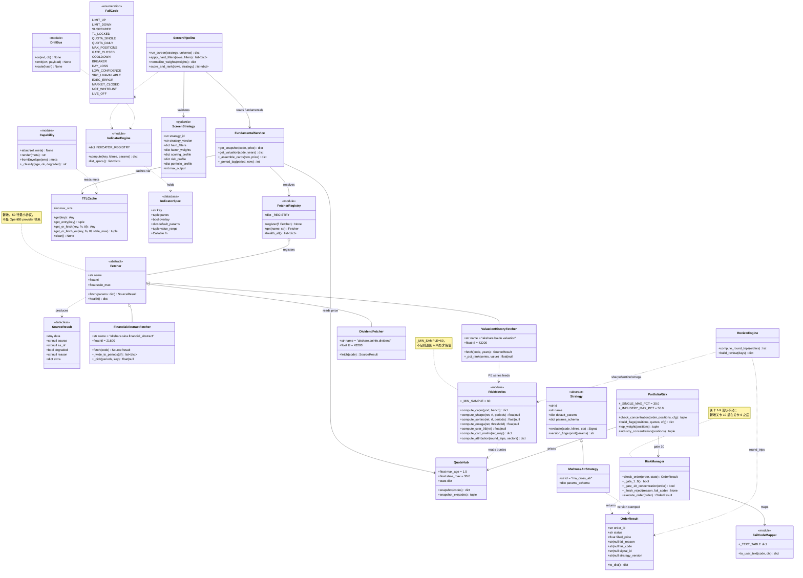
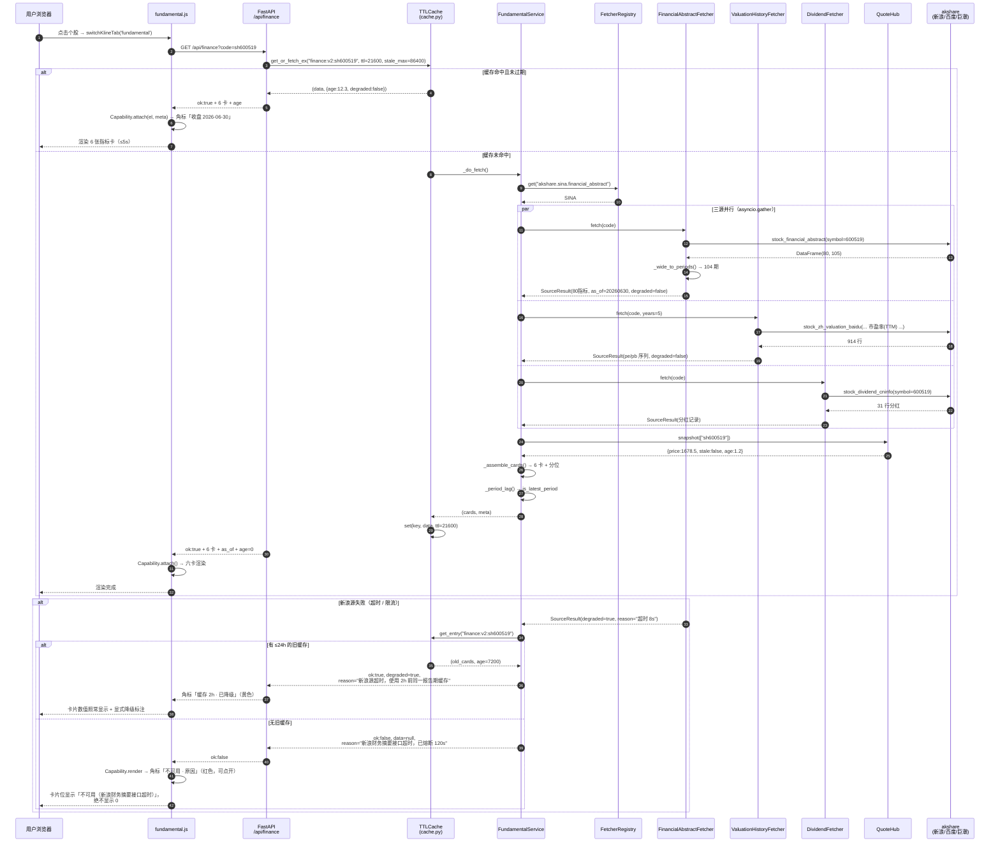
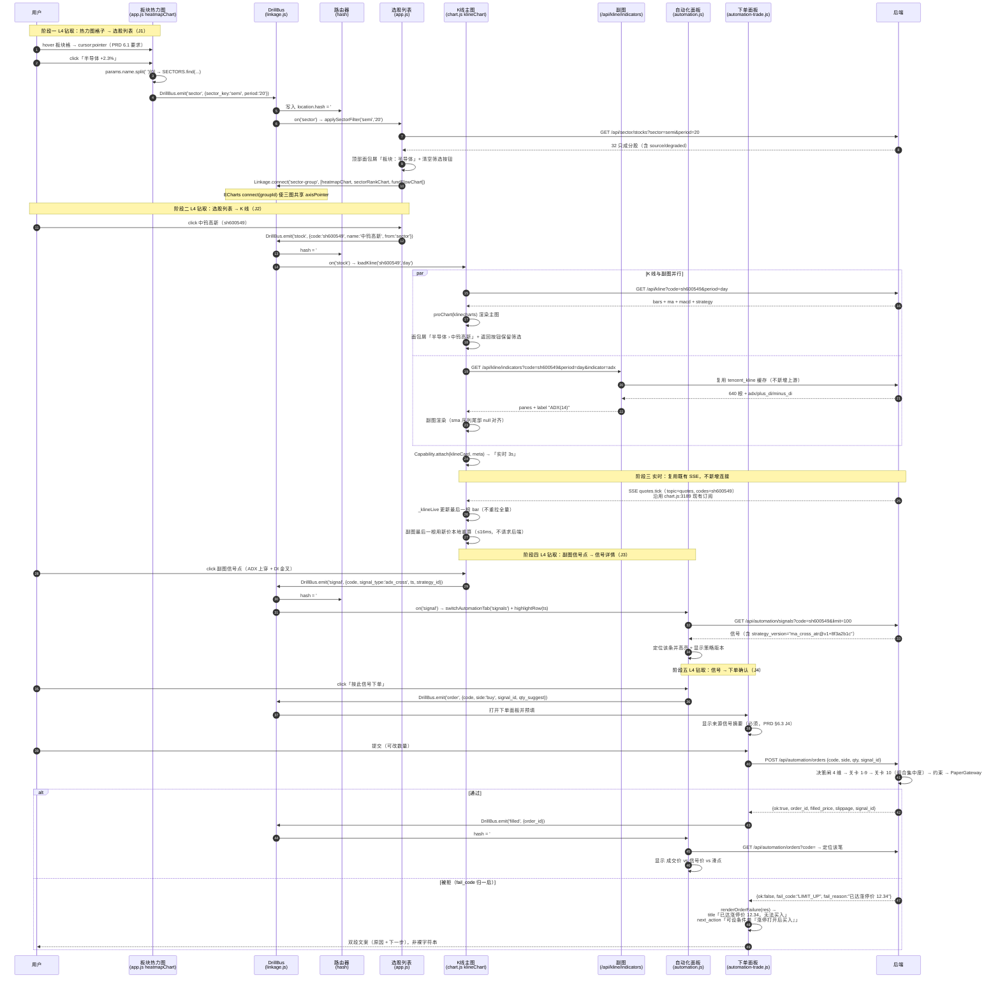

# OpenBB × DailyStockAnalysis 能力接入 — 系统设计与任务分解

- **文档类型**: 架构设计（设计文档，不含实现代码）
- **上游输入**: [`../20-prd/openbb-dsa-integration-prd.md`](../20-prd/openbb-dsa-integration-prd.md)（v1.0）
- **版本**: v1.3（2026-10-19）— ①并入全部五项决策（Q1 §1.5/§1.6、Q2 §2.6、Q3 T17、Q4 §8、Q5 §6.1 W3.5）；②对齐分时盘后点语义（§5.7）；③**按 T02 实际交付修订 §3.2**（ROE_TTM 口径与样例、全失败信封形状、缓存落点三层键、实测缺失样本）；④新增 §6.5 T02b 预热评估、§7.5 冷启动延迟、§7.6 已知缺陷补记。
- **配套实施清单**: [`impl-checklist-openbb-dsa.md`](./impl-checklist-openbb-dsa.md)（逐单派工用，含行号锚点 / 断言命令 / 禁碰文件 / 陷阱）
- **作者**: 高见远（Architect）
- **代码基线**: `dapeng-water/`，FastAPI 单服务 :8900
- **适用范围**: 本文是**设计**。不改变既有实现，不含实现代码，只给文件路径、函数签名、端点契约、JSON 示例。

---

## 0. 阅读前必读：三条我实测得到的、与 PRD 结论不同的事实

> 这三条直接改变了 P0-1 的设计与成本估算，也改变了「哪些缺口其实没那么难」的判断。PRD §10.2 的 U4 把这几条列为「未实跑，属实现期验证」——我已实跑，结论如下。

### 0.1 事实一：AkShare 内部**不是同质的**，东财系接口在本机 403

在服务实际使用的解释器（`%LOCALAPPDATA%\Programs\Python\Python311\python.exe`，装有 `numpy 2.4.4 / pandas 3.0.2 / akshare 1.18.59`）实测：

| 探测项 | 结果 |
|---|---|
| `https://qt.gtimg.cn/q=sh600519`（腾讯，我方主力源） | **200**，547 字节 ✅ |
| `https://push2.eastmoney.com/api/qt/stock/get?...`（东财） | **403**，159 字节 ❌ |
| `ak.stock_individual_info_em(symbol='600519')`（东财系） | **FAIL** `JSONDecodeError`（403 返回 HTML）❌ |
| `ak.stock_financial_abstract(symbol='600519')`（**新浪**系） | **OK**，`(80, 105)` —— 80 个指标 × 104 个报告期 ✅ |
| `ak.stock_zh_valuation_baidu(symbol='600519', indicator='市盈率(TTM)', period='近五年')`（**百度**系） | **OK**，914 行日频 PE_TTM ✅ |
| `ak.stock_zh_valuation_baidu(..., indicator='市净率', ...)` | **OK**，914 行日频 PB ✅ |
| `ak.stock_dividend_cninfo(symbol='600519')`（**巨潮**系） | **OK**，31 行分红记录 ✅ |
| `ak.stock_fhps_em(date='20251231')`（东财系分红） | **FAIL** `ChunkedEncodingError` ❌ |

**架构结论（硬约束）**：
> **P0-1 禁止使用 AkShare 的 `*_em` 系列接口。**必须显式选定新浪（`stock_financial_abstract`）、百度（`stock_zh_valuation_baidu`）、巨潮（`stock_dividend_cninfo`）三条非东财链路。
> 如果实现者按 PRD 字面「AkShare 已装，直连即可」去写 `stock_individual_info_em`，会得到一个和第 D1 条缺口**完全相同的失败**（`ok:false` + 全 null），只是把「westock 废弃」换成了「东财 403」。

这同时解释了现有 `server/stable_market_provider.py` 里为何存在 `push2_breaker_state()` —— 东财 push2 在本机长期不可用是有历史原因的，不是偶发。

### 0.2 事实二：一个端点就够 5/6 个财务指标，且自带 104 期历史

`stock_financial_abstract` 返回的宽表（行=指标，列=`选项|指标|20260630|20260331|...`）中，P0-1 要的 6 张卡所需字段**全部命中**：

| P0-1 要求的指标卡 | 数据来源 | 该宽表中的行 | 实测样例（600519, 20260630） |
|---|---|---|---|
| **ROE_TTM** | 新浪 | `常用指标 / 净资产收益率(ROE)` | `16.75` |
| **PB** | 百度 | `市净率` 日频序列末值 | `6.59`（2026-10-19） |
| **营收同比** | 新浪 | `成长能力 / 营业总收入增长率` | `1.300099` |
| **净利同比** | 新浪 | `成长能力 / 归属母公司净利润增长率` | `-1.951594` |
| **每股净资产** | 新浪 | `常用指标 / 每股净资产` | `200.989754` |
| **PE_TTM** | 百度 | `市盈率(TTM)` 日频序列末值 | （同日可取值） |
| **股息率** | 巨潮 | `派息比例 / 10 ÷ 现价` | `10派239.57元` |

**额外收获**：`stock_zh_valuation_baidu` 直接给了 **5 年 914 个交易日的 PE_TTM / PB 日频序列**。这意味着 PRD §4.2 的 **A5（估值分位）不必等到 P1**，而且 **D2（PE_TTM 历史序列）被直接解决**——它是 `Alpha_Value_EP` 因子 IC 的硬前置。
> 这**部分推翻** PRD §8-9 的提醒「P0-1 只解决当期财务字段，不自动解决历史序列」。实测：**历史序列一起解决了**，成本约 +0.5 人天。我会把它作为一个独立验收项塞进 P0-1（见 T02），但不承诺它自动让 qlib 的 IC 列变活（那需要改 `qlib_factor_engine.py` 的截面构造，属另一件事）。

### 0.3 事实三：`requirements.txt` 与实际运行环境**不一致**（现存技术债）

`requirements.txt` 里：

```
numpy>=1.26.0
...
# 以下为量化回测模块(quant_core.py)依赖，按需安装：
# pandas>=2.0.0
# ...
```

**`akshare` / `pandas` 根本没有出现在 `requirements.txt`**（`pandas` 是注释掉的）。实际能跑，是因为 `start_server.py` 的解释器候选列表里第 4 顺位命中了全局 `Python311`，而那台解释器恰好装了 `akshare 1.18.59 + pandas 3.0.2`。

**架构结论**：P0-1 落地时必须把 `akshare`、`pandas` 提升为 `requirements.txt` 的**显式硬依赖**并**锁上兼容上界**（建议 `pandas>=2.0,<3.1`、`akshare>=1.18,<2.0`）。否则换机部署会得到一个「代码全对但 import 失败」的环境。

---

## 1. 总体接入策略

### 1.1 一句话策略

> **移植纯计算算法，借鉴产品化契约，拒绝任何「系统级接入」。**
> 不装 `openbb` 包，不引 React/Plotly，不动交易侧主体，不新增需要外国 Key 的数据源。

### 1.2 三分法：移植 / 借设计 / 不采纳

| 处理方式 | 具体对象 | 落点 | 判定依据 |
|---|---|---|---|
| **移植算法**（复制实现思路，按我方风格重写） | OpenBB `technical` 的 12 类指标；`quantitative/metrics.capm`（β/R²/特质风险）；`quantitative/performance`（夏普/索提诺/Omega）；`quantitative/risk_decomposition`（简化版归因）；`multi/correlation_matrix` | `server/indicators.py`（新增）、`server/risk_metrics.py`（新增） | **纯函数，入参只有 OHLCV / 收益序列**，零外部依赖、零 provider、零网络。Apache-2.0，可安全移植，需在文件头保留 `Derived from OpenBB (Apache-2.0)` 归属 |
| **借设计**（照抄 schema / 契约 / 语义，不复制代码） | OpenBB `provider/abstract` 分层（**仅取 Fetcher 协议，50 行**）；DSA 选股 YAML schema；DSA `DecisionSignal` 八态契约；DSA 组合风险 6 旗标的「不可用」语义；DSA `market-support.md` 能力矩阵范式；DSA ETF 轮动边界规则 | `server/providers/base.py`、`server/screening/`、`server/trading/decision_gate.py`（改造）、`server/trading/portfolio_risk.py`（新增）、`docs/30-data/DATA-CAPABILITY-MATRIX.md` | 设计是**认知资产**，代码是**依赖负担**。借设计无许可证风险、无升级风险 |
| **不采纳** | OpenBB `openbb_charting`（Plotly + pywry）、`platform_api`、`mcp_server`、`economy`（FRED/OECD/IMF）；DSA `apps/dsa-web`（React）、`apps/dsa-desktop`（Electron）、16 个自然语言策略 YAML、多渠道路由推送、Agent 编排 | — | 换栈成本 >> 收益；或与我方已有能力重叠且更弱；或引入外国源 Key 管理负担 |

### 1.3 边界原则（四条硬边界，写进 code review checklist）

| # | 边界 | 具体禁止项 | 违反后果 |
|---|---|---|---|
| **B1** | **不新增需要外国 API Key 的数据源** | 禁 FRED / OECD / IMF / SEC / Nasdaq / Cboe / Deribit / CFTC / ECB / EIA / BLS / FINRA | 引入 Key 轮换、跨境合规、滞后口径三重负担，且 A 股场景收益近零 |
| **B2** | **不引入第二套前端框架或图表栈** | 禁 React / Vue / Plotly / pywry / Lightweight Charts 替换现有 ECharts + klinecharts | 现有 29,439 行 JS 全部锚定 ECharts/klinecharts，换栈=重写 |
| **B3** | **交易主体不动，只做增量** | 禁替换 `risk.py` 九关 ↔ `decision_gate.py` 四维闸；禁引入外部订单状态机；禁把下单权交给任何外部组件 | 我方交易层（9 关 + 四维闸 + 门禁四态 + 纸面网关 + 物理不可达实盘）是**唯一强于两家的部分**，改动即自毁护城河 |
| **B4** | **新代码必须挂在现有缓存与报价中枢上** | 禁自建 `asyncio` 连接池 / 自建 dict 缓存 / 每端点直连上游；必须走 `server/cache.py::cache.get_or_fetch`，实时价必须走 `server/quote_hub.py::QuoteHub.snapshot` | 现有 141 端点 / 13 分组靠「分层缓存 + single-flight」才没打爆上游。放开这条 = 上游限流 + 同标的多价 |

### 1.4 对 PM 两个结论的显式处理

**PM 结论①：OpenBB 无中国数据源，不能靠它解决 A 股数据。**
→ **完全接受，并把它升级为架构约束**：OpenBB 在本项目中**只作为算法参考实现**存在，不作为运行时依赖。财务数据走 §0.1 实测可行的三条 AkShare 非东财链路。这也意味着 **P0-1 与 OpenBB 无关** —— 它是「自建 Provider」，不是「接入 OpenBB」。

**PM 结论②：DSA 不做下单，交易侧仍以我方 9 关风控 + 四维决策闸为主体。**
→ **完全接受**，并且补一条：交易侧的改动只允许是**加关卡、加字段、加文案**，不允许**改流程**。具体到本期：
- 加：第 10 关「组合集中度」（`portfolio_risk.py`，在关卡 6 之后、关卡 7 之前插入）
- 加：`OrderResult.fail_code`（枚举字段，不改变 `fail_reason` 的自由文本兼容性）
- 加：`strategy_version`（记录字段，不参与决策）
- 不改：`check_order()` 的九关顺序语义、`decision_gate` 的 4 维权重默认值、`PaperGateway` 的即时全额成交行为

### 1.5 财务数据源：**已定稿 = AkShare 直连 + 预留薄 Provider 接口**

> **决策状态：已拍板（2026-10-19），本节为定稿，不再保留方案对比。**

**采用方案**：`server/fundamental.py` 直连 AkShare，前端接口 `/api/finance` 优先上线把全 null 治掉。

**同时预留一个薄接口**（**仅此而已，不引入完整 provider 体系、不引依赖注入框架**）：

```python
# server/providers/base.py —— 全文约 50 行，不装任何第三方抽象框架
@dataclass
class SourceResult:
    data: Any
    source: Optional[str] = None      # 如 "AkShare/新浪·财务摘要"
    as_of: Optional[str] = None       # 数据本身的时点（报告期 / 交易日）
    degraded: bool = False
    reason: Optional[str] = None

class Fetcher(ABC):
    name: str = ""
    ttl: float = 21600
    stale_max: float = 86400
    @abstractmethod
    async def fetch(self, **params) -> SourceResult: ...
```

**为什么薄接口必须留（两个硬理由，不是「为了将来」）**：
1. **P0-7 能力角标需要唯一事实源**。12 个区块的角标要回答「实时/缓存/收盘/不可用 + 原因」。若每个取数函数各自返回各自形状的 dict，前端要写 6 套判断；有了统一 `SourceResult`，角标只读 4 个字段。
2. **P1 加第二个源（如 Tushare 补北向/龙虎榜）时不再返工**。届时只需实现 1 个类，不改 `fundamental.py` 的聚合与卡片装配逻辑。

**明确不做**：`QueryParams` 体系、`Data` 模型继承树、provider registry 的插件发现机制、依赖注入容器。这些在「只有一个数据源」时是纯开销。

### 1.6 缺数纪律：**`null + reason`，禁止一切填充**（硬规则）

AkShare 取不到时**只允许**返回 `null` + `reason`。**明令禁止**以下四类"让页面好看"的做法：

| ❌ 禁止 | 具体形态 | 为什么禁止 |
|---|---|---|
| 行业均值回填 | PE 取不到 → 填行业中位数 | 用户会拿它做买卖决策，而它**不是这家公司的估值** |
| 历史推算/外插 | ROE 缺季 → 用前后季线性插值 | 财报是离散事件，插值点**从未发生** |
| 0 占位 | `pe_ttm: 0` | 0 是合法估值（几乎不可能但语义不同），会让「贵贱」判断彻底反向 |
| 默认值兜底 | `roe_ttm: 10.0`（"行业常态"） | 假数据比没数据危险一个量级 |

**唯一允许的降级**：使用**同一标的、同一报告期**的上一次成功缓存，且必须 `degraded:true` + 写明缓存年龄。跨报告期的旧值不得冒充当期。

**验收断言（写进单测）**：断网跑 `/api/finance`，6 张卡 `value` 必须全为 `null`，且每张卡 `reason` 非空；**全文 grep 不到任何数字型 fallback**。

### 1.7 我不认同的 PM 优先级判断（独立意见）

| # | PM 的判断 | 我的意见 | 理由 |
|---|---|---|---|
| 1 | **P0-3（12 类技术指标）列为 P0** | **同意是 P0，但建议前置到第一个交付** | 它是 7 项里**唯一零回归面**的（纯函数 + 纯新增端点 + 前端下拉多几项）。其他 6 项都触碰持仓/订单/配置主路径。先做它可以让「用户看到变化」和「团队建立信心」同时发生，且不占用回归窗口 |
| 2 | **P0-4（风险旗标）依赖 P0-1** | **依赖关系不成立，建议解耦** | PRD 写「P0-4 依赖 P0-1（价格源校验）」。但旗标要的是「价格是否可得/来源/是否陈旧」，这三个字段来自 **`QuoteHub`**（已存在，含 `stale`/`stale_age`/`reason`），与财务数据无关。把 P0-4 挂在 P0-1 后面会白白串行 5–8 人天。**P0-4 只需依赖 T01（缓存元信息）** |
| 3 | **P0-6 依赖 P0-5** | **同意，但两者应允许同一人连续做** | 两项都改 `automation.js` 同一区域，拆给两个人会产生合并冲突。建议 T05+T06 合并给同一工程师（作为 Wave B 一个工作包） |
| 4 | **A5（估值分位）判为 P1** | **建议提到 P0-1 范围内**（作为同一任务的加值项） | 实测成本 +0.5 人天（百度接口一次调用拿 914 天 PE/PB 序列）。降级到 P1 会让「PE_TTM = 18」这张卡在整个 P0 期间处于「有数字但无法判断贵贱」的半残状态 |
| 5 | **P1-4（钻取+跳转）列为 P1** | **同意列 P1，但要指出它是本期「用户原话」里权重最高的一条** | 用户原话「增强各功能模块之间的关联与跳转」在 P1-4 里，而 §3.1 的 Top 8 一条都不覆盖它（PRD §8-10 自己承认了）。若本期只交付 P0，用户会得到一个「指标变多但依然碎」的系统。**建议给出「P0 之后立刻做 P1-4」的排期承诺，而不是等到下一期重排** |

---

## 2. 需要新增 / 改造的模块清单

> 路径均为相对仓库根。`新增` 标记该文件当前不存在。

### 2.1 后端 — 数据层

| 模块路径 | 职责 | 对外接口 | 依赖 | 改造/新增 |
|---|---|---|---|---|
| `server/providers/base.py` | 最小 Fetcher 协议：统一数据源返回契约 | `@dataclass SourceResult(data, source, as_of, degraded, reason, extra)`；`class Fetcher(ABC): name, ttl, stale_max, async def fetch(params: dict) -> SourceResult`；`def register(fetcher)`；`def get_fetcher(name)` | 无 | **新增** |
| `server/providers/akshare_fundamental.py` | AkShare 财务/估值/分红三个 Fetcher（**显式禁用 `*_em`**） | `class FinancialAbstractFetcher(Fetcher)`、`class ValuationHistoryFetcher(Fetcher)`、`class DividendFetcher(Fetcher)` | `akshare`, `pandas`, `providers/base.py` | **新增** |
| `server/fundamental.py` | 财务基本面聚合服务：把 3 个 Fetcher 合成 6 卡 + 分位数 | `async def get_fundamental_snapshot(code: str, price: float \| None) -> dict`<br>`async def get_valuation_history(code: str, years: int = 5) -> dict`<br>`def _pct_rank(series: list[float], value: float) -> float \| None` | `providers/*`, `cache.py`, `quote_hub.py`, `config.py` | **新增** |
| `server/ak_market.py` | 复用现有 `AkShareDataHub`（宏观/资金/公告），不改 | — | — | 不动（仅确认不冲突） |

### 2.2 后端 — 指标与风险层

| 模块路径 | 职责 | 对外接口 | 依赖 | 改造/新增 |
|---|---|---|---|---|
| `server/indicators.py` | 12 类技术指标纯函数（移植 OpenBB technical） | `compute_adx(klines, period=14) -> dict`<br>`compute_di(klines, period=14) -> dict`<br>`compute_aroon(klines, period=25) -> dict`<br>`compute_choppiness(klines, period=14) -> dict`<br>`compute_supertrend(klines, period=10, mult=3.0) -> dict`<br>`compute_ichimoku(klines, tenkan=9, kijun=26, senkou=52) -> dict`<br>`compute_donchian(klines, period=20) -> dict`<br>`compute_kc(klines, period=20, mult=2.0) -> dict`<br>`compute_vwap(klines) -> dict`<br>`compute_obv(klines) -> dict`<br>`compute_mfi(klines, period=14) -> dict`<br>`compute_williams_r(klines, period=14) -> dict`<br>`INDICATOR_REGISTRY: dict[str, IndicatorSpec]` | `numpy`（仅复用 `strategies.py` 已有的 `_extract_*` 工具，不反向 import） | **新增** |
| `server/risk_metrics.py` | 组合级风险与绩效：β/R²/特质风险、夏普/索提诺/Omega、相关矩阵、简化归因 | `compute_capm(port_ret: np.ndarray, bench_ret: np.ndarray) -> dict`<br>`compute_sharpe(returns, rf=0.0, periods=252) -> float \| None`<br>`compute_sortino(returns, rf=0.0, periods=252) -> float \| None`<br>`compute_omega(returns, threshold=0.0) -> float \| None`<br>`compute_cvar_95(returns) -> float \| None`<br>`compute_corr_matrix(ret_map: dict[str, np.ndarray]) -> dict`<br>`compute_attribution(round_trips, sectors) -> dict` | `numpy` | **新增** |

### 2.3 后端 — 选股 / 风控 / 交易层

| 模块路径 | 职责 | 对外接口 | 依赖 | 改造/新增 |
|---|---|---|---|---|
| `server/screening/__init__.py` | 声明式选股包 | — | — | **新增**（P1-1） |
| `server/screening/schema.py` | YAML/JSON 策略 schema 定义与校验（借 DSA schema） | `class ScreenStrategy(BaseModel)`；`def validate(raw: dict) -> tuple[ScreenStrategy, list[str]]`；`FACTOR_KEYS: tuple[str,...]`；`HARD_FILTER_KEYS: tuple[str,...]` | `pydantic`（FastAPI 已带） | **新增**（P1-1） |
| `server/screening/pipeline.py` | 9 硬过滤 → 8 因子打分 → 归一化 → 排序 → 输出 | `async def run_screen(strategy: ScreenStrategy, universe: list[dict]) -> dict`<br>`def normalize_weights(w: dict[str,float]) -> dict[str,float]` | `screening/schema.py`, `fundamental.py`, `strategies.py` | **新增**（P1-1） |
| `server/trading/portfolio_risk.py` | 第 10 关组合集中度 + 6 项风险旗标 + 暴露聚合 | `async def check_concentration(order, positions, cfg) -> tuple[bool, str \| None, dict]`<br>`async def build_flags(positions, quotes, cfg) -> dict`<br>`def top_weight(positions) -> tuple[float \| None, list]` | `trading/store.py`, `quote_hub.py` | **新增** |
| `server/trading/fail_codes.py` | 9 类 `fail_code` 枚举 + 中文文案 + 下一步建议映射 | `class FailCode(str, Enum)`（`LIMIT_UP/LIMIT_DOWN/SUSPENDED/T1_LOCKED/QUOTA_SINGLE/QUOTA_DAILY/MAX_POSITIONS/GATE_CLOSED/COOLDOWN/BREAKER/DAY_LOSS/LOW_CONFIDENCE/SRC_UNAVAILABLE/EXEC_ERROR/MARKET_CLOSED/NOT_WHITELIST/LIVE_OFF`）<br>`def to_user_text(code: FailCode, ctx: dict) -> dict` → `{code, title, reason, next_action}` | 无 | **新增** |
| `server/trading/risk.py` | 插入第 10 关；`_finish_reject` 改为同时写 `fail_code` | 改 `check_order()`（在关卡 6 后插 `await check_concentration(...)`）；`_finish_reject(reason, code)` | `portfolio_risk.py`, `fail_codes.py` | **改造** |
| `server/trading/constraints.py` | `check_price_limit` / `is_suspended` 返回值改为返回 `(code, detail)` 或原字符串兼容 | `check_price_limit(...) -> tuple[str \| None, FailCode \| None]`（保持向后兼容：新增可选 `with_code=True`） | `fail_codes.py` | **改造** |
| `server/trading/models.py` | `OrderResult` 加 `fail_code`；`Signal` 加 `strategy_version` | `OrderResult.fail_code: Optional[str] = None`（`to_dict()` 同步） | — | **改造** |
| `server/trading/strategies/base.py` | 加 `params_schema` 抽象与 `version_fingerprint()` | `params_schema: dict[str, ParamSpec] = {}`；`def version_fingerprint(self, params) -> str`（格式 `<id>@v<n>+<params_hash8>`） | — | **改造** |
| `server/trading/strategies/*.py`（5 个） | 每个策略补 `params_schema`（类型/范围/单位/默认/说明） | `params_schema = {"fast": ParamSpec(int, 2, 60, "日", 5, "快线周期"), ...}` | `base.py` | **改造** |
| `server/trading/store.py` | `signals` / `orders` 表加 `strategy_version` 列 + 迁移 | `ALTER TABLE ... ADD COLUMN IF NOT EXISTS`（幂等迁移） | — | **改造** |

### 2.4 后端 — 路由层

| 模块路径 | 职责 | 对外接口 | 依赖 | 改造/新增 |
|---|---|---|---|---|
| `server/routers/market_data.py` | `/finance` 重建（走 `fundamental.py`）；新增 `/finance/valuation` | `GET /api/finance?code=`（改造）<br>`GET /api/finance/valuation?code=&years=5`（新增） | `fundamental.py` | **改造 + 新增端点** |
| `server/routers/kline.py` | 新增独立指标端点（**不把 12 指标塞进 `/api/kline`**） | `GET /api/kline/indicators?code=&period=day&indicator=adx&params=14` | `indicators.py` | **改造（新增端点）** |
| `server/routers/automation.py` | `/positions` 加 `risk` + `price_*`；`/config` 加 `params_schema`；`/orders`·`/signals` 加 `fail_code`/`strategy_version`；新增 `/review/metrics`、`/attribution` | 见 §3 | `risk_metrics.py`, `portfolio_risk.py` | **改造** |
| `server/routers/risk.py` | 组合风险独立视图（β/R²/分位） | `GET /api/risk/portfolio?benchmark=sh000300` | `risk_metrics.py` | **新增** |
| `server/routers/meta.py` | 统一能力元信息（角标事实源）+ 数据源健康 | `GET /api/meta/capability?keys=finance,positions,kline` | `cache.py`, `quote_hub.py` | **新增** |
| `server/routers/screening.py` | 声明式选股 | `GET/POST /api/screening/strategy`、`POST /api/screening/run` | `screening/*` | **新增**（P1-1） |
| `server/routers/etf.py` | ETF 双动量轮动 | `GET /api/etf/rotation?top=2&lookback=20` | `etf_rotation.py` | **新增**（P1-3） |
| `server/cache.py` | 增加带元信息的读取（角标必需） | `def get_entry(key) -> tuple[Any, float, float] \| None`（data, ts, age）；`async def get_or_fetch_ex(key, fn, ttl, stale_max) -> tuple[Any, dict]` | 无 | **改造** |
| `server/config.py` | 新增 TTL 常量与特性开关 | `CACHE_TTL_FUNDAMENTAL=21600`、`CACHE_TTL_VALUATION=43200`、`CACHE_TTL_INDICATORS=300`、`CACHE_TTL_PORTFOLIO_RISK=60`；`FEATURE_FLAGS: dict[str,bool]` | — | **改造** |

### 2.5 前端

| 模块路径 | 职责 | 对外接口 | 依赖 | 改造/新增 |
|---|---|---|---|---|
| `static/js/capability.js` | **能力角标统一组件**（12 区块唯一渲染入口）+ 状态机 | `Capability.attach(el, meta)`；`Capability.render(meta) -> string`；`Capability.fromEnvelope(env) -> meta` | 无 | **新增** |
| `static/js/fundamental.js` | 个股基本面 6 卡 + 估值分位条 | `renderFundamental(code)`；`renderValuationBar(code)` | `api.js`, `capability.js` | **新增** |
| `static/js/linkage.js` | L4 钻取事件总线 + L5 ECharts `connect` 分组 + hash 路由 | `DrillBus.on/emit`；`Linkage.connect(groupId, [chartInstances])`；`Linkage.route('#/stock/<code>?from=&tab=')` | `echarts` | **新增**（P1-4） |
| `static/js/chart.js` | 副图 12 指标渲染与切换；能力角标挂载 | 扩展 `window._indicatorConfig.subIndicator` 枚举；`window.setSubIndicator(type)`；新增 `_renderExtraSubIndicator(data)` | `indicators` 端点 | **改造**（bump `?v=33`→`?v=34`） |
| `static/js/app.js` | 板块热力图/资金流/排行 L4 点击 + L5 connect 分组 | `heatmapChart.on('click')` 扩展（现 `app.js:3888`）；新增 `_registerLinkage()` | `linkage.js` | **改造**（bump `?v=36`→`?v=37`） |
| `static/js/automation.js` | 持仓 6 旗标 + 复盘 7 指标条 + 策略参数表单 + fail_code 文案 | `renderRiskFlags(flags)`；`renderReviewMetrics(m)`；`renderStrategyForm(schema)`；`renderFailCode(fc)` | `capability.js` | **改造**（bump `?v=8`→`?v=9`） |
| `static/js/automation-trade.js` | 下单表单按 `fail_code` 渲染「原因 + 下一步」 | `renderOrderFailure(res)` | — | **改造**（bump `?v=3`→`?v=4`） |
| `static/dashboard.html` | 引入新 JS、个股详情加「基本面」区、持仓 Tab 加旗标条容器 | 新增 `<script src="js/capability.js?v=1">` 等；新增 `#fundamental-block`、`#risk-flag-bar`、`#valuation-bar` | — | **改造** |

> ⚠️ **前端版本号规则（跨页一致）**：`dashboard.html` 第 1328–1344 行集中声明 15 个 `<script src="js/*.js?v=N">`。任何被修改的 JS 必须在其引用处 bump `?v=`，且若 `index.html` / `sentiment.html` / `quant.html` / `admin.html` 也引用了同一文件，必须**同步 bump**。当前引用清单见附表 A。

### 2.6 交易侧行为变更（Q2 定稿：熔断只拦买入方向）

> **决策状态：已拍板。熔断与日亏熔断统一为「只拦买入」，卖出/减仓/平仓一律放行。**

#### 2.6.1 现状核实（我已逐行读过 `server/trading/risk.py`）

| 关卡 | 位置 | 现状 | 是否分 side | 定稿要求 |
|---|---|---|---|---|
| 关卡 7 `breaker` | `risk.py:353-358` | `gate7_ok = not state.breaker_tripped` | **否（缺陷）** | **改为只拦 `buy`** |
| 关卡 8 `daily_loss` | `risk.py:360-371` | `gate8_ok = not (day_loss_hit and order.side == "buy")` | 是 ✅ | 保持不动（已是正确语义） |
| 关卡 2 `master_switch` | `risk.py:299-307` | 总开关 | 否 | **保持拦所有方向** |
| 关卡 3 `whitelist` | `risk.py:309-315` | 白名单 | 否 | **保持拦所有方向** |

**关键语义区分（必须写进代码注释与审计文案）**：

- **关卡 2 / 3 是「不该交易这个标的」**（账户层面不允许 / 标的不在白名单）→ 拦所有方向。此时**卖出一个不在白名单的既有持仓**也会被拒 —— 这是可接受的，因为白名单为空时系统本就「只提醒不下单」，不会产生持仓。
- **关卡 7 / 8 是「该止血了」**（连续失败 / 当日已亏到线）→ **只拦开新仓**。禁止平仓会在极端行情把已有持仓锁死，与风控本意完全相反。

#### 2.6.2 改法（关卡 7）

```python
# server/trading/risk.py  关卡 7（改造后）
# 熔断语义：只阻断「开新仓」；减仓/平仓放行 —— 否则极端行情下用户被锁死，
# 与风控目的（止损、阻断失控）相反。
breaker_hit = bool(state.breaker_tripped)
gate7_ok = not (breaker_hit and order.side == "buy")
checks["7_breaker"] = {
    "pass": gate7_ok,
    "tripped": breaker_hit,
    "side": order.side,
    "reduced_only": breaker_hit and order.side != "buy",   # 标记：熔断中仅放行减仓
    "consecutive_failures": state.consecutive_failures,
}
if not gate7_ok:
    return await self._finish_reject(
        result, checks, "7_breaker",
        f"连败熔断已触发（{state.breaker_tripped_at}），熔断期间暂停开新仓，"
        f"减仓/平仓不受限；须人工复位")
```

#### 2.6.3 审计区分（复盘必需）

现有 `_store.audit(category, action, payload, result=...)`（`store.py:589`）。定稿要求 **两种结果必须落不同 `action`，不能混为一条**：

| 场景 | category | action | result | payload 关键字段 |
|---|---|---|---|---|
| 熔断中拒绝**开仓** | `risk` | `order_rejected` | `denied` | `gate:"7_breaker"`, `side:"buy"`, `fail_code:"BREAKER"` |
| 熔断中**放行减仓** | `risk` | **`breaker_reduce_allowed`**（新增 action） | `allowed` | `gate:"7_breaker"`, `side:"sell"`, `tripped_at`, `consecutive_failures`, `code`, `qty` |

**为什么必须分开记**：复盘时要能回答两个不同问题 ——「熔断期间我有没有继续加仓」（看 `order_rejected`）与「熔断期间我有没有成功减仓止损」（看 `breaker_reduce_allowed`）。混在一条里会导致复盘引擎把「成功减仓」误算成「被拒单」。

**落点**：`server/trading/risk.py` 在关卡 7 通过且 `breaker_hit and order.side != "buy"` 时，补一条 `audit("risk", "breaker_reduce_allowed", {...}, result="allowed")`。注意**不要**在每次卖出都写 —— 只在熔断期间写，否则审计表会被正常卖出淹没。

**对 `/api/automation/audit` 的影响**：新增 action 值需在前端筛选下拉中注册（`automation.js` 的 audit 筛选项），否则「留痕」页按 action 筛选时看不到这类记录。

#### 2.6.4 与 `fail_code` 的关系

`gate7` 拒绝 → `fail_code = "BREAKER"`（对应 `FailCode.BREAKER`，见 §2.3）。放行减仓**不是失败**，不产生 `fail_code`，只在审计中留 `breaker_reduce_allowed`。

#### 2.6.5 统计口径隔离（**主理人要求，但机制与他预想的不同，必须按实际代码来**）

主理人要求「`breaker_reduce_allowed` 在 `/decision-quality` 与复盘归因里显式排除」。我核了代码，**排除的对象要换个位置**，否则会排错地方：

**实际机制（`review_engine.py:337-394` `score_decisions`）**：
- `decision_quality` 的样本来源是 **`orders` 表**（`store.list_orders(limit=10000)`），**不是 `audit_log`**。所以 `breaker_reduce_allowed` 作为**纯 audit action**，**天然不会**流进 decision_quality —— 不需要额外排除。
- **真正的污染点是两处，都在 orders 层面**：

| # | 真实风险 | 位置 | 处置 |
|---|---|---|---|
| **P1** | 熔断放行减仓时，若顺手 `insert_order` 了一条「已放行」记录，会与**真实成交**那条重复计数（同一笔卖出现在 orders 两行） | `risk.py:186/194/202/219` 的 `insert_order` 调用点 | **硬规则：关卡 7 的放行路径只写 `audit`，绝不 `insert_order`。** 订单行仍由网关成交后统一落（`:219`），即"一笔交易一行" |
| **P2** | **既存缺陷，比 P1 更严重**：`score_decisions` 对**所有** `decision_json` 订单（含 `side="sell"`）一律按 `latest_close/ref-1` 打 `good/bad`。一笔**风控止损卖出**（亏损出局）会被判 `bad`，从而**拉低"决策质量"**——但它恰恰是**正确的风控动作**。加了熔断减仓后这类样本会变多 | `review_engine.py:377` `if allow: verdict = "good" if ret > 0 ...` | **T06 顺手修**：`score_decisions` 跳过 `exit_reason ∈ {fixed_stop, trailing_stop, take_profit, drill_forced, breaker_reduce}` 的订单 —— 因为 `decision_quality` 度量的是**入场决策**质量（详见该函数 docstring 口径），风控退出不属于选股判断。**只统计 `exit_reason is None` 的买单 + `signal` 卖单** |

**三条可复制断言（T06 验收用）**：
```bash
# ⑧-1 熔断放行减仓不产生订单行（只产生 audit）
sqlite3 data/trading.db "SELECT COUNT(*) FROM orders WHERE exit_reason='breaker_reduce';"
# 期望：0（若 >0 说明违反"只写 audit 不 insert_order"）

# ⑧-2 decision_quality 中不含风控退出样本
curl -s 'http://127.0.0.1:8900/api/automation/decision-quality?limit=500' \
  | python -c "import sys,json; d=json.load(sys.stdin)['data']['items']; \
bad=[x for x in d if (x.get('verdict_reason') or '').startswith('breaker')]; \
print('暴漏条数', len(bad))"
# 期望：暴漏条数 0

# ⑧-3 breaker_reduce_allowed 只出现在 audit，且 action 筛选可命中
curl -s 'http://127.0.0.1:8900/api/automation/audit?action=breaker_reduce_allowed' \
  | python -c "import sys,json; d=json.load(sys.stdin)['data']; print('total', d['total'])"
# 期望：≥0 且不报 422/500（说明 action 已注册可筛）
```

> **为什么 P2 必须在 T06 一并修**：这不是"新引入的问题"，而是**既有口径缺陷**。若不修，本期新增的熔断减仓会把"风控做对了"记成"选股做错了"，复盘指标（胜率、决策质量）会朝**反方向**漂移 —— 而这恰好是 P0-2 想让用户看清的东西。修它只需在 `score_decisions` 的循环里加一个 `if o.get("exit_reason") in _RISK_EXITS: continue`，约 5 行，不加人天。

---

## 3. 数据接口契约

### 3.1 统一响应信封（沿用现状 + 新增元字段）

现状：`{ok, data, message}` 三键。本期**不破坏**它，只在 `ok:true` 的响应里**并行**追加 4 个元字段（不嵌套，避免前端大改）：

```json
{
  "ok": true,
  "data": { "...": "..." },
  "message": "ok",
  "source": "AkShare/新浪·财务摘要",
  "as_of": "2026-06-30T00:00:00+08:00",
  "age": 12.3,
  "degraded": false,
  "reason": null
}
```

失败/不可用时（**绝不返回 0 冒充**）：

```json
{
  "ok": false,
  "data": null,
  "message": "数据源不可用",
  "source": "AkShare/新浪·财务摘要",
  "as_of": null,
  "age": null,
  "degraded": true,
  "reason": "akshare 调用超时（8s），已熔断 120s；上次成功 2026-10-18 15:02"
}
```

`source` / `as_of` / `age` / `degraded` / `reason` 四元组 + `ok` 就是**能力角标状态机的全部输入**。前端不猜。

### 3.2 `GET /api/finance`（**改造**，P0-1 主体）

> **本节已于 v1.3 按 T02 实际交付修订**（三处设计与实现不一致：ROE 口径样例、全失败信封形状、缓存落点）。样例值来自 2026-10-19 对 `sh600519` 的**实跑**，不是设计推演。

- **入参**：`code`（必填，如 `sh600519` / `600519` / `600519.SH`）、`type`（可选，仅作兼容回显，不参与取数）
- **缓存（**实际实现**，与我 v1.0 的设计不同）**：**没有快照级 `finance:v2:{code}` 键**。缓存在 **Fetcher 层**，三源各自独立键（`server/providers/akshare_fundamental.py`）：
  | 键 | 内容 | TTL |
  |---|---|---|
  | `akfund:v1:abstract:{symbol}` | 新浪财务宽表 | `CACHE_TTL_FINANCE_STATEMENT`=21600s |
  | `akfund:v1:valuation:{symbol}:{period_label}:{key}` | 百度单指标序列（`key` = `pe_ttm`/`pb`） | `CACHE_TTL_VALUATION`=43200s |
  | `akfund:v1:dividend:{symbol}` | 巨潮分红记录 | `CACHE_TTL_DIVIDEND`=43200s |
  | **负缓存** | 取数失败也写一条，`NEGATIVE_TTL=120s` | 120s（`akshare_fundamental.py:45`） |
  - **为什么这样更好**：单卡失败不会拖垮整体缓存 —— PE 挂了不影响 ROE 命中缓存。快照级缓存会把"1 卡失败"放大成"6 卡全重算"。
  - **负缓存 120s 的含义**：失败后 2 分钟内重试会直接拿负缓存（不再打上游），这是防雪崩，不是"不重试"。
- **降级链**：新浪/百度/巨潮三源并行（受 `MAX_CONCURRENT_UPSTREAM=2` 闸门约束）→ 任一源失败则**该源对应卡** `null + reason`，其余卡正常 → 全部失败则 `ok:false` 但**仍返回 6 张 null 卡**（见 §3.2.2）。**无东财兜底**（本机 403）

**响应示例（成功）**：

```json
{
  "ok": true,
  "message": "ok",
  "source": "AkShare/新浪·财务摘要 + AkShare/百度·估值 + AkShare/巨潮·分红",
  "as_of": "2026-06-30T00:00:00+08:00",
  "age": 0.0,
  "degraded": false,
  "reason": null,
  "data": {
    "code": "sh600519",
    "symbol": "600519.SH",
    "name": "贵州茅台",
    "report_period": "20260630",
    "report_period_label": "2026 中报",
    "report_period_quarter": "2026Q2",
    "is_latest_period": true,
    "latest_period_is_stale": false,
    "period_lag_quarters": 1,
    "period_quarters_elapsed": 1,
    "cards": {
      "pe_ttm": {
        "value": 20.34, "unit": "倍", "source": "AkShare/百度·估值·市盈率(TTM)",
        "as_of": "2026-10-19", "degraded": false, "reason": null,
        "percentile_5y": 35.8,
        "formula": "市盈率(TTM) 日频序列末值；分位=pe_ttm 在近 5 年序列中的百分位",
        "extra": { "sample": 914, "window_start": "2021-10-19", "window_end": "2026-10-19" }
      },
      "pb": {
        "value": 6.59, "unit": "倍", "source": "AkShare/百度·估值·市净率",
        "as_of": "2026-10-19", "degraded": false, "reason": null,
        "percentile_5y": 12.5,
        "formula": "市净率 日频序列末值；分位=pb 在近 5 年序列中的百分位",
        "extra": { "sample": 914, "window_start": "2021-10-19", "window_end": "2026-10-19" }
      },
      "roe_ttm": {
        "value": 32.3648, "unit": "%", "source": "AkShare/新浪·财务摘要",
        "as_of": "2026-06-30", "degraded": false, "reason": null,
        "formula": "EPS_TTM（滚动 4 季）/ 最新每股净资产 × 100",
        "extra": { "eps_ttm": 65.06, "roe_reported": 16.75 }
      },
      "revenue_yoy": {
        "value": 1.3001, "unit": "%", "source": "AkShare/新浪·财务摘要",
        "as_of": "2026-06-30", "degraded": false, "reason": null,
        "formula": "财报原值（营业总收入增长率，报告期同比口径，未做 TTM 重构）"
      },
      "profit_yoy": {
        "value": -1.9516, "unit": "%", "source": "AkShare/新浪·财务摘要",
        "as_of": "2026-06-30", "degraded": false, "reason": null,
        "formula": "财报原值（归属母公司净利润增长率，报告期同比口径，未做 TTM 重构）"
      },
      "dividend_yield": {
        "value": 3.9232, "unit": "%", "source": "AkShare/巨潮·分红 + 现价",
        "as_of": "2026-06-26", "degraded": false, "reason": null,
        "formula": "Σ 近 12 个月已除权现金分红（元/股）÷ 现价 × 100",
        "extra": { "per_share_ttm": 65.87, "dividend_count_ttm": 2, "price": 1678.5 }
      }
    },
    "availability": {
      "available": ["pe_ttm","pb","roe_ttm","revenue_yoy","profit_yoy","dividend_yield"],
      "missing": [], "available_count": 6, "total": 6
    },
    "ttm": {
      "basis": "滚动 4 季聚合（累计值差分，任一季度缺失则整体置 null，不插值）",
      "revenue_ttm": 174188000000.0,
      "net_profit_ttm": 82600000000.0
    }
  }
}
```

> **⚠️ 三个口径陷阱（QA 与前端最容易判错的地方）**
>
> 1. **`roe_ttm` ≠ 财报里的 `净资产收益率(ROE)`**。
>    茅台上表 `roe_ttm = 32.3648`，而财报原值 `16.75` 是 **2026 中报 H1 累计 ROE**（半年口径）。按已定的「滚动 4 季」口径，TTM 值约为 H1 的两倍，与 2025 年报同口径 `32.53` 自洽。
>    **原值通过 `cards.roe_ttm.extra.roe_reported = 16.75` 并列透出**，两种口径都可查。
>    **❌ QA 断言禁用 `16.75`** —— 那是 H1 累计值，不是 TTM。
> 2. **`revenue_yoy` / `profit_yoy` 不是 TTM**。它们的 `formula` 明写「财报原值，报告期同比口径，**未做 TTM 重构**」。只有 `roe_ttm` 走滚动 4 季。**不要假设 6 卡口径统一。**
> 3. **样例数值会随时点漂移**（PE/PB/股息率含现价）。断言只能校验**结构与非空**，不能校验具体数值。上表数值取自 2026-10-19 实跑，仅作结构示例。

**响应示例（部分不可用 —— 关键：`ok` 仍为 `true`）**：

```json
{
  "ok": true,
  "message": "部分指标不可用",
  "source": "AkShare/新浪·财务摘要 + AkShare/百度·估值",
  "as_of": "2026-06-30T00:00:00+08:00",
  "age": 3.1,
  "degraded": true,
  "reason": "1/6 项不可用：dividend_yield",
  "data": {
    "code": "sz002456", "name": "欧菲光", "report_period": "20260630",
    "cards": {
      "roe_ttm": { "value": 4.12, "unit": "%", "source": "AkShare/新浪·财务摘要", "degraded": false, "reason": null },
      "dividend_yield": {
        "value": null, "unit": "%", "source": "AkShare/巨潮·分红", "degraded": true,
        "reason": "近 12 个月（2025-10-19 ~ 2026-10-19）无已除权现金分红记录，该口径下股息率不可计算"
      }
    },
    "availability": { "available": ["pe_ttm","pb","roe_ttm","revenue_yoy","profit_yoy"], "missing": ["dividend_yield"], "available_count": 5, "total": 6 }
  }
}
```

### 3.2.1 实测的「部分缺失 / 全缺失」样本（**替换 PRD 的错误假设**）

| 场景 | 标的 | 实况 | 归因 |
|---|---|---|---|
| 正常 6/6 | `sh600519` | 6 卡齐全 | — |
| **股息率缺失** | `sz002456`（欧菲光） | 5/6，`dividend_yield=null` | 近 12 个月无已除权现金分红记录 |
| **全缺失** | `bj430047`（北交所） | 0/6，`ok:false` | 北交所标的不在三源覆盖范围 |
| ~~百度无覆盖~~ | ~~`sz000001`（平安银行）~~ | **实测百度有覆盖，914 条 PE+PB** | **PRD 的「百度无覆盖」假设不成立** —— 不要再拿平安银行当缺失样本 |

### 3.2.2 6 卡全部不可用时的信封（**与 v1.0 设计不同，以此为准**）

v1.0 设计写的是「全失败 → `data:null`」。**实际实现不是这样**，且实际做法更好：

```json
{
  "ok": false,
  "message": "数据源不可用",
  "source": null,
  "as_of": null,
  "age": null,
  "degraded": true,
  "reason": "6/6 项不可用：AkShare/新浪·财务摘要、AkShare/百度·估值、AkShare/巨潮·分红 均不可用；首个原因：新浪财务摘要调用超时（8s 未返回）",
  "data": {
    "code": "bj430047",
    "cards": {
      "pe_ttm":         { "value": null, "reason": "百度估值接口返回空序列（该标的不在覆盖范围）" },
      "pb":             { "value": null, "reason": "同上" },
      "roe_ttm":        { "value": null, "reason": "新浪财务摘要未返回该标的报告期" },
      "revenue_yoy":    { "value": null, "reason": "同上" },
      "profit_yoy":     { "value": null, "reason": "同上" },
      "dividend_yield": { "value": null, "reason": "无分红记录" }
    },
    "availability": { "available": [], "missing": ["pe_ttm","pb","roe_ttm","revenue_yoy","profit_yoy","dividend_yield"], "available_count": 0, "total": 6 }
  }
}
```

**为什么 `ok:false` 时仍返回 `data.cards`（6 张 null 卡）**：
1. 前端能**稳定渲染 6 块「不可用 + 各自原因」**，而不是整块白屏 —— 用户至少知道「6 个指标都不行」，而不是「页面坏了」。
2. 每张卡的原因**不同**（PE 是百度无覆盖、ROE 是新浪无报告期），塞进一个 `data:null` 就丢失了这些信息。
3. 信封级 `reason` 只写「哪个源不可用 + 首个原因」（截断），**逐卡细节留在 `data.cards[*].reason`**，不重复堆叠。

> **前端契约（已同步 T09）**：`ok:false && data.cards` 非空时，**必须**渲染 6 张卡并显示各自 reason；**不得**因 `ok:false` 直接显示整页错误。

> **纪律**：`ok:true` 只表示「请求被正确处理」，不表示「所有字段都有值」。字段级 `value:null + reason` 是唯一合法表达缺失的方式。**禁止 `value:0`。**

### 3.3 `GET /api/finance/valuation`（**新增**）

- **入参**：`code`（必填）、`years`（1–10，默认 5）、`indicators`（逗号分隔，默认 `pe_ttm,pb`）
- **缓存**：`ttl=CACHE_TTL_VALUATION=43200s`（12h，日频序列盘中不变）
- **降级链**：百度 → 上次缓存（≤48h）→ `ok:false`
- **响应**：`data.series = { "pe_ttm": [{"date":"2021-10-19","value":46.70}, ...], "pb": [...] }`，`data.percentile = {"pe_ttm": {"p10":..., "p50":..., "p90":..., "current_pct":38.2}}`
- **用途**：P0-1 卡片内的分位条；同时**为 `Alpha_Value_EP` 提供 PE_TTM 历史序列**（解决 D2）

### 3.4 `GET /api/kline/indicators`（**新增**，P0-3 主体）

**为什么独立端点而不是塞进 `/api/kline`**：`/api/kline` 现在每次都同步计算 6 组指标（`compute_ma/macd/ma_cross/atr/strategy/rsi`），已是热点路径；12 组序列全塞进去会让**每个不看副图的用户**都付 12 组的 CPU。独立端点 = 按需 + 独立缓存键。

- **入参**：`code`（必填）、`period`（`day|week|month|min|5|15|30|60`，默认 `day`）、`indicator`（必填，枚举 12 项 + 可选 `all`）、`params`（可选，格式 `"14"` 或 `"10,3.0"`）
- **缓存**：`ttl=CACHE_TTL_INDICATORS=300s`；缓存键 `ind:{code}:{period}:{indicator}:{params}`
  - 说明：日 K 收盘后序列不变，但**盘中最后一根在动**；300s 是「副图不需要秒级」与「盘中不能太旧」的折中。SSE `quotes` tick 只更新最后一根，由前端本地重算（见 §5.4）而非重新请求
- **降级**：K 线来自现有 `tencent_kline` 链路（不新增源）；K 线不可得 → `ok:false + reason`，**不返回空数组冒充**
- **响应示例**（`indicator=adx`）：

```json
{
  "ok": true, "message": "ok",
  "source": "Tencent K线（本地计算）",
  "as_of": "2026-10-19T15:00:00+08:00",
  "age": 42.0, "degraded": false, "reason": null,
  "data": {
    "code": "sh600519", "period": "day", "indicator": "adx",
    "params": { "period": 14 },
    "label": "ADX(14)",
    "bars": 640,
    "series": {
      "adx":  [null, null, "...", 24.6, 25.1],
      "plus_di":  ["...", 28.4],
      "minus_di": ["...", 18.2]
    },
    "panes": ["adx", "plus_di", "minus_di"],
    "value_range": [0, 100],
    "last": { "adx": 25.1, "regime": "趋势成型（ADX>25 且 +DI>-DI）" }
  }
}
```

**12 指标契约表**（`indicator` 取值 → 输出 `panes` → 副图形态）：

| indicator | panes | 副图形态 | 默认 params | 值域 |
|---|---|---|---|---|
| `adx` | `adx, plus_di, minus_di` | 三线（0–100） | `period=14` | 0–100 |
| `aroon` | `aroon_up, aroon_down` | 双线（0–100） | `period=25` | 0–100 |
| `choppiness` | `chop` | 单线（0–100，>61.8 震荡） | `period=14` | 0–100 |
| `supertrend` | `st_line, st_dir` | 主图叠加（不入副图） | `period=10,mult=3.0` | 价格 |
| `ichimoku` | `tenkan, kijun, senkou_a, senkou_b, chikou` | 主图叠加 | `9,26,52` | 价格 |
| `donchian` | `upper, middle, lower` | 主图叠加 | `period=20` | 价格 |
| `kc` | `upper, middle, lower` | 主图叠加 | `period=20,mult=2.0` | 价格 |
| `vwap` | `vwap` | 主图叠加 | — | 价格 |
| `obv` | `obv` | 副图（单线，量纲大） | — | 累计量 |
| `mfi` | `mfi` | 副图（0–100，20/80） | `period=14` | 0–100 |
| `williams_r` | `wr` | 副图（-100–0） | `period=14` | -100–0 |
| `di` | `plus_di, minus_di` | 副图（单 pane 双线） | `period=14` | 0–100 |

> **主图叠加 vs 副图**必须由后端 `panes` + 一个 `overlay: true/false` 字段声明，前端不硬编码。理由：`supertrend/ichimoku/donchian/kc/vwap` 是价格量纲（必须叠主图），其余是振荡量纲（必须副图）。混了会毁掉 Y 轴刻度。

### 3.5 `GET /api/automation/positions`（**改造**，P0-2 + P0-4 主体）

在现有响应（`source/gateway/cash/initial_cash/trading_days/market_value/total_equity/items/paper_days_*`）上**追加**三个块，不动既有字段：

```json
{
  "ok": true, "data": {
    "items": [{
      "code": "sh600519", "name": "贵州茅台", "qty": 100,
      "avg_cost": 1650.2, "last_price": 1678.5, "pnl_pct": 1.71,
      "weight_pct": 32.4,
      "price_available": true,
      "price_source": "腾讯实时（QuoteHub）",
      "price_stale": false,
      "price_stale_age": 1.2
    }],
    "risk": {
      "beta": 1.21, "r2": 0.64, "idiosyncratic_risk": 0.0221,
      "benchmark": "sh000300", "sample_days": 180,
      "sample_required": 60,
      "metrics": {
        "sharpe": 1.34, "sortino": 2.02, "omega": 1.87,
        "max_drawdown": -8.4, "volatility": 12.6, "cvar_95": -2.1,
        "risk_free_rate": 0.0,
        "note": "无风险利率取 0；样本 180 个交易日"
      },
      "concentration": {
        "top_weight_pct": 32.4, "top_code": "sh600519",
        "top_positions": [{"code":"sh600519","weight_pct":32.4},{"code":"sz000858","weight_pct":18.1}],
        "industry_top": "半导体", "industry_top_pct": 55.2,
        "consistent": true
      },
      "flags": {
        "single_concentration": { "state": "warn",  "value": 32.4, "threshold": 30.0, "reason": "单票 32.4% 超 30% 上限" },
        "industry_concentration": { "state": "warn", "value": 55.2, "threshold": 50.0, "reason": "半导体 55.2% 超 50% 上限" },
        "drawdown":        { "state": "ok",   "value": -8.4, "threshold": -15.0, "reason": null },
        "stop_loss":       { "state": "ok",   "value": 0,    "reason": "无持仓触发止损位" },
        "ai_signal":       { "state": "unavailable", "value": null, "reason": "今日 AI 信号未生成（最后生成 2026-10-18 09:12）" },
        "price_quality":   { "state": "unavailable", "value": null, "reason": "1/3 只标的缺有效现价（sz000858: 停牌）" }
      },
      "exposure": {
        "available": false,
        "reason": "汇率快照 stale（>300s），币种暴露不可用",
        "market": null, "currency": null
      }
    }
  }
}
```

**6 旗标状态枚举**（**这是 DSA 纪律的核心，必须严格实现**）：
`ok`（绿）｜`warn`（黄）｜`breach`（红）｜`unavailable`（灰，**必须带 reason**）

**硬验收**：任一标的价格不可得 → `price_quality` 必须是 `unavailable` 而**不是** `ok`。集中度若 `top_weight_pct` 与 `top_positions[0].weight_pct` 不一致（浮点/口径漂移）→ 该旗标降级为 `unavailable`，**不得猜**。不截断尾部持仓（权重 ≤0.1% 的也要列出，否则 `top_weight_pct` 会虚高）。

### 3.6 `GET /api/automation/review/metrics`（**新增**，P0-2 复盘指标条）

- **入参**：`days`（默认 90）、`benchmark`（默认 `sh000300`）
- **缓存**：`ttl=60s`
- **响应**：`data = {trade_count, win_rate, profit_factor, max_drawdown, net_pnl, sharpe, sortino, omega, cvar_95, sample_days, sample_required:60, degraded, sample_insufficient: bool}`
- **纪律**：`sample_days < 60` 时 `sharpe/sortino/omega/cvar_95` 全部返回 `null` + `reason:"样本 34/60 个交易日，不足"`，**绝不返回用 34 天算出的夏普**

### 3.7 `GET /api/risk/portfolio`（**新增**，β 独立视图）

- **入参**：`benchmark`（默认 `sh000300`）、`window`（60–500，默认 180）
- **降级链**：指数日 K（腾讯，已有）→ `ok:false + reason:"基准指数日 K 不可得"`
- **响应**：`data = {beta, alpha_annual, r2, idiosyncratic_risk, total_risk, systematic_pct, sample_days, regression: {intercept, slope, stderr}, as_of}`
- **纪律**：`sample_days < 60` → 三值全 `null` + `reason:"样本不足 N/60"`

### 3.8 `GET /api/meta/capability`（**新增**，P0-7 角标事实源）

- **入参**：`keys`（逗号分隔，如 `finance,positions,kline,flow,sector`）
- **响应**：

```json
{
  "ok": true,
  "data": {
    "finance":   { "state": "closed",      "label": "收盘 2026-06-30", "as_of": "2026-06-30", "age": 1036800, "degraded": false, "reason": null, "source": "AkShare/新浪" },
    "positions": { "state": "realtime",    "label": "实时 3s",          "as_of": "2026-10-19T14:03:21+08:00", "age": 1.2, "degraded": false, "reason": null, "source": "腾讯实时/QuoteHub" },
    "flow":      { "state": "cached",      "label": "缓存 12s",         "as_of": "2026-10-19T14:03:09+08:00", "age": 12.0, "degraded": false, "reason": null, "source": "东财 push2" },
    "sector":    { "state": "unavailable", "label": "不可用",            "as_of": null, "age": null, "degraded": true, "reason": "东财 push2 403，已熔断 120s", "source": null }
  }
}
```

- **实现要点**：**只读缓存，不触发上游**。`state` 由 `(age, ok, degraded)` 三输入推导，规则集中在 `server/routers/meta.py::_classify()` 一处，前端 `Capability.fromEnvelope()` 做镜像校验。

### 3.9 缓存分层：新指标如何接入（**B4 边界的具体落地**）

```
┌────────────────────────────────────────────────────────────────┐
│  L0  上游（腾讯 / 新浪 / 百度 / 巨潮 / 东财 push2）              │
├────────────────────────────────────────────────────────────────┤
│  L1  QuoteHub（server/quote_hub.py）                            │
│      只管「实时价」，max_age=1.5s / stale_max=30s / single-flight│
│      消费方：/api/kline/quote、SSE quotes、分时校准、持仓浮盈      │
├────────────────────────────────────────────────────────────────┤
│  L2  TTLCache（server/cache.py）                                │
│      管「非价格数据」：财报 6h / 估值 12h / 指标 300s / 研报 30m   │
│      本期新增 get_or_fetch_ex() → 同时返回 (data, meta)          │
├────────────────────────────────────────────────────────────────┤
│  L3  派生内存（无网络）                                          │
│      risk_metrics / portfolio_risk / indicators 的纯计算结果      │
│      不缓存（CPU 便宜），但 /api/meta/capability 读 L1+L2 的 meta │
└────────────────────────────────────────────────────────────────┘
```

**四条落地规则**：
1. **实时价只能来自 `QuoteHub`**。`fundamental.py` 算股息率要现价时，必须经 QuoteHub 取（实现用 `quote_hub.get(prefixed)`，批量场景用 `quote_hub.snapshot(codes)`），**不得自己打腾讯**。
2. **非价格数据只能来自 `cache.get_or_fetch_ex`**。新端点禁止出现裸 `httpx.get` / 裸 `ak.xxx()` 调用（code review 必查）。
3. **同一上游在一个 TTL 窗口内只允许一次请求**。`cache` 的 `_pending` 去重已实现，新代码必须复用。
4. **降级必须回落到 L2 的上一份缓存并标记 `degraded` + `age`**，而不是回落到空。

---

## 4. 类图与时序图

> 独立文件（三份，已用 mermaid v11 官方解析器校验通过）：
> - `docs/10-architecture/class-diagram-openbb-dsa.mermaid`
> - `docs/10-architecture/sequence-diagram-openbb-dsa-fundamental.mermaid`（时序图一）
> - `docs/10-architecture/sequence-diagram-openbb-dsa-linkage.mermaid`（时序图二）
>
> 注：`.mermaid` 文件一个文件只能装一张图，因此时序图拆为两份。

### 4.1 类图（数据 Provider → 指标 → 选股 → 风控 → 交易 → 复盘）



### 4.2 时序图一：财务指标从请求到渲染（含降级）



### 4.3 时序图二：「点击板块某只股票」→ K 线 + 信号 + 下单面板全链路（L4/L5）



---

## 5. 前端动态可视化设计（架构视角）

### 5.1 现状盘点与复用原则（不重复造）

PM 实测：`dataZoom` 80 处、`axisPointer` 64 处、`brush` 174 处、`markLine` 21 处。**L2 视窗与 L3 选取已很强**，本期只补 **L4 钻取**与 **L5 联动**。

| 已有能力 | 本期做法 |
|---|---|
| `dataZoom`（80 处） | **零投入，不动**。ECharts `connect` 会自动同步 `dataZoom`，只要同一 group 内的图坐标系兼容。**不新增任何缩放交互** |
| `axisPointer`（64 处） | **零投入，不动**，作为 `connect` 的主要收益点（十字光标跨图同步，见 §5.2 `sector-group`） |
| `brush`（174 处） | **零投入，保留现有用途**。仅新增一处事件出口：选股列表框选区间 → `DrillBus.emit('range', ...)` 供 J8 用；**不新增刷选 UI** |
| `markLine/markPoint` | 新增指标（supertrend/ichimoku）的支撑阻力标注**复用** `markLine` 配置，不引入新机制 |
| 涨红跌绿 | 所有新增图表**必须**读 `chart.js::refreshThemeColors()` 已缓存的 `_themeUp/_themeDown`（源自 `:root --red/--green`），**禁止硬编码色值** |

> **⚠️ 工作量红线（避免重复投入）**：`dataZoom` 80 处 / `axisPointer` 64 处 / `brush` 174 处 说明 **L2 视窗控制与 L3 区间选取已充分具备**，本期**不为这三项分配任何人天**。
> 真正的缺口只有两个，且必须精准命中：
> - **L4 点击钻取**：全仓仅 2 处（`app.js:3888` 热力图、`app.js:993` 右键菜单）→ 目标是把这 2 处归并进 `DrillBus`，并扩到 J1–J8 八条路径。
> - **L5 图表联动**：ECharts `connect` 全仓 **0 处使用** → 目标是建立 4 个 group（§5.2）。
> 若 engineer 在实现 T14 时开始"优化缩放体验"，即为跑偏，应立即拉回。

### 5.2 L5 联动：ECharts `connect` 分组设计

ECharts 的 `connect` 是**按实例分组**：同组实例共享 `axisPointer`、`dataZoom`、`legend` 选中、`highlight` 等 action。

| groupId | 成员实例（现有变量名） | 共享维度 | 共享内容 | 不共享（刻意） |
|---|---|---|---|---|
| `sector-group` | `heatmapChart`（`app.js:3836`）、`sectorRankChart`（`sentiment.js:449` 的 `_charts.sectorRank`）、资金流柱图 | 板块 | `axisPointer`（十字光标）+ 选中高亮 | `dataZoom` —— 热力图无时间轴，强行同步会错位 |
| `kline-group` | `klineChart`（`chart.js:105`，ECharts 简易引擎）+ MACD/KDJ/RSI 副图（**同一实例内的多 grid**） | 时间 | 已是同实例，无需 `connect` | — |
| `compare-group` | 多标的归一化净值曲线（P1-6 新增） | 日期 | `dataZoom` + `axisPointer` | — |
| `review-group` | `equityChart`（`market-dashboard.js:1345`）+ 回撤水域图（P1-2 新增）+ 归因瀑布 | 时间 | `axisPointer` | `dataZoom`（瀑布图无时间轴） |

**关键实现约束**：
1. **`klinecharts`（Pro 引擎，`chart.js:1756` `proChart`）不参与 `connect`**。它是另一套引擎，`connect` 只对 ECharts 实例有效。K 线与副图的联动靠**同一 ECharts 实例的多 grid**（现状已是如此，见 `chart.js` 副图区域 3）。
2. **`connect` 必须在所有实例 `setOption` 完成后调用**，且在 Tab 切换 / 容器隐藏后 `disconnect` 再 `connect`（隐藏容器的图尺寸为 0，`axisPointer` 同步会抛错）。落地为 `Linkage.connect(groupId, instances)` 内部做 `resize` 守卫。
3. **`connect` 是双向的**：选中板块热力图某一格，`sectorRankChart` 会同步 `highlight`。但**业务筛选**（列表只显示该板块）必须由 `DrillBus` 事件驱动，**不能**依赖 `connect` —— `connect` 只同步视觉，不同步数据。

### 5.3 L4 钻取：点击事件契约

统一事件总线 `static/js/linkage.js`：

```js
// 事件契约（参数即「可粘贴复现」的 hash 参数）
DrillBus.emit('sector', { sector_key: 'semi', period: '20', from: 'heatmap' });
DrillBus.emit('stock',  { code: 'sh600549', name: '中钨高新', from: 'sector', sector_key: 'semi' });
DrillBus.emit('signal', { code: 'sh600549', signal_type: 'adx_cross', ts: '2026-10-19T10:32:00', strategy_id: 'ma_cross_atr' });
DrillBus.emit('order',  { code: 'sh600549', side: 'buy', signal_id: 'sig_9f3a', qty_suggest: 100 });
DrillBus.emit('filled', { order_id: 'ord_2b71' });
DrillBus.emit('range',  { start: '2026-09-01', end: '2026-10-19', codes: ['sh600549','sz000858'] });
```

**ECharts 侧接入方式**（每个可点图表统一 4 行）：

```js
chart.off('click');
chart.on('click', function (params) {
  var payload = DrillBus.extract(params);   // 统一从 params.data / params.name 提取
  if (payload) DrillBus.emit(payload.type, payload);  // 提取失败 → toast 明示，不静默
});
chart.getZr().setCursorStyle('pointer');    // PRD 6.1：悬停必须 pointer
```

**`DrillBus.extract(params)` 的判定规则（唯一实现，避免 12 处各写一套）**：
- `params.data && params.data.code` → `{type:'stock', code, ...}`
- `params.data && params.data.sector_key` → `{type:'sector', ...}`
- `params.data && params.data.signal_type` → `{type:'signal', ...}`
- 其余 → `null`（调用方必须 `if (payload)` 守卫，且失败走 `toast('该元素不支持钻取')`）

**现有 2 处钻取的归并**：`app.js:3888`（热力图）与 `app.js:993`（右键菜单）改为调用 `DrillBus`，保持行为不变但纳入统一链路。这是「不重复造」的具体落实。

### 5.4 实时更新：复用现有 SSE，不新增连接

现状两条链路，**本期都复用，不新建**：

| 链路 | 位置 | 主题 | 频率 | 本期用途 |
|---|---|---|---|---|
| 大盘主题 | `static/js/dashboard-stream.js` | `market` / `signals` | 3s | 指数条、市场涨跌分布、信号推送 |
| 报价主题 | `static/js/chart.js:3189`（`_klineLive`） | `quotes` | 3s | K 线最后一根、分时、持仓浮盈 |

**本期新增的实时需求与它们的映射**：

| 新增需求 | 复用方式 |
|---|---|
| 持仓浮动盈亏实时 | 复用 `quotes` 主题，`codes` 参数传持仓代码列表（`QuoteHub` 已支持批量） |
| 副图最后一根随价变动 | **SSE tick → 前端本地重算**（12 指标都是 O(n) 单点增量，`kdj/rsi/mfi/wr` 单点重算 ≤1ms）。**不发新请求**，因为 300s 缓存 + 3s tick 会让最后一根永远滞后 |
| 风控旗标随价刷新 | 旗标输入是 `positions + quotes`，**前端可本地重算** `price_quality`；但 `concentration` 需后端（依赖权重口径），走 15s 轮询 `/api/meta/capability` |
| β/夏普变化 | **不需要实时**。日频，收盘后更新。角标显示「收盘 2026-10-19」 |

**硬约束**：`stream.py` 的 `StreamHub` 是**单例进程内广播**（`_Subscriber` 队列 + `_broadcast`）。新增消费方只能**订阅既有 topic**，不得在 `stream.py` 里新增发布循环（否则 3s 节拍翻倍，`QuoteHub.stats.upstream_calls` 会失控）。

### 5.5 数据能力角标：状态机

```
                    ┌──────────────────────────────────────────┐
                    │  输入：(ok, age, degraded, reason)        │
                    └──────────────────────────────────────────┘
                                      │
        ┌─────────────────────────────┼─────────────────────────────┐
        ▼                             ▼                             ▼
   ok=false                                                 ok=true
        │                             │                             │
        ▼                             ▼                             ▼
┌───────────────┐         ┌──────────────────┐         ┌──────────────────┐
│ unavailable   │         │  age ≤ 3s        │         │  age ≤ TTL       │
│ 红 ✕          │         │  → realtime      │         │  → closed(日更)  │
│ 必须带 reason │         │  绿 ● 实时 3s    │         │  灰 ○ 收盘 MM-DD │
│ 点击展开原因  │         └──────────────────┘         └──────────────────┘
└───────────────┘                    │
                                     ▼
                          ┌──────────────────────────┐
                          │  3s < age ≤ stale_max    │
                          │  → cached（黄 ◐）        │
                          │  显示「缓存 Ns」          │
                          └──────────────────────────┘
                                     │
                                     ▼
                          ┌──────────────────────────┐
                          │  age > stale_max         │
                          │  → stale（橙 ◑）         │
                          │  「延迟 Ns」+ 手动重连   │
                          └──────────────────────────┘
```

**四态渲染规范**（PRD §6.2 的角标规范，落地为 `Capability.render()` 唯一实现）：

| state | 视觉 | 文案模板 | 适用 |
|---|---|---|---|
| `realtime` | 绿实心 ● | `实时 3s` | 指数条、报价、K 线最后一根、持仓浮盈 |
| `cached` | 黄半环 ◐ | `缓存 {age}s` | 资金流、板块排行、龙虎榜、北向 |
| `closed` | 灰空心 ○ | `收盘 {as_of}`（报告期落后 >1 季度加「数据可能过期」） | 财务、因子 IC、复盘归因、ETF 信号 |
| `stale` | 橙 ◑ | `延迟 {age}s` + 重连按钮 | SSE 连续 2 拍无 tick |
| `unavailable` | 红叉 ✕ | `不可用 · {reason}`（可点开） | 任一源失败 |

**性能约束（重要）**：`Capability.attach()` 会在 12 个区块调用。若每个区块都 `GET /api/meta/capability?keys=x`，会产生 12 个请求。落地方式：**一次批量请求 + 全局内存缓存**：
```js
Capability.preload(['finance','positions','kline','flow','sector',...])  // 1 次请求，15s 刷新
```
`server/routers/meta.py` 的 `keys` 参数就是为此设计的。

### 5.6 前端版本号与跨页一致性（硬规则）

**规则**：改 `static/js/X.js` → 所有引用处 `?v=N` 必须 +1。当前引用清单：

| JS 文件 | 当前版本 | 引用页面 |
|---|---|---|
| `api.js` | `?v=11` | `dashboard.html:1328` |
| `chart.js` | `?v=33` | `dashboard.html:1331` |
| `market-data.js` | `?v=13` | `dashboard.html:1332` |
| `strategies-ui.js` | `?v=11` | `dashboard.html:1333` |
| `strategy-lab.js` | `?v=2` | `dashboard.html:1334` |
| `portfolio.js` | `?v=14` | `dashboard.html:1335` |
| `dashboard-stream.js` | `?v=3` | `dashboard.html:1336` |
| `market-dashboard.js` | `?v=20` | `dashboard.html:1337` |
| `stock-agent.js` | `?v=2` | `dashboard.html:1338` |
| `intelligent-analysis.js` | `?v=32` | `dashboard.html:1339` |
| `app.js` | `?v=36` | `dashboard.html:1340` |
| `automation.js` | `?v=8` | `dashboard.html:1341` |
| `automation-trade.js` | `?v=3` | `dashboard.html:1344` |

**新增文件**：`capability.js?v=1`、`fundamental.js?v=1`、`linkage.js?v=1` —— 必须插在 `api.js` **之后**、`app.js` **之前**（依赖顺序）。

> ⚠️ 若某 JS 在 `index.html` / `sentiment.html` / `quant.html` / `admin.html` 也出现，**必须同步 bump**。落地时用一条命令核对：`grep -rn "js/chart.js?v=" static/*.html`。

### 5.7 分时「盘后固定价格点」语义（**不是 bug，禁止"修复"**）

> 主理人实测确认。写入设计文档的目的是防止后续有人把它当缺陷处理，或按"不落槽"实现而破坏时序。

**现象**：`/api/timeshare` 在收盘后会返回 **15:06–15:30** 的盘后固定价格交易点，实测点数可达 **267 点 > 242 标准槽**。

**现有处理（正确，保持不变）**：`static/js/chart.js:667-674` 的 `_tsCanonSlot()`：

```js
function _tsCanonSlot(hm) {
  var mod = _tsMinuteOfDay(hm);
  if (mod == null) return null;
  if (mod < 570) return '09:30';        // 集合竞价 → 09:30
  if (mod > 690 && mod < 780) return '11:30';  // 午休 → 11:30
  if (mod > 900) return '15:00';        // mod > 900 即 15:00 之后 → 15:00 槽
  return hm;
}
```

即 **15:00 之后的全部盘后点并入 `15:00` 槽**。

**为什么无害（必须理解这一点）**：
1. 盘后固定价格交易**以当日收盘价成交**，价格与 15:00 收盘价等价 → 并入 `15:00` 槽不引入任何价格误差。
2. 分时图的 Y 轴以昨收对称、X 轴是时间槽 → 同一价格多点重合在视觉上**不可区分**。
3. 242 槽定义（`chart.js:352`）= 09:30–11:30（121）+ 13:00–15:00（121）；盘后点落槽后**不新增槽位**，故 X 轴宽度与交易时段严格一致。

**时序基准判定（`chart.js:679-681`，v33 已修正，勿回退）**：`_tsApplyQuote` 用「**当日分钟序号**」而非「槽位数组下标」作时序基准，以「最后一个落在交易槽内的点」为基准。注释原文已写明原因：分时数据可能包含 15:30（盘后固定价格交易）等非标准槽位，若按数组尾巴做基准会误判，导致早盘时间戳被当成新点插入。

**本期纪律**：
- ❌ **禁止**在 `/api/timeshare` 后端过滤掉 15:00 之后的点 —— 那是真实成交数据，过滤即丢数据。
- ❌ **禁止**把 `_tsCanonSlot` 的 `mod > 900` 分支改成返回 `null`（"不落槽"）—— 会让盘后点被丢弃或触发 `_tsReject('no_time')`，破坏收盘后的实时校准。
- ✅ 若要区分展示，只能在**角标/说明文案**层面标注「含盘后固定价格交易」，**不改数据与落槽逻辑**。
- ✅ 若未来要显式画出盘后段，须新增独立 plot 区（`15:00–15:30` 单独 X 轴段），属**新需求**，不在本期范围。

---

## 6. 任务分解

> **关于任务数**：本团队有 9 名工程师并行，且 PM 要求「粒度到 1–3 天可完成」。因此我采用 **6 个任务波（Wave）+ 19 个工单**的两层结构：Wave 是并行边界（≤6，供主理人排班），工单是最小交付单元（1–3 天，供工程师认领）。单文件 / 单函数的拆法会让 9 个人互相阻塞，故不采用。

### 6.1 Wave 划分与并行策略

| Wave | 主题 | 可并行度 | 前置 |
|---|---|---|---|
| **W1** | 数据基座（缓存元信息 + 财务 + 指标 + 风险计算） | **4 条并行** | 无 |
| **W2** | 交易与风控（schema + 版本 + fail_code + 集中度） | 2 条并行 | W1-T01 |
| **W3** | 前端交付（角标 + 基本面 + 副图 + 旗标 + 表单） | **5 条并行** | 各自后端就绪 |
| **W4** | 文档与验收（能力矩阵 + 全链路回归） | 1 | W3 |
| **W5 → 更名 W3.5** | **L4 钻取 + L5 `connect`（Q5 已定：与 P0 同期，升为并行轨）** | **2 条并行（T14a/T14b/T14c 内部分工）** | W3 后半段（共享 `capability.js` 元信息概念） |
| **W6** | 其余 P1（归因 / 选股 / ETF / 八态 / 相关矩阵） | 4 条并行 | W1-W3 |

> **W3.5 与 W3 的并行关系（Q5 定稿）**：L4/L5 不再排在下期，**与 W3 后半段并行**。
> 依赖点只有一个：`capability.js` 的 `fromEnvelope()` 用来生成「来自 XX」面包屑所需的区块元信息。
> 因此建议 **T08（capability.js）先落 1 天、T14a（DrillBus 事件总线）同时开工**，两者在 `DataZone` 边界上解耦：
> `Capability` 管「这块数据可不可信」，`DrillBus` 管「点击后去哪」，只共享一个 `meta` 对象结构。
> 同期做的收益：面包屑、角标、钻取三处共用一个区块注册表，**省约 1 人天**（若分两期，`attach()` 要改两次）。

**W1 内部 4 条可同一天开工**：T01（缓存）→ 被依赖但不阻塞，因为 T02/T03/T04 可以先写 `fetch` 逻辑、最后一行接 `get_or_fetch_ex`。

> **⚠️ as-built 状态（2026-10-19 19:45 我实测）**：T01 / T02 / T03 **代码已落盘**（`server/providers/base.py` 11.5KB、`server/providers/akshare_fundamental.py` 24KB、`server/fundamental.py` 953 行、`server/indicators.py` 1517 行、`server/routers/meta.py` 11.4KB、`/api/kline/indicators` 已接线）。
> **但运行中的 8900 仍是旧进程**：`/api/meta/capability` → 404、`/api/kline/indicators` → 404、`/api/finance` 仍返回 `westock CLI 链路已废弃`。
> 且 `config.py:440` 的 `finance_v2_enabled` 默认 **False**，**仅重启不足以让 T02 生效**。详见实测清单 `docs/10-architecture/impl-checklist-openbb-dsa.md` 的「第 0 步」。

### 6.2 P0 工单（T01–T13）

| 任务号 | 标题 | 涉及文件 | 依赖 | 预估人天 | 验收标准 |
|---|---|---|---|---|---|
| **T01** | **缓存元信息 + 统一能力契约** | `server/cache.py`（`get_entry`、`get_or_fetch_ex`）、`server/providers/base.py`（`SourceResult`/`Fetcher`/`registry`）、`server/routers/meta.py`（新增 `/api/meta/capability`）、`server/config.py`（TTL + `FEATURE_FLAGS`） | 无 | **2.5** | ①`get_or_fetch_ex` 单测覆盖「命中/未命中/过期但有旧值」三态；②`/api/meta/capability?keys=finance` 在无缓存时返回 `state:"unavailable"+reason` 而非 500；③读缓存**不触发**上游（用 `QuoteHub.stats.upstream_calls` 断言不变） |
| **T02** | **财务基本面链路重建（P0-1 + A5 分位）** | `server/providers/akshare_fundamental.py`（新增 3 Fetcher）、`server/fundamental.py`（新增）、`server/routers/market_data.py`（改 `/finance`、新增 `/finance/valuation`）、`requirements.txt`（加 `akshare`/`pandas` 带上界） | T01 | **5.5** | ①`/api/finance?code=sh600519` 从 `ok:false` 变 `ok:true` 且 6 卡有值；②`/api/finance?code=sz000001`（百度无覆盖）返回 **部分卡 null + reason**，`ok` 仍 `true`；③断网测试：6 卡全 null + 统一 reason，**无一处为 0**；④`/finance/valuation` 返回 ≥900 条 PE_TTM 日序列 + 5 年分位；⑤**代码中 grep `_em` 零命中** |
| **T03** | **12 类技术指标 + 独立指标端点** | `server/indicators.py`（新增，12 函数 + `INDICATOR_REGISTRY`）、`server/routers/kline.py`（新增 `/kline/indicators`）、`tests/test_indicators.py`（新增） | T01（弱） | **4** | ①12 个指标各与 OpenBB 参考实现对拍（≥30 根样本，误差 <1e-6）；②`/kline/indicators` 冷启动 <200ms（640 根）；③`panes`/`overlay` 字段正确（supertrend/ichimoku/donchian/kc/vwap → `overlay:true`）；④数据不足 30 根返回 `ok:false+reason`，不返回空数组 |
| **T04** | **组合风险指标：β/R²/特质风险 + 夏普/索提诺/Omega/CVaR** | `server/risk_metrics.py`（新增）、`server/routers/risk.py`（新增 `/api/risk/portfolio`）、`server/routers/automation.py`（`/positions` 加 `risk` 块、新增 `/review/metrics`） | T01 | **3** | ①`/api/risk/portfolio` 返回 β/r2/idio 三值非 null（180 日样本）；②样本 34 日时三值 **全 null** + `reason:"样本 34/60"`；③夏普 tooltip 内明写「无风险利率取 0」；④`/positions` 原字段一个不少（回归断言） |
| **T05** | **策略参数 schema + 可视化校验 + `strategy_version`** | `server/trading/strategies/base.py`（`ParamSpec`/`params_schema`/`version_fingerprint`）、`strategies/*.py`（5 个补 schema）、`server/trading/store.py`（加列迁移）、`server/routers/automation.py`（`/config` 返回 schema） | T01 | **6** | ①5 个策略的 `params_schema` 覆盖全部 `default_params`（断言 `set(schema)==set(default_params)`）；②`/config` 返回 schema 含 type/min/max/unit/default/desc；③新信号带 `strategy_version="<id>@v<n>+<hash8>"`；④历史记录 `strategy_version` 为 `null`（不回填）；⑤`fast>=slow` 后端拒绝并给原因 |
| **T06** | **`fail_code` 九类归一 + 熔断方向边界（关卡 7 只拦买入）** | `server/trading/fail_codes.py`（新增枚举 + 文案表）、`server/trading/risk.py`（`_finish_reject` 写 code、关卡 7 改 side 判定 + 新增 `breaker_reduce_allowed` 审计、插第 10 关）、`server/trading/constraints.py`（返回 code）、`server/trading/models.py`（`OrderResult.fail_code`）、**`server/trading/review_engine.py`（`score_decisions` 排除风控退出，见⑧）** | T05 | **3.5** | ①17 个 `FailCode` 全部有 `to_user_text()` 映射（断言无遗漏）；②每条文案含 `reason` + `next_action` 两段；③`/api/automation/orders` 每条带 `fail_code`，**无未映射裸字符串**；④**熔断中买入被拒、卖出放行**（`risk.py:353` 改动生效）；⑤熔断中卖出成功时审计出现 `breaker_reduce_allowed`（`result="allowed"`），正常卖出**不写**该 action；⑥关卡 2/3 仍拦所有方向（回归断言）；⑦原 9 类拒绝场景的 `fail_reason` 语义不变；⑧**`breaker_reduce_allowed` 不得进入任何统计分母**（见下方「口径隔离」三条断言） |
| **T07** | **组合集中度第 10 关 + 6 项风险旗标** | `server/trading/portfolio_risk.py`（新增）、`server/routers/automation.py`（`/positions` 加 `flags`/`concentration`/`exposure`/`price_*`） | T01（**不依赖 T02**，纠正 PRD） | **4** | ①6 旗标常驻，状态 ∈ {ok,warn,breach,unavailable}；②缺价标的 → `price_quality` 必为 `unavailable` 且带 reason；③`top_weight_pct` 与 `top_positions[0].weight_pct` 不一致时降级 `unavailable`；④权重 0.05% 的尾部持仓**不被截断**；⑤第 10 关：单票 32%/上限 30% → 拒单 `fail_code=QUOTA_SINGLE` 之外的新 code 且不误伤平仓 |
| **T08** | **能力角标组件 + 12 区块挂载** | `static/js/capability.js`（新增）、`static/dashboard.html`（12 处角标容器）、`static/js/app.js`（bump `?v=37`） | T01 | **3** | ①12 个区块出现角标；②四态视觉与 §5.5 表一致；③`unavailable` 必须显示原因（可点开）；④**全文仅 1 次** `/api/meta/capability` 批量请求（Network 面板断言）；⑤断网时 12 区块全变 `unavailable`，无一显示 0 |
| **T09** | **基本面 6 卡前端 + 估值分位条** | `static/js/fundamental.js`（新增）、`static/dashboard.html`（个股详情新增 `#fundamental-block`、`#valuation-bar`、`ktab` 加「基本面」）、`static/js/app.js`（`switchKlineTab` 分支） | T02 | **3** | ①点开任一股票，基本面区 ≤5s 显示 6 卡；②每卡带「数据源 + 报告期 + 是否最新期」；③分位条显示当前 PE 在 5 年区间的百分位；④AkShare 失败时卡片显示「不可用（原因）」；⑤报告期落后 >1 季度加「数据可能过期」警示 |
| **T10** | **副图 12 指标前端切换** | `static/js/chart.js`（扩展 `subIndicator` 枚举、`_renderExtraSubIndicator`、主图 overlay 渲染；bump `?v=34`）、`static/dashboard.html`（副图按钮 3→12、参数弹层扩展） | T03 | **2.5** | ①副图选项 4 类 → 12 类；②切换 ≤1s 重绘；③每指标显示参数标签（如 `ADX(14)`）；④`overlay:true` 的 5 个指标叠主图且**不打乱主图 Y 轴**；⑤盘中最后一根随 SSE 本地重算，不请求后端；⑥涨红跌绿读 `_themeUp/_themeDown`，无硬编码色值 |
| **T11** | **持仓旗标条 + 复盘 7 指标条前端** | `static/js/automation.js`（`renderRiskFlags`/`renderReviewMetrics`；bump `?v=9`）、`static/dashboard.html`（`#risk-flag-bar`、复盘指标条扩位） | T04, T07 | **3** | ①持仓 Tab 顶部 6 旗标常驻；②复盘指标条 4 → 7 个；③样本不足时显示「样本 N/60」而非比率；④旗标 `unavailable` 点击展开原因；⑤`fxStale` 场景暴露块显示「暴露不可用」 |
| **T12** | **策略参数表单 + fail_code 文案前端** | `static/js/automation.js`（`renderStrategyForm`；bump `?v=9`）、`static/js/automation-trade.js`（`renderOrderFailure`；bump `?v=4`） | T05, T06 | **3.5** | ①5 个策略出现表单（类型/范围/单位/默认来自 schema）；②非法值前端拦截并给原因（`fast >= slow` → 拒绝）；③保存后回显一致；④下单失败显示「原因 + 下一步」两段，17 个 code 全覆盖；⑤`strategy_version` 在信号/订单表可见 |
| **T13** | **数据能力矩阵文档** | `docs/30-data/DATA-CAPABILITY-MATRIX.md`（新增） | T02,T03,T04,T07 | **2** | ①覆盖 PRD 的 D1–D9 / A1–A8 共 17 行；②列 = 数据源（腾讯/东财/AkShare新浪/AkShare百度/巨潮/Westock），格 = 可得/降级/不可得 + 原因 + 最后核验日期；③每个「不可得」格写明**已知阻塞点**（如「东财 push2 本机 403」）；④与 `DATA-DICTIONARY.md` 交叉链接 |

**P0 小计**：**45.5 人天**（T01–T13）。

> ⚠️ **我必须如实说明：45 人天比 PRD 的 28–41 上限高出 4 人天（+10%）。** 不做数字美化，逐项交代差异：
>
> **我增加的（+3.5）**
> - **T01（2.5d）缓存元信息 + 统一能力契约** —— PRD 未列此项。但 P0-7 要求 12 个区块都能回答「实时/缓存/收盘/不可用 + 原因」。现有 `cache.get()` **只返回 data，不返回时间戳**，无法区分「3 秒前」与「3 小时前」。没有 T01，12 处角标就得各写一套时间推断，且必然漂移。这不是可选项。
> - **T02 里的 PE/PB 历史分位（+0.5d）** —— PRD 把 A5 判为 P1，但实测百度接口一次调用就给 914 天序列，成本极低；留到 P1 会让「PE_TTM = 21.4」这张卡在整个 P0 期间处于「有数字但无法判断贵贱」的半残状态。
> - **T06 里的熔断方向边界（+0.5d）** —— Q2 拍板后新增：关卡 7 由「不分 side」改为「只拦买入」+ 新增 `breaker_reduce_allowed` 审计。这是**行为语义变更**，PRD 未包含。
>
> **我上调的（+2.0）**
> - **P0-7 由 3–4d 上调为 5d（T08 3d + T13 2d）** —— PRD 把「12 区块角标 + 17 行矩阵文档」压在 3–4 天。12 个区块的 DOM 挂载点分散在 `dashboard.html` 的 4 个 workspace + 3 个 overlay 里，逐个找准位置并处理「容器隐藏时角标不渲染」的边界，实测不会少于 3 天；矩阵文档要覆盖 17 行 × 6 个数据源并逐格写明阻塞原因，2 天是紧的。
> - **P0-3 由 4–6d 上调为 6.5d（T03 4d + T10 2.5d）** —— 12 个指标里 5 个是**主图叠加**（supertrend/ichimoku/donchian/kc/vwap），要与 klinecharts Pro 引擎的 pane 分配、Y 轴刻度做适配（`chart.js:1867` 有显式的 pane 高度分配逻辑），不是「下拉多几项」那么简单。
>
> **我下调的（−1.0）**
> - **P0-5 由 6–9d 下调为 6d**（`ParamSpec` 是声明式的，5 个策略照填即可）
> - **P0-6 的 fail_code 部分由 3–4d 下调为 3d**（枚举 + 查表，无算法；熔断边界的 0.5d 另计于 T06 总额）
>
> **如果要压回 ≤41 人天**，削减方案（按推荐顺序，从 45.5 起算）：
> 1. **砍 T13（−2.0d）** → 能力矩阵文档降为 P1。代价：P0-7 只剩角标，矩阵文档下期补。**影响最小**，因为角标本身已能回答「这个数字可信吗」。→ 43.5
> 2. **A5 分位移出 T02（−0.5d）** → PE/PB 分位降为 P1。代价：财务卡有数字无分位。→ 43.0
> 3. **T08 由 12 区块缩到 8 区块（−1.0d）** → 只覆盖最高频的 8 个区块（个股详情、K 线、持仓、复盘、资金流、板块排行、选股列表、龙虎榜）。代价：低频区块无角标。→ 42.0
> 4. **T10 的 5 个主图叠加指标延后（−1.0d）** → 本期副图只上 7 个振荡型指标（adx/aroon/choppiness/obv/mfi/williams_r/di），supertrend/ichimoku/donchian/kc/vwap 下期。→ **41.0**
>
> 四步之后为 **41.0 人天**，贴合 PRD 上限。**我的建议仍是只做第 1 步（砍 T13）**：能力矩阵文档可以下期补，但 T01 缓存元信息、熔断方向边界、A5 分位三项都是"前置换取"——省下来的人天会在 P1 以返工形式还回去。

### 6.3 P1 工单（T14–T19，供下期排班）

| 任务号 | 标题 | 涉及文件 | 依赖 | 预估人天 | 验收标准 |
|---|---|---|---|---|---|
| **T14** | **L4 钻取 + L5 `connect` + hash 路由（J1–J8）** | `static/js/linkage.js`（新增）、`static/js/app.js`（`app.js:3888`/`:993` 归并、bump `?v=37`）、`static/js/chart.js`、`static/js/automation.js`、`static/dashboard.html` | W3 全部 | **8** | ①J1–J8 八条路径全通；②每次跳转带面包屑「来自 XX」；③URL 可粘贴复现；④`DrillBus.extract` 返回 null 时 toast 明示，不静默；⑤`sector-group` 三图 `axisPointer` 同步；⑥Tab 隐藏后 `connect` 不抛错 |
| **T15** | 收益归因瀑布图 | `server/risk_metrics.py`（`compute_attribution`）、`server/routers/automation.py`（`/attribution`）、`static/js/automation.js` | T04 | **5** | 四段（选股/择时/成本/板块）带数值与占比；笔数 <10 整块显示「样本不足」；每段可点开明细 |
| **T16** | 声明式选股（9 硬过滤 + 8 因子权重） | `server/screening/{__init__,schema,pipeline}.py`、`server/routers/screening.py`、`static/js/strategy-lab.js` | T02 | **9** | 9 项硬过滤全支持；8 项权重自动归一化且 `effective_factor_weights` 回显；非法组合（`pe_ttm_max < pe_ttm_min`）拒绝 |
| **T17** | ETF 双动量轮动（**照抄 DSA 三条硬纪律**） | `server/etf_rotation.py`（新增）、`server/routers/etf.py`、`static/js/etf-rotation.js`（新增） | 无（ETF 报价已有） | **7** | **①参数平原优先**：默认视图呈现 `lookback × top_n` 的二维热力表（每格显示收益/回撤/**是否跑输等权基准**），**不得只给单点最优参数**；②**样本 <1 年仅给信号不给年化**：`annual_return/sharpe/max_drawdown` 全返回 `null` + `reason:"样本 312/252 交易日不足一年，不提供年化"`，只输出 `current_holding/target_holding/momentum_rank`；③**跑输等权基准必须照实显示**：`vs_equal_weight` 为负时用绿色（跌）显示并明示「本期跑输等权 −X%」，**不许隐藏、不许只展示绝对收益**；④缺报价日跳过并告警，不得用前值填充成"当日有成交"；⑤**防未来函数单测**：调仓日 T 的信号只能用 ≤T 收盘数据，执行价取 T+1，单测断言不得出现 T+1 及以后信息 |
| **T18** | DecisionSignal 八态 + 风格校准 | `server/trading/decision_gate.py`、`server/routers/automation.py`（`/signals/outcomes`）、`static/js/automation.js` | T05 | **7** | 信号表 6→10 列；样本 <30 **只显示样本量不显示比率**；`confidence<0.5` 不标 actionable |
| **T19** | 多标的归一化对比 + 相关矩阵热力图 | `server/risk_metrics.py`（`compute_corr_matrix`）、`server/routers/risk.py`、`static/js/app.js` | T03 | **3.5** | N≤15 热力图；格子可点跳 K 线；归一化净值曲线叠加基准；N=15 计算 <300ms（105 对） |

**P1 小计**：约 **39.5 人天**（落在 PRD 的 36–53 区间内）。

### 6.4 MVP：最快让用户看到变化的最小集合

**MVP = T02 + T09 + T03 + T10 + T04 + T11 = 21.0 人天（5.5 + 3 + 4 + 2.5 + 3 + 3），3 名工程师 × 2 周可交付。**

| 组成 | 人天 | 用户看到什么 | 为什么选它 |
|---|---|---|---|
| **T02 + T09** | 8.5d | **点开任何股票，「基本面」区不再空白**：PE_TTM、PB、ROE、营收同比、净利同比、股息率 6 张卡，每张带报告期；PE/PB 还有 5 年分位条 | 缺口 D1/D2/D3 的共同根因，用户感知最强 |
| **T03 + T10** | 6.5d | **K 线副图从 4 类变 12 类**：想用 ADX 判趋势强度、ICHIMOKU 判支撑，直接切 | **零回归面**（纯函数 + 纯新增端点 + 下拉多几项），可最先上线建立信心 |
| **T04 + T11** | 6.0d | **持仓页出现 β=1.21「大盘跌 1% 你跌 1.2%」**；复盘指标条 4 → 7（+夏普/索提诺/Omega） | 当前**完全没有**的风险维度；纯 numpy，20–40 行 |

> 注：MVP 里 T11 只做「复盘 7 指标条」部分（不做 6 旗标，旗标随 T07 在第二批上线），故 T11 的 3 人天全部计入 MVP，但验收口径收窄为指标条。

**MVP 刻意排除**：T05/T06/T12（策略表单 + fail_code）虽然重要，但它是**交易侧**改动，回归面覆盖九关 + 决策闸 + 纸面网关，需要更长回归窗口；T07/T11 里的旗标若与 T04 同期上线会共用 `/positions` 端点，容易互相踩。**建议 MVP 后立刻做 W2（T05+T06+T07+T12）作为第二批**。

### 6.5 T02b：财务冷启动预热（**我的结论：值得做，但只做「自选池前 5 只」这一半**）

**背景**：冷启动 10–18s / 热缓存 1.5s（§7.5 实测）。T09 已做「前端串行预热前 3–5 只 + 分卡加载态」，但那只缓解**前端观感**，服务端每次重启后**第一轮请求仍是冷的**。

**我的评估（0.5–1 人天）**：

| 子项 | 内容 | 人天 | 我的判断 |
|---|---|---|---|
| **不推荐** | 把百度超时从 8s 调到 12s | 0 | **别做**。实现已把最坏耗时钉在 8+8=16s（`akshare_fundamental.py:399`），调大只会把尾巴推到 24s |
| **不推荐** | 提高 `MAX_CONCURRENT_UPSTREAM` 到 4 | 0 | **别做**。实测 4 路并发会同时打穿 8s 超时，反而更慢（4 路全超时→全重试） |
| **推荐** | **`_preload_fundamentals()` 后台预热自选池前 5 只** | **0.5** | 唯一能把成本移出用户关键路径的解法 |
| 可选 | 预热标的从「自选池」改为「当前看板板块成分股」 | +0.5 | 收益不确定（用户不一定会点那些），不建议 |

**与现有 `_preload_data()` 的衔接方式（关键，不这么做会抢走用户流量的信号量）**：

现机制（`server/main.py:66`）：`lifespan`(:136) 里 `asyncio.create_task(_preload_data())`，函数内先 `await asyncio.sleep(PRELOAD_DELAY)`，然后**按板块批量 10 并发**预热 K 线，写 `cache.set(f"raw_kline:{code}:day", ...)`。

新增函数的五条硬约束：
1. **必须排在 K 线预热之后**：`await asyncio.sleep(PRELOAD_DELAY + PRELOAD_KLINE_BUDGET)`（K 线预热约 30–60s），否则两波预热抢 `MAX_CONCURRENT_UPSTREAM=2` 的两个槽，会把用户首屏请求挤到超时。
2. **严格串行，逐只 `await`**，绝不 `gather` —— 每只自身已占 2 个槽（PE/PB），并发即打穿闸门。
3. **总预算上限**：`PRELOAD_FUNDAMENTAL_BUDGET = 120s`，超时立即停止（`asyncio.wait_for` 包住整体循环），**不追求跑完**。
4. **调用 `get_fundamental_snapshot(code)` 本身**，不要自己拼缓存键 —— 缓存在 **Fetcher 层**（`akfund:v1:abstract:{symbol}` 等，见 §3.2），手写键必然对不上，预热就白做。
5. **受开关控制**：`FEATURE_FLAGS["fundamental_preheat_enabled"]`，默认 False，与 T01 的 fail-closed 口径一致。

**为什么选「自选池」而不是「热门股」**：自选池是**用户自己会点的**，命中率高；热门股会变，且用户未必看。`stock_pool` 已有现成接口（`server/stock_pool.py`）。

**收益量化（诚实估计）**：假设自选池 20 只，用户首次浏览 5 只 → 预热后这 5 只从 10–18s 降到 1.5s，**首屏等待减少约 45–80s**。但注意：缓存 TTL 6h（财报）/12h（估值），所以**每次服务重启只收益一次**。若服务不常重启，收益摊薄。
→ **若你判断本期服务不会频繁重启，T02b 可以降到 P2**；但它只有 0.5 人天，且是唯一能根治冷启动的手段，我倾向于**做**。

---

## 7. 风险与回滚

### 7.1 依赖包：**明确不引入 `openbb`**

| 主张 | 依据 |
|---|---|
| **不 `pip install openbb`** | ①`openbb-core` 会硬拉 pydantic 大版本 + 自己的 settings 单例，与我方 `FastAPI`/`pydantic` 版本策略绑定；②18 个 `openbb-*-provider` 包各自锁 `pandas` 版本，而我方运行环境是 **pandas 3.0.2**（akshare 1.18.59 要求），冲突概率极高；③我方路由/信封/缓存已成型，`OBBject.to_dataframe()` 无任何收益；④引入后 `import openbb` 的冷启动成本会直接落在服务启动时间上 |
| **只移植纯函数** | 12 个指标 + capm + 4 个绩效比率 + 相关性，合计约 **600–800 行 numpy**，零依赖、可单测、可对拍。归属声明写在每个文件头：`# Derived from OpenBB (https://github.com/OpenBB-finance/OpenBB), Apache-2.0` |
| **必须新增的依赖**（唯一） | `akshare>=1.18,<2.0`、`pandas>=2.0,<3.1`（当前 `requirements.txt` 里 pandas 是注释掉的，这是**现存债务**，必须偿还） |
| **不得新增** | `openbb`、`plotly`、`pywry`、`react`、`scipy`（numpy 足够，避免体积翻倍） |

### 7.2 数据源不可用兜底

| 层 | 兜底路径 | 用户可见 |
|---|---|---|
| 财务摘要（新浪） | 上次成功缓存（≤24h）→ `ok:false+reason` | 卡片显示「不可用（原因）」，角标红 ✕ |
| 估值序列（百度） | 上次缓存（≤48h）→ 该两卡 null，其余 4 卡正常 | `ok:true` + 部分卡 null，整块 `degraded:true` |
| 分红（巨潮） | 股息率单卡 null | 单卡「不可用」 |
| K 线（腾讯） | 现有三级降级（腾讯→东财→本地样本，`stable_market_provider`） | 指标端点随 K 线一起 `ok:false` |
| 指数日 K（β 基准） | `ok:false+reason` | β 三值全 null，**不显示 0** |
| 实时价（QuoteHub） | 现有 `stale`（≤30s 用旧价+标记）→ 超时 `price:null+reason` | 持仓浮盈显示「价格不可用」 |

**熔断器**：沿用 `stable_market_provider.push2_breaker_state()` 的模式，为 AkShare 三源各建一个轻量熔断（`_ak_breaker[name]`：连续 3 次失败 → 熔断 120s，期间直接返回上次缓存 + `reason`）。**落地在 `server/providers/base.py` 的 `Fetcher.health()`**，由 `/api/meta/capability` 与 `/api/admin/*` 共同消费。

### 7.3 回滚策略

| 机制 | 实现 | 用法 |
|---|---|---|
| **特性开关** | `server/config.py::FEATURE_FLAGS = {"FUNDAMENTAL_V2": True, "KLINE_INDICATORS": True, "PORTFOLIO_RISK": True, "FAIL_CODE_V2": True, "STRATEGY_SCHEMA": True}`<br>可被环境变量 `DAPENG_FLAG_<NAME>=0` 覆盖 | 单个功能出问题 → 关开关立即回旧路径，**无需回滚代码** |
| **开关语义** | `False` → 端点返回旧实现（`/api/finance` 回 `ok:false+"westock 未接入"`；`/api/automation/positions` 不带 `risk`/`flags` 块） | 前端 `Capability` 对缺失块自动降级为「不可用」，不白屏 |
| **版本号回滚** | `?v=` 只增不减；回滚时**重新 bump 到新数字**（如 `chart.js?v=35`），**不回到旧数字** | 避免浏览器拿到中间态缓存 |
| **DB 迁移可逆** | `strategy_version` / `fail_code` 用 `ADD COLUMN`（可空），**不做 DELETE / RENAME** | 回滚代码后新列闲置，不报错 |
| **灰度顺序** | 后端开关 → 单机验证 → 前端 `?v=` bump → 全量 | 前端 JS 与后端开关**解耦**：先上后端（旧前端不受影响，因为响应只增字段），再上前端 |

### 7.4 架构级风险（我最担心的两条）

**风险 R-1（高）：AkShare 源同质性是假象 —— 团队会写出「东财 403」式的第二次失败。**
- 现象：PRD 字面说「AkShare 已装，直连即可」，实现者顺手写 `stock_individual_info_em` → 全 null → 又一次「数据源不可用」，第 D1 缺口换个马甲重演
- 缓解：①`server/providers/akshare_fundamental.py` 文件头写死「**禁用 `*_em` 系列**」；②code review checklist 加一条 `grep -n "_em(" server/providers/` 必须零命中；③单测用 `pytest.mark.integration` 实跑三源，CI 里跑（无网时 skip 但记录）

**风险 R-2（中高）：`/api/kline` 与 `/api/automation/positions` 是两个已在主路径上的热点端点，改动即触发全局回归。**
- 现象：`/api/kline` 每次同步算 6 组指标；`/positions` 每次查账户 + 持仓 + 策略 spec。在此之上加「12 指标」「risk 块 + 6 旗标」，会让 P95 明显上升，且任何字段改名都会打断前端
- 缓解：①指标走**独立端点**；②`/positions` 的 `risk`/`flags` 块**纯追加**，既有字段一个不改（写回归断言：旧字段集合 ⊆ 新字段集合）；③`portfolio_risk.build_flags()` 内部若需多次取价，必须**批量** `quote_hub.snapshot(all_codes)` 一次，不得循环单取

**风险 R-3（中）：pandas 3.0.2 与 akshare 1.18.59 的兼容性未全量验证。**
- 已实测 3 个接口可用；但宽表 → 长表转换（`(80,105)` → 104 期 dict）用到 `df.set_index` / `df.T` / `pd.to_numeric`，pandas 3.0 对 `errors='ignore'` 等参数有废弃警告
- 缓解：转换逻辑集中在 `FinancialAbstractFetcher._wide_to_periods()` 一处，单测用固定 fixture（不依赖网络）；`requirements.txt` 锁 `pandas<3.1`

### 7.5 冷启动延迟（真实成本：10–18s 冷 / 1.5s 热）

**实测分解（串行，`sh600519`）**：新浪财务摘要 2.7s + 巨潮分红 3.8s + 百度 PE 4.5s + 百度 PB 4.8s。**热缓存 1.5s。**

**为什么不能简单并发**：4 路并发会同时打穿 8s 单源超时。实现已加 `MAX_CONCURRENT_UPSTREAM=2`（`providers/base.py:36`，惰性 `asyncio.Semaphore`）作为闸门。

**⚠️ 一个我核过但**不推荐**的"优化"**：把百度超时 8s 调到 12s。
- 看起来能消除「首轮超时→串行重试」，但实现（`akshare_fundamental.py:399-401`）已把**最坏耗时钉在 ≈8s + 8s = 16s**（重试预算固定 1 次）。调到 12s 会把最坏尾巴推到 24s，**更糟**。
- 该实现是**有意的权衡**，不是缺陷。**不要动超时值。**

**结论**：冷启动延迟的正确解法是「**把成本移出用户关键路径**」= 后台预热（见 §6.5 T02b），不是调超时或加并发。

### 7.6 已知缺陷补记（**既有问题，勿当新 bug 重报**）

| # | 缺陷 | 状态 | 说明 |
|---|---|---|---|
| **D-1** | `server/routers/market_data.py` 使用 `logger.warning` 但**从未定义 `logger`** → `/api/market-overview` 的异常分支必然 `NameError`（把"降级"变成"500"） | **T02 已顺手修复**（`:10 import logging` + `:53 logger = logging.getLogger(__name__)`） | 这类缺陷的危险性在于：正常路径永不触发，只有上游抖动时才炸，且炸出来的错误信息与真实原因无关。**建议全仓 grep 一遍同类**：`grep -rn "logger\." server/ \| grep -v "getLogger"` 逐文件确认 |
| **D-2** | PRD 称「百度估值对平安银行无覆盖」 | **假设不成立**（实测 914 条 PE+PB） | 真实的部分缺失样本是 `sz002456`（无分红），全缺失样本是 `bj430047`（北交所）。**QA 不要再用 `sz000001` 当缺失样本** |

---

## 8. 待明确事项（5 条，影响架构的）

> **状态：Q1 / Q2 / Q3 已拍板定稿（见 §1.5、§1.6、§2.6，不再讨论）；以下保留记录并标为已决。Q4 / Q5 仍待定。**

### ✅ Q1（原「熔断是否拒平仓」）｜**已定：只拒开仓，允许减仓/平仓**
- **采纳 A**。关卡 7 `breaker` 由「不分 side」改为「只拦 `buy`」，与关卡 8 `daily_loss` 语义统一；审计新增 `breaker_reduce_allowed` action 区分「熔断放行减仓」。
- 关卡 2（总开关）/ 关卡 3（白名单）**仍拦所有方向** —— 语义是「不该交易这个标的」，不是「该止血」。
- **完整设计见 §2.6；工单见 T06。**

### ✅ Q2（原「`/api/finance` 原地改造 vs v2」）｜**已定：AkShare 直连 + 原地改造 + 薄 Provider 接口**
- **采纳 A**：`server/fundamental.py` 直连 AkShare，`/api/finance` 原地改造，优先上线治全 null。
- 保留 50 行薄 `Fetcher`/`SourceResult` 接口（为角标统一契约 + P1 加第二源不返工）；**不引入**完整 provider 体系或依赖注入框架。
- 回滚靠 `FEATURE_FLAGS.FUNDAMENTAL_V2`。
- **完整设计见 §1.5；缺数纪律见 §1.6。**

### ✅ Q3（原「TTM 口径」）｜**已定：滚动 4 季 TTM 聚合**
- **采纳 A**：`fundamental.py` 增加 `_ttm_aggregate(periods, key)`，卡名 `pe_ttm`/`roe_ttm` 名副其实。
- 缺某季时降级为累计口径，**必须** `degraded:true` + 注明口径，不得静默混用。
- **完整设计见 §1.6 与 T02 验收标准。**

### ✅ Q4（已定）｜收益归因 = **简化三段（选股/择时/成本）+ 板块配置，不做完整 Brinson**
- **采纳 A**。完整 Brinson 需要基准的**逐期成分权重**，而我方基准（沪深300）只有价格序列 —— 硬做 Brinson 等于**编造权重**，违反 §1.6 缺数纪律。
- **架构落地**：`risk_metrics.compute_attribution()` 只需 `round_trips`（`review_engine.py:66`）+ `sector_map`，不引入指数成分权重数据源。
- **工单**：T15。

### ✅ Q5（已定）｜P1-4（L4 钻取 + L5 联动）= **与 P0 同期做，升为「并行轨 W3.5」**
- **采纳 A**，且由用户明确要求与 P0 同期，不再等下期。
- **并行关系**：W3.5 依赖 W3 的前端区块元信息（与 `capability.js` 共享 `fromEnvelope/attach` 概念），因此**与 W3 后半段并行**，不是串行；两者同期做比分开做**省约 1 人天**。
- **工单**：T14（拆为 T14a 事件总线+归并 / T14b connect 分组 / T14c hash 路由+面包屑）。
- **完整设计见 §5.2 / §5.3；Wave 排班见 §6.1。**

---

## 9. 交付摘要

| 项 | 结论 |
|---|---|
| **Q1 财务数据源（已定稿）** | **AkShare 直连 + 50 行薄 `Fetcher`/`SourceResult` 接口**（§1.5）。不引入完整 provider 体系。缺数纪律：**`null + reason`，禁止行业均值/插值/0 占位/默认值四类填充**（§1.6） |
| **Q2 熔断边界（已定稿）** | **只拒开仓，允许减仓/平仓**（§2.6）。关卡 7 由「不分 side」改「只拦 `buy`」；审计新增 `breaker_reduce_allowed` 区分「放行减仓」；关卡 2/3 仍拦所有方向 |
| **Q3 ETF 回测纪律（已定稿）** | **照抄 DSA 三条**（T17 验收）：①参数平原优先，不给单点最优；②样本 <1 年只给信号不给年化；③跑输等权基准照实显示。不足一律 `null + reason`，不用 0 |
| **P0 总人天** | **45.5 人天**（T01–T13）。**比 PRD 的 28–41 上限高 4.5 人天（+11%）**，逐项差异与「四步压回 41.0」方案见 §6.2 |
| **MVP（最快见效，第一刀）** | **T02+T09（基本面 6 卡）+ T03+T10（副图 4→12）+ T04+T11（β+7 指标）= 21.0 人天**，3 人 × 2 周。刻意排除交易侧改动以降低回归面 |
| **前端投入红线** | `dataZoom`/`axisPointer`/`brush` 已充分（80/64/174 处），**零人天投入**。只做 L4 钻取（现仅 2 处）与 L5 `connect`（现 0 处）（§5.1） |
| **分时盘后点** | 15:06–15:30 盘后固定价格点并入 `15:00` 槽（`chart.js:667-674`）是**正确语义，不是 bug**，禁止"修复"（§5.7） |
| **最大架构风险** | **R-1**：团队写出东财 `*_em` 接口 → 403 → 第 D1 缺口换马甲重演。**R-2**：`/api/kline` 与 `/positions` 是主路径热点端点，加字段/加计算即触发全局回归 |
| **仍需拍板** | 仅剩 §8 的 **Q4**（归因：简化三段 vs 完整 Brinson）、**Q5**（P1-4 是否本期做） |

---

*本文为设计文档，不含实现代码。实现由工程侧按 §6 工单展开。*
