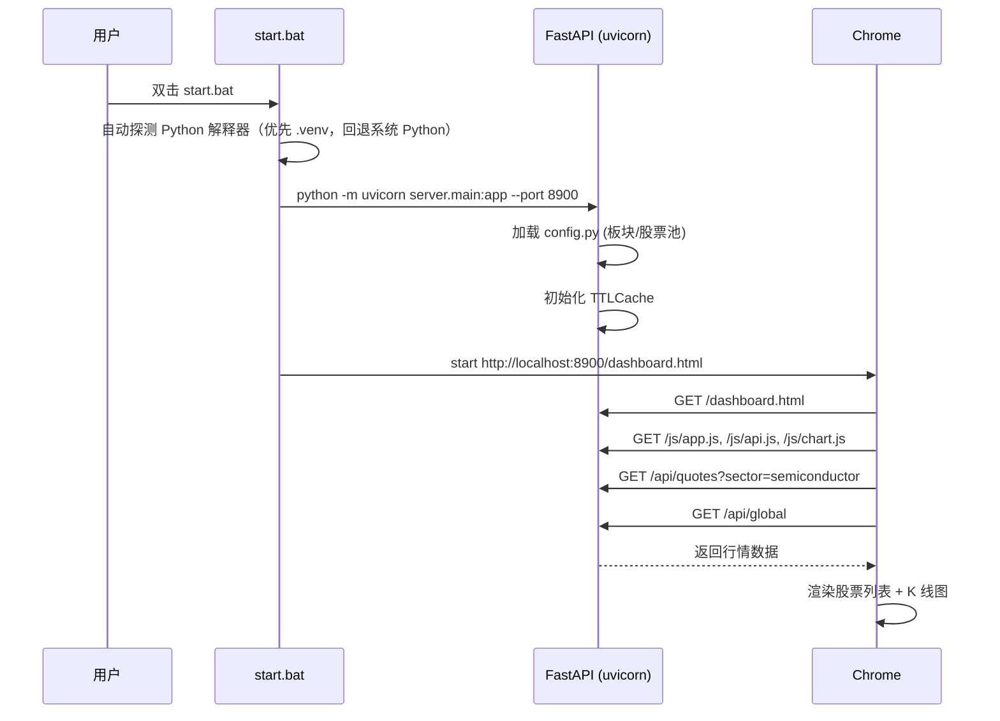
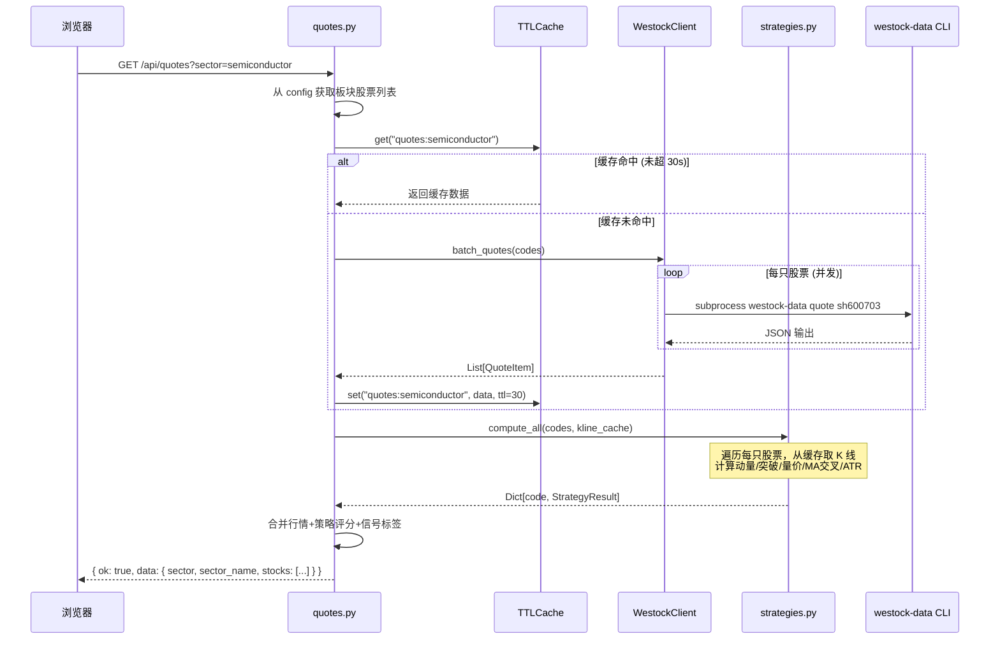
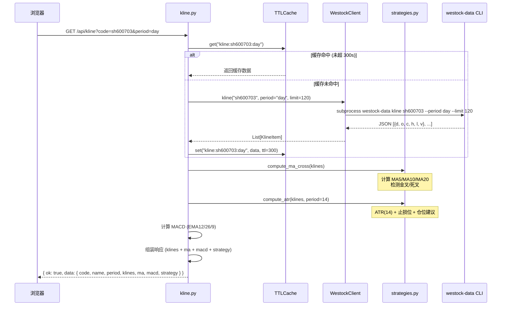
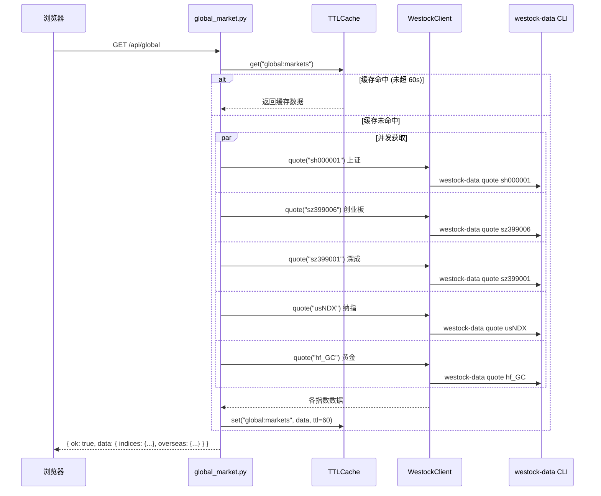
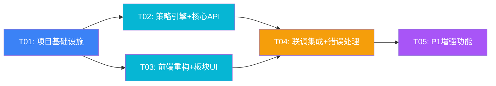

# BigA Pro 策略选股系统 — 系统架构设计

> ⚠️ **状态更新（2026-10-16）：历史文档** —— 本文为 **早期系统设计（项目起步阶段）**，其中"主数据源 = `westock-data` CLI"的设定**已废弃**（CLI 永久不可用，相关端点返回 `null`）。当前实时主链路为腾讯行情，数据口径见 [`docs/30-data/DATA-DICTIONARY.md`](../30-data/DATA-DICTIONARY.md)。

> 架构师：高见远（Gao） | 版本：v1.0 | 日期：2025-06-27

---

## Part A：系统设计

### 1. 实现方案 + 框架选型

#### 核心技术挑战

| 挑战 | 分析 | 方案 |
|------|------|------|
| westock-data CLI 集成 | subprocess 调用需处理超时、异常、JSON 解析 | 统一封装 `WestockClient`，超时 10s，异常降级返回空数据 |
| 实时行情并发获取 | 14 只股票逐个调用 CLI 太慢 | 并发 `asyncio.create_task` + `asyncio.to_thread` 包装 subprocess |
| 策略计算真实化 | 现有前端策略含 `Math.random()`，完全假数据 | 后端 Python 策略引擎，基于真实 K 线计算 MA/ATR/RSI/量价 |
| 多板块支持 | 现有硬编码 `SEMI_POOL`，需扩展到 8 个板块 | 后端板块配置 + 前端动态切换 |
| 缓存策略 | 行情 30s / K 线 5min TTL | 内存缓存 `dict` + 时间戳，无额外依赖 |
| 前端 JS 拆分 | 1245 行全内联，维护困难 | 拆为独立 JS 文件，HTML 只保留结构 + CSS |

#### 框架选型

| 层次 | 技术 | 理由 |
|------|------|------|
| 后端框架 | **FastAPI** | 异步支持好、自动 OpenAPI 文档、类型安全 |
| 数据获取 | **westock-data CLI** | 项目已确认，subprocess 调用 |
| 策略引擎 | **纯 Python** (numpy) | MA/ATR/RSI 计算简单，无需复杂量化库 |
| 前端 | **原生 HTML/CSS/JS + ECharts** | 保留现有设计风格，不引入重框架 |
| 缓存 | **内存 dict** | 单进程够用，避免 Redis 依赖 |
| 启动 | **start.bat** | Windows 环境一键启动 |

#### 架构模式

```
┌─────────────────────────────────────────────────┐
│                  浏览器 (Chrome)                  │
│   dashboard.html + app.js + chart.js + api.js   │
└────────────────────┬────────────────────────────┘
                     │ HTTP (localhost:8900)
┌────────────────────▼────────────────────────────┐
│               FastAPI 后端                        │
│  ┌─────────┐ ┌──────────┐ ┌───────────────────┐ │
│  │ 路由层   │ │ 缓存层    │ │ 策略引擎          │ │
│  │ 3 个 API │ │ TTL dict  │ │ 动量/突破/量价    │ │
│  └────┬────┘ └─────┬────┘ └────────┬──────────┘ │
│       │            │               │             │
│  ┌────▼────────────▼───────────────▼──────────┐  │
│  │           WestockClient (subprocess)        │  │
│  └───────────────────┬───────────────────────┘  │
└──────────────────────┼─────────────────────────┘
                       │ CLI calls
              ┌────────▼────────┐
              │ westock-data CLI │
              └─────────────────┘
```

---

### 2. 文件列表

```
dapeng-water/
├── start.bat                          # 一键启动脚本
├── requirements.txt                   # Python 依赖
├── server/                            # FastAPI 后端
│   ├── main.py                        # 入口：FastAPI app + 挂载静态文件 + CORS
│   ├── config.py                      # 板块配置、股票池、常量
│   ├── westock.py                     # WestockClient：subprocess 封装
│   ├── cache.py                       # 简易 TTL 内存缓存
│   ├── strategies.py                  # 策略计算引擎（动量/突破/量价/MA交叉/ATR）
│   └── routers/
│       ├── quotes.py                  # GET /api/quotes
│       ├── kline.py                   # GET /api/kline
│       └── global_market.py           # GET /api/global
├── static/                            # 前端静态资源
│   ├── css/
│   │   └── dashboard.css              # 从 dashboard.html 提取的 CSS
│   ├── js/
│   │   ├── api.js                     # API 请求封装
│   │   ├── chart.js                   # ECharts K 线渲染
│   │   ├── strategies-ui.js           # 策略面板 UI 更新
│   │   └── app.js                     # 主入口：初始化、事件绑定、状态管理
│   └── dashboard.html                 # 重构后的 HTML（仅结构）
├── dashboard.html                     # [原始文件，保留不动]
├── index.html                         # 公司官网（不动）
├── about.html                         # 公司官网（不动）
├── product.html                       # 公司官网（不动）
├── pricing.html                       # 公司官网（不动）
└── docs/
    ├── system_design.md               # 本文档
    ├── class-diagram.mermaid          # 类图
    └── sequence-diagram.mermaid       # 时序图
```

---

### 3. 数据结构与接口

#### 3.1 API 响应格式（统一）

```typescript
// 所有 API 统一响应格式
interface ApiResponse<T> {
  ok: boolean;       // 成功与否
  data: T;           // 业务数据
  message?: string;  // 错误信息（仅失败时）
}
```

#### 3.2 GET /api/quotes

**请求参数：**
| 参数 | 类型 | 必填 | 说明 |
|------|------|------|------|
| sector | string | 否 | 板块 key，默认 "semiconductor" |

```typescript
interface QuoteItem {
  code: string;      // 完整代码 "sh600703"
  name: string;      // 股票名称
  price: number;     // 当前价
  chg: number;       // 涨跌幅 %
  high: number;      // 最高价
  low: number;       // 最低价
  yclose: number;    // 昨收价
  volume: number;    // 成交量（手）
  amount: number;    // 成交额
  score: number;     // 策略综合评分 0-100
  signals: Signal[]; // 策略信号列表
}

interface Signal {
  type: "momentum" | "breakout" | "volume_divergence" | "ma_cross_gold" | "ma_cross_dead";
  label: string;     // 中文标签 "动量" | "突破" | "量价" | "金叉" | "死叉"
  score: number;     // 该策略评分 0-100
  desc: string;      // 描述 "强势突破" | "放量上涨" 等
}

// 响应
interface QuotesResponse {
  sector: string;        // 当前板块 key
  sector_name: string;   // 板块中文名
  stocks: QuoteItem[];
}
```

#### 3.3 GET /api/kline

**请求参数：**
| 参数 | 类型 | 必填 | 说明 |
|------|------|------|------|
| code | string | 是 | 股票代码 "sh600703" |
| period | string | 否 | "day"(默认) / "week" / "60" |

```typescript
interface KlineItem {
  d: string;    // 日期 "2025-06-27"
  o: number;    // 开盘价
  c: number;    // 收盘价
  h: number;    // 最高价
  l: number;    // 最低价
  v: number;    // 成交量
}

// 响应
interface KlineResponse {
  code: string;
  name: string;
  period: string;
  klines: KlineItem[];
  ma: {
    ma5: number[];
    ma10: number[];
    ma20: number[];
  };
  macd: {
    dif: number[];
    dea: number[];
    hist: number[];
  };
  strategy: {
    ma_cross: "gold" | "dead" | null;  // 最近 MA 交叉信号
    atr14: number;                      // ATR(14) 值
    stop_loss: number;                  // ATR 止损位
    position_pct: number;               // 建议仓位 %
  };
}
```

#### 3.4 GET /api/global

```typescript
interface GlobalMarketItem {
  code: string;    // 指数代码
  name: string;    // 指数名称
  price: number;   // 最新价
  chg: number;     // 涨跌幅 %
}

// 响应
interface GlobalResponse {
  indices: {
    sh: GlobalMarketItem;    // 上证指数
    cyb: GlobalMarketItem;   // 创业板指
    sz: GlobalMarketItem;    // 深证成指
  };
  overseas: {
    ndx: GlobalMarketItem;   // 纳指
    gold: GlobalMarketItem;  // 黄金
  };
}
```

#### 3.5 板块配置

```typescript
interface SectorConfig {
  key: string;           // "semiconductor"
  name: string;          // "半导体"
  stocks: [string, string][];  // [["sh600703", "三安光电"], ...]
}

// 8 个板块
const SECTORS: SectorConfig[] = [
  { key: "semiconductor", name: "半导体", stocks: [...] },
  { key: "new_energy",    name: "新能源", stocks: [...] },
  { key: "pharma",        name: "医药",   stocks: [...] },
  { key: "consumer",      name: "消费",   stocks: [...] },
  { key: "finance",       name: "金融",   stocks: [...] },
  { key: "military",      name: "军工",   stocks: [...] },
  { key: "ai_compute",    name: "AI算力", stocks: [...] },
  { key: "photovoltaic",  name: "光伏",   stocks: [...] },
];
```

#### 3.6 缓存数据结构

```python
@dataclass
class CacheEntry:
    data: Any           # 缓存数据
    timestamp: float    # time.time() 写入时间
    ttl: float          # 生存时间（秒）

class TTLCache:
    _store: dict[str, CacheEntry]  # key -> CacheEntry
    
    def get(self, key: str) -> Optional[Any]
    def set(self, key: str, data: Any, ttl: float) -> None
```

#### 3.7 策略引擎数据结构

```python
@dataclass
class StrategyResult:
    """单只股票的策略计算结果"""
    momentum_score: int      # 动量评分 0-100
    momentum_desc: str       # "强势突破" 等
    breakout_score: int      # 突破评分 0-100
    breakout_desc: str
    volume_score: int        # 量价评分 0-100
    volume_desc: str
    ma_cross: Optional[str]  # "gold" | "dead" | None
    atr14: float             # ATR(14)
    stop_loss: float         # 止损位
    position_pct: int        # 建议仓位 0-80%
    total_score: int         # 综合评分
    signals: list[Signal]    # 信号列表
```

---

### 4. 程序调用流程

#### 4.1 启动流程



#### 4.2 行情查询流程（/api/quotes）



#### 4.3 K 线查询流程（/api/kline）



#### 4.4 全球市场流程（/api/global）



---

### 5. 待明确事项

| # | 事项 | 假设/建议 |
|---|------|-----------|
| 1 | westock-data CLI 具体输出 JSON 格式 | 假设 `westock-data quote sh600703` 返回包含 name/price/chg/high/low/yclose/volume/amount 的 JSON |
| 2 | westock-data kline 返回字段命名 | 假设返回 `[{d, o, c, h, l, v}, ...]` 格式，若不同需做字段映射 |
| 3 | 全球市场纳指/黄金的 westock-data 代码 | 假设 `usNDX` 和 `hf_GC` 可直接用，若不行则通过 neodata 获取 |
| 4 | 8 个板块的具体股票池列表 | 需 PM 或用户确认每个板块 10-14 只代表性个股 |
| 5 | westock-data sector --search 是否可用 | 若可用，可用它动态获取板块成分股；否则用配置文件硬编码 |
| 6 | 端口号 | 默认 8900，避免与常见服务冲突 |
| 7 | 行情定时推送 | 当前设计为前端 30s 轮询，不做 WebSocket 推送（首期简化） |

---

## Part B：任务分解

### 6. 依赖包列表

```
# requirements.txt
fastapi>=0.111.0          # Web 框架
uvicorn[standard]>=0.30.0 # ASGI 服务器
numpy>=1.26.0             # 策略计算（MA/ATR/RSI）
```

> 说明：仅 3 个核心依赖。`westock-data` 为 CLI 工具非 Python 包，通过 subprocess 调用。

安装方式（清华镜像）：
```bash
pip install -r requirements.txt -i https://pypi.tuna.tsinghua.edu.cn/simple
```

---

### 7. 任务列表

#### T01：项目基础设施（配置 + 后端骨架 + 启动脚本）

- **任务说明**：搭建项目目录结构，创建 requirements.txt、start.bat、FastAPI 入口（main.py）、板块配置（config.py）、缓存模块（cache.py）、westock 客户端（westock.py），确保服务能启动并返回占位响应
- **涉及文件**：
  - `requirements.txt`
  - `start.bat`
  - `server/__init__.py`
  - `server/main.py`
  - `server/config.py`
  - `server/cache.py`
  - `server/westock.py`
  - `server/routers/__init__.py`
  - `server/routers/quotes.py`（占位）
  - `server/routers/kline.py`（占位）
  - `server/routers/global_market.py`（占位）
- **依赖**：无
- **优先级**：P0

#### T02：策略计算引擎 + 核心 API 实现

- **任务说明**：实现完整的策略引擎（strategies.py：动量/突破/量价/MA交叉/ATR/仓位建议），并实现三个核心 API 的完整逻辑——quotes.py 调用 westock 获取行情 + 策略评分，kline.py 获取 K 线 + MA/MACD/策略指标，global_market.py 获取全球指数
- **涉及文件**：
  - `server/strategies.py`
  - `server/routers/quotes.py`（完整实现）
  - `server/routers/kline.py`（完整实现）
  - `server/routers/global_market.py`（完整实现）
  - `server/westock.py`（完善异常处理+并发）
- **依赖**：T01
- **优先级**：P0

#### T03：前端重构 + 板块切换 UI

- **任务说明**：将 dashboard.html 拆分为 HTML+CSS+JS 独立文件，新增板块选择器 UI（8 个板块标签），改造 API 调用逻辑对接后端真实数据格式，保留现有暗色玻璃态视觉风格和 ECharts K 线图
- **涉及文件**：
  - `static/dashboard.html`（从原文件提取 HTML 结构）
  - `static/css/dashboard.css`（从原文件提取 CSS）
  - `static/js/api.js`（API 请求封装，适配新接口格式）
  - `static/js/chart.js`（ECharts K 线渲染，从原文件提取+改造）
  - `static/js/strategies-ui.js`（策略面板 UI 更新逻辑）
  - `static/js/app.js`（主入口、状态管理、板块切换、事件绑定）
- **依赖**：T01
- **优先级**：P0

#### T04：联调集成 + 错误处理 + 缓存优化

- **任务说明**：前后端联调确保全链路通畅（板块切换→行情→K线→策略→信号），添加错误降级（CLI 调用失败时返回友好错误而非 500），优化缓存策略确保行情 30s/K线 5min TTL 生效，验证 MACD/MA/ATR 计算结果正确性，确认 start.bat 一键启动流程
- **涉及文件**：
  - `server/westock.py`（增加超时/异常处理/降级逻辑）
  - `server/cache.py`（验证 TTL 生效）
  - `server/routers/quotes.py`（错误处理增强）
  - `server/routers/kline.py`（错误处理增强）
  - `server/routers/global_market.py`（错误处理增强）
  - `static/js/api.js`（前端错误处理+重试）
  - `static/js/app.js`（降级 UI 提示）
  - `start.bat`（最终验证）
- **依赖**：T02, T03
- **优先级**：P0

#### T05：P1 增强（搜索 + 自选 + RSI + 信号历史）

- **任务说明**：实现 P1 级需求——股票搜索功能（westock-data search）、自选股列表（localStorage 持久化）、RSI(14) 指标计算与展示、策略信号历史记录面板、前端 30s 行情自动轮询
- **涉及文件**：
  - `server/routers/quotes.py`（新增搜索 API）
  - `server/strategies.py`（新增 RSI 计算）
  - `static/js/app.js`（自选股管理、搜索交互）
  - `static/js/chart.js`（RSI 指标子图）
  - `static/js/strategies-ui.js`（信号历史面板）
  - `static/dashboard.html`（搜索框+自选股+信号历史 DOM）
- **依赖**：T04
- **优先级**：P1

---

### 8. 共享知识

#### API 约定
- 所有 API 响应格式：`{ ok: bool, data: T, message?: string }`
- 成功时 `ok: true`，`data` 为业务数据
- 失败时 `ok: false`，`message` 为错误描述
- HTTP 状态码始终 200（业务错误通过 ok 区分），仅 422 参数校验失败返回 422

#### 后端编码规范
- Python 3.13，使用 type hints
- `async def` 定义所有路由处理函数
- subprocess 调用通过 `asyncio.to_thread` 包装为异步
- 异常处理：CLI 调用失败时 `ok: false`，不抛 500
- 日志：`logging.getLogger(__name__)`，关键操作记录 info/warning

#### 前端编码规范
- 原生 JS（ES2020+），不使用框架
- CSS 变量沿用现有 `:root` 定义（`--bg`, `--glass`, `--green`, `--red` 等）
- fetch 封装在 `api.js`，统一处理 ok 判断和错误提示
- ECharts 实例全局唯一，`setOption(option, { notMerge: true })` 全量更新
- 时间格式：K 线日期 `d` 字段为 `"YYYY-MM-DD"` 字符串

#### 缓存策略
- 行情缓存 key：`quotes:{sector}`，TTL = 30s
- K 线缓存 key：`kline:{code}:{period}`，TTL = 300s (5min)
- 全球市场缓存 key：`global:markets`，TTL = 60s
- 缓存为内存 dict，重启后清空

#### westock-data CLI 调用
- 行情：`westock-data quote sh600703` → JSON
- K 线：`westock-data kline sh600703 --period day --limit 120` → JSON array
- 搜索：`westock-data search 腾讯` → JSON
- 板块：`westock-data sector --search 半导体` → JSON
- 超时：10 秒
- Python 环境：由启动脚本自动探测（优先项目 `.venv`，回退系统 Python 3.11），不写死绝对路径

#### 端口与路径
- 后端端口：8900
- 静态文件目录：`./static/`（FastAPI `StaticFiles` 挂载）
- 访问地址：`http://localhost:8900/dashboard.html`

---

### 9. 任务依赖图



**关键路径**：T01 → T02 → T04 → T05

**并行机会**：T02 和 T03 可以在 T01 完成后并行开发（后端 API 和前端 UI 互不依赖，只需约定好接口格式即可）
