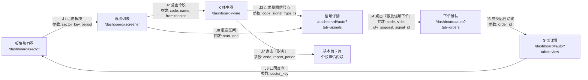
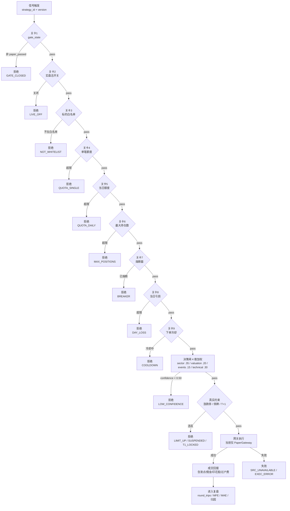
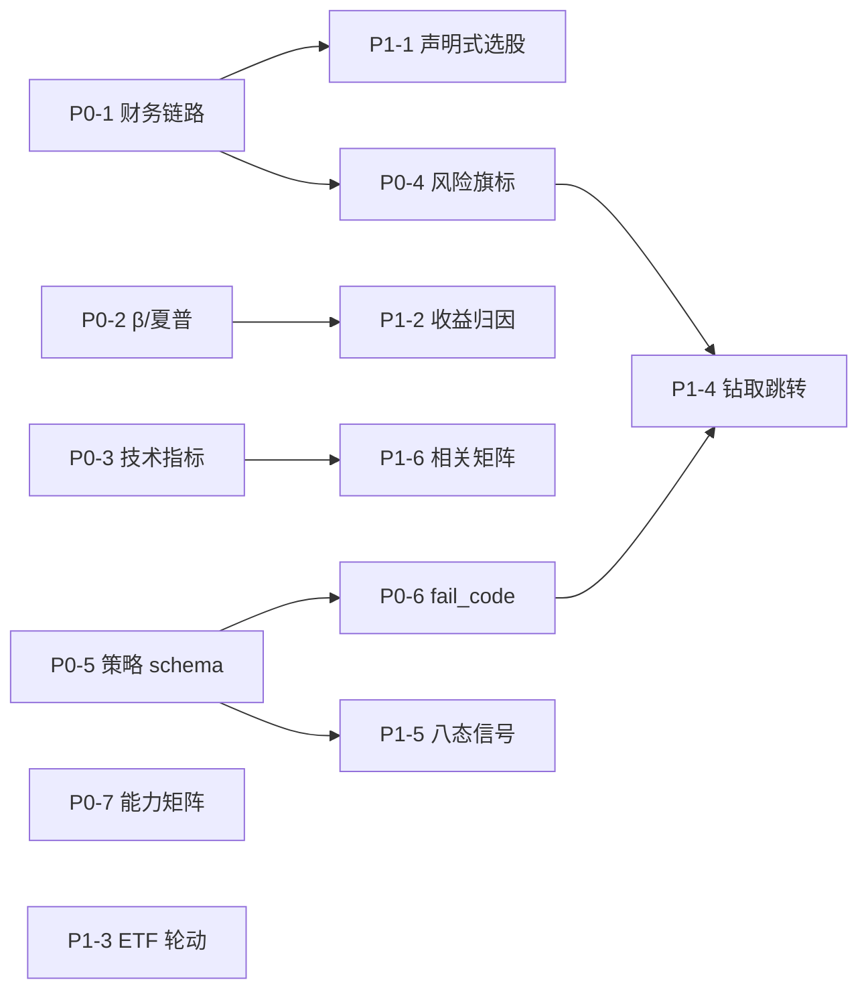

# OpenBB × DailyStockAnalysis 能力接入 — 增量 PRD

> 📋 **增量 PRD（living）** — 本文是**需求设计**，不改变既有实现。当前实现状态以
> [`MASTER-PLAN-2026Q4.md`](../00-strategy/MASTER-PLAN-2026Q4.md) 与
> [`DATA-DICTIONARY.md`](../30-data/DATA-DICTIONARY.md) 为准。
> 与 [`OPEN_SOURCE_INTEGRATION_PLAN.md`](../00-strategy/OPEN_SOURCE_INTEGRATION_PLAN.md) 的关系：
> 该文（2026-09-29）已覆盖 AKShare / QuantStats / Lightweight Charts 等候选；本文**不重复**其结论，
> 只补充 **OpenBB** 与 **DailyStockAnalysis** 两个新调研对象，并对该文中「不受支持」的能力给出新结论。

- **Language**: 中文
- **Programming Language**: 沿用现状 —— 后端 Python（FastAPI 单服务 8900）；前端原生 HTML + 原生 JS + ECharts + klinecharts v10.0.3。**不引入第二套前端框架 / 图表栈。**
- **Project Name**: openbb_dsa_integration
- **文档版本**: v1.0（2026-10-19）
- **调研方式**: GitHub REST API + `raw.githubusercontent.com` 实读源码与文档，逐条标注仓库路径。**未读到的写「未确认」，不做推测填充。**

---

## 0. 调研对象甄别与采信

### 0.1 OpenBB

| 项 | 实测值 | 证据 |
|---|---|---|
| 仓库 | `https://github.com/OpenBB-finance/OpenBB`<br>（GitHub API 解析回 `openbq-org/OpenBB`，疑为组织改名/迁移，URL 仍可解析） | `GET /repos/OpenBB-finance/OpenBB` |
| Stars / Forks | 74,432 / 7,726 | 同上 |
| 语言 / 默认分支 | Python / `develop` | 同上 |
| 最近推送 | 2026-10-18T20:30:02Z | 同上 |
| 版本 | **5.0.0** | `openbb_platform/pyproject.toml` → `version = "5.0.0"` |
| 定位（原文） | "Open Data Platform for analysts, quants and AI agents"，自称 **ODP（Open Data Platform）**，「connect once, consume everywhere」 | `README.md` 第 3 段 |
| 规模 | 4,138 个文件；`openbb_platform/providers` 2,717 / `core` 454 / `extensions` 421 | `git/trees/develop?recursive=1` |
| **许可证** | **Apache-2.0** | 见 §1 |

> ⚠️ **认知纠偏**：任务书假设「OpenBB 是 AGPL-3.0，对商用/闭源有传染性」。**实测不成立**。
> OpenBB 当前主仓全仓 Apache-2.0。这个纠偏直接改变了接入结论 —— 详见 §1。

### 0.2 DailyStockAnalysis：先确认是哪一个

GitHub `search/repositories` 有两个可能指向，必须先排歧：

| 查询 | 结果 |
|---|---|
| `q=DailyStockAnalysis+in:name` | 12 个结果，**全部 0–1 star**（`stiens-cod`、`liudong-work`、`GaussYuan191` 等），无描述、无实质内容 → **不是目标任务** |
| `q=daily-stock-analysis` | 第 1 名 **`ZhuLinsen/daily_stock_analysis`，66,727 stars，MIT，pushed 2026-10-17** |

**采信结论：`https://github.com/ZhuLinsen/daily_stock_analysis`（下文简称 DSA）。**

采信依据（4 条，均可溯源）：
1. 规模与活跃度唯一匹配：66,727 stars / 55,434 forks / 2026-10-17 仍在推送；同名项目最高 1 star。
2. 描述与任务书推测一致：`LLM 驱动的多市场股票智能分析系统：多源行情、实时新闻、决策看板与自动推送`，topics = `a-stock, ai-agent, aigc, llm, quant, quantitative-finance, quantitative-trading`。
3. 真实技术组合即为「AKShare + 技术指标 + LLM 日报」：`data_provider/akshare_fetcher.py`、`strategies/*.yaml`（16 个自然语言策略）、`src/agent/agents/*_agent.py`。
4. 有独立主页 `https://dsa.zhulinsen.tech` 与 arXiv 编号（README badge `arXiv-2608.26990`），是一个被引用的事实项目。

| 项 | 实测值 | 证据 |
|---|---|---|
| Stars / Forks | 66,727 / 55,434 | `GET /repos/ZhuLinsen/daily_stock_analysis` |
| 许可证 | **MIT** | `LICENSE`；API `license.spdx_id = "MIT"` |
| 语言 / 分支 | Python / `main` | 同上 |
| 创建 / 最近推送 | 2026-01-10 / 2026-10-17T11:54:29Z | 同上 |
| 规模 | 1,217 文件：`apps` 335（React+TS Web / Electron 桌面）、`tests` 308、`src` 259、`docs` 130、`api` 41、`data_provider` 21、`strategies` 16 | `git/trees/main?recursive=1`（`truncated=false`） |
| 覆盖市场 | A股 / 港股 / 美股 / 日股 / 韩股 / 台股 + ETF | `README.md`「功能特性」表 |

---

## 1. 许可证结论（能否「直接嵌入」的关键前提）

> 这一节单独成章，因为它决定了「接代码」还是「只借设计」。

### 1.1 OpenBB = Apache-2.0，**不构成传染**

| 证据 | 内容 |
|---|---|
| `LICENSE`（205 行）第 1–3 行 | `Copyright (c) 2021-2026 OpenBB Inc.` / `All files in this repository are licensed under the Apache License, Version 2.0.` |
| `openbb_platform/pyproject.toml` | `license = { text = "Apache-2.0" }` |
| `README.md` §3 License | `Distributed under the Apache License, Version 2.0.` |
| 仓库内 LICENSE 文件仅 3 处 | 根 `LICENSE`、`desktop/LICENSE`、`desktop/src-tauri/LICENSE`，均为 Apache-2.0 体系 |

**GitHub API 返回 `license.spdx_id = "NOASSERTION"` 的解释**：这是 GitHub 许可证识别器未能把「自定义版权头 + Apache 2.0 正文」归类为标准模板导致的**误判**，不是"许可证不明"。以文件原文为准。

**对商用/闭源的实操结论**：
- ✅ **可以** `pip install openbb` 作为依赖使用（Apache-2.0 允许闭源分发与商业使用）。
- ✅ **可以**复制其单个算法文件（如某个指标实现）进我方仓库，**须**保留版权声明与 NOTICE 类归属。
- ⚠️ **仍需注意**：OpenBB 的**上游数据 provider 各自有独立条款**（`sec`、`nasdaq`、`cboe`、`fred`、`imf`、`oecd` 等），走这些源需遵守其数据授权；且**大部分需 API Key / 有速率限制**（`openbb_core/app/model/credentials.py` 存在即说明依赖凭证管理）。这不是许可证问题，是**数据合规问题**。

### 1.2 DailyStockAnalysis = MIT，**同样不构成传染**

| 证据 | 内容 |
|---|---|
| `LICENSE` | MIT License © 2026 ZhuLinsen |
| `README.md` §License | `[MIT License](LICENSE) © 2026 ZhuLinsen` |

⚠️ **但有一个二级许可证事实必须写清**：DSA 的**选股引擎是从 AlphaSift 派生**的。

| 证据 | 内容 |
|---|---|
| `THIRD_PARTY_NOTICES.md` | AlphaSift / `https://github.com/ZhuLinsen/alphasift` / revision `9f52274...` / **License: Apache License 2.0** / 涉及文件 `src/services/screening/**/*.py` 与 `src/services/screening/strategies/*.yaml` |
| `src/services/screening/strategies/momentum_quality.yaml` 第 1–2 行 | `Derived from AlphaSift revision 9f52274... Licensed under Apache-2.0 and modified for daily_stock_analysis.` |
| `docs/screening-engine.md` 首段 | 同上声明 |

结论：**DSA 的选股部分实际是 MIT 外壳 + Apache-2.0 内核**。Apahce-2.0 要求保留来源头（`src/services/screening/LICENSE` 已存在）。我方若移植该 YAML schema 或 pipeline 结构，需沿用同一归属约定。

### 1.3 一句话结论

> **两个项目都不是 AGPL，都不阻止商用与闭源分发。** 「不能直接嵌入」这个前提不成立 —— 真正的约束不是许可证，而是 **① 它们都不提供 A 股数据覆盖，② 它们都不做下单执行**。这两点才是我们该做取舍的地方，见 §2 / §5。

---

## 2. 两个项目的核心能力拆解

### 2.1 OpenBB（ODP v5.0.0）

口径说明：「可独立复用」= 能否在不引入 OpenBB 整体架构的前提下，把这块能力搬进我方 FastAPI 单服务。

| 能力域 | 具体实现（模块 / 接口） | 数据来源 | 可独立复用 | 许可证 / 合规风险 |
|---|---|---|---|---|
| **Provider 插件机制** | `openbb_core/provider/abstract/{fetcher,provider,query_params,data,annotated_result}.py` + `provider/registry.py` + `registry_map.py`；每个 provider 是独立 `pyproject.toml` 包 | 抽象层，无数据 | ✅ 可复用（**仅借设计**：Fetcher/QueryParams 分层是我们 provider 化最值得抄的骨架） | Apache-2.0，无风险 |
| **统一输出模型** | `OBBject`（`openbb_core/app/model/obbject.py`）→ `to_dataframe()` / `to_dict()`；`QueryParams.__output_columns__` 显式声明列 | 抽象层 | ✅ 可复用（设计） | Apache-2.0 |
| **美股基本面（三表）** | `extensions/equity/.../fundamental_router.py`：`balance`、`balance_growth`、`cash`、`cash_growth`、`income`、`income_growth`、`ratios`、`metrics`、`dividends`、`historical_eps`、`filings`、`transcript`、`esg_score`、`revenue_per_segment`、`revenue_per_geography`（共 25 个命令） | `sec`（SEC filings/XBRL）、`nasdaq`、`tmx`、`government_us` | ❌ **不可** —— 全部美股/加股，**无 A 股财报** | Apache-2.0；需 SEC 合规抓取礼节（UA/速率） |
| **美股持仓/股权** | `ownership_router.py`：`major_holders`、`institutional`、`insider_trading`、`share_statistics`、`form_13f`、`government_trades` | `sec`、`finra`、`government_us` | ❌ 不可（美股口径） | 同上 |
| **ETF 深度** | `etf_router.py`：`holdings`、`sectors`、`countries`、`equity_exposure`、`price_performance`、`nport_disclosure` | `tmx`、`cboe`、`nasdaq` | ❌ 不可（美股 ETF）；✅ **借字段设计** | Apache-2.0 |
| **宏观序列** | `economy_router.py` 26 命令：`cpi`、`unemployment`、`interest_rates`、`central_bank_holdings`、`pce`、`fred_series`/`fred_search`、`fomc_documents`、`country_profile`、`composite_leading_indicator` … | `fred`、`oecd`、`imf`、`bls`、`ecb`、`eia`、`federal_reserve` | ⚠️ **部分可** —— FRED/OECD/IMF 含中国序列（有滞后、需 Key） | Apache-2.0；**数据授权在源** |
| **期权/期货** | `derivatives_router.py` → `futures/futures_router.py`、`options/options_router.py` | `cboe`、`deribit`、`cftc` | ❌ 不可（美/加密口径，无 A 股期权/中金所） | Apache-2.0 |
| **技术指标（≈50 命令）** | `extensions/technical/openbb_technical/`：<br>· overlays 15：`sma ema hma wma zlma tema dema kama frama vwma bbands donchian kc ichimoku supertrend`<br>· oscillators 10：`rsi stoch cci fisher cg williams_r mfi trix ultimate_oscillator awesome_oscillator`<br>· trend 5：`macd adx di aroon choppiness`<br>· volatility 4：`realized_volatility realized_volatility_compare cones atr`<br>· volume 4：`obv ad adosc vwap`<br>· structure 3：`fib demark pivot_points` | 纯计算（入参为 OHLCV） | ✅ **完全可独立复用**（纯函数，无外部依赖） | Apache-2.0 |
| **技术信号** | `signals/`：`crossovers`、`breakouts`、`divergences`、`candlestick_patterns`、`regime`、`thresholds` | 纯计算 | ✅ 可复用（设计 + 算法） | Apache-2.0 |
| **多标的技术** | `multi/`：`screen`（条件筛选）、`correlation` / `correlation_matrix`、`relative_rotation` | 纯计算 | ✅ 可复用 | Apache-2.0 |
| **定量分析** | `extensions/quantitative/openbb_quantitative/`：<br>· `metrics`：`normality`（Jarque-Bera / Shapiro-Wilk / Lilliefors-KS）、**`capm`（β / systematic_risk=R² / idiosyncratic_risk）**、`unitroot_test`、`summary`<br>· `performance`：`sharpe_ratio`、`sortino_ratio`、`omega_ratio`<br>· `risk_decomposition`、`attribution`、`factors`、`rolling`（`skew variance stdev kurtosis mean quantile` + 滚动因子） | 纯计算 | ✅ **完全可独立复用** | Apache-2.0 |
| **计量经济** | `extensions/econometrics/`：`regression`、`panel`、`time_series`、`diagnostics` | 纯计算 | ✅ 可复用（价值中等） | Apache-2.0 |
| **可视化** | `obbject_extensions/charting/openbb_charting/`：Plotly；charts = `price_historical`、`price_performance`、`correlation_matrix`、`relative_rotation`、`generic_charts`；`core/plotly_ta/plugins/`（momentum/overlap/trend/volatility/volume）；渲染依赖 **pywry** 桌面 webview | 纯前端 | ❌ **不采纳**（Plotly + pywry ≠ ECharts；换栈成本 >> 收益） | Apache-2.0 |
| **服务化层** | `extensions/platform_api/`：FastAPI app + `widgets_service` / `apps_service` / `agents_service` + `merge_widgets/apps/agents` | — | ⚠️ 借设计（widget JSON 描述图表与数据的**契约化**思路） | Apache-2.0 |
| **MCP Server** | `extensions/mcp_server/openbb_mcp_server/`：tools / prompts / skills / `category_index` | — | ⚠️ 借设计（若未来要暴露我方能力给 AI Agent） | Apache-2.0 |
| **流式响应** | `openbb_core/app/model/stream.py`（`OBBStream`，含 SIGINT/SIGTERM 清理、`stop_all`）+ `tests/provider/abstract/test_fetcher_streaming.py` | — | ⚠️ 借设计（fetcher 级流式，非对客 SSE） | Apache-2.0 |
| **凭证/偏好** | `app/model/{credentials,preferences,user_settings,system_settings}.py`、`app/service/{auth,user,system}_service.py` | — | 借设计 | Apache-2.0 |

**OpenBB 明确没有的能力（避免误判）**：

1. ❌ **零 A 股数据覆盖**。本仓库 18 个 provider 包（`bls cboe cftc deribit ecb eia famafrench federal_reserve finra fred government_us imf jodi nasdaq oecd sec tmx`）**没有任何中国数据源**；无腾讯、无东财、无 AkShare、无 Tushare、无 YFinance/FMP/Polygon（后三者在本版本已不在 OSS 仓内）。**指望 OpenBB 供给 A 股 = 方向性错误。**
2. ❌ **无对客实时推送**。`stream.py` 是 provider/fetcher 层的流式封装，不是对浏览器的 SSE/WebSocket 服务；`platform_api` 是请求-响应 REST。
3. ❌ **无下单执行、无风控、无订单状态机、无组合台账**。整个仓库无 broker/gateway/order 相关模块。
4. ❌ **无 A 股交易日历、无涨跌停/T+1/停牌约束**。

### 2.2 DailyStockAnalysis（DSA）

| 能力域 | 具体实现（模块 / 接口） | 数据来源 | 可独立复用 | 许可证 / 合规风险 |
|---|---|---|---|---|
| **多源行情抽象** | `data_provider/base.py` + 14 个 fetcher：`akshare_ tenscent baostock pytdx efinance yfinance tushare longbridge futu finnhub alphavantage miaoxiang tickflow tw_institutional` + `fundamental_adapter.py` / `yfinance_fundamental_adapter.py` / `futu_fundamental_adapter.py` | 含 **A 股（腾讯/AkShare/Tushare/Baostock/Pytdx/Efinance）** | ✅ **可复制**（A 股 fetcher 与我们同源，直接可用） | MIT；各源自身条款 |
| **多市场能力边界** | `docs/market-support.md`（16 KB，逐市场逐字段列能力可用性） | — | ✅ **值得直接抄文档格式**（这是「如实告知边界」的范本） | MIT |
| **技术指标 + 策略检测** | `src/agent/strategies/router.py`、15 个内置 skill | 纯计算 | ⚠️ 与我方 `server/strategies.py` **高度重叠**，收益低 | MIT |
| **自然语言策略 YAML** | `strategies/*.yaml`（16 个）：`ma_golden_cross bull_trend chan_theory wave_theory hot_theme event_driven growth_quality expectation_repricing box_oscillation bottom_volume dragon_head one_yang_three_yin shrink_pullback volume_breakout emotion_cycle`；`strategies/README.md` 给出完整 schema（`name/display_name/category/core_rules/required_tools/aliases/default_active/market_regimes/instructions`） | 无（自然语言，由 LLM 消费） | ✅ **借设计**（「策略 = 可版本化的 YAML 能力包」） | MIT |
| **声明式选股引擎** | `src/services/screening/`：`pipeline.py`、`filter.py`（硬过滤）、`scorer.py`、`ranker.py`、`risk.py`、`snapshot.py`、`context.py`、`hotspot.py`；策略 `strategies/*.yaml` 含 `hard_filters` / `factor_weights` / `scoring_profile` / `risk_profile` / `portfolio_profile` / `scorecard_profile` / `max_output` | 全市场快照 + 日 K + 财务字段 | ✅ **借设计（强烈推荐）** | **Apache-2.0（AlphaSift 派生，需保留来源头）** |
| **决策信号契约** | `DecisionSignal`：`api/v1/schemas/decision_signals.py` + `src/services/decision_signal_service.py`；字段含 `action`（8 态 buy/add/hold/reduce/sell/watch/avoid/alert）、`horizon`、`decision_profile`（conservative/balanced/aggressive）、`plan_quality`、`status`、`entry_low/entry_high/stop_loss/target_price/invalidation/watch_conditions`、`evidence`、`data_quality_summary`；评分口径 `decision-scale-v1`（0-19 sell / 20-39 reduce / 40-59 watch / 60-79 buy / 80-100 strong_buy）；`MIN_ACTIONABLE_CONFIDENCE = 0.5`；`profile_calibration.minimum_completed_sample_size = 30` | 分析报告 + Agent + 告警 | ✅ **借设计（最高价值之一）** | MIT |
| **信号后验评估** | `src/core/backtest_engine.py`：`evaluate_single` / `evaluate_decision_signal`，用 `max_high` / `min_low` 算 MFE/MAE 类指标；`src/repositories/backtest_repo.py` 持久化 | 历史 K 线 | ✅ 借设计（与我方 round_trips/MFE/MAE 同构，可对照补字段） | MIT |
| **ETF 双动量轮动** | `src/core/etf_rotation.py`（纯逻辑）+ `src/services/etf_rotation_service.py`（取数/告警/报告）；规则：相对动量排名 + 绝对动量（涨幅>0 才入选）+ 换仓缓冲 + 只在组合变化时交易 + 成本扣减（`换手率 × COST_BPS`）；回测输出：累计/年化收益、波动、夏普、最大回撤、**Calmar**、**分年度收益**、**参数平原检验** | A 股 ETF（明确只接受前复权源） | ✅ **算法可移植（推荐）** | MIT；`docs/etf-rotation.md` 含极详细的防未来函数说明 |
| **组合风险与暴露看板** | `docs/portfolio-risk-exposure-dashboard.md`：6 个风险旗标（个股集中/行业集中/回撤/止损/AI 信号/价格质量）+ 市场暴露 + 币种暴露；**每个指标都定义了「不可用」的降级语义** | 持仓快照 + 汇率 | ✅ **借设计（强烈推荐）** | MIT |
| **运行期告警规则** | `src/services/alert_worker.py` + `alert_service.py` + `src/agent/events.py`（EventMonitor）；三类可执行规则：`price_cross`（above/below + price）、`price_change_percent`（up/down + change_pct）、`volume_spike`（multiplier，对近 20 日均量）；配置入口 `AGENT_EVENT_ALERT_RULES_JSON` | 实时行情 | ✅ 借设计 | MIT |
| **多渠道路由推送** | 企业微信 / 飞书 / Telegram / Discord / Slack / 邮件；`docs/notifications.md` | — | ⚠️ 我方已有邮件/告警，收益低 | MIT |
| **Web 工作台 + 视觉回归** | `apps/dsa-web`（React + TS + Vite + Playwright）；e2e fixtures 覆盖 `portfolio-risk-exposure`、`screening-explanations`、`market-structure-card-visual` 等，产出桌面 1440px + 窄屏 390px 双截图证据 | — | ❌ 不采纳（栈不同）；✅ 借**「每个 UI 状态都要有 fixture 截图证据」**的验收范式 | MIT |
| **Agent 多智能体编排** | `src/agent/orchestrator.py`、`agents/{technical,risk,portfolio,decision,intel}_agent.py`、`skills/`、`disagreement.py`、`risk_override.py`、`litellm_route_resolution.py` | LLM 多provider | ⚠️ 我方已有 AI 主脑 + 4 agent；**仅借 `disagreement.py`（多智能体分歧记录）与 `risk_override.py`（风控否决 AI 建议）两个模式** | MIT |
| **桌面端** | `apps/dsa-desktop`（Electron） | — | ❌ 不采纳 | MIT |

**DSA 明确没有的能力（避免误判）**：

1. ❌ **没有下单执行**。`docs/decision-signals.md`「能力边界」原文：*"`DecisionSignal` 只记录建议、证据摘要、风险、观察条件、生命周期和来源，**不执行下单或调仓**"*。全仓 broker 相关只有 `src/brokers/futu/portfolio.py`（只读持仓）。
2. ❌ **没有订单状态机**（无 pending/partial/partial-filled/撤单/回报）。
3. ❌ **没有 A 股实时逐笔 / 分时链路**。取数层是日 K + 实时快照，无 SSE/WebSocket 对客推送。
4. ❌ **没有九关风控**、没有额度/熔断/白名单/冷却。
5. ❌ **没有盘口级微观结构**（逐笔、委托队列）。

> **由此得出本文最核心的一条判断**：
> **这两家在「数据获取（A股）」和「自动化交易」两块，都比我们弱。**
> 它们的真正价值集中在三处：**(a) OpenBB 的纯计算指标库与 provider 分层设计；(b) DSA 的「决策信号契约 + 声明式策略/选股 + 组合风险看板」的产品化定义；(c) 两者对「不可得就说不可得」的降级语义纪律。**
> 所以本 PRD 的基调是 **移植算法 + 借设计**，不是「接入系统」。

---

## 3. 可复用能力映射矩阵（核心）

> 「接入后补全哪个面板」列中的面板名以 `static/dashboard.html` 现有区块为准。

| # | 外部能力 | 我方现状 | 接入方式 | 补全的区块 | 预期效果（可度量口径） |
|---|---|---|---|---|---|
| **R1** | OpenBB `quantitative/metrics.capm`：β、systematic_risk（R²）、idiosyncratic_risk | **完全没有**（`grep -rniE "\bbeta\b\|brinson\|因子暴露" server/` 零命中） | **移植算法**（3 个字段的 OLS，纯 numpy） | 自动化中心「持仓」Tab 新增「组合风险」卡片 | 新卡出现 3 个数字：组合 β、R²、特质风险占比；`/api/automation/positions` 响应新增 `risk_beta` 块；F5 后 ≤5s 可见；数据不足 60 个交易日时显示「样本不足（N/60）」而非假值 |
| **R2** | OpenBB `quantitative/performance`：`sharpe_ratio`、`sortino_ratio`、`omega_ratio` | **部分有** —— 有 `compute_max_drawdown` / `compute_volatility` / `compute_var_95`（`server/strategies.py:534/556/584`）；组合层面无夏普/索提诺 | **移植算法** | 自动化中心「复盘」Tab 顶部指标条 | 指标条从 4 个（胜率/盈亏比/最大回撤/净盈亏）扩到 7 个（+ 夏普、索提诺、Omega）；口径在 tooltip 内明写「无风险利率取 0」 |
| **R3** | OpenBB `quantitative/risk_decomposition` + `attribution` | **完全没有** | **移植算法**（分层风险贡献 + Brinson 式归因） | 自动化中心「复盘」Tab 新增「收益归因」区块（瀑布图） | 出现「选股贡献 / 择时贡献 / 成本拖累 / 板块配置」四段瀑布；每段带数值与占比；笔数 <10 时整块显示「样本不足，仅供观察」 |
| **R4** | OpenBB `technical/` 中我方缺的指标：`supertrend`、`ichimoku`、`donchian`、`kc`、`aroon`、`choppiness`、`adx/di`、`vwap`、`obv/ad/adosc`、`mfi`、`williams_r`、`cci`、`trix`、`stoch` | **部分有** —— 有 `compute_rsi/macd/atr/boll/kdj/ma` + `momentum_score/breakout_score/volume_divergence_score`；缺上列全部 | **移植算法**（纯函数，逐个进 `server/strategies.py`） | 选股策略 K 线副图 + 个股详情技术指标区 | 副图可选指标从 4 类（MACD/KDJ/RSI/量）扩到 12 类；切换后 ≤1s 重绘；每个指标标注计算周期与参数 |
| **R5** | OpenBB `technical/multi.screen` + `correlation_matrix` | **部分有** —— 有 `sector_graph/sector_linkage/sector_clusters`（板块间），**无个股间相关矩阵** | **移植算法 + 借设计** | 选股面板新增「持仓相关矩阵」热力图 | 出现 N×N 热力图（N≤15）；格子可点；点击后跳个股 K 线（见 §5.3 跳转 J3） |
| **R6** | DSA 声明式选股 YAML（`hard_filters` + `factor_weights` + `scoring_profile` + `risk_profile` + `portfolio_profile`） | **部分有** —— `server/strategies.py` 有 5 套硬编码策略逻辑；`server/trading/strategies/base.py` 的 `default_params` **已是可配参数**，但**无 YAML、无参数可视化编辑、无因子权重归一化** | **借设计**（schema 直接借鉴；不复制 AlphaSift 代码） | 自动化中心「配置」Tab → 策略区块 | 每个策略从「只有 4 个 default_params」扩到「可编辑 hard_filters 9 项 + factor_weights 8 项」；保存后 `/api/automation/config` 回显一致；非法值（如 `pe_ttm_max < pe_ttm_min`）前端即时拒绝并给原因 |
| **R7** | DSA `DecisionSignal` 八态契约 + `decision_profile` + `guardrail_result` + `profile_calibration`（样本<30 只显示样本量） | **部分有** —— 我方 `decision_gate.py` 有 4 维加权 + `allow/confidence/reason`；**无 8 态 action、无 horizon、无 invalidation 字段、无按决策风格分桶的后验校准** | **借设计** | 自动化中心「信号」Tab 表格列 + AI 主脑决策卡 | 信号表从 6 列扩到 10 列（+ action/horizon/invalidation/plan_quality）；「按风格校准」分区在样本 <30 时只显示「样本量 N，不足 30，仅供观察」；**绝不显示命中率** |
| **R8** | DSA ETF 双动量轮动 + `参数平原检验` | **完全没有**（全仓 `grep -i etf` 仅在 `agents/finance_agent.py` 出现板块分类键，无 ETF 轮动） | **移植算法** | 新增独立面板「ETF 轮动」（挂到选股页 Tab） | 输出：当前持仓 / 目标持仓 / 是否需要调仓 / 动量排名 / 参数平原表；回测区间 <1 年时**只给信号不给年化**（照抄 DSA 的边界纪律） |
| **R9** | DSA 组合风险与暴露看板（6 旗标 + 市场/币种暴露 + 逐项「不可用」语义） | **部分有** —— 有 `acct-*` 系列（净值/仓位/胜率/回撤）与 `automation` 的 positions；**无集中度旗标、无暴露聚合、无价格质量旗标** | **借设计** | 自动化中心「持仓」Tab 顶部风险旗标条 | 6 个旗标常驻；任一标的缺价 → 对应旗标显示「不可用」而非「正常」；`fxStale` 场景下暴露块显示「暴露不可用」 |
| **R10** | DSA 运行期告警三类规则（`price_cross` / `price_change_percent` / `volume_spike`）+ 冷却 | **部分有** —— `server/trading/alerts.py` 存在；`automation.py` 有 `/conditional-orders`（5 个端点）；**规则类型未确认是否已覆盖 volume_spike 倍数口径** | **借设计 + 对照补齐** | 自动化中心「配置」Tab 告警规则区块 | 规则类型下拉出现 3 类；每类带「方向 / 阈值 / 冷却」三字段；保存后 `/api/automation/conditional-orders` 回显 |
| **R11** | DSA `docs/market-support.md`「逐市场逐字段能力边界」文档范式 | **部分有** —— `docs/30-data/DATA-DICTIONARY.md` 有字段字典，但**缺少「某市场某字段是否可得 + 不可得原因」的矩阵** | **借设计** | 文档站新增「数据能力矩阵」页 | 一页矩阵：行=字段（PE_TTM/PB/ROE/股东/ETF 成分/期权…），列=市场/数据源，格=可得/降级/不可得 + 原因 + 最后核验日期 |
| **R12** | OpenBB `provider/abstract` 分层（Fetcher / QueryParams / Data / Registry） | **部分有** —— 我方是「模块级函数集合」（`ak_market.py` / `eastmoney.py` / `westock.py` / `global_assets.py`），**无统一 provider 接口、无 credential 统一管理、无 provider 级 fallback 注册表** | **仅借设计**（重构成本高，只在新代码里落地） | 后端骨架（非用户可见） | 新增数据源时只需实现 1 个 Fetcher 类即可注册；`/api/admin/*` 出现「数据源健康」列表，含每个 provider 的成功率与最后失败原因 |
| **R13** | OpenBB `openbb_charting`（Plotly + pywry，5 类图表 + 5 组 TA 插件） | 我方已有 ECharts + klinecharts，`dataZoom` 80 处 / `axisPointer` 64 处 / `brush` 174 处 | **不采纳**（仅参考「价格表现对比」「相对轮动」两个图表的信息组织方式） | — | — |
| **R14** | DSA React Web 工作台 / Electron 桌面端 | 我方原生 HTML+JS | **不采纳** | — | — |
| **R15** | OpenBB `economy`（FRED/OECD/IMF 中国序列） | **部分有** —— `ak_market.get_macro_data()`（8 项东财宏观）+ `get_macro_data` fallback | **不采纳**（当前 A 股宏观已够用；引入需管理外国源 Key 与滞后口径） | — | — |
| **R16** | OpenBB `equity/fundamental`、`ownership`、`etf/holdings`、`derivatives` | **完全没有**（`/api/finance` 走已废弃 westock → 全 null） | **不采纳 OpenBB**，**改走 AkShare 自建**（见 P0-1） | 个股详情「财务/股东」区 | 见 §4.1 |

### 3.1 Top 8（按「投入产出比」排序）

| 排名 | 能力 | 接入方式 | 为什么排这个位置 |
|---|---|---|---|
| 1 | **R1 β / R² / 特质风险** | 移植算法 | 20 行 numpy，补的是「风险」这块**当前完全没有**的指标；用户可感知 |
| 2 | **R4 缺的技术指标 12 类** | 移植算法 | 纯函数、零外部依赖、直接加副图；是「补全缺失指标」最直给的一条 |
| 3 | **R6 声明式策略/选股配置** | 借设计 | 把「硬编码 5 策略」变成「可配参数 + 因子权重」，是自动化能力的基础设施 |
| 4 | **R9 组合风险旗标 +「不可用」语义** | 借设计 | 直接解决我方「拿不到就当 0」的观感问题；零新数据源 |
| 5 | **R3 收益归因（瀑布）** | 移植算法 | 复盘从「看数字」升级到「看为什么」；依赖 R2 先做 |
| 6 | **R8 ETF 双动量轮动** | 移植算法 | 新增一块完整能力面板；且 DSA 已把防未来函数写透，抄边界不用自己踩坑 |
| 7 | **R7 DecisionSignal 八态 + 校准分桶** | 借设计 | 让我方 `decision_gate` 的 `allow/confidence` 变成可统计、可评估的信号资产 |
| 8 | **R2 组合级夏普/索提诺/Omega** | 移植算法 | 补齐组合层绩效口径，成本极低 |
| — | **R11 数据能力矩阵文档** | 借设计 | 不是功能，是纪律；但决定了后续所有「缺失」讨论的效率 |

> **没进 Top 8 的高估项**见 §8。

---

## 4. 缺口清单（按用户点名的四块）

### 4.1 数据获取缺口

| # | 缺什么 | 当前系统证据 | 用户看到什么 |
|---|---|---|---|
| D1 | **财务三表 / 财务指标** | `server/routers/market_data.py:411` `/api/finance` → `westock.finance(code, type)`；`server/trading/decision_gate.py:334` 原文注明 `现金流/资产负债/股本结构不可得（westock CLI 已废弃，/api/finance 全 null）` | 个股详情「财务」Tab 永远空白 / 显示「数据源不可用」；`qlib_factor_engine.py:196` 的 `Alpha_Quality_ROE` 永远 `unavailable_reason: 缺少财务报表数据源（ROE_TTM 不可得）` |
| D2 | **PE_TTM 历史序列** | `decision_gate.py:9` 原文 `个股 PE（腾讯实时 field39，非 PE_TTM，degraded）；PB/财报/现金流**不可得**`；`qlib_factor_engine.py:183` `时间序列因子不可用（无 PE_TTM 历史序列，无法构造截面 IC）` | 估值只看得到「此刻的 PE」，看不到分位；`Alpha_Value_EP` 因子永远 `degraded`，IC/回测列全空 |
| D3 | **PB / 每股净资产 / 股息率 / ROE / 毛利率 / 营收增速** | 全仓 `grep -rniE "pb_ratio\|roe\|每股收益\|净资产"` 仅命中 qlib 的 unavailable 说明与 scan 的 PE 展示 | 选股只能按 PE 筛（`server/routers/search.py:136` `max_pe`），**无法按「低 PB + 高 ROE」选**；「价值/质量」风格无法落地 |
| D4 | **股东结构 / 机构持仓 / 十大流通股东** | 无对应端点；`server/agents/news_agent.py:107-113` 只能从**新闻标题关键词**猜「股东增持/减持/分红」 | 想知道「谁在买」只能看新闻标题；`Alpha` 因子体系缺「筹码」维度 |
| D5 | **ETF 成分 / 行业暴露 / ETF 持仓** | 无 ETF 端点（`stock_pool.py` 无 `etf` 分类键）；只有个股/指数报价 | 无法做「ETF 轮动」「ETF 穿透看行业」「ETF 溢价率」 |
| D6 | **期权 / 期货（中金所、商品）** | `server/global_assets.py` 有 11 类全球资产报价（`get_global_assets`），**无期权链、无期货合约、无 IV/Greeks** | 无法做「隐含波动率 → A 股风险偏好」；`VIX` 只作为指数值参考（见任务 #43 的 VIX heuristic guard） |
| D7 | **融资融券 / 大宗交易 / 限售解禁 / 股权质押** | 全仓零命中 | 「杠杆资金」「减持压力」这两类 A 股特有风险完全看不到 |
| D8 | **宏观：中国序列（CPI/PPI/社融/M2/LPR）** | `server/ak_market.py:468` `get_macro_data()` 走东财 8 项；有 fallback 示例值标注（任务 #72） | 宏观区块粒度较粗；无「社融-M2 剪刀差」这类组合序列 |
| D9 | **公告 / 事件的机构化字段** | `server/ak_market.py:594` `get_notices_and_news(limit=15)` 只有标题流；`decision_gate.py` 原文 `仅做**保守的标题匹配**，不编造情绪分` | 事件维度只有「标题里有没有这个词」，没有事件类型、影响标的、时间窗口、金额 |

**已具备、不要误报为缺口**（核实过）：龙虎榜（`/api/lhb` + `westock.lhb` + `stable_market_provider.py` 东财兜底）、北向资金（`ak_market.get_north_flow`，含 2024-08 停止披露的如实标注）、研报/一致预期（`/api/report`、`/api/consensus`）、板块体系（`sector_map/sector_graph/sector_linkage/sector_clusters`）。

### 4.2 分析指标缺口

| # | 缺什么 | 当前系统证据 | 用户看到什么 |
|---|---|---|---|
| A1 | **β / R² / 特质风险** | `grep -rniE "\bbeta\b\|brinson\|barra\|因子暴露" server/` → **0 命中** | 不知道持仓相对大盘的放大倍数；「大盘跌 1%，我的组合大概跌多少」无法回答 |
| A2 | **组合级夏普 / 索提诺 / Omega / Calmar** | `strategies.py` 有 `compute_max_drawdown`(534)、`compute_volatility`(556)、`compute_var_95`(584)，但均为**单标的**；组合层无 | 复盘只有胜率/盈亏比/最大回撤；无法与「无风险利率」比较，也不知道「承担了多少波动换多少收益」 |
| A3 | **收益归因（选股/择时/成本/板块配置）** | 零命中 | 复盘只知赚亏多少，不知**为什么**；无法判断是策略有效还是撞上板块行情 |
| A4 | **因子暴露（Barra 式）** | `server/qlib_factor_engine.py` 有 6 个 alpha 因子（`Alpha_Mom_20`/`Alpha_Vol_Std`/`Alpha_Liq_Turnover`/`Alpha_Value_EP`/`Alpha_Quality_ROE`/`Alpha_OrderFlow_Imbalance`），但**2 个（Value/Quality）因数据缺失不可用**，且**无组合层面的因子暴露分解** | 因子页看到 6 个卡片其中 2 个永远灰着；无法回答「我的持仓现在偏动量还是偏价值」 |
| A5 | **估值分位（PE/PB 历史分位）** | 依赖 D2（无 PE_TTM 历史） | 看到 PE=18 但不知「这是历史 90 分位还是 10 分位」 |
| A6 | **风险模型：VaR 已有，缺 CVaR / Expected Shortfall** | `compute_var_95` 存在（`strategies.py:584`），无 CVaR | 尾部风险只看到 95 分位点，看不到「超出的部分平均亏多少」 |
| A7 | **技术指标覆盖度** | 有 MA/MACD/ATR/RSI/BOLL/KDJ + 3 个合成评分；缺 `supertrend/ichimoku/donchian/kc/aroon/choppiness/adx-di/vwap/obv/ad/adosc/mfi/williams_r/cci/trix/stoch/fib/pivot_points` | K 线副图选项少；想用 ADX 判趋势强度、用 ICHIMOKU 判支撑，都没有 |
| A8 | **个股间相关矩阵 / 相对轮动** | 有 `sector_linkage`（板块间），无个股间 | 无法回答「我这 5 只票是不是其实同一个风险」 |

### 4.3 可视化缺口

> **重要纠偏**：任务书假设「缺交互式图表」。实测**缩放/十字光标/刷选都已具备**（`dataZoom` 80 处、`axisPointer` 64 处、`brush` 174 处、`markLine` 21 处）。真正的缺口在**联动与钻取**。

| # | 缺什么 | 当前系统证据 | 用户看到什么 |
|---|---|---|---|
| V1 | **图表点击钻取** | 全仓仅 **2 处** 点击钻取：`static/js/app.js:3888` 板块热力图 `heatmapChart.on('click')` → `switchSector()`；`app.js:993` 个股列表右键菜单 `showStockContextMenu` | 点其他任何图表（板块排行条、资金流、情绪雷达、因子 IC 柱）都**没有反应**；用户不知道能点 |
| V2 | **图表间联动高亮** | `grep "connect("` 的命中全是 WebAudio（`osc.connect`）与 SSE 重连（`scheduleReconnect`），**ECharts `connect` 实际使用 0 处** | 选了板块后，资金流图不会跟着高亮该板块；改了时间窗，上方指数条不跟着变 |
| V3 | **跨面板带参跳转** | 无统一路由/深链；`dashboard.html` 是单页多 Tab，切换靠 `data-tab`，**不携带上下文** | 从「板块」看到某板块强 → 无法一键带着「板块+时间窗」跳到「选股 → K 线 → 信号 → 下单 → 复盘」 |
| V4 | **实时更新的如实告知** | `static/js/dashboard-stream.js` 有 `degrade()` 与 stale 检测（第 232 行 `scheduleReconnect('stale')`），但**只在首页大盘主题生效**；`chart.js:3189` 的 K 线 quotes 订阅独立 | 不同区块的「心跳」来源不一致；用户不知道「这个数字是 3 秒前的，还是收盘的，还是缓存过期的」 |
| V5 | **多标的对比可视化** | 有股票对比功能，但无「归一化净值曲线叠加 + 相对强弱带」 | 对比只能看表，不能看「这 3 只票谁跑赢大盘」 |
| V6 | **组合层图表** | 有 `acct-equity-chart`（净值曲线）；无回撤水域图、无持仓权重树图、无归因瀑布图、无相关矩阵热力图 | 「组合诊断」只能看一条净值线 |

### 4.4 自动化交易缺口

| # | 缺什么 | 当前系统证据 | 用户看到什么 |
|---|---|---|---|
| T1 | **策略触发条件：参数可配但不可视化编辑** | `server/trading/strategies/base.py:38` `default_params` + `merged_params()`（默认参数+实例参数合并）**机制已存在**；`automation.py:162` `/config` 返回 `strategies[].params`；**但无参数 schema（类型/范围/单位），无前端表单** | 用户能改参数但只能手写 JSON；不知道 `atr_mult` 的合理范围；改错后无校验提示 |
| T2 | **策略触发条件：无声明式硬过滤** | 5 策略逻辑硬编码在 `server/trading/strategies/*.py`；选股侧 `server/routers/search.py` 只有 `max_pe` 等少数参数 | 想要「ST 排除 + 成交额>2亿 + 市值>80亿 + PE 0~60」这类组合过滤，只能靠人工看列表 |
| T3 | **下单执行链路：无部分成交 / 无挂单** | `server/trading/paper.py:210` 原文 `模拟盘即时成交，无挂单可撤` | 下 1000 股大单会「瞬间全成」，成交价就是现价±滑点；看不到「部分成交」这种真实状态 |
| T4 | **下单执行链路：无实盘通道（设计上物理不可达）** | `server/trading/gateway.py:1-5` 原文 `注册表只挂 PaperGateway；broker_adapter=null 时实盘物理不可达（D1 架构级保证）` | 这是**刻意设计**，不是缺陷。但用户点「实盘」只看到「通道未接入」，不知道接入需要什么 |
| T5 | **风控：缺「持仓集中度」红线** | `risk.py` 九关 = `1_gate_state` / 总开关 / 白名单 / 单笔额度 / 当日额度 / 最大持仓 / 熔断 / 当日亏损 / 下单冷却；**无单票权重上限、无行业集中度上限** | 允许「全仓一只票」通过所有关卡；行业集中无约束 |
| T6 | **风控：缺「组合层风险预算」** | 无 β 预算、无波动率预算（`decision_gate.py:35` 有 `_TARGET_DAILY_VOL_PCT = 2.0` 用于**仓位缩放**，但不是组合层预算） | 系统按单笔缩放仓位，但不会因为「组合整体已经太波动」而拒绝新单 |
| T7 | **异常处理：上游断/下单失败/部分成交/休市/涨跌停/T+1 的「用户可见反馈」不统一** | 约束逻辑在 `constraints.py`（`check_price_limit` / `is_suspended` / T+1 在 `paper.py:122`）；`OrderResult.fail_reason` 存在 | 不同失败原因返回的文案粒度不一；用户看到 `fail_reason` 原文（如「涨跌停」），但没有「下一步该做什么」 |
| T8 | **信号 → 订单 的可追溯性（信号是否被消费）** | `signals` 与 `orders` 是两张表（`automation.py:354` `/signals`、`:371` `/orders`）；`OrderResult` 无 `signal_id` 溯源字段（未在 `models.py` 中确认到） | 复盘时无法回答「这笔单是被哪个信号的哪一版策略触发的」 |
| T9 | **策略版本化** | `automation.py:162` 返回 `params` 但无 `strategy_version`；对比 DSA 在响应里保留 `strategy_version` / `effective_factor_weights`（`docs/screening-engine.md`） | 改了参数之后，历史信号/订单无法区分是「改前」还是「改后」触发的 |

---

## 5. 需求池（P0 / P1 / P2）

### P0 判定标准（写进文档，后续所有分档引用此条）

一条需求评为 **P0**，必须**同时**满足：

1. 直接补全用户点名的「**缺失指标 / 图表 / 信息区块**」，**或**闭环当前交易链路中一个**已确认的断点**（§4.4 中 T3/T5/T7/T8/T9 之一）；
2. **不引入 AGPL 代码**（两家均非 AGPL，实际约束是「不新增需要外国 Key 的数据源」）；
3. **不引入第二套前端框架或图表栈**；
4. **有可度量的验收口径**（数字、列数、秒数、百分比）；
5. 依赖项已在库内（不依赖尚未发生的 P1）。

不满足 1 条的，即使容易做，也最多 P1。

### P0（本期必做，7 项）

| 编号 | 标题 | 用户价值 | 涉及模块 | 依赖 | 验收标准 | 优先级理由 |
|---|---|---|---|---|---|---|
| **P0-1** | **财务基本面数据链路重建 + 指标卡** | 「买股票就是买公司」缺了「公司」这一半。当前 `/api/finance` 全 null，用户看不到任何财务字段 | 新建 `server/fundamental.py`（AkShare 财务/估值/股东 三组接口）+ 改造 `server/routers/market_data.py` 的 `/finance` `/profile`；新建前端 `static/js/fundamental.js`；个股详情新增「基本面」区 | AkShare 已装（`requirements.txt`） | 新增 6 个指标卡：**PE_TTM、PB、ROE_TTM、营收同比、净利同比、股息率**；每卡带「数据源 + 报告期 + 是否为最新报告期」；`/api/finance` 从 `ok:false` 变为 `ok:true`；AkShare 失败时卡片显示「不可用（原因）」，**不显示 0**；F5 后 ≤5s 可见 | **不是 P1 的理由**：这是 D3/D4/A4/A5 四条缺口的共同根因，也是 `Alpha_Quality_ROE` 与 `Alpha_Value_EP` 两个因子从「永久灰」变可用的唯一前置。不解决它，A4/A5 全部是空谈 |
| **P0-2** | **β / R² / 特质风险 + 组合级夏普·索提诺·Omega** | 回答「我的组合风险有多大」 | 新建 `server/risk_metrics.py`（移植 OpenBB `capm` / `sharpe_ratio` / `sortino_ratio` / `omega_ratio` 算法）；`automation.py` `/positions` 响应新增 `risk` 块；`static/js/automation.js`「持仓」「复盘」两 Tab 新增卡片 | P0-1 不依赖（β 用指数日 K，已有） | 「持仓」Tab 出现 β/R²/特质风险 3 卡；「复盘」Tab 指标条 4→7；样本 <60 交易日时显示「样本不足 N/60」；`/api/automation/positions` 带 `risk.beta` 非 null | **不是 P1**：`grep` 证实 A1 是**唯一一个「完全没有」类别的风险指标**；纯 numpy 移植 20–40 行，成本最低、可感知度最高 |
| **P0-3** | **补齐 12 类技术指标（副图可选）** | 「这个票用 ADX 看趋势强不强」现在做不到 | `server/strategies.py` 新增 `compute_adx / compute_di / compute_aroon / compute_choppiness / compute_supertrend / compute_ichimoku / compute_donchian / compute_kc / compute_vwap / compute_obv / compute_mfi / compute_williams_r`（移植 OpenBB technical 纯函数）；`server/routers/kline.py` 暴露；`static/js/chart.js` 副图下拉 | 无 | 副图选项从 4 类 → 12 类；切换 ≤1s 重绘；每指标显示参数（如 ADX(14)）；计算用日 K 收盘后与实时最后一根**都能算**（最后一根用实时价） | **不是 P1**：用户原话点名「补全当前面板中缺失的指标、图表」。这是最直给的一条，纯函数无副作用，可与 P0-1 并行不冲突 |
| **P0-4** | **组合风险旗标条 + 「不可用」如实语义** | 现在缺价时会静默变 0，用户以为「没问题」 | 借 DSA `portfolio-risk-exposure-dashboard.md` 设计；`static/js/automation.js`「持仓」Tab 顶部新增旗标条；`automation.py` `/positions` 补 `priceAvailable/priceSource/priceStale` 三字段 | P0-1（价格源校验） | 6 旗标常驻（个股集中/行业集中/回撤/止损/AI 信号/价格质量）；任一标的缺价 → 对应旗标显示**「不可用」**（灰）而非「正常」（绿）；集中度需 `topWeightPct` 与 `topPositions[0].weightPct` 一致才展示，否则降级为「不可用」；不截断尾部持仓 | **不是 P1**：这是「诚实度」问题。我方多处降级逻辑（任务 #72/#73/#86 已在治理）说明这是系统性短板，用户已明确抱怨过 |
| **P0-5** | **策略参数 schema + 可视化编辑 + `strategy_version`** | 改参数要手写 JSON，且改完无法追溯 | `server/trading/strategies/*.py` 每个策略新增 `params_schema`（类型/范围/单位/默认）；`automation.py` `/config` 返回 schema；`static/js/automation.js`「配置」Tab 生成表单；`signals`/`orders` 表加 `strategy_version` | 无 | 5 个策略都出现表单；非法值前端拦截并给原因（如 `fast >= slow` 拒绝）；保存后回显一致；新信号与订单带 `strategy_version`（格式 `ma_cross_atr@v1+params_hash`）；历史记录不回填 | **不是 P1**：T1/T9 都指向这里。用户明确要求「明确策略触发条件」—— 参数不可见 = 条件不可见 |
| **P0-6** | **失败原因归一 + 用户可见「下一步建议」** | 下单失败只看到技术原因，不知道怎么办 | `server/trading/constraints.py` + `paper.py` + `risk.py` 统一 `fail_code` 枚举（`LIMIT_UP/LIMIT_DOWN/SUSPENDED/T1_LOCKED/QUOTA_EXCEED/GATE_CLOSED/COOLDOWN/BREAKER/SRC_UNAVAILABLE`）；前端 `automation-trade.js` 按 code 渲染文案 + 建议 | P0-5（同一前端区） | 9 类 `fail_code` 全部有独立文案；每条文案含「原因 + 下一步」两段（如「已达涨停价，无法买入。可在条件单中设置『涨停打开后买入』」）；`/api/automation/orders` 每条带 `fail_code`；无未映射的裸字符串 | **不是 P1**：用户原话点名「异常处理机制」。这是链路闭环的最后一段，缺了它整条链仍是「能下单但不懂为什么失败」 |
| **P0-7** | **数据能力矩阵文档 + 面板角标** | 用户分不清「这个 0 是真的 0 还是没数据」 | 新建 `docs/30-data/DATA-CAPABILITY-MATRIX.md`（行=字段，列=数据源，格=可得/降级/不可得+原因+核验日期）；前端关键区块右上角加「数据源 / 更新时刻 / 是否降级」角标 | 无 | 矩阵覆盖 D1–D9 / A1–A8 共 17 行；每个「不可得」格写明原因与已知阻塞点；面板角标在 12 个关键区块上出现；角标三态：`实时`/`缓存 3s`/`收盘`/`不可用` | **不是 P1**：DSA 的 `market-support.md` 证明这是**可交付物**；也是用户原话「补全…信息区块」里最容易被忽略但最影响信任的一块 |

### P1（下一期，6 项）

| 编号 | 标题 | 用户价值 | 涉及模块 | 依赖 | 验收标准 |
|---|---|---|---|---|---|
| P1-1 | **声明式选股/策略 YAML + 硬过滤 + 因子权重** | 「低 PB 高 ROE + 排除 ST + 成交额 >2 亿」一句话筛 | 借 DSA schema；新建 `server/screening/`；`static/js/strategy-lab.js` 扩展 | P0-1（财务字段） | 支持 9 项硬过滤；8 项因子权重自动归一化；保存后 `effective_factor_weights` 回显；非法组合拒绝 |
| P1-2 | **收益归因瀑布图（选股/择时/成本/板块）** | 复盘从「看数字」到「看原因」 | 移植 OpenBB `risk_decomposition` + `attribution`；`automation.js`「复盘」Tab | P0-2 | 四段瀑布带数值；笔数 <10 显示「样本不足」；每段可点开看明细 |
| P1-3 | **ETF 双动量轮动面板** | 新增一类完整能力 | 移植 `src/core/etf_rotation.py` 算法（不复制代码，按 `docs/etf-rotation.md` 规则重写）；新建 `server/etf_rotation.py` + 面板 | 无（ETF 报价已有） | 输出当前/目标持仓 + 动量排名 + 参数平原表；回测 <1 年仅给信号；缺报价日跳过调仓并告警 |
| P1-4 | **图表点击钻取 + 跨面板带参跳转** | 「从板块看到个股看到 K 线看到信号看到下单」一键链 | `static/js/app.js` + `chart.js` + `automation.js` + 统一 hash 路由（`#/stock/sh600519?from=sector&tab=kline`） | 无 | 5 条跳转路径（§5.3 的 J1–J5）全部可用；每次跳转携带参数并在目标页顶部显示「来自 XX」面包屑 |
| P1-5 | **DecisionSignal 八态 + 决策风格校准分桶** | 信号从「一次性」变「可评估资产」 | 借 DSA `decision_signals.py` 契约；改造 `decision_gate.py` 输出 + `automation.py` `/signals` 列 + 新增 `/signals/outcomes` | P0-5 | 信号表 6→10 列；新增「按风格校准」分区；样本 <30 **只显示样本量，不显示命中率**；`MIN_ACTIONABLE_CONFIDENCE=0.5` 以下拒绝标 actionable |
| P1-6 | **多标的归一化对比 + 相关矩阵热力图** | 回答「这 5 只是不是同一个风险」 | 移植 OpenBB `multi/correlation_matrix`；选股面板新增区块 | 无 | N≤15 热力图；格子可点跳 K 线；归一化净值曲线叠加基准 |

### P2（可延后，5 项）

| 编号 | 标题 | 说明 |
|---|---|---|
| P2-1 | Provider 分层重构（Python 侧） | 借 OpenBB `Fetcher/QueryParams/Data/Registry` 设计，仅在**新增**数据源时落地，不重构存量 |
| P2-2 | 组合层风险预算（β 预算 / 波动率预算） | 在九关之上加第 10 关「组合风险预算」 |
| P2-3 | 大盘/宏观补充 FRED/OECD 中国序列 | 需评估外国源 Key 管理与滞后口径，优先级低 |
| P2-4 | ETF 成分穿透 / 期权期货 | 需先解决 D5/D6 数据源，属独立立项 |
| P2-5 | 公告事件机构化字段（类型/金额/影响标的） | 需接入结构化公告源，当前只有标题流 |

---

## 6. 动态可视化与实时更新设计（产品视角，不写代码）

### 6.1 交互分级（明确每类图表的交互等级）

| 等级 | 含义 | 已具备？ | 应用区块 |
|---|---|---|---|
| **L0 静态** | 只渲染，不响应 | — | 文档站 |
| **L1 检索** | tooltip + legend 开关 | ✅ 已有（`tooltip` 99 / `legend` 114） | 全部 |
| **L2 视窗** | dataZoom 缩放 + axisPointer 十字光标 | ✅ 已有（`dataZoom` 80 / `axisPointer` 64） | K 线、资金流、净值曲线 |
| **L3 选取** | brush 框选 → 联动统计 | ⚠️ brush 有 174 处但未用于跨图联动 | 需新增：框选区间 → 下方信号表按区间过滤 |
| **L4 钻取** | 点击元素 → 下钻 / 跳转 | ❌ **仅 2 处**（`app.js:3888` 热力图、`app.js:993` 右键菜单） | **本期补全目标** |
| **L5 联动** | 多图共享维度，一图选中全图高亮 | ❌ ECharts `connect` 使用 0 处 | **本期补全目标** |

**产品要求（写进验收）**：

1. 所有标为 L4 的图表，鼠标悬停时**光标必须变 pointer**，且数据点高亮半径 ≥ 默认 1.5 倍 —— 让用户知道「这能点」。
2. 所有 L5 区块，选中状态必须在**图内 + 图外同时可见**（例如选中某板块后，板块热力图对应格加描边、资金流图对应柱加描边、标题旁出现「已筛选：半导体」）。
3. 任何钻取/跳转失败（目标不存在、参数非法）必须给 toast 明示，**不得静默无反应**。

### 6.2 实时更新分级与降级告知

| 频率档 | 适用区块 | 技术要求 | **降级时如何如实告知用户** |
|---|---|---|---|
| **3s（实时）** | 指数条、个股报价、K 线最后一根、持仓浮动盈亏、告警触发 | SSE 主题 `market` / `quotes` / `signals`（`static/js/dashboard-stream.js`、`chart.js:3189`） | 连续 2 个节拍无 tick → 角标从「实时」变「延迟 Ns」（黄）；断连 → 「已断开，重连中（第 N 次）」（橙）+ 手动重连按钮；**禁止继续显示旧数字而不标注** |
| **15s（准实时）** | 资金流、板块排行、龙虎榜、北向 | 轮询或 SSE 低频 | 角标显示「缓存 Ns 前」；上游失败 → 「数据源不可用（原因）」+ 上次成功时刻 |
| **收盘级（日更）** | 财务指标、因子 IC、ETF 轮动信号、复盘归因 | 定时任务 | 角标强制显示「报告期 YYYY-MM-DD · 生成于 HH:MM」；若报告期落后超 1 个季度 → 加「数据可能过期」警示 |
| **手动（按需）** | 研报、一致预期、公告 | 用户点击触发 | 显示「上次刷新 HH:MM」+「刷新」按钮；未刷新前明确「未加载」 |

**统一角标规范（P0-7 交付）**：

```
[● 实时 3s]   [◐ 缓存 12s]   [○ 收盘 10-18]   [✕ 不可用 · 原因]
```

- 绿色点 = 实时；黄色半环 = 缓存（含秒数）；灰色空心 = 收盘级（含日期）；红色叉 = 不可用（含原因，可点开）。
- **不可用态禁止显示 `0`、`--` 而不给原因**（这是 DSA `portfolio-risk-exposure-dashboard.md` 反复强调的纪律）。

### 6.3 跨模块联动跳转路径



**每跳携带参数表（开发/验收对齐用）**：

| 跳转 | 起点 → 终点 | 必带参数 | 可选参数 | 目标页必须做的事 |
|---|---|---|---|---|
| J1 | 板块热力图 → 选股列表 | `sector_key` | `period`(5/20/60d) | 列表自动按板块过滤，顶部面包屑「板块：半导体」；清空筛选可回退 |
| J2 | 选股列表 → K 线 | `code` | `name`, `from=sector` | 加载该股 K 线；面包屑「半导体 › 中钨高新」；返回按钮回列表并保留筛选 |
| J3 | K 线副图信号点 → 信号详情 | `code`, `signal_type`, `ts` | `strategy_id` | 信号 Tab 定位到该条并高亮；显示该信号触发的策略版本 |
| J4 | 信号详情 → 下单确认 | `code`, `side`, `signal_id` | `qty_suggest` | 下单表单预填代码/方向/建议数量；**必须显示来源信号摘要**；用户可改数量 |
| J5 | 下单成功 → 复盘详情 | `order_id` | — | 复盘 Tab 定位到该笔；显示成交价 vs 信号价 vs 滑点 |
| J6 | 复盘归因 → 板块热力图 | `sector_key` | `period` | 反向定位到该板块并高亮归因中「板块贡献」那一格 |
| J7 | K 线 → 基本面卡片 | `code`, `report_period` | — | 展开基本面区并定位到对应报告期 |
| J8 | 选股列表框选 → 信号列表 | `start`, `end` | `codes[]` | 信号列表按时间窗 + 标的集合过滤 |

**实现约束（产品侧）**：以上全部走**浏览器 hash 路由**，不改后端路由；所有参数**必须可粘贴复现**（用户复制 URL 到新标签页能得到同一视图）。这是「可分享的看盘结论」的最低要求。

---

## 7. 自动化交易完善（产品视角）

### 7.1 策略触发条件：可配项清单

| 分组 | 可配项 | 当前状态 | 目标状态（P0-5 / P1-1） |
|---|---|---|---|
| **技术触发** | `fast`, `slow`, `atr_period`, `atr_mult`, `fixed_stop_pct`, `vol_confirm`（`ma_cross_atr` 的 `default_params`） | ✅ 可配（JSON 手写） | 表单化 + 范围校验 + 单位标注 |
| **入场硬过滤** | `exclude_st`, `amount_min`, `market_cap_min`, `pe_ttm_min/max`, `pb_min/max`, `change_pct_min/max`, `price_min/max` | ❌ 不存在 | P1-1 交付（借 DSA `hard_filters` 9 项） |
| **因子权重** | `momentum`, `value`, `liquidity`, `activity`, `stability`, `reversal`, `theme_heat`, `size` | ❌ 不存在 | P1-1 交付（借 DSA `factor_weights` 8 项，自动归一化） |
| **风控参数** | 单笔额度、当日额度、最大持仓、当日亏损上限、冷却秒数 | ✅ 已有（`RiskConfig`） | 保持 + 新增「单票权重上限 / 行业集中上限」（T5） |
| **决策闸** | 4 维权重 + `allow_threshold` | ✅ 已有（`decision_gate.load_gate_config`） | 借 P1-5 加 `decision_profile`（保守/均衡/进取）三档预设 |
| **门禁** | `gate_state`（draft → paper_validating → paper_passed → live_enabled）、`paper_days_required` | ✅ 已有 | 保持（这是我校优于 DSA 的地方） |

### 7.2 下单执行流程与关卡



**说明**：关卡 1–9 为**现状已实现**（`server/trading/risk.py`）；决策闸为现状已实现（`decision_gate.py`，`_ALLOW_THRESHOLD = 0.50`）；真实约束为现状已实现（`constraints.py` + `paper.py:122` 的 T+1）。**本期要补的是**：T5 的第 10 关（组合集中度）、P0-6 的 `fail_code` 归一、以及把 `signal_id` 一路带到订单（T8）。

### 7.3 风控红线（产品口径）

| 红线 | 阈值（默认） | 触发后行为 | 用户可见反馈 |
|---|---|---|---|
| 单笔金额 | 可配（建议 ≤1 万） | 拒绝该笔 | 「单笔 12,000 元超限 10,000 元。可在配置中调整，或拆为 2 笔」 |
| 当日累计金额 | 可配（建议 ≤3 万） | 当日全部新单拒绝 | 「今日已用 28,000/30,000 元，剩余 2,000 元」 |
| 最大持仓数 | 可配 | 拒绝新开仓（平仓不受限） | 「已持 5/5 只，需先平仓才能开新仓」 |
| 单票权重（**新增**） | 建议 30% | 拒绝加仓 | 「该股已占组合 32%，超 30% 上限」 |
| 行业集中（**新增**） | 建议 50% | 拒绝加仓并警示 | 「半导体已占组合 55%，超 50% 上限」 |
| 当日亏损 | 可配（建议 3%） | 熔断，当日停止 | 「今日亏损 3.2%，已熔断。明日自动恢复，或手动重置」 |
| 连续失败 | 3 次 | 熔断 + 通知 | 「连续 3 次下单失败，已熔断。最后原因：数据源不可用」 |
| 决策闸置信度 | 0.50 | 拒绝买入 | 「综合置信度 0.42 < 0.50，四维得分：板块 0.6 / 估值 不可用 / 事件 0.3 / 技术 0.5」 |
| 下单冷却 | 可配（建议 60s） | 拒绝同标的重复单 | 「冷却中，剩余 42s」 |

### 7.4 异常处理：场景 → 应有行为 → 用户可见反馈

| 场景 | 系统应有行为 | 用户可见反馈（`fail_code` + 文案 + 建议） |
|---|---|---|
| **上游行情断** | 不成交、不写脏数据；保持持仓与现金不变；进入降级 | `SRC_UNAVAILABLE` —「无法获取有效现价，本次未下单。持仓与资金未变动」+「检查网络/数据源，稍后重试」 |
| **下单失败（网关异常）** | 记录 `fail_reason`，`consecutive_failures += 1`，达 3 次熔断 | `EXEC_ERROR` —「下单失败（第 N/3 次）：<原因>」+「连续 3 次失败将自动熔断」 |
| **部分成交** | **当前不支持**（`paper.py:210` 即时全额成交）。P1 期若引入：必须把剩余数量留为挂单或明确撤销，**不得静默丢弃** | 现状：「模拟盘为即时全额成交，不支持部分成交」<br>目标：`PARTIAL_FILLED` —「成交 600/1000 股，剩余 400 股已撤销」 |
| **休市 / 非交易时段** | 拒绝下单；条件单不下发 | `MARKET_CLOSED` —「当前非交易时段（午休/收盘）。条件单将在开盘后评估」 |
| **涨停（买）** | 拒绝买入；涨停价由 `constraints.py` 校验（`limit_source=provider` 或 `derived`） | `LIMIT_UP` —「已达涨停价 12.34，无法买入」+「可设条件单『涨停打开后买入』」 |
| **跌停（卖）** | 拒绝卖出 | `LIMIT_DOWN` —「已达跌停价 9.87，无法卖出。明日可挂单或设置条件单」 |
| **停牌** | 拒绝买卖（`is_suspended`：成交量=0 且成交额=0 且现价>0） | `SUSPENDED` —「该股停牌中，无法交易」+「复牌日期需关注公告」 |
| **T+1 锁定** | 卖出时校验 `sellable_qty`；当日买入量不可卖 | `T1_LOCKED` —「可卖 0 股（今日买入 500 股 T+1 锁定，明日可卖）」 |
| **额度超限** | 拒绝 | `QUOTA_SINGLE` / `QUOTA_DAILY` — 见 §7.3 |
| **熔断中** | 拒绝所有新单（平仓也拒绝？**需拍板**，见 §9 Q2） | `BREAKER` —「熔断中，剩余恢复时间 HH:MM」+ 手动重置入口 |
| **冷却中** | 拒绝同标的重复单 | `COOLDOWN` —「冷却中，剩余 Ns」 |
| **门禁未通过** | 拒绝 | `GATE_CLOSED` —「策略处于 <状态>，需完成 M 天模拟盘验证」+ 当前进度 `paper_days_done/paper_days_required` |
| **条件单到期** | 到期自动失效（`conditional_expire_days` 默认 30） | 「条件单已过期（创建于 YYYY-MM-DD）」+ 一键重建 |

---

## 8. 最容易高估的能力（踩坑提醒）

> 这一节写给架构师与后续实现者，避免按「GitHub star 数」而非「我方缺口」分配工时。

| # | 容易被高估的点 | 实际情况 | 该怎么办 |
|---|---|---|---|
| 1 | **「OpenBB 有 A 股数据」** | 18 个 provider **零中国源**。以为接 OpenBB 就有了 A 股财报/多市场数据，是最可能踩的第一个坑 | 财报只能自己走 AkShare（P0-1）。OpenBB 的价值只在**纯计算层** |
| 2 | **「OpenBB 是 AGPL，不能碰」** | 实测 Apache-2.0（§1.1）。按 AGPL 假设做决策，会白扔掉一个高质量算法库 | 放心移植 `technical` / `quantitative` 纯函数，按 Apache-2.0 保留归属 |
| 3 | **「DSA 66k star，能力应该全面强于我」** | DSA 无下单执行、无订单状态机、无九关风控、无实时推送、无微观结构。它的强项集中在**分析报告与产品化契约** | 只借 4 样：决策信号契约、选股 YAML schema、组合风险看板语义、ETF 轮动算法 |
| 4 | **「DSA 的 16 个自然语言策略 YAML 可以直接用」** | 那些 YAML 是**给 LLM 的 prompt**，不是可执行规则。真跑起来靠模型解释，**不可回测、不可复现** | 别把它们当策略引擎。要可回测就用 P1-1 的 `hard_filters + factor_weights` 确定性 schema |
| 5 | **「OpenBB 的 openbb_charting 可以参考着搬」** | 是 Plotly + pywry，天然跟我们 ECharts + klinecharts 不同栈。而且**我方交互能力并不弱**（`dataZoom` 80 / `axisPointer` 64 / `brush` 174） | 不搬。我方真正缺的是 **L4 钻取（仅 2 处）与 L5 联动（0 处）**，不是缩放/十字光标 |
| 6 | **「接 MCP Server 就能让 AI 调我们系统」** | `openbb_mcp_server` 是 OpenBB 自己的工具服务。接过来等于给 AI 一套 OpenBB 的 A 股**空壳**能力 | 别接。真要暴露，自己按 MCP 协议写薄层（P2-1 之后评估） |
| 7 | **「DSA 的 `profile_calibration` 是现成的胜率统计可以直接抄」** | 它有一套严格纪律：`minimum_completed_sample_size = 30`，样本不足时**所有比率字段返回 `null`**，Web 只显示「样本不足，仅供观察」。抄的时候**很容易只抄数据结构忘了纪律**，结果变成「3 笔交易算出 67% 胜率」 | 抄的时候把「样本不足就不显示比率」当成硬验收（P1-5 已写入） |
| 8 | **「ETF 轮动很简单，看动量排名买前 2 就行」** | DSA 的 `docs/etf-rotation.md` 用整篇讲防未来函数：调仓日收盘算信号、下一交易日收盘执行、缺报价日跳过、交易日历对齐、不足 1 年不给年化、参数平原检验。**这些边界比算法本身难** | 照抄规则文档，别自己「简化」—— 简化出的回测曲线会好看且假 |
| 9 | **「因子引擎有 6 个因子，补数据就能全活」** | `Alpha_Value_EP` 需要 **PE_TTM 历史序列**（不是快照 PE），`Alpha_Quality_ROE` 需要**多期财报**。P0-1 只解决「当期财务字段」，**不自动解决历史序列** | P0-1 验收只承诺「6 个指标卡」，**不承诺「2 个灰因子变活」**。后者是 P1 的独立工作 |
| 10 | **「把 3.1 的 Top 8 全做了就叫集成完成」** | 用户原话还有「增强各功能模块之间的关联与跳转」和「随数据实时更新」两件**纯工程/产品活**，Top 8 里一条都不覆盖 | P1-4（跳转）与 P0-7（角标）必须单独立项，不能算在「能力复用」里 |

---

## 9. 整体改造范围、优先级与预期效果

### 9.1 总表

| 阶段 | 改造模块 | 工作量粗估（人天） | 依赖 | 预期效果 | 风险 |
|---|---|---|---|---|---|
| **P0-1** 财务基本面链路 | 新增 `server/fundamental.py`；改 `routers/market_data.py`；新增 `static/js/fundamental.js`；`dashboard.html` 个股详情区 | **5–8** | AkShare 可达性（任务 #29 已实测） | 6 个基本面指标卡上线；`/api/finance` 从全 null 变 `ok:true` | AkShare 上游限流/字段变更；财报更新有滞后（须标注报告期） |
| **P0-2** β/夏普/索提诺/Omega | 新增 `server/risk_metrics.py`；改 `routers/automation.py`；改 `static/js/automation.js` | **3–4** | 指数日 K（已有） | 持仓 Tab +3 卡；复盘指标条 4→7 | 样本不足时指标无意义（须强制样本门槛提示） |
| **P0-3** 12 类技术指标 | 改 `server/strategies.py`；改 `routers/kline.py`；改 `static/js/chart.js` | **4–6** | 无 | 副图选项 4→12 类 | 指标公式口径错误（须与 OpenBB 实现逐一对拍单测） |
| **P0-4** 风险旗标 + 不可用语义 | 改 `routers/automation.py`（补 `priceAvailable/priceSource/priceStale`）；改 `static/js/automation.js` | **4–6** | P0-1 | 6 旗标；缺价显示「不可用」 | 改动触及持仓渲染主路径，易回归 |
| **P0-5** 策略参数 schema + 可视化 + 版本化 | 改 `server/trading/strategies/*.py`（5 个）；改 `routers/automation.py`；改 `static/js/automation.js`；DB 加 `strategy_version` | **6–9** | 无 | 5 个策略表单化；信号/订单可溯源版本 | DB 迁移；历史数据不回填的口径需写清 |
| **P0-6** `fail_code` 归一 + 建议文案 | 改 `constraints.py` / `paper.py` / `risk.py`；改 `static/js/automation-trade.js` | **3–4** | P0-5（同前端区） | 9 类 `fail_code` 全覆盖；每条带「下一步」 | 触碰风控拒绝路径，需回归九关 |
| **P0-7** 数据能力矩阵 + 角标 | 新增 `docs/30-data/DATA-CAPABILITY-MATRIX.md`；12 个区块加角标 | **3–4** | 无 | 用户能分辨「真 0」与「无数据」 | 角标需统一组件，否则 12 处各写一遍会漂移 |
| **P0 小计** | | **28–41** | | | |
| **P1-1** 声明式选股 | 新增 `server/screening/`；改 `static/js/strategy-lab.js` | 8–12 | P0-1 | 9 硬过滤 + 8 因子权重 | 因子权重归一化口径；ST 判定源 |
| **P1-2** 收益归因 | 改 `server/risk_metrics.py`；改 `automation.js` | 5–7 | P0-2 | 四段归因瀑布 | 归因方法选择（Brinson vs 简化分解）需拍板 |
| **P1-3** ETF 轮动 | 新增 `server/etf_rotation.py` + 面板 | 6–9 | 无 | 动量大屏 + 参数平原 | 防未来函数实现错误 → 回测虚高（风险最高的一项） |
| **P1-4** 钻取 + 跳转 | 改 `app.js` / `chart.js` / `automation.js` + hash 路由 | 7–10 | 无 | J1–J8 八条路径通 | 触及多个面板，回归面最广 |
| **P1-5** DecisionSignal 八态 | 改 `decision_gate.py`；改 `routers/automation.py`；新增 outcomes 端点 | 7–10 | P0-5 | 信号表 6→10 列 + 校准分区 | 校准统计易做出假精度（见 §8-7） |
| **P1-6** 对比 + 相关矩阵 | 新增计算 + 改选股面板 | 3–5 | 无 | N×N 热力图 + 归一化曲线 | 性能（N=15 需 105 次相关性计算） |
| **P1 小计** | | **36–53** | | | |
| **P2** | Provider 重构 / 组合风险预算 / FRED / ETF 穿透 / 公告结构化 | 25–45 | 各自独立 | — | 需单独立项 |

### 9.2 阶段依赖图



### 9.3 「如果只做 P0，用户能感知到什么变化」

> 打开面板后会看到四件不同的事。
> **第一，个股终于有「公司」了**：点开任何一只股票，基本面区不再空白，而是 PE_TTM、PB、ROE、营收同比、净利同比、股息率 6 张卡，每张都写着数据来自哪个报告期 —— 而不是之前那个永远的「数据源不可用」。
> **第二，K 线副图能选了**：从原来的 MACD/KDJ/RSI/量 4 个，变成 12 个，想看 ADX 判趋势强度、想看 ICHIMOKU 判支撑位，直接切。
> **第三，持仓和复盘会「说实话」**：持仓页顶部出现 6 个风险旗标，任何一只票缺价，对应旗标就变灰写「不可用」，而不是像以前那样悄悄按 0 算成「正常」；复盘页的指标从 4 个变成 7 个，多了夏普、索提诺、Omega，还会告诉你这个组合的 β 是 1.2 —— 大盘跌 1%，你大概跌 1.2%。
> **第四，下单失败了你知道为什么、也知道下一步干什么**：以前看到的是「fail_reason: 涨停」，现在看到的是「已达涨停价 12.34，无法买入。可设条件单『涨停打开后买入』」。策略参数也从手写 JSON 变成带范围校验的表单，每个信号和订单都能追到是哪一版策略、哪一组参数触发的。
> **一句话**：P0 不会让系统「更聪明」，但会让它**不再说谎、不再空白、不再让用户猜**。这三件事比多接几个指标更能建立信任。

---

## 10. 附：证据索引与未确认项

### 10.1 证据索引（可逐条复核）

| 结论 | 证据位置 |
|---|---|
| OpenBB Apache-2.0 | `OpenBB/LICENSE` 第 1–3 行；`openbb_platform/pyproject.toml` `license` |
| OpenBB 18 个 provider 零中国源 | `openbb_platform/providers/`（`git/trees/develop?recursive=1` 目录枚举）；`openbb_platform/pyproject.toml` `dependencies` |
| OpenBB technical ≈50 命令 | `openbb_platform/extensions/technical/openbb_technical/{indicators,signals,multi}/*.py` 的 `@router.command(name=...)` |
| OpenBB quantitative 命令清单 | `openbb_platform/extensions/quantitative/openbb_quantitative/{metrics,performance,risk_decomposition,attribution,factors,rolling,stats}.py` |
| OpenBB equity fundamental 25 命令 | `.../equity/openbb_equity/fundamental/fundamental_router.py` |
| OpenBB charting = Plotly + pywry | `openbb_platform/obbject_extensions/charting/openbb_charting/`；`pyproject.toml` 依赖 `openbb-charting[pywry]` |
| DSA MIT | `daily_stock_analysis/LICENSE`；`README.md` §License |
| DSA 选股部分 Apache-2.0 派生 | `THIRD_PARTY_NOTICES.md`；`src/services/screening/strategies/momentum_quality.yaml` 首两行；`docs/screening-engine.md` 首段 |
| DSA 不下单 | `docs/decision-signals.md`「能力边界」首条 |
| DSA 无部分成交/订单状态机 | 全仓 broker 仅 `src/brokers/futu/portfolio.py`（只读持仓） |
| DSA 选股 YAML schema | `src/services/screening/strategies/momentum_quality.yaml` |
| DSA ETF 轮动规则与回测口径 | `docs/etf-rotation.md` |
| DSA 组合风险旗标 6 项与降级语义 | `docs/portfolio-risk-exposure-dashboard.md` |
| DSA 告警三类规则 | `docs/alerts.md`「当前基线」表 |
| DSA 校准样本门槛 30 | `docs/decision-signals.md`「决策风格历史表现」 |
| 我方 `/api/finance` 全 null | `server/routers/market_data.py:411`；`server/trading/decision_gate.py:334` |
| 我方无 β/Brinson/因子暴露 | `grep -rniE "\bbeta\b\|brinson\|barra\|因子暴露\|factor_exposure" server/` → 0 命中 |
| 我方技术指标清单 | `server/strategies.py`：`compute_ma`:982 / `compute_macd`:1010 / `compute_atr`:345 / `compute_rsi`:393 / `compute_boll`:419 / `compute_kdj`:471 / `compute_max_drawdown`:534 / `compute_volatility`:556 / `compute_var_95`:584 / `compute_multi_timeframe`:1049 |
| 我方仅 PaperGateway | `server/trading/gateway.py:1-5` |
| 我方模拟盘即时全额成交 | `server/trading/paper.py:210` |
| 我方九关风控 | `server/trading/risk.py:286-296`（关卡 1）+ 全文 |
| 我方决策闸 4 维权重 | `server/trading/decision_gate.py:31` `_WEIGHTS`；`:32` `_ALLOW_THRESHOLD = 0.50` |
| 我方策略参数可配机制已存在 | `server/trading/strategies/base.py:38` `default_params`；`:52` `merged_params()` |
| 我方图表钻取仅 2 处 | `static/js/app.js:3888`（热力图 click）、`static/js/app.js:993`（右键菜单） |
| 我方 ECharts 联动 connect 未使用 | `grep "connect(" static/js/*.js` 命中均为 WebAudio / SSE 重连 |
| 我方交互能力已较强 | `dataZoom` 80 / `axisPointer` 64 / `brush` 174 / `markLine` 21 / `markPoint` 16 |
| 我方端点规模 | `grep -rhoE "@router\.(get\|post\|put\|delete)\(" server/routers/ \| wc -l` → **139**（团队口径 141，差额疑为 app 级非 router 装饰器端点） |

### 10.2 未确认项（不推测，需后续核实）

| # | 未确认 | 卡在哪 | 影响 |
|---|---|---|---|
| U1 | 我方 `/api/automation/conditional-orders` 是否已支持 `volume_spike` 倍数口径 | 只读了 `automation.py` 端点列表，未读 `conditional.py` 规则实现细节 | R10 的「对照补齐」范围可能缩小 |
| U2 | 我方 `OrderResult` 是否已有 `signal_id` 字段 | 未逐行读 `server/trading/models.py`（21 KB） | 若有，T8 的工作量下降 |
| U3 | 我方 `server/trading/alerts.py` 与 `automation` 条件单的功能重叠度 | 同上 | 影响 P1 告警规则是否要新建 |
| U4 | AkShare 财务接口（`stock_financial_abstract` 等）当前在我的环境的可达性与字段稳定性 | 未实跑（属实现期验证） | P0-1 的 5–8 人天估算可能上下浮动 |
| U5 | OpenBB 仓库 `openbq-org` 与 `OpenBB-finance` 的关系 | API 返回 `full_name=openbq-org/OpenBB`，但 `raw.githubusercontent.com/OpenBB-finance/OpenBB/develop/...` 正常返回内容 | 仅影响引用 URL 写法，不影响技术结论 |
| U6 | DSA 的 15 个 agent skill 具体判定逻辑 | 只读了策略 YAML 与 `strategies/router.py` 结构，未读每个 skill 的 LLM prompt 全文 | 不影响结论（本次判定为「不采纳，仅借 YAML schema」） |

---

## 11. 待决策问题（最多 3 个，可选项化）

### Q1｜P0-1 的财务数据源，走「AkShare 直连」还是「先做 Provider 抽象再接入」？

| 选项 | 说明 | 代价 | 收益 |
|---|---|---|---|
| **A（推荐）** | AkShare 直连，按现状风格写在 `server/fundamental.py`，带超时/缓存/熔断 | 5–8 人天 | 最快让 6 张卡上线；与现有 `ak_market.py` 风格一致 |
| B | 先按 OpenBB `Fetcher/QueryParams/Data` 建 provider 抽象，再挂 AkShare provider | 12–18 人天 | 后续接 Tushare/自建源零改动；但 P0 整体延后约 2 周 |
| C | 先只做 `/finance` 单端点最小可用（3 个指标），其余延到 P1 | 2–3 人天 | 最快见效；但「价值/质量」风格仍不能落地 |

### Q2｜熔断状态下，「平仓单」是否也拒绝？

这是 §7.4 里唯一一个**产品语义必须拍板**、实现层不该自行决定的问题。

| 选项 | 行为 | 风险 |
|---|---|---|
| **A（推荐）** | 熔断**只拒绝开仓**，允许减仓/平仓 | 熔断时仍可能有成交，但用户能自救 |
| B | 熔断拒绝**所有**下单（含平仓） | 最安全，但极端行情下用户被锁死，只能手动干预 |
| C | 熔断拒绝开仓；平仓需二次确认 | 折中，多一次点击 |

### Q3｜P1-3 的 ETF 轮动，回测结果的**呈现口径**选哪种？

| 选项 | 说明 | 风险 |
|---|---|---|
| **A（推荐）** | 照抄 DSA：先看**参数平原**再看收益；回测区间 <1 年只给信号不给年化；跑输等权持有照实显示 | 曲线不好看，但不会误导 |
| B | 只显示最优参数的结果 | 好看，但必然过拟合，且违背我方「不编造」纪律 |
| C | 不做回测，只做实时信号 | 最省事，但用户无法判断规则好坏 |

---

*文档结束。本 PRD 仅定义需求与验收口径，不含实现代码；实现由架构与工程侧展开。*
