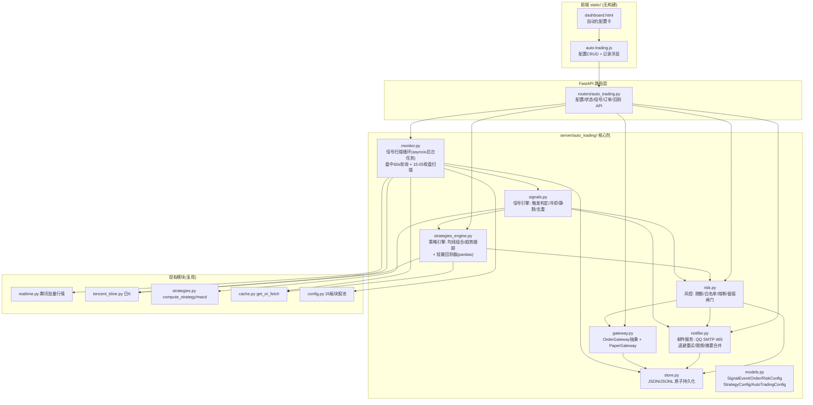
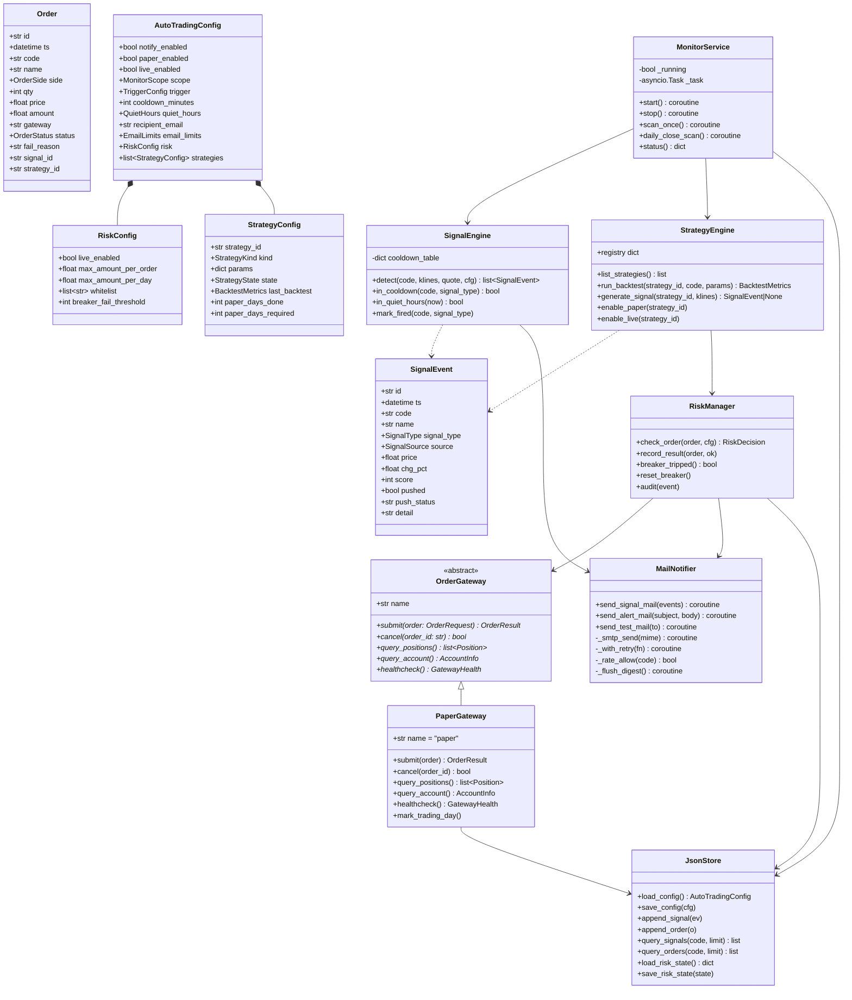
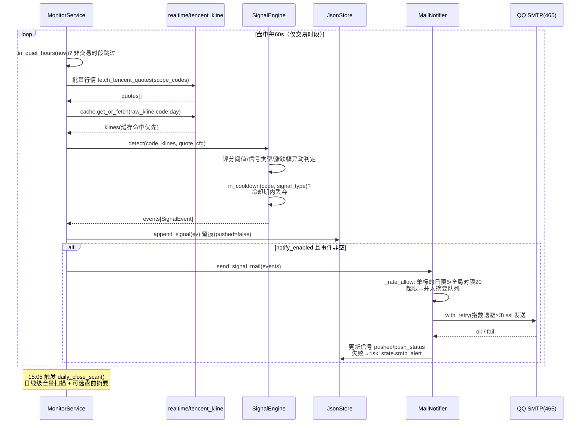
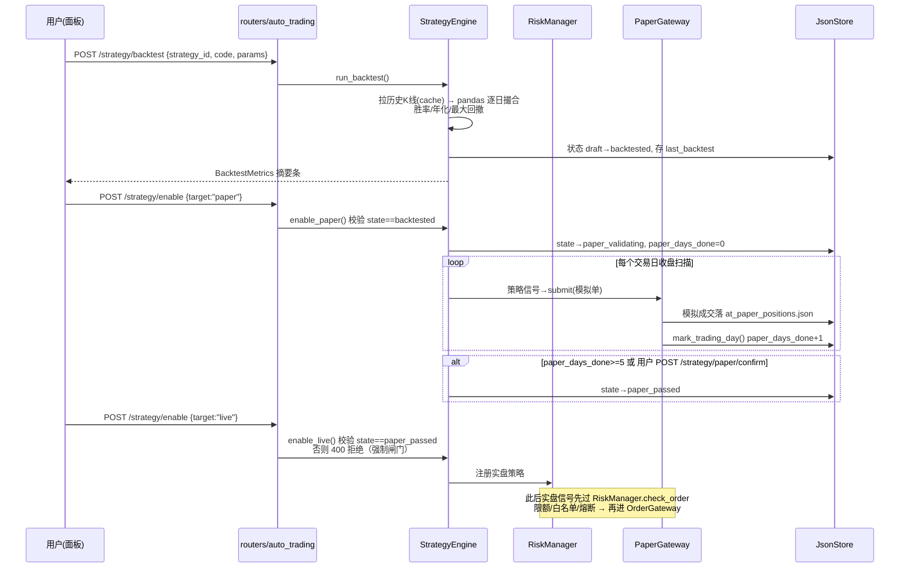
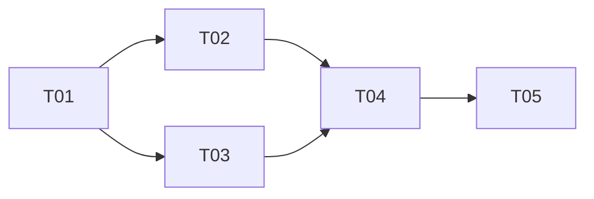

# 自动化交易系统 — 系统架构设计（P0 增量）

> 架构师：高见远（Gao） · 基于 `docs/20-prd/auto-trading-prd.md`（P0-1 ~ P0-10）
> 基线：FastAPI `server/` + 纯 HTML/原生 JS `static/`，无构建工具，uvicorn 端口 8900

---

## 1. 实现方案（Implementation Approach）

### 1.1 核心技术难点与对策

| 难点 | 对策 |
|------|------|
| 后台常驻信号扫描，不能阻塞 FastAPI 请求 | 在 `lifespan` 中创建 asyncio 后台任务（仿 `AlertAgent._run_loop` 模式），循环内全量 try/except + 崩溃退避自恢复，**不引入 Celery/Redis** |
| 扫描 434 只股票不能每轮都打满行情接口 | 复用 `cache.get_or_fetch` 防击穿缓存（K线 TTL 600s）+ 腾讯行情批量接口（`fetch_tencent_quotes` 一次请求多代码）；策略评分只在 K 线缓存窗口内计算 |
| SMTP 同步阻塞 + QQ 限流 | `smtplib`（标准库，465 SSL）放入 `asyncio.to_thread` 执行；指数退避重试 3 次；单标的每日 / 全局每小时双限频，超限合并摘要邮件 |
| 实盘准入必须可强制拦截 | 策略状态机 `draft → backtested → paper_validating → paper_passed → live_enabled`，状态持久化，服务端在 `enable live` API 处强制校验，前端置灰仅为体验层 |
| 下单通道 P1 才接券商 | 定义 `OrderGateway` 抽象基类 + `PaperGateway` 模拟实现；风控/留痕/熔断全部在网关调用点之前生效，P1 换实现零改动上层 |
| pandas 未安装导致回测不可用 | 新策略引擎的轻量回测器仅需 `pandas`（已在 requirements.txt 启用）；`quant_core.py` 的重依赖（tushare/yfinance/lightgbm/ta）保持懒加载，本期策略引擎**不依赖** quant_core，避免被其重依赖拖垮 |
| JSON 持久化并发写损坏 | 原子写（写临时文件 + `os.replace`）+ 模块级 `asyncio.Lock`；留痕类用 JSONL 追加 |

### 1.2 架构模式

- 分层：**监控层（monitor）→ 信号层（signals）→ 决策/策略层（strategies_engine）→ 风控层（risk）→ 网关层（gateway）→ 通知层（notifier）→ 持久层（store）**
- 依赖方向自上而下单向，跨层只通过 `models.py` 的模型对象传递，无循环依赖。
- 路由层（`routers/auto_trading.py`）只做参数校验与编排，业务逻辑全部在 `server/auto_trading/` 包内，可独立单测。

### 1.3 系统架构图



---

## 2. 文件清单（File List）

### 2.1 新增文件

| 路径 | 职责 |
|------|------|
| `server/auto_trading/__init__.py` | 包入口；导出全局单例 `auto_trading` 门面（聚合 monitor/engine/risk/gateway/notifier） |
| `server/auto_trading/models.py` | 全部 Pydantic 模型与枚举（SignalEvent、Order、RiskConfig、StrategyConfig、AutoTradingConfig、状态机枚举） |
| `server/auto_trading/store.py` | JSON/JSONL 持久化：原子写、文件锁、配置读写、信号/订单追加与分页查询 |
| `server/auto_trading/signals.py` | 信号引擎：触发条件判定（评分阈值/信号类型/涨跌幅异动）、冷却表、静默时段、去重 |
| `server/auto_trading/monitor.py` | asyncio 后台扫描循环（盘中 + 收盘扫描），生命周期 start/stop，崩溃退避自恢复 |
| `server/auto_trading/strategies_engine.py` | 独立策略引擎：策略注册表、均线组合(MA5/20+ATR止损)、趋势跟踪(N日新高/M日低点)、轻量回测器（胜率/年化/最大回撤） |
| `server/auto_trading/gateway.py` | `OrderGateway` 抽象基类 + `PaperGateway` 模拟实现 + 网关注册表（为 QMT/PTrade/easytrader 预留） |
| `server/auto_trading/risk.py` | 风控层：总开关校验、单笔/单日限额、白名单、熔断器（连续3败）、全量留痕调用 |
| `server/auto_trading/notifier.py` | QQ SMTP(465 SSL) 邮件发送、指数退避重试×3、单标的日限/全局时限频、超限摘要合并、邮件模板 |
| `server/routers/auto_trading.py` | REST API：配置 CRUD、状态/开关、信号历史、订单流水、回测触发、模拟确认、熔断重置、测试邮件 |
| `static/js/auto-trading.js` | 前端：自动化配置卡渲染与交互、信号历史/订单流水 full-overlay-panel（双 Tab）、状态灯轮询 |
| `docs/90-archive/auto-trading-arch-v0-deprecated.md` | 本文档 |

### 2.2 修改文件

| 路径 | 改动 |
|------|------|
| `server/main.py` | 注册 `auto_trading` 路由（`prefix="/api/auto"`）；lifespan 启动/停止 `monitor` 后台任务 |
| `requirements.txt` | 启用 `pandas>=2.0.0`（其余注释行不动） |
| `dashboard.html` | 新增「自动化」卡片挂载点 + `<script src="js/auto-trading.js?v=N">`（按既有版本号约定递增） |
| `static/css/dashboard.css` | 自动化卡片、网关状态灯（绿/黄/红/灰）、熔断横幅、记录表格样式（追加到文件末尾，沿用 CSS 变量） |

### 2.3 运行时数据文件（`data/` 目录，由 store.py 创建）

| 文件 | 内容 |
|------|------|
| `data/auto_trading_config.json` | AutoTradingConfig（三档开关、监控范围、触发条件、冷却、邮箱、风控限额、白名单、策略配置与状态机） |
| `data/at_signals.jsonl` | 信号历史（追加写，含是否已推送） |
| `data/at_orders.jsonl` | 订单流水（追加写，含网关/状态/失败原因） |
| `data/at_risk_state.json` | 熔断状态、连续失败计数、当日累计金额、限频计数器 |
| `data/at_paper_positions.json` | PaperGateway 模拟持仓与模拟验证进度（已运行交易日数） |

---

## 3. 数据结构与接口

### 3.1 类图



### 3.2 关键枚举与默认值

```python
SignalType   = "score" | "momentum" | "breakout" | "macd_gold" | "macd_dead" | "chg_spike" | "strategy_buy" | "strategy_sell" | "atr_stop"
SignalSource = "panel" | "strategy"
OrderSide    = "buy" | "sell"
OrderStatus  = "filled" | "rejected" | "failed" | "cancelled"
StrategyKind = "ma_cross_atr" | "trend_breakout"
StrategyState= "draft" | "backtested" | "paper_validating" | "paper_passed" | "live_enabled"
MonitorScope = {"mode": "pool" | "watchlist" | "both", "watchlist": ["sh600519", ...]}
TriggerConfig= {"score_threshold": 80, "signal_types": [...], "chg_pct_threshold": 3.0}
QuietHours   = {"trading_only": True, "premarket_digest": False}   # 9:30-11:30 / 13:00-15:00；9:15-9:30 可选摘要
EmailLimits  = {"per_stock_per_day": 5, "global_per_hour": 20}
RiskConfig 默认 = max_amount_per_order=10000, max_amount_per_day=30000, breaker_fail_threshold=3, live_enabled=False
策略默认参数: ma_cross_atr={fast:5, slow:20, atr_period:14, atr_mult:2.0}
             trend_breakout={entry_days:20, exit_days:10}
             paper_days_required=5
```

### 3.3 OrderGateway 抽象签名（实盘通道预留）

```python
class OrderGateway(ABC):
    name: str  # "paper" | "qmt" | "ptrade" | "easytrader"（P1 适配器注册同名接口）

    async def submit(self, order: OrderRequest) -> OrderResult:
        """统一下单入口。OrderRequest{code, side, qty|amount, price_type}
        P1 适配器只需实现本方法；qty 由风控层按 amount/price 换算后传入。"""

    async def cancel(self, order_id: str) -> bool: ...
    async def query_positions(self) -> list[Position]: ...
    async def query_account(self) -> AccountInfo: ...
    async def healthcheck(self) -> GatewayHealth:
        """GatewayHealth{ok: bool, mode: "paper"|"live", message: str}
        前端状态灯数据源；连接异常时 risk 层据此亮红灯。"""
```

PaperGateway 成交规则（P0 简化）：以当前腾讯行情价即时成交，不计滑点/手续费（P1-3 升级）；持仓与资金落 `at_paper_positions.json`。

### 3.4 REST API 端点表（全部挂在 `/api/auto`，响应统一 `{"ok": bool, "data": ..., "message": str}`）

| 方法 | 路径 | 入参 | 返回 data | 说明 |
|------|------|------|-----------|------|
| GET | `/config` | — | AutoTradingConfig | 读取完整配置 |
| PUT | `/config` | AutoTradingConfig（部分字段） | AutoTradingConfig | 更新配置；`live_enabled=true` 在此被强制校验（策略须 `paper_passed`，否则 400） |
| GET | `/status` | — | `{gateway_light, mode, breaker, monitor, smtp, paper_progress}` | 状态灯/熔断/监控循环/SMTP 健康聚合，前端 30s 轮询 |
| POST | `/switch` | `{channel: "notify"|"paper"|"live", on: bool}` | `{channel, on}` | 三档开关；live 开启强制走状态机校验 |
| GET | `/signals` | `code?, limit=100, offset=0` | `{total, items: [SignalEvent]}` | 信号历史（P0-10） |
| GET | `/orders` | `code?, limit=100, offset=0` | `{total, items: [Order]}` | 订单流水（P0-10） |
| POST | `/strategy/backtest` | `{strategy_id, code, params?}` | BacktestMetrics `{win_rate, annual_return, max_drawdown, trades}` | 手动触发回测；成功后状态置 `backtested` |
| POST | `/strategy/enable` | `{strategy_id, target: "paper"|"live"}` | `{state}` | paper：须 `backtested`；live：须 `paper_passed`，强制拦截（P0-8） |
| POST | `/strategy/paper/confirm` | `{strategy_id}` | `{state}` | 用户手动确认模拟表现 → `paper_passed`（替代等满 5 交易日） |
| POST | `/risk/reset-breaker` | — | `{breaker: false}` | 熔断手动复位（P0-9 横幅按钮） |
| POST | `/notify/test` | `{to?}` | `{sent: true}` | 发送测试邮件 |

BacktestMetrics 结构：`{win_rate: float, annual_return: float, max_drawdown: float, total_trades: int, profit_factor: float, equity_curve: [[date, equity], ...]}`（equity_curve 供前端画迷你曲线，可选渲染）。

---

## 4. 程序调用流程（时序图）

### 4.1 信号触发 → 冷却判定 → 邮件推送



### 4.2 策略回测 → 模拟验证 → 启用（强制准入链）



---

## 5. 待澄清项与假设（Anything UNCLEAR）

1. **回测与 quant_core 的关系**：PRD 写"复用/修复 quant_core.py"，但 quant_core 依赖 tushare/yfinance/lightgbm（重且需 token）。**假设**：本期策略引擎自带轻量回测器（仅需 pandas，数据源走腾讯日 K + cache），quant_core 保持现状不动；若后续要复用其 ML 回测，再单独评估。
2. **自选清单来源**：监控范围"用户自选"假设复用面板现有自选股存储（前端 localStorage / 后端 watchlist 接口），若不存在则在 AutoTradingConfig.scope.watchlist 内自维护一份。
3. **交易日历**：无第三方日历库，P0 用"周一至周五 + 时段"近似，法定节假日会多发空扫描（无害，仅静默）；P1 可接交易所日历。
4. **策略引擎信号下单的标的集**：P0 假设策略按"单标的回测、单标的启用"，实盘信号只对白名单内已启用标的生效。
5. **邮件收件人**：假设单收件人（配置项 `recipient_email`），多收件人属 P2-4。

---

## 6. 依赖包清单（最小化）

```
- pandas>=2.0.0: 策略引擎回测器（K线 DataFrame 运算）——唯一新增，requirements.txt 中取消注释
```

不新增任何其他第三方包：SMTP 用标准库 `smtplib`/`email`，后台任务用 `asyncio`，持久化用标准库 `json`，Pydantic 随 FastAPI 已有。

---

## 7. 任务列表（JSON，有序 + 依赖）

```json
[
  {
    "id": "T01",
    "title": "基础设施与数据层：依赖启用 + 模型 + 持久化",
    "files": [
      "requirements.txt",
      "server/auto_trading/__init__.py",
      "server/auto_trading/models.py",
      "server/auto_trading/store.py"
    ],
    "depends_on": [],
    "priority": "P0",
    "acceptance": "pip install -r requirements.txt 后 pandas 可导入；models 全部 Pydantic 模型可实例化且默认值与本文档 3.2 一致；store 原子写/追加/分页查询单测通过；data/ 下 5 个数据文件能自动创建"
  },
  {
    "id": "T02",
    "title": "策略引擎 + 回测器 + 网关抽象 + 风控层",
    "files": [
      "server/auto_trading/strategies_engine.py",
      "server/auto_trading/gateway.py",
      "server/auto_trading/risk.py"
    ],
    "depends_on": ["T01"],
    "priority": "P0",
    "acceptance": "两个内置策略(均线组合/趋势跟踪)对给定日K可产出信号；run_backtest 返回胜率/年化/最大回撤且对 sh600519 实跑成功；PaperGateway 模拟下单/持仓/healthcheck 可用；RiskManager 限额/白名单/熔断(连续3败自动停+留痕)逻辑单测通过"
  },
  {
    "id": "T03",
    "title": "信号引擎 + 扫描循环 + 邮件通知服务",
    "files": [
      "server/auto_trading/signals.py",
      "server/auto_trading/monitor.py",
      "server/auto_trading/notifier.py"
    ],
    "depends_on": ["T01"],
    "priority": "P0",
    "acceptance": "detect() 按触发条件产出 SignalEvent 且冷却(同标的+同信号30min)/静默时段(非交易时段不推)生效；monitor 循环崩溃后指数退避自恢复且 status() 可见；notifier 用环境变量授权码发信成功，失败退避重试3次，单标的日限5/全局时限20超限合并摘要"
  },
  {
    "id": "T04",
    "title": "REST API 路由 + 服务装配（main.py 生命周期接入）",
    "files": [
      "server/routers/auto_trading.py",
      "server/main.py",
      "server/auto_trading/__init__.py"
    ],
    "depends_on": ["T02", "T03"],
    "priority": "P0",
    "acceptance": "3.4 表全部 11 个端点可用且响应为 {ok,data,message}；live 开启在 state!=paper_passed 时返回 400（强制闸门）；uvicorn 重启后 monitor 随 lifespan 启动/停止，配置改动即时生效"
  },
  {
    "id": "T05",
    "title": "前端：自动化配置卡 + 信号历史/订单流水浮层",
    "files": [
      "static/js/auto-trading.js",
      "dashboard.html",
      "static/css/dashboard.css"
    ],
    "depends_on": ["T04"],
    "priority": "P0",
    "acceptance": "配置卡含三档开关/状态灯(绿黄红灰)/监控范围/触发条件/冷却/邮箱/测试邮件/策略参数/回测按钮/启用按钮(未回测禁用)；熔断时红横幅+重置按钮；full-overlay-panel 双 Tab 展示信号与订单、支持按标的筛选、失败行标红悬浮原因；页脚合规声明；静态文件版本号递增"
  }
]
```

### 任务依赖图



---

## 8. 共享知识（Shared Knowledge）

- **响应格式**：所有新 API 返回 `{"ok": bool, "data": ..., "message": str}`，与现有 `/api/health`、`/api/sectors` 一致；业务拒绝（如闸门拦截）用 HTTP 400 + `ok:false`。
- **股票代码格式**：一律带市场前缀小写（`sh600519` / `sz000858` / `hk00700`），与 config.py / 腾讯接口一致；腾讯返回的无前缀数字码必须映射回带前缀码再入库。
- **缓存**：所有 K 线/行情读取走 `cache.get_or_fetch(key, fetch_fn, ttl)`，key 沿用 `raw_kline:{code}:day` 等现有命名，TTL 常量从 `server/config.py` 取，不私自定义。
- **配置读取**：板块/股池用 `config.get_all_stock_codes()` / `find_stock_name(code)`；环境变量由 main.py 的 `_load_dotenv` 统一加载，新代码**只读 `os.environ`，绝不硬编码** QQ 授权码。
- **日志**：`logger = logging.getLogger(__name__)`，风格与现有模块一致；后台循环异常必须 `logger.error(..., exc_info=True)` 后吞掉继续，不得让循环退出。
- **持久化**：一律经 `store.py`（原子写 + asyncio.Lock），禁止各模块自行 open 写 data/ 文件。
- **时间**：落库时间用本地时间 ISO 8601 字符串（面板同源展示，无需 UTC 换算）。
- **合规措辞**：邮件与 UI 一律"信号提示/供参考"，页脚固定"本系统仅为个人量化工具，信号不构成投资建议，据此操作风险自负"。
- **前端缓存**：dashboard.html 中新增/修改的 js/css 引用按现有 `?v=N` 约定递增版本号。
- **服务重启**：改动后端后需重启（`start_server.py`，端口 8900）才生效；验收前先确认进程已重载。

---

## 9. 风险与缓解

| 风险 | 缓解 |
|------|------|
| pandas 安装失败（网络/编译） | 优先 `pip install pandas -i https://pypi.tuna.tsinghua.edu.cn/simple`；Windows 下有官方 wheel 无需编译；极端情况下回测器可降级为纯 numpy 实现（代码预留 pandas 导入隔离在 strategies_engine 顶部，便于替换） |
| 后台扫描任务崩溃导致信号中断 | monitor 循环体全量 try/except + 连续失败计数 + 指数退避重启（最多 5 次/小时）；`/status` 暴露 monitor 状态，前端状态灯可见；lifespan 关闭时优雅 cancel |
| QQ SMTP 限流/授权码失效 | 双限频（单标的 5/日、全局 20/时）天然防限流；退避重试 3 次后记录 `smtp_alert` 并在状态灯亮红 + 面板告警；测试邮件按钮供用户即时验证授权码 |
| 行情接口（腾讯）超时拖垮扫描轮 | 批量请求 5s 超时；单轮扫描整体设上限（asyncio.wait_for 90s），超时本轮作废；K 线走缓存，盘中每轮只增量拉行情 |
| JSON 文件写损坏/并发冲突 | 原子写（tmp + os.replace）+ 模块级 asyncio.Lock；启动时对 JSON 解析失败做备份重命名（`.bak-时间戳`）并重建默认配置 |
| 误开实盘 | 三重防线：状态机服务端强制校验（paper_passed 才可 live）+ 实盘总开关持久化默认关 + 前端开关置灰与风险确认文案 |
| 冷却/限频计数器重启丢失 | 计数器随 risk_state 持久化，重启后冷却期按时间戳判定自然恢复 |
